# Categorical Reverse Mathematics: Core Concept Curriculum

> **An Ordered Curriculum of Core Mathematical Concepts for Structured Self-Study and Regimen Construction**  
> **Monograph:** *Categorical Reverse Mathematics — Volume I: Obstructions, Residuums, and the Geometry of Necessity*  
> **Author:** James F. Walters, *Port Townsend, Washington*  
> **License:** Creative Commons Attribution 4.0 International (CC BY 4.0)  
> **Source:** `docs/categorical_reverse_mathematics.tex` (Lines 603–3770) & `docs/ch07_sets_residuum.tex` (Lines 1–392, included at Line 2661)  
> **Text Boundary Constraint:** Strictly Chapter 1 onward (`docs/categorical_reverse_mathematics.tex` Line 603+). Zero concepts from frontmatter/preface/glossary (Lines 1–602).  

---

## Executive Overview & Learning Regimen Architecture

This document establishes the definitive, pedagogically ordered curriculum of **55 foundational prerequisite concepts** (Stage 0 and Stage 1) and **189 core monograph concepts** (Stages 2–4), definitions, theorems, foundational structural objects, conjectures, and open problems introduced across Volume I of the monograph *Categorical Reverse Mathematics — Volume I: Obstructions, Residuums, and the Geometry of Necessity* by James F. Walters.

### Foundational Principles of Categorical Reverse Mathematics (CRM)

1. **Geometry Over Syntax:** Rather than calibrating mathematical theorems by syntactic set-existence axioms over a fixed arithmetic base like $\mathrm{RCA}_0$, CRM calibrates deductive necessity as universal geometric, topological, cohomological, and higher-homotopy obstruction invariants across abstract **Doctrinal Comparison Triples** $\mathfrak{T} = (\mathcal{D}_0 \supseteq \mathcal{D}_1, \; \kappa : \Phi \Rightarrow \Psi) \in \mathrm{Dom}(\mathrm{Res})$.
2. **The Fundamental Equivalence:** For an ambient doctrine $\mathcal{D}_0$ and subdoctrine $\mathcal{D}_1$, the categorical residuum $\mathrm{Res}(\kappa)$ measures the gap separating $\mathcal{D}_0$ from $\mathcal{D}_1$, validating the foundational equivalence:
   $$\mathcal{D}_0 + \mathrm{Res}(\kappa) \iff \mathcal{D}_1$$
   In the topos-theoretic setting, $\mathcal{R} = (A \Rightarrow_{\mathbf{Topos}} B)$ acts order-theoretically as the relative pseudocomplement in the lattice of universe classes.
3. **Five Foundational Coordinate Axes (and Two Universe-Scale Axes in Chapter 7):** Chapters 1–6 are structured along five universal coordinate axes, extended in Chapter 7 across the universe boundary to Joyal--Moerdijk class-set ambients $(\mathcal{C}, \mathcal{S})$ and univalent $(\infty, 1)$-topos universes $(\mathcal{X}, \mathcal{U})$ along Axes VI and VII:
   - **Axis I (Choice / Splitting):** Stratification of Choice ($\mathrm{AC}, \mathrm{IAC}, \mathrm{COSHEP}, \mathrm{WISC}, \mathrm{SVC}, \mathrm{DC}, \mathrm{BPI}$), external projectivity of $1_{\mathcal{E}}$, higher choice $\mathrm{AC}_{n,m}$, and large skeletal splitting $\mathbf{Card} \hookrightarrow \mathbf{Set} \iff \mathsf{GC}$.
   - **Axis II (Constructive Logic):** Geometry of the subobject classifier $\Omega$ (De Morgan Stone lattices, Gödel--Dummett linearity, Boolean collapse $\Omega \simeq 1+1$, and $\mathsf{CZF}$ $\Omega^X / 2^X$ separation).
   - **Axis III (Arithmetic Infinity):** Finitary vs. infinitary doctrines, dynamical lassos $\widehat{\mathbb{N}}_{\mathrm{lasso}}$, Dedekind finiteness vs. Kuratowski infinity, and the biproduct-tail cokernel $\prod_I A / \bigoplus_I A$.
   - **Axis IV (Characteristic / $p$-Torsion / Directions):** Joyal $\delta$-rings, $2$-torsion lift torsors, relative slice perfection $A_{\mathrm{perf}}$, and oriented cubical amalgamation.
   - **Axis V (Directional Invertibility / Homotopy / Moduli):** 4-tier $(\infty,\infty)$-ladder, categorical spectra $\mathrm{CatSp}$, and light condensed Cantor tail moduli $\mathcal{Q}_{E_0} = 2^\mathbb{N} \sslash E_0$.
   - **Axis VI (Quotient-Image Descent / Replacement):** Small-indexed image descent $\kappa_{\mathrm{Rep}} : \mathrm{im}(f) \in \mathcal{S}$ in $(\mathcal{C}, \mathcal{S})$, separating $\mathsf{ETCS} \simeq \mathsf{Mac}$ and $\mathsf{ZC}$ ($V_{\omega+\omega}$ colimit escape & $\boldsymbol{\Sigma}^0_\omega$ Borel Determinacy $\mathsf{ZC}$-unprovability) from $\mathsf{ZFC}$.
   - **Axis VII (Universe Fixed Points & Hereditary Truncation):** Well-founded vs. unrestricted coalgebra-doctrine comparison $\mathbf{Coalg}_{\mathrm{wf}}(\mathcal{P}_{\mathcal{S}}) \hookrightarrow \mathbf{Coalg}(\mathcal{P}_{\mathcal{S}})$ inducing strict $\kappa_{\mathrm{Reg}} : \nu^{\mathrm{wf}}\mathcal{P}_{\mathcal{S}} \simeq \mu\mathcal{P}_{\mathcal{S}} \hookrightarrow \nu\mathcal{P}_{\mathcal{S}}$ ($V_{\mathsf{ZF}}$ vs. Aczel $V_{\mathsf{AFA}}$, Boffa Quine torsors) and Gylterud's hereditary fiberwise $(-1)$-truncation $V_0 \hookrightarrow \mu\mathcal{P}_{\mathrm{Anima}}$.
4. **The Five Anchor Witnesses:** Every high-altitude abstraction across the monograph is anchored by five concrete mathematical witnesses:
   - **Witness I:** Parity torsor $\mathcal{T}_{\mathrm{odd}}$ in nominal topos $\mathbf{Nom}$ ($[\mathcal{T}_{\mathrm{odd}}] = \delta(1) \neq 0 \in H^1(\mathbf{Nom}; \mathrm{EvenFinset})$).
   - **Witness II:** $2$-torsion $\delta$-ring $R_2 = \mathbb{Z}[\eta]/(2\eta, \eta^2)$ and dual integers `DualInt` ($\mathbb{Z}[\varepsilon]/(\varepsilon^2)$).
   - **Witness III:** Gaunt Noetherian rank-$\omega$ step-product $\mathcal{Q} \subset \prod_{k \ge 1} \mathcal{A}_k$ with pure Postnikov phantom $X_\bullet \in RL(\mathcal{Q}) \setminus \mathcal{Q}$.
   - **Witness IV:** Facet-supported directed cycle complex $F_n = \partial\Delta^{n-1}$ erecting the $n \ge 3$ cubical amalgamation wall.
   - **Witness V:** Light condensed smooth-4-manifold tail quotient $\mathcal{Q}_{E_0} = 2^\mathbb{N}\sslash E_0$ with CAR algebra $\mathrm{UHF}(2^\infty)$ and non-splitting $[q] \in \mathrm{Ext}^1_{\mathbf{CondAb}_{\mathrm{light}}}$.

### The Pedagogical Bridge for Undergraduate Students

For an undergraduate student in mathematics, the step from standard coursework (calculus, linear algebra, abstract algebra, point-set topology) to Categorical Reverse Mathematics can initially feel daunting. The student is accustomed to asking: *"Is this statement true in $\mathbb{R}$ or $\mathbf{Set}$?"* CRM asks a fundamentally different, geometric question: *"In what category of mathematical universes does this theorem hold, and what topological or cohomological obstruction appears when the universe fails to satisfy it—even when that universe is $\mathbf{Set}$ itself?"*

To construct an unbroken ramp from standard undergraduate courses to the research frontier of CRM, this curriculum establishes a five-stage progression:
- **Stage 0 (Undergraduate Mathematical Foundations):** Recalibrates familiar undergraduate subjects—Propositional and Predicate Logic ($P01$), Equivalence Relations and Quotients ($P02$), Posets and Boolean Algebras ($P03$), Metric and Topological Spaces ($P04$), Real Analysis and Cauchy Completeness ($P05$), Groups and Symmetries ($P06$), Commutative Rings and Ideals ($P07$), and Modules and Exact Sequences ($P08$)—into structural definitions emphasizing universal properties.
- **Stage 1 (Graduate Foundations & Prerequisite Bridges):** Introduces the essential graduate tools demanded by modern categorical logic, geometry, and foundations: Functorial Semantics and Lawvere Theories ($P15$), 2-Categories and Monadic Doctrines ($P16$), Lawvere Hyperdoctrines ($P17$), Elementary and Grothendieck Topoi ($P22, P25$), Prime Spectra $\mathrm{Spec}(R)$ and Schemes ($P28, P29$), Homological Algebra and Derived Functors ($P31, P32$), Sheaf Cohomology and Spectral Sequences ($P33, P36$), Computability and Realizability ($P40–P42$), Simplicial Sets and Higher Categories ($P44–P48$), and Class-Set Subsystems, Terminal Coalgebras, Univalent Truncations, and Borel Games ($P51–P55$).
- **Stage 2 (Monograph Core Framework & Residuum Calculus):** Formulates Doctrinal Comparison Triples $\mathfrak{T} = (\mathcal{D}_0 \supseteq \mathcal{D}_1, \kappa)$, the Residuum Operator $\mathrm{Res}$, Base-Fiber Conservation, and the Seven Coordinate Axes (Axes I–V in Chapter 1; universe-scale Axes VI–VII in Chapter 7).
- **Stage 3 (The Five Foundational Anchor Witnesses):** Studies the five concrete countermodels that anchor the coordinate axes across all nine chapters.
- **Stage 4 (Advanced Synthesis, Set Foundations, Lean Formalization & Research Horizons):** Explores Chapters 2–9, covering the choice atlas, non-AC lattices, base-fiber conservation, higher choice $\mathrm{AC}_{n,m}$, Fraïssé permutation topoi, algebraic set theory and double-clamped $\mathbf{Set}_{\mathsf{ZFC}}$ scale-invariance, the 11 Lean 4 formalization modules of `HomotopyCRM`, and the 17 open research problems across eight horizons.

---

## Directed Concept Dependency Graph (Curriculum Prerequisite DAG)

To guarantee that a student or researcher can navigate the curriculum without circular dependencies or unmotivated cognitive leaps, all concepts are organized into a mathematically verified **Directed Acyclic Graph (DAG)**:
$$G = (V, E)$$
where $V$ is a set of **61 canonical concept nodes** partitioned across five educational stages, and $E$ is a set of **147 directed edges**.

### Theoretical Graph Properties and Conventions

1. **Strict Prerequisite Directed Edge Convention:**
   Every directed edge $A \to B$ (rendered as `A --> B` in Mermaid and `"A" -> "B"` in Graphviz DOT) strictly denotes:
   $$\text{"Concept node } A \text{ is a direct mathematical prerequisite for understanding concept node } B\text{."}$$
   A reader must master the concepts encapsulated in node $A$ before attempting node $B$.
2. **Educational Stage Stratification & Visual Styling:**
   The graph is partitioned into five clustered subgraphs, each styled with distinctive color-coded fills and borders:
   - **Stage 0: Undergraduate Foundations** (`stage_ug`, 7 nodes): Light Blue fill (`#E1F5FE`), Dark Blue border (`#0288D1`).
   - **Stage 1: Graduate Foundations & Bridges** (`stage_grad`, 19 nodes): Light Purple fill (`#EDE7F6`), Deep Purple border (`#7E57C2`).
   - **Stage 2: Monograph Core Framework** (`stage_core`, 15 nodes): Light Green fill (`#E8F5E9`), Forest Green border (`#388E3C`).
   - **Stage 3: The Five Anchor Witnesses** (`stage_witness`, 5 nodes): Light Orange fill (`#FFF3E0`), Vibrant Orange border (`#F57C00`).
   - **Stage 4: Advanced Synthesis & Horizons** (`stage_adv`, 15 nodes): Light Pink fill (`#FCE4EC`), Crimson border (`#C2185B`).
3. **Mathematical Proof of Strict Acyclicity (DAG Guarantee):**
   The graph contains **zero directed cycles** ($\text{cycles}(G) = \emptyset$), verified computationally via Python's standard `graphlib.TopologicalSorter`. Every directed edge points strictly forward in topological rank ($1 \le \text{Rank}(u) < \text{Rank}(v) \le 61$).
4. **100% Reachability from Undergraduate Roots:**
   Every single node in the graph is reachable via a directed prerequisite path from the three fundamental undergraduate root nodes (`UG_LOGIC`, `UG_ALGEBRA`, `UG_TOPOLOGY`):
   $$R_{\mathrm{UG}} = \{\mathtt{UG\_LOGIC}, \mathtt{UG\_ALGEBRA}, \mathtt{UG\_TOPOLOGY}\} $$
   There are **zero orphan nodes** (0 unreachable concepts).
5. **Standalone Graph Deliverables:**
   For external visualization, publication rendering, and automated programmatic processing, this complete graph is also provided as standalone files:
   - `docs/concept_graph.dot`: Full Graphviz DOT format with clusters and visual attributes, compilable via `dot -Tsvg docs/concept_graph.dot -o docs/concept_graph.svg`.
   - `docs/concept_graph.json`: Machine-readable JSON schema containing complete node metadata, topological rankings, prerequisite lists, dependent lists, and edge rationales.

### Embedded Mermaid.js Flowchart Diagram

```mermaid
flowchart TD
    %% Styling Classes
    classDef ug fill:#E1F5FE,stroke:#0288D1,stroke-width:2px,color:#000000;
    classDef grad fill:#EDE7F6,stroke:#7E57C2,stroke-width:2px,color:#000000;
    classDef core fill:#E8F5E9,stroke:#388E3C,stroke-width:2px,color:#000000;
    classDef witness fill:#FFF3E0,stroke:#F57C00,stroke-width:2px,color:#000000;
    classDef adv fill:#FCE4EC,stroke:#C2185B,stroke-width:2px,color:#000000;

    subgraph stage_ug ["Stage 0: Undergraduate Mathematical Foundations"]
        UG_LOGIC["Classical Logic & Proof Theory"]:::ug
        UG_ALGEBRA["Abstract Algebra (Groups, Rings, Modules)"]:::ug
        UG_TOPOLOGY["Point-Set Topology"]:::ug
        UG_ORDER["Posets, Lattices & Choice"]:::ug
        UG_COMPUTABILITY["Computability & Recursion Theory"]:::ug
        UG_ANALYSIS["Real Analysis & Metric Spaces"]:::ug
        UG_CATEGORY["First-Course Category Theory"]:::ug
    end

    subgraph stage_grad ["Stage 1: Graduate Foundations & Prerequisite Bridges"]
        GRAD_PRESHEAF["Presheaves & Yoneda Lemma"]:::grad
        GRAD_LAWVERE_THEORY["Lawvere Theories & Algebras"]:::grad
        GRAD_MONAD_2DOCTRINE["2-Categories & 2-Monadic Doctrines"]:::grad
        GRAD_CHAIN_COMPLEX["Chain Complexes & Homological Algebra"]:::grad
        GRAD_SHEAF["Sheaves on Topological Spaces"]:::grad
        GRAD_ELEM_TOPOS["Elementary Topoi & Subobject Classifier"]:::grad
        GRAD_SIMPLICIAL_SET["Simplicial Sets & Model Categories"]:::grad
        GRAD_HYPERDOCTRINE["Lawvere Hyperdoctrines"]:::grad
        GRAD_DERIVED_CAT["Derived Categories & Spectral Sequences"]:::grad
        GRAD_AFFINE_SCHEME["Affine Schemes (Spec R)"]:::grad
        GRAD_SITE["Grothendieck Topologies & Sites"]:::grad
        GRAD_INTERNAL_LOGIC["Internal Logic & Kripke-Joyal Semantics"]:::grad
        GRAD_SCHEME["General Schemes & Locally Ringed Spaces"]:::grad
        GRAD_GROTH_TOPOS["Grothendieck Topoi & Geometric Morphisms"]:::grad
        GRAD_REALIZABILITY_TOPOS["Triposes & Realizability Topoi (RT/Eff)"]:::grad
        GRAD_INFINITY_CAT["(inf, 1)-Categories & Quasicategories"]:::grad
        GRAD_STABLE_INFINITY["Stable (inf, 1)-Categories & Spectra"]:::grad
        GRAD_CLASS_SET_THEORY["Weak Set Subsystems & Class Theories (ETCS, ZC, NBG)"]:::grad
        GRAD_COALGEBRA_BISIM["Endofunctor Coalgebras, Bisimulation & Truncations"]:::grad
    end

    subgraph stage_core ["Stage 2: Monograph Core Framework & Residuum Calculus"]
        CORE_CRM_PARADIGM["CRM Paradigm: Geometry Over Syntax"]:::core
        CORE_DOCTRINE["Categorical Doctrine (D in Doct)"]:::core
        CORE_TRIPLE["Doctrinal Comparison Triple (T)"]:::core
        CORE_RESIDUUM["Categorical Residuum Operator (Res)"]:::core
        CORE_FUND_EQUIV["Fundamental Equivalence of CRM"]:::core
        CORE_TOPOS_RESIDUUM["Topos-Logical Relative Pseudocomplement"]:::core
        CORE_AXIS_1["Axis I: Choice / Splitting Coordinate Axis"]:::core
        CORE_AXIS_2["Axis II: Constructive Logic & Omega-Geometry"]:::core
        CORE_AXIS_3["Axis III: Arithmetic Infinity & Rigidity"]:::core
        CORE_AXIS_4["Axis IV: Characteristic & p-Torsion"]:::core
        CORE_AXIS_5["Axis V: Directional Invertibility & Higher Cells"]:::core
        CORE_RELATIVIZATION["Two-Axis Relativization Framework"]:::core
        CORE_BASE_FIBER["Base-Fiber Conservation Principle"]:::core
        CORE_AXIS_6["Axis VI: Quotient-Image Descent & Small-Map AST (C, S)"]:::core
        CORE_AXIS_7["Axis VII: Foundation vs. Anti-Foundation (Coalg_wf -> Coalg)"]:::core
    end

    subgraph stage_witness ["Stage 3: The Five Foundational Anchor Witnesses"]
        WITNESS_1_T_ODD["Witness I: Parity Torsor T_odd in Nom"]:::witness
        WITNESS_2_R2_DUALINT["Witness II: 2-Torsion delta-Ring R_2 & DualInt"]:::witness
        WITNESS_3_STEP_PROD_Q["Witness III: Gaunt Step-Product Q & Phantom"]:::witness
        WITNESS_4_FACET_CYCLE["Witness IV: Directed Facet Cycles F_3 / F_n"]:::witness
        WITNESS_5_Q_E0_UHF["Witness V: Light Condensed Q_E0 & UHF(2^inf)"]:::witness
    end

    subgraph stage_adv ["Stage 4: Advanced Synthesis, Lean Formalization & Research Horizons"]
        ADV_NON_AC_LATTICES["Seven Multi-Dimensional Non-AC Lattices"]:::adv
        ADV_POSTNIKOV_CHOICE["Higher Choice AC_(n,m) & Postnikov Gerbes"]:::adv
        ADV_CHOICE_ATLAS["Choice-Geometry Residuum Atlas"]:::adv
        ADV_SITE_REALIZABILITY["Site Combinatorics & Kihara Atomic Spectrum"]:::adv
        ADV_INFTY_INFTY_LADDER["Four-Tier (inf, inf)-Ladder & Hom-Rank"]:::adv
        ADV_CUBICAL_AMALGAMATION["Cubical Disjoint n-Amalgamation Dichotomy"]:::adv
        ADV_CORE_CONJECTURES["The Five Core Conjectures of CRM"]:::adv
        ADV_CATSP_SPECTRA["Categorical Spectra CatSp & Stabilization"]:::adv
        ADV_DOUBLE_SOLVENT["Double-Solvent Theorem for 4-Smoothings"]:::adv
        ADV_CLASS_FIBRATION_GC["Class Kaleidoscope Def -| pi_Set & GC Non-Conservativity"]:::adv
        ADV_BOFFA_ANIMA_TORSORS["Boffa Hyperset Torsors & Univalent nu P_Anima Loops"]:::adv
        ADV_DOUBLE_CLAMPED_SETS["Double-Clamped Set_ZFC Scale-Invariance & SetsResiduum"]:::adv
        ADV_HOMOTOPY_CRM["Lean 4 HomotopyCRM Production Ledger"]:::adv
        ADV_OPEN_HORIZONS["17 Open Problems across Eight Horizons"]:::adv
        ADV_EPILOGUE_SYNTHESIS["Epilogue: Truth as Obstruction Invariant"]:::adv
    end

    %% Prerequisite Edges (A --> B: A is prerequisite for B)
    UG_LOGIC --> UG_ORDER
    UG_LOGIC --> UG_COMPUTABILITY
    UG_LOGIC --> GRAD_HYPERDOCTRINE
    UG_LOGIC --> GRAD_CLASS_SET_THEORY
    UG_LOGIC --> CORE_CRM_PARADIGM
    UG_ALGEBRA --> UG_CATEGORY
    UG_ALGEBRA --> GRAD_LAWVERE_THEORY
    UG_ALGEBRA --> GRAD_CHAIN_COMPLEX
    UG_ALGEBRA --> GRAD_AFFINE_SCHEME
    UG_TOPOLOGY --> UG_ANALYSIS
    UG_TOPOLOGY --> GRAD_SHEAF
    UG_TOPOLOGY --> GRAD_SIMPLICIAL_SET
    UG_TOPOLOGY --> GRAD_CLASS_SET_THEORY
    UG_ORDER --> UG_CATEGORY
    UG_ORDER --> GRAD_ELEM_TOPOS
    UG_ORDER --> GRAD_HYPERDOCTRINE
    UG_ORDER --> GRAD_CLASS_SET_THEORY
    UG_COMPUTABILITY --> GRAD_REALIZABILITY_TOPOS
    UG_COMPUTABILITY --> CORE_AXIS_3
    UG_ANALYSIS --> ADV_NON_AC_LATTICES
    UG_CATEGORY --> GRAD_PRESHEAF
    UG_CATEGORY --> GRAD_LAWVERE_THEORY
    UG_CATEGORY --> GRAD_MONAD_2DOCTRINE
    UG_CATEGORY --> GRAD_CHAIN_COMPLEX
    UG_CATEGORY --> GRAD_ELEM_TOPOS
    UG_CATEGORY --> GRAD_HYPERDOCTRINE
    UG_CATEGORY --> GRAD_COALGEBRA_BISIM
    GRAD_PRESHEAF --> GRAD_SHEAF
    GRAD_PRESHEAF --> GRAD_ELEM_TOPOS
    GRAD_PRESHEAF --> GRAD_SIMPLICIAL_SET
    GRAD_PRESHEAF --> GRAD_SITE
    GRAD_LAWVERE_THEORY --> GRAD_HYPERDOCTRINE
    GRAD_LAWVERE_THEORY --> CORE_DOCTRINE
    GRAD_MONAD_2DOCTRINE --> CORE_CRM_PARADIGM
    GRAD_MONAD_2DOCTRINE --> CORE_DOCTRINE
    GRAD_CHAIN_COMPLEX --> GRAD_DERIVED_CAT
    GRAD_SHEAF --> GRAD_AFFINE_SCHEME
    GRAD_SHEAF --> GRAD_SITE
    GRAD_ELEM_TOPOS --> GRAD_INTERNAL_LOGIC
    GRAD_ELEM_TOPOS --> GRAD_GROTH_TOPOS
    GRAD_ELEM_TOPOS --> GRAD_REALIZABILITY_TOPOS
    GRAD_ELEM_TOPOS --> GRAD_CLASS_SET_THEORY
    GRAD_ELEM_TOPOS --> GRAD_COALGEBRA_BISIM
    GRAD_SIMPLICIAL_SET --> GRAD_INFINITY_CAT
    GRAD_SIMPLICIAL_SET --> WITNESS_4_FACET_CYCLE
    GRAD_HYPERDOCTRINE --> GRAD_INTERNAL_LOGIC
    GRAD_HYPERDOCTRINE --> CORE_DOCTRINE
    GRAD_DERIVED_CAT --> GRAD_STABLE_INFINITY
    GRAD_DERIVED_CAT --> CORE_BASE_FIBER
    GRAD_AFFINE_SCHEME --> GRAD_SCHEME
    GRAD_AFFINE_SCHEME --> CORE_AXIS_4
    GRAD_AFFINE_SCHEME --> WITNESS_2_R2_DUALINT
    GRAD_SITE --> GRAD_GROTH_TOPOS
    GRAD_INTERNAL_LOGIC --> GRAD_REALIZABILITY_TOPOS
    GRAD_INTERNAL_LOGIC --> CORE_AXIS_1
    GRAD_INTERNAL_LOGIC --> CORE_AXIS_2
    GRAD_SCHEME --> CORE_RELATIVIZATION
    GRAD_SCHEME --> ADV_NON_AC_LATTICES
    GRAD_GROTH_TOPOS --> GRAD_INFINITY_CAT
    GRAD_GROTH_TOPOS --> CORE_TOPOS_RESIDUUM
    GRAD_GROTH_TOPOS --> CORE_RELATIVIZATION
    GRAD_GROTH_TOPOS --> WITNESS_1_T_ODD
    GRAD_REALIZABILITY_TOPOS --> ADV_SITE_REALIZABILITY
    GRAD_INFINITY_CAT --> GRAD_STABLE_INFINITY
    GRAD_INFINITY_CAT --> GRAD_COALGEBRA_BISIM
    GRAD_INFINITY_CAT --> CORE_AXIS_5
    GRAD_INFINITY_CAT --> WITNESS_3_STEP_PROD_Q
    GRAD_INFINITY_CAT --> ADV_POSTNIKOV_CHOICE
    GRAD_STABLE_INFINITY --> ADV_CATSP_SPECTRA
    GRAD_CLASS_SET_THEORY --> CORE_AXIS_6
    GRAD_CLASS_SET_THEORY --> ADV_CLASS_FIBRATION_GC
    GRAD_COALGEBRA_BISIM --> CORE_AXIS_7
    GRAD_COALGEBRA_BISIM --> ADV_BOFFA_ANIMA_TORSORS
    CORE_CRM_PARADIGM --> CORE_DOCTRINE
    CORE_DOCTRINE --> CORE_TRIPLE
    CORE_TRIPLE --> CORE_RESIDUUM
    CORE_RESIDUUM --> CORE_FUND_EQUIV
    CORE_FUND_EQUIV --> CORE_TOPOS_RESIDUUM
    CORE_TOPOS_RESIDUUM --> CORE_AXIS_1
    CORE_TOPOS_RESIDUUM --> CORE_AXIS_2
    CORE_TOPOS_RESIDUUM --> CORE_AXIS_3
    CORE_TOPOS_RESIDUUM --> CORE_AXIS_4
    CORE_TOPOS_RESIDUUM --> CORE_AXIS_5
    CORE_TOPOS_RESIDUUM --> CORE_AXIS_6
    CORE_TOPOS_RESIDUUM --> CORE_AXIS_7
    CORE_AXIS_1 --> CORE_RELATIVIZATION
    CORE_AXIS_1 --> WITNESS_1_T_ODD
    CORE_AXIS_1 --> ADV_NON_AC_LATTICES
    CORE_AXIS_1 --> ADV_POSTNIKOV_CHOICE
    CORE_AXIS_1 --> ADV_CHOICE_ATLAS
    CORE_AXIS_1 --> ADV_CLASS_FIBRATION_GC
    CORE_AXIS_2 --> CORE_RELATIVIZATION
    CORE_AXIS_2 --> WITNESS_1_T_ODD
    CORE_AXIS_2 --> ADV_NON_AC_LATTICES
    CORE_AXIS_2 --> ADV_DOUBLE_CLAMPED_SETS
    CORE_AXIS_3 --> WITNESS_3_STEP_PROD_Q
    CORE_AXIS_3 --> WITNESS_5_Q_E0_UHF
    CORE_AXIS_3 --> ADV_NON_AC_LATTICES
    CORE_AXIS_3 --> ADV_DOUBLE_CLAMPED_SETS
    CORE_AXIS_4 --> CORE_AXIS_7
    CORE_AXIS_4 --> WITNESS_2_R2_DUALINT
    CORE_AXIS_4 --> WITNESS_4_FACET_CYCLE
    CORE_AXIS_5 --> WITNESS_3_STEP_PROD_Q
    CORE_AXIS_5 --> WITNESS_4_FACET_CYCLE
    CORE_AXIS_5 --> WITNESS_5_Q_E0_UHF
    CORE_AXIS_5 --> ADV_POSTNIKOV_CHOICE
    CORE_AXIS_5 --> ADV_INFTY_INFTY_LADDER
    CORE_AXIS_5 --> ADV_BOFFA_ANIMA_TORSORS
    CORE_RELATIVIZATION --> CORE_BASE_FIBER
    CORE_BASE_FIBER --> WITNESS_5_Q_E0_UHF
    CORE_BASE_FIBER --> ADV_DOUBLE_SOLVENT
    CORE_BASE_FIBER --> ADV_CLASS_FIBRATION_GC
    CORE_AXIS_6 --> CORE_AXIS_7
    CORE_AXIS_6 --> ADV_CLASS_FIBRATION_GC
    CORE_AXIS_6 --> ADV_DOUBLE_CLAMPED_SETS
    CORE_AXIS_7 --> ADV_BOFFA_ANIMA_TORSORS
    CORE_AXIS_7 --> ADV_DOUBLE_CLAMPED_SETS
    WITNESS_1_T_ODD --> ADV_CHOICE_ATLAS
    WITNESS_1_T_ODD --> ADV_SITE_REALIZABILITY
    WITNESS_1_T_ODD --> ADV_BOFFA_ANIMA_TORSORS
    WITNESS_2_R2_DUALINT --> ADV_HOMOTOPY_CRM
    WITNESS_3_STEP_PROD_Q --> ADV_INFTY_INFTY_LADDER
    WITNESS_4_FACET_CYCLE --> ADV_CUBICAL_AMALGAMATION
    WITNESS_5_Q_E0_UHF --> ADV_DOUBLE_SOLVENT
    WITNESS_5_Q_E0_UHF --> ADV_DOUBLE_CLAMPED_SETS
    ADV_NON_AC_LATTICES --> ADV_HOMOTOPY_CRM
    ADV_POSTNIKOV_CHOICE --> ADV_CORE_CONJECTURES
    ADV_CHOICE_ATLAS --> ADV_CORE_CONJECTURES
    ADV_CHOICE_ATLAS --> ADV_HOMOTOPY_CRM
    ADV_SITE_REALIZABILITY --> ADV_OPEN_HORIZONS
    ADV_INFTY_INFTY_LADDER --> ADV_CATSP_SPECTRA
    ADV_INFTY_INFTY_LADDER --> ADV_HOMOTOPY_CRM
    ADV_INFTY_INFTY_LADDER --> ADV_OPEN_HORIZONS
    ADV_CUBICAL_AMALGAMATION --> ADV_HOMOTOPY_CRM
    ADV_CUBICAL_AMALGAMATION --> ADV_OPEN_HORIZONS
    ADV_CORE_CONJECTURES --> ADV_OPEN_HORIZONS
    ADV_CATSP_SPECTRA --> ADV_OPEN_HORIZONS
    ADV_DOUBLE_SOLVENT --> ADV_HOMOTOPY_CRM
    ADV_DOUBLE_SOLVENT --> ADV_OPEN_HORIZONS
    ADV_CLASS_FIBRATION_GC --> ADV_DOUBLE_CLAMPED_SETS
    ADV_CLASS_FIBRATION_GC --> ADV_OPEN_HORIZONS
    ADV_BOFFA_ANIMA_TORSORS --> ADV_DOUBLE_CLAMPED_SETS
    ADV_BOFFA_ANIMA_TORSORS --> ADV_OPEN_HORIZONS
    ADV_DOUBLE_CLAMPED_SETS --> ADV_HOMOTOPY_CRM
    ADV_DOUBLE_CLAMPED_SETS --> ADV_OPEN_HORIZONS
    ADV_HOMOTOPY_CRM --> ADV_EPILOGUE_SYNTHESIS
    ADV_OPEN_HORIZONS --> ADV_EPILOGUE_SYNTHESIS
```

---

## Comprehensive Canonical Graph Cross-Reference Table

The following master cross-reference table correlates the 61 canonical graph nodes, their topological rank, educational stage, all **55 prerequisite concepts** ($P01$--$P55$), all **189 monograph concepts** ($C001$--$C189$), and their direct prerequisite and dependent connections:

| Rank | Canonical Node ID | Label | Stage | Prerequisites Covered | Monograph Concepts Covered | Direct Prerequisites | Direct Dependents |
|:---:|:---|:---|:---|:---|:---|:---|:---|
| 1 | `UG_LOGIC` | **Classical Logic & Proof Theory** | Stage 0 (UG) | P01 | C001, C002 | *(Root)* | `CORE_CRM_PARADIGM`, `GRAD_CLASS_SET_THEORY`, `GRAD_HYPERDOCTRINE`, `UG_COMPUTABILITY`, `UG_ORDER` |
| 2 | `UG_ALGEBRA` | **Abstract Algebra (Groups, Rings, Modules)** | Stage 0 (UG) | P02, P06, P07, P08 | — | *(Root)* | `GRAD_AFFINE_SCHEME`, `GRAD_CHAIN_COMPLEX`, `GRAD_LAWVERE_THEORY`, `UG_CATEGORY` |
| 3 | `UG_TOPOLOGY` | **Point-Set Topology** | Stage 0 (UG) | P04 | — | *(Root)* | `GRAD_CLASS_SET_THEORY`, `GRAD_SHEAF`, `GRAD_SIMPLICIAL_SET`, `UG_ANALYSIS` |
| 4 | `UG_ORDER` | **Posets, Lattices & Choice** | Stage 0 (UG) | P03, P09 | C015 | `UG_LOGIC` | `GRAD_CLASS_SET_THEORY`, `GRAD_ELEM_TOPOS`, `GRAD_HYPERDOCTRINE`, `UG_CATEGORY` |
| 5 | `UG_COMPUTABILITY` | **Computability & Recursion Theory** | Stage 0 (UG) | P40 | C094 | `UG_LOGIC` | `CORE_AXIS_3`, `GRAD_REALIZABILITY_TOPOS` |
| 6 | `UG_ANALYSIS` | **Real Analysis & Metric Spaces** | Stage 0 (UG) | P05 | C132, C133, C134, C135 | `UG_TOPOLOGY` | `ADV_NON_AC_LATTICES` |
| 7 | `UG_CATEGORY` | **First-Course Category Theory** | Stage 0 (UG) | P10, P11, P12 | — | `UG_ALGEBRA`, `UG_ORDER` | `GRAD_CHAIN_COMPLEX`, `GRAD_COALGEBRA_BISIM`, `GRAD_ELEM_TOPOS`, `GRAD_HYPERDOCTRINE`, `GRAD_LAWVERE_THEORY`, `GRAD_MONAD_2DOCTRINE`, `GRAD_PRESHEAF` |
| 8 | `GRAD_PRESHEAF` | **Presheaves & Yoneda Lemma** | Stage 1 (Grad) | P13, P14 | — | `UG_CATEGORY` | `GRAD_ELEM_TOPOS`, `GRAD_SHEAF`, `GRAD_SIMPLICIAL_SET`, `GRAD_SITE` |
| 9 | `GRAD_LAWVERE_THEORY` | **Lawvere Theories & Algebras** | Stage 1 (Grad) | P15 | — | `UG_ALGEBRA`, `UG_CATEGORY` | `CORE_DOCTRINE`, `GRAD_HYPERDOCTRINE` |
| 10 | `GRAD_MONAD_2DOCTRINE` | **2-Categories & 2-Monadic Doctrines** | Stage 1 (Grad) | P16 | C005 | `UG_CATEGORY` | `CORE_CRM_PARADIGM`, `CORE_DOCTRINE` |
| 11 | `GRAD_CHAIN_COMPLEX` | **Chain Complexes & Homological Algebra** | Stage 1 (Grad) | P31, P32 | C142, C144 | `UG_ALGEBRA`, `UG_CATEGORY` | `GRAD_DERIVED_CAT` |
| 12 | `GRAD_SHEAF` | **Sheaves on Topological Spaces** | Stage 1 (Grad) | P23 | — | `GRAD_PRESHEAF`, `UG_TOPOLOGY` | `GRAD_AFFINE_SCHEME`, `GRAD_SITE` |
| 13 | `GRAD_ELEM_TOPOS` | **Elementary Topoi & Subobject Classifier** | Stage 1 (Grad) | P20, P22 | C014, C026 | `GRAD_PRESHEAF`, `UG_CATEGORY`, `UG_ORDER` | `GRAD_CLASS_SET_THEORY`, `GRAD_COALGEBRA_BISIM`, `GRAD_GROTH_TOPOS`, `GRAD_INTERNAL_LOGIC`, `GRAD_REALIZABILITY_TOPOS` |
| 14 | `GRAD_SIMPLICIAL_SET` | **Simplicial Sets & Model Categories** | Stage 1 (Grad) | P44 | — | `GRAD_PRESHEAF`, `UG_TOPOLOGY` | `GRAD_INFINITY_CAT`, `WITNESS_4_FACET_CYCLE` |
| 15 | `GRAD_HYPERDOCTRINE` | **Lawvere Hyperdoctrines** | Stage 1 (Grad) | P17, P18 | C005 | `GRAD_LAWVERE_THEORY`, `UG_CATEGORY`, `UG_LOGIC`, `UG_ORDER` | `CORE_DOCTRINE`, `GRAD_INTERNAL_LOGIC` |
| 16 | `GRAD_DERIVED_CAT` | **Derived Categories & Spectral Sequences** | Stage 1 (Grad) | P33, P36 | C064 | `GRAD_CHAIN_COMPLEX` | `CORE_BASE_FIBER`, `GRAD_STABLE_INFINITY` |
| 17 | `GRAD_AFFINE_SCHEME` | **Affine Schemes (Spec R)** | Stage 1 (Grad) | P28 | — | `GRAD_SHEAF`, `UG_ALGEBRA` | `CORE_AXIS_4`, `GRAD_SCHEME`, `WITNESS_2_R2_DUALINT` |
| 18 | `GRAD_SITE` | **Grothendieck Topologies & Sites** | Stage 1 (Grad) | P24 | C101 | `GRAD_PRESHEAF`, `GRAD_SHEAF` | `GRAD_GROTH_TOPOS` |
| 19 | `GRAD_INTERNAL_LOGIC` | **Internal Logic & Kripke-Joyal Semantics** | Stage 1 (Grad) | P19 | C140, C141 | `GRAD_ELEM_TOPOS`, `GRAD_HYPERDOCTRINE` | `CORE_AXIS_1`, `CORE_AXIS_2`, `GRAD_REALIZABILITY_TOPOS` |
| 20 | `GRAD_SCHEME` | **General Schemes & Locally Ringed Spaces** | Stage 1 (Grad) | P29, P30 | — | `GRAD_AFFINE_SCHEME` | `ADV_NON_AC_LATTICES`, `CORE_RELATIVIZATION` |
| 21 | `GRAD_GROTH_TOPOS` | **Grothendieck Topoi & Geometric Morphisms** | Stage 1 (Grad) | P25, P26 | C016, C056 | `GRAD_ELEM_TOPOS`, `GRAD_SITE` | `CORE_RELATIVIZATION`, `CORE_TOPOS_RESIDUUM`, `GRAD_INFINITY_CAT`, `WITNESS_1_T_ODD` |
| 22 | `GRAD_REALIZABILITY_TOPOS` | **Triposes & Realizability Topoi (RT/Eff)** | Stage 1 (Grad) | P41, P42 | C094, C095, C096 | `GRAD_ELEM_TOPOS`, `GRAD_INTERNAL_LOGIC`, `UG_COMPUTABILITY` | `ADV_SITE_REALIZABILITY` |
| 23 | `GRAD_INFINITY_CAT` | **(inf, 1)-Categories & Quasicategories** | Stage 1 (Grad) | P45, P46 | C055, C071 | `GRAD_GROTH_TOPOS`, `GRAD_SIMPLICIAL_SET` | `ADV_POSTNIKOV_CHOICE`, `CORE_AXIS_5`, `GRAD_COALGEBRA_BISIM`, `GRAD_STABLE_INFINITY`, `WITNESS_3_STEP_PROD_Q` |
| 24 | `GRAD_STABLE_INFINITY` | **Stable (inf, 1)-Categories & Spectra** | Stage 1 (Grad) | P47 | C152 | `GRAD_DERIVED_CAT`, `GRAD_INFINITY_CAT` | `ADV_CATSP_SPECTRA` |
| 25 | `GRAD_CLASS_SET_THEORY` | **Weak Set Subsystems & Class Theories (ETCS, ZC, NBG)** | Stage 1 (Grad) | P51, P52, P55 | — | `GRAD_ELEM_TOPOS`, `UG_LOGIC`, `UG_ORDER`, `UG_TOPOLOGY` | `ADV_CLASS_FIBRATION_GC`, `CORE_AXIS_6` |
| 26 | `GRAD_COALGEBRA_BISIM` | **Endofunctor Coalgebras, Bisimulation & Truncations** | Stage 1 (Grad) | P53, P54 | — | `GRAD_ELEM_TOPOS`, `GRAD_INFINITY_CAT`, `UG_CATEGORY` | `ADV_BOFFA_ANIMA_TORSORS`, `CORE_AXIS_7` |
| 27 | `CORE_CRM_PARADIGM` | **CRM Paradigm: Geometry Over Syntax** | Stage 2 (Core) | — | C004, C011, C012 | `GRAD_MONAD_2DOCTRINE`, `UG_LOGIC` | `CORE_DOCTRINE` |
| 28 | `CORE_DOCTRINE` | **Categorical Doctrine (D in Doct)** | Stage 2 (Core) | — | C005 | `CORE_CRM_PARADIGM`, `GRAD_HYPERDOCTRINE`, `GRAD_LAWVERE_THEORY`, `GRAD_MONAD_2DOCTRINE` | `CORE_TRIPLE` |
| 29 | `CORE_TRIPLE` | **Doctrinal Comparison Triple (T)** | Stage 2 (Core) | — | C006, C007 | `CORE_DOCTRINE` | `CORE_RESIDUUM` |
| 30 | `CORE_RESIDUUM` | **Categorical Residuum Operator (Res)** | Stage 2 (Core) | — | C008, C013, C014, C158, C160, C161 | `CORE_TRIPLE` | `CORE_FUND_EQUIV` |
| 31 | `CORE_FUND_EQUIV` | **Fundamental Equivalence of CRM** | Stage 2 (Core) | — | C009 | `CORE_RESIDUUM` | `CORE_TOPOS_RESIDUUM` |
| 32 | `CORE_TOPOS_RESIDUUM` | **Topos-Logical Relative Pseudocomplement** | Stage 2 (Core) | — | C010, C159 | `CORE_FUND_EQUIV`, `GRAD_GROTH_TOPOS` | `CORE_AXIS_1`, `CORE_AXIS_2`, `CORE_AXIS_3`, `CORE_AXIS_4`, `CORE_AXIS_5`, `CORE_AXIS_6`, `CORE_AXIS_7` |
| 33 | `CORE_AXIS_1` | **Axis I: Choice / Splitting Coordinate Axis** | Stage 2 (Core) | P38 | C003, C011, C015, C016, C017, C018, C019, C026, C027, C028, C029, C030, C031, C032, C033, C034, C035, C036, C037, C038, C039, C043 | `CORE_TOPOS_RESIDUUM`, `GRAD_INTERNAL_LOGIC` | `ADV_CHOICE_ATLAS`, `ADV_CLASS_FIBRATION_GC`, `ADV_NON_AC_LATTICES`, `ADV_POSTNIKOV_CHOICE`, `CORE_RELATIVIZATION`, `WITNESS_1_T_ODD` |
| 34 | `CORE_AXIS_2` | **Axis II: Constructive Logic & Omega-Geometry** | Stage 2 (Core) | — | C011, C140, C141 | `CORE_TOPOS_RESIDUUM`, `GRAD_INTERNAL_LOGIC` | `ADV_DOUBLE_CLAMPED_SETS`, `ADV_NON_AC_LATTICES`, `CORE_RELATIVIZATION`, `WITNESS_1_T_ODD` |
| 35 | `CORE_AXIS_3` | **Axis III: Arithmetic Infinity & Rigidity** | Stage 2 (Core) | P21 | C011, C021, C022, C023, C054 | `CORE_TOPOS_RESIDUUM`, `UG_COMPUTABILITY` | `ADV_DOUBLE_CLAMPED_SETS`, `ADV_NON_AC_LATTICES`, `WITNESS_3_STEP_PROD_Q`, `WITNESS_5_Q_E0_UHF` |
| 36 | `CORE_AXIS_4` | **Axis IV: Characteristic & p-Torsion** | Stage 2 (Core) | P49 | C011, C045, C046, C049, C050, C093 | `CORE_TOPOS_RESIDUUM`, `GRAD_AFFINE_SCHEME` | `CORE_AXIS_7`, `WITNESS_2_R2_DUALINT`, `WITNESS_4_FACET_CYCLE` |
| 37 | `CORE_AXIS_5` | **Axis V: Directional Invertibility & Higher Cells** | Stage 2 (Core) | — | C011, C082, C083, C152 | `CORE_TOPOS_RESIDUUM`, `GRAD_INFINITY_CAT` | `ADV_BOFFA_ANIMA_TORSORS`, `ADV_INFTY_INFTY_LADDER`, `ADV_POSTNIKOV_CHOICE`, `WITNESS_3_STEP_PROD_Q`, `WITNESS_4_FACET_CYCLE`, `WITNESS_5_Q_E0_UHF` |
| 38 | `CORE_RELATIVIZATION` | **Two-Axis Relativization Framework** | Stage 2 (Core) | — | C024, C051, C052, C053, C057, C058, C059, C060, C061, C062, C162 | `CORE_AXIS_1`, `CORE_AXIS_2`, `GRAD_GROTH_TOPOS`, `GRAD_SCHEME` | `CORE_BASE_FIBER` |
| 39 | `CORE_BASE_FIBER` | **Base-Fiber Conservation Principle** | Stage 2 (Core) | — | C025, C063, C064, C065 | `CORE_RELATIVIZATION`, `GRAD_DERIVED_CAT` | `ADV_CLASS_FIBRATION_GC`, `ADV_DOUBLE_SOLVENT`, `WITNESS_5_Q_E0_UHF` |
| 40 | `CORE_AXIS_6` | **Axis VI: Quotient-Image Descent & Small-Map AST (C, S)** | Stage 2 (Core) | — | C121, C122, C123 | `CORE_TOPOS_RESIDUUM`, `GRAD_CLASS_SET_THEORY` | `ADV_CLASS_FIBRATION_GC`, `ADV_DOUBLE_CLAMPED_SETS`, `CORE_AXIS_7` |
| 41 | `CORE_AXIS_7` | **Axis VII: Foundation vs. Anti-Foundation (Coalg_wf -> Coalg)** | Stage 2 (Core) | — | C125, C127 | `CORE_AXIS_4`, `CORE_AXIS_6`, `CORE_TOPOS_RESIDUUM`, `GRAD_COALGEBRA_BISIM` | `ADV_BOFFA_ANIMA_TORSORS`, `ADV_DOUBLE_CLAMPED_SETS` |
| 42 | `WITNESS_1_T_ODD` | **Witness I: Parity Torsor T_odd in Nom** | Stage 3 (Witness) | P34, P39 | C012, C040, C069, C106, C189 | `CORE_AXIS_1`, `CORE_AXIS_2`, `GRAD_GROTH_TOPOS` | `ADV_BOFFA_ANIMA_TORSORS`, `ADV_CHOICE_ATLAS`, `ADV_SITE_REALIZABILITY` |
| 43 | `WITNESS_2_R2_DUALINT` | **Witness II: 2-Torsion delta-Ring R_2 & DualInt** | Stage 3 (Witness) | — | C012, C046, C047, C048, C189 | `CORE_AXIS_4`, `GRAD_AFFINE_SCHEME` | `ADV_HOMOTOPY_CRM` |
| 44 | `WITNESS_3_STEP_PROD_Q` | **Witness III: Gaunt Step-Product Q & Phantom** | Stage 3 (Witness) | — | C012, C090, C091, C189 | `CORE_AXIS_3`, `CORE_AXIS_5`, `GRAD_INFINITY_CAT` | `ADV_INFTY_INFTY_LADDER` |
| 45 | `WITNESS_4_FACET_CYCLE` | **Witness IV: Directed Facet Cycles F_3 / F_n** | Stage 3 (Witness) | — | C012, C110, C189 | `CORE_AXIS_4`, `CORE_AXIS_5`, `GRAD_SIMPLICIAL_SET` | `ADV_CUBICAL_AMALGAMATION` |
| 46 | `WITNESS_5_Q_E0_UHF` | **Witness V: Light Condensed Q_E0 & UHF(2^inf)** | Stage 3 (Witness) | P50 | C012, C067, C068, C189 | `CORE_AXIS_3`, `CORE_AXIS_5`, `CORE_BASE_FIBER` | `ADV_DOUBLE_CLAMPED_SETS`, `ADV_DOUBLE_SOLVENT` |
| 47 | `ADV_NON_AC_LATTICES` | **Seven Multi-Dimensional Non-AC Lattices** | Stage 4 (Adv/Horizons) | P37 | C020, C131, C132, C133, C134, C135, C136, C137, C138, C139, C142, C143, C144, C145, C146, C147, C148, C149, C153, C154, C155, C156 | `CORE_AXIS_1`, `CORE_AXIS_2`, `CORE_AXIS_3`, `GRAD_SCHEME`, `UG_ANALYSIS` | `ADV_HOMOTOPY_CRM` |
| 48 | `ADV_POSTNIKOV_CHOICE` | **Higher Choice AC_(n,m) & Postnikov Gerbes** | Stage 4 (Adv/Horizons) | P35 | C072, C073, C074, C075, C076, C077, C078, C079, C080, C081, C150, C151 | `CORE_AXIS_1`, `CORE_AXIS_5`, `GRAD_INFINITY_CAT` | `ADV_CORE_CONJECTURES` |
| 49 | `ADV_CHOICE_ATLAS` | **Choice-Geometry Residuum Atlas** | Stage 4 (Adv/Horizons) | — | C042, C043, C044 | `CORE_AXIS_1`, `WITNESS_1_T_ODD` | `ADV_CORE_CONJECTURES`, `ADV_HOMOTOPY_CRM` |
| 50 | `ADV_SITE_REALIZABILITY` | **Site Combinatorics & Kihara Atomic Spectrum** | Stage 4 (Adv/Horizons) | P27 | C097, C098, C099, C100, C102, C103, C104, C105 | `GRAD_REALIZABILITY_TOPOS`, `WITNESS_1_T_ODD` | `ADV_OPEN_HORIZONS` |
| 51 | `ADV_INFTY_INFTY_LADDER` | **Four-Tier (inf, inf)-Ladder & Hom-Rank** | Stage 4 (Adv/Horizons) | P48 | C083, C084, C085, C086, C087, C088, C089, C092 | `CORE_AXIS_5`, `WITNESS_3_STEP_PROD_Q` | `ADV_CATSP_SPECTRA`, `ADV_HOMOTOPY_CRM`, `ADV_OPEN_HORIZONS` |
| 52 | `ADV_CUBICAL_AMALGAMATION` | **Cubical Disjoint n-Amalgamation Dichotomy** | Stage 4 (Adv/Horizons) | P43 | C107, C108, C109, C110, C111, C112 | `WITNESS_4_FACET_CYCLE` | `ADV_HOMOTOPY_CRM`, `ADV_OPEN_HORIZONS` |
| 53 | `ADV_CORE_CONJECTURES` | **The Five Core Conjectures of CRM** | Stage 4 (Adv/Horizons) | — | C041, C077, C163, C164, C165, C166, C167 | `ADV_CHOICE_ATLAS`, `ADV_POSTNIKOV_CHOICE` | `ADV_OPEN_HORIZONS` |
| 54 | `ADV_CATSP_SPECTRA` | **Categorical Spectra CatSp & Stabilization** | Stage 4 (Adv/Horizons) | — | C152, C157, C179 | `ADV_INFTY_INFTY_LADDER`, `GRAD_STABLE_INFINITY` | `ADV_OPEN_HORIZONS` |
| 55 | `ADV_DOUBLE_SOLVENT` | **Double-Solvent Theorem for 4-Smoothings** | Stage 4 (Adv/Horizons) | — | C066, C067, C070 | `CORE_BASE_FIBER`, `WITNESS_5_Q_E0_UHF` | `ADV_HOMOTOPY_CRM`, `ADV_OPEN_HORIZONS` |
| 56 | `ADV_CLASS_FIBRATION_GC` | **Class Kaleidoscope Def -\| pi_Set & GC Non-Conservativity** | Stage 4 (Adv/Horizons) | — | C113, C114, C115, C116, C117, C118, C119, C120 | `CORE_AXIS_1`, `CORE_AXIS_6`, `CORE_BASE_FIBER`, `GRAD_CLASS_SET_THEORY` | `ADV_DOUBLE_CLAMPED_SETS`, `ADV_OPEN_HORIZONS` |
| 57 | `ADV_BOFFA_ANIMA_TORSORS` | **Boffa Hyperset Torsors & Univalent nu P_Anima Loops** | Stage 4 (Adv/Horizons) | — | C126, C128 | `CORE_AXIS_5`, `CORE_AXIS_7`, `GRAD_COALGEBRA_BISIM`, `WITNESS_1_T_ODD` | `ADV_DOUBLE_CLAMPED_SETS`, `ADV_OPEN_HORIZONS` |
| 58 | `ADV_DOUBLE_CLAMPED_SETS` | **Double-Clamped Set_ZFC Scale-Invariance & SetsResiduum** | Stage 4 (Adv/Horizons) | — | C124, C129, C130 | `ADV_BOFFA_ANIMA_TORSORS`, `ADV_CLASS_FIBRATION_GC`, `CORE_AXIS_2`, `CORE_AXIS_3`, `CORE_AXIS_6`, `CORE_AXIS_7`, `WITNESS_5_Q_E0_UHF` | `ADV_HOMOTOPY_CRM`, `ADV_OPEN_HORIZONS` |
| 59 | `ADV_HOMOTOPY_CRM` | **Lean 4 HomotopyCRM Production Ledger** | Stage 4 (Adv/Horizons) | — | C185, C186 | `ADV_CHOICE_ATLAS`, `ADV_CUBICAL_AMALGAMATION`, `ADV_DOUBLE_CLAMPED_SETS`, `ADV_DOUBLE_SOLVENT`, `ADV_INFTY_INFTY_LADDER`, `ADV_NON_AC_LATTICES`, `WITNESS_2_R2_DUALINT` | `ADV_EPILOGUE_SYNTHESIS` |
| 60 | `ADV_OPEN_HORIZONS` | **17 Open Problems across Eight Horizons** | Stage 4 (Adv/Horizons) | — | C168, C169, C170, C171, C172, C173, C174, C175, C176, C177, C178, C179, C180, C181, C182, C183, C184 | `ADV_BOFFA_ANIMA_TORSORS`, `ADV_CATSP_SPECTRA`, `ADV_CLASS_FIBRATION_GC`, `ADV_CORE_CONJECTURES`, `ADV_CUBICAL_AMALGAMATION`, `ADV_DOUBLE_CLAMPED_SETS`, `ADV_DOUBLE_SOLVENT`, `ADV_INFTY_INFTY_LADDER`, `ADV_SITE_REALIZABILITY` | `ADV_EPILOGUE_SYNTHESIS` |
| 61 | `ADV_EPILOGUE_SYNTHESIS` | **Epilogue: Truth as Obstruction Invariant** | Stage 4 (Adv/Horizons) | — | C187, C188, C189 | `ADV_HOMOTOPY_CRM`, `ADV_OPEN_HORIZONS` | *(Terminal Sink)* |

## Stage 0: Undergraduate Mathematical Foundations (Concepts P01–P08)

To understand Categorical Reverse Mathematics, an undergraduate mathematics student does not need to discard standard undergraduate training, but rather recognize how familiar concrete structures—sets, groups, metrics, and vector spaces—admit categorical reformulations that expose their hidden geometric necessity.

---

### Concept P01: Classical Propositional & First-Order Predicate Logic

- **Prerequisite ID:** `P01`
- **Canonical Graph Node:** `UG_LOGIC`
- **Undergraduate Domain:** Mathematical Logic & Proof Theory
- **Formal Definition:**
  A formal system consisting of a language of propositional connectives ($\neg, \wedge, \vee, \to, \leftrightarrow$), individual variables, function and relation symbols, and first-order quantifiers ($\forall, \exists$). A first-order theory $T$ over signature $\Sigma$ consists of a set of sentences closed under logical deduction in a sound and complete deductive calculus (such as Hilbert-style or sequent calculi). A model $\mathcal{M} \models T$ provides an interpretation of constants, functions, and relations into a non-empty carrier set $M$ satisfying Tarski's truth definition. The system satisfies the classical Gödel Completeness Theorem: $T \vdash \phi \iff T \models \phi$.
- **Intuitive Motivation & Concrete Example:**
  In undergraduate mathematics, students learn that every mathematical statement is either True or False, and proofs are finite sequences of deductive steps. For example, in elementary number theory, Peano Arithmetic ($\mathrm{PA}$) is formulated in first-order logic with induction. In classical reverse mathematics, Simpson's program begins with the subsystem $\mathrm{RCA}_0$ (Recursive Comprehension Axiom with $\Sigma^0_1$ induction), which uses classical two-sorted first-order logic to formalize which mathematical theorems require which set-existence axioms.
- **Direct Role in CRM Progression:**
  Grounds the classical baseline that CRM generalizes. Concept C001 (Big Five Subsystems) and Concept C002 (Constructive Reverse Mathematics) take $P01$ as their departure point. In CRM, classical truth is recognized not as an absolute syntactic rule, but as the degenerate Boolean case where the subobject classifier $\Omega$ collapses to the discrete two-element set $1+1 = \{0, 1\}$.

---

### Concept P02: Sets, Relations, Functions, and Equivalence Quotients

- **Prerequisite ID:** `P02`
- **Canonical Graph Node:** `UG_ALGEBRA`
- **Undergraduate Domain:** Discrete Mathematics & Set Foundations
- **Formal Definition:**
  Let $A, B$ be sets. A relation $R \subseteq A \times B$ is a subset of the Cartesian product. A function $f: A \to B$ is a functional relation (total and single-valued). An equivalence relation $\sim$ on $A$ is reflexive, symmetric, and transitive, inducing a partition into equivalence classes $[a] = \{x \in A \mid x \sim a\}$. The canonical projection $\pi: A \twoheadrightarrow A/\sim$ onto the quotient set satisfies the universal property that any function $g: A \to C$ respecting $\sim$ factors uniquely through $\pi$ as $g = \bar{g} \circ \pi$.
- **Intuitive Motivation & Concrete Example:**
  Undergraduate students encounter equivalence relations when constructing modular arithmetic $\mathbb{Z}/n\mathbb{Z}$, the rational numbers $\mathbb{Q} = (\mathbb{Z} \times (\mathbb{Z} \setminus \{0\}))/\sim$, and the real numbers via Cauchy sequences $\mathbb{R} = \mathcal{C}/\mathcal{N}$. Taking a quotient collapses unwanted distinctions while preserving algebraic structure.
- **Direct Role in CRM Progression:**
  Equivalence relations and quotient projections form the set-theoretic precursor to *effective equivalence relations* in Giraud's topos axioms (Concept P25) and *Barr-exactness* (Concept C058). Furthermore, non-smooth equivalence relations (such as Vitali's $E_0$ tail equivalence on the Cantor space $2^\mathbb{N}$) serve as the direct foundation for **Anchor Witness V** (Concept C091, $\mathcal{Q}_{E_0} = 2^\mathbb{N} \sslash E_0$).

---

### Concept P03: Partially Ordered Sets, Lattices, and Boolean Algebras

- **Prerequisite ID:** `P03`
- **Canonical Graph Node:** `UG_ORDER`
- **Undergraduate Domain:** Order Theory & Lattice Theory
- **Formal Definition:**
  A partially ordered set (poset) $(P, \le)$ is a set equipped with a reflexive, antisymmetric, and transitive binary relation. A poset is a **lattice** if every pair $x, y \in P$ possesses a greatest lower bound (meet, $x \wedge y$) and a least upper bound (join, $x \vee y$). A lattice is **distributive** if $\wedge$ distributes over $\vee$. A **Boolean algebra** is a complemented distributive lattice $(B, \wedge, \vee, \neg, 0, 1)$ satisfying $x \wedge \neg x = 0$ and $x \vee \neg x = 1$ for all $x$. A poset is a **complete lattice** if joins and meets exist for all arbitrary subsets.
- **Intuitive Motivation & Concrete Example:**
  The power set $\mathcal{P}(X)$ ordered by subset inclusion $\subseteq$ is the prototype Boolean algebra, where meet is intersection $\cap$, join is union $\cup$, and complement is set difference $X \setminus A$. In computer science and digital logic, Boolean algebras model binary logic gates ($0, 1$). In mathematics, Boolean algebras formalize classical propositional logic.
- **Direct Role in CRM Progression:**
  Posets are "thin categories" (categories where $\mathrm{Hom}(x, y)$ has at most one element), providing the simplest bridge to category theory (Concept P10). In CRM, lattices of subobjects $\mathrm{Sub}(X)$ replace the power set. When the complement axiom $x \vee \neg x = 1$ is weakened to the relative pseudocomplement $a \Rightarrow b$, Boolean algebras generalize to **Heyting algebras** (Concept P19), governing **Axis II (Constructive Logic)** and the geometry of $\Omega$.

---

### Concept P04: Metric Spaces, Open/Closed Sets, and Point-Set Topology

- **Prerequisite ID:** `P04`
- **Canonical Graph Node:** `UG_TOPOLOGY`
- **Undergraduate Domain:** Topology & Analysis
- **Formal Definition:**
  A metric space $(M, d)$ is a set equipped with a distance function $d: M \times M \to [0, \infty)$ satisfying positivity, symmetry, and the triangle inequality. A **topological space** $(X, \tau)$ generalizes this by declaring a family of subsets $\tau \subseteq \mathcal{P}(X)$ to be "open" such that $\emptyset, X \in \tau$, and $\tau$ is closed under arbitrary unions and finite intersections. Closed sets are complements of open sets. A function $f: X \to Y$ is continuous if $f^{-1}(U)$ is open for every open $U \subseteq Y$. $X$ is **compact** if every open cover has a finite subcover, and **Hausdorff** ($T_2$) if distinct points admit disjoint open neighborhoods.
- **Intuitive Motivation & Concrete Example:**
  In $\mathbb{R}^n$ with Euclidean distance, open sets are unions of open balls. Topology distills calculus down to the qualitative essence of "nearness" without requiring rigid numerical distances. Compactness generalizes finite sets: continuous real-valued functions on compact spaces achieve maxima and minima (Extreme Value Theorem).
- **Direct Role in CRM Progression:**
  Point-set topology is the indispensable foundation for **Sheaf Theory** (Concept P23). In CRM, sheaves of sets over a topological space $X$ represent mathematical sets whose elements vary continuously over $X$. Furthermore, the topology of open sets $\mathcal{O}(X)$ is the prototype of a **Heyting algebra** and a **Frame/Locale** (Concept P37), demonstrating that non-Boolean constructive logic arises naturally from geometry.

---

### Concept P05: Classical Real Analysis and Cauchy Completeness

- **Prerequisite ID:** `P05`
- **Canonical Graph Node:** `UG_ANALYSIS`
- **Undergraduate Domain:** Real Analysis
- **Formal Definition:**
  The ordered field of real numbers $\mathbb{R}$ is the unique Dedekind-complete ordered field. A sequence $(x_n)_{n=1}^\infty$ in a metric space is **Cauchy** if $\forall \varepsilon > 0, \exists N, \forall m, n \ge N, d(x_m, x_n) < \varepsilon$. The space is **complete** if every Cauchy sequence converges to a limit. Key classical theorems include the Intermediate Value Theorem ($\mathrm{IVT}$), the Heine-Borel Theorem (closed bounded subsets of $\mathbb{R}^n$ are compact), and the Bolzano-Weierstrass Theorem.
- **Intuitive Motivation & Concrete Example:**
  The rational numbers $\mathbb{Q}$ have "holes" (e.g., $\sqrt{2} \notin \mathbb{Q}$). The Cauchy completion fills these holes by adjoining limits of all Cauchy sequences. In undergraduate analysis, Cauchy sequences and Dedekind cuts produce the exact same real line $\mathbb{R}$.
- **Direct Role in CRM Progression:**
  In a topos without Choice or the Law of Excluded Middle, Cauchy completeness and Dedekind completeness split apart! This produces the **Internal Continuum Trichotomy** (Concept C047): $\mathbb{Q} \rightarrowtail \mathbb{R}_C \rightarrowtail \mathbb{R}_D \rightarrowtail \mathbb{R}_M$, where the Cauchy reals $\mathbb{R}_C$, Dedekind reals $\mathbb{R}_D$, and MacNeille reals $\mathbb{R}_M$ diverge. The collapse $\mathbb{R}_C \Rightarrow \mathbb{R}_D$ requires Countable Choice (Concept C048).

---

### Concept P06: Abstract Algebra I: Groups, Subgroups, and Homomorphisms

- **Prerequisite ID:** `P06`
- **Canonical Graph Node:** `UG_ALGEBRA`
- **Undergraduate Domain:** Abstract Algebra
- **Formal Definition:**
  A **group** $(G, \cdot, e, (-)^{-1})$ is a set equipped with an associative binary operation, an identity element $e$, and inverses. A subgroup $H \le G$ is **normal** ($H \trianglelefteq G$) if $gHg^{-1} = H$ for all $g \in G$. A group homomorphism $\phi: G \to H$ preserves products. The **First Isomorphism Theorem** states that $G/\ker(\phi) \cong \mathrm{im}(\phi)$. A group action of $G$ on a set $X$ is a homomorphism $G \to \mathrm{Sym}(X)$.
- **Intuitive Motivation & Concrete Example:**
  Groups formalize symmetry. The symmetric group $S_n$ permutes $n$ objects; the circle group $U(1)$ represents planar rotations. Symmetries preserve invariants. When a symmetry group acts on a space, the orbits represent equivalence classes of invariant configurations.
- **Direct Role in CRM Progression:**
  Symmetry actions are the gateway to **Permutation Topoi** and **Nominal Sets** (Concepts P39, C130). In nominal topos $\mathbf{Nom}$, sets carry actions of the infinite symmetric group $\mathrm{Sym}(\mathbb{N})$. The **Odd-Finset Parity Torsor** $\mathcal{T}_{\mathrm{odd}}$ (**Anchor Witness I / Touchstone**, Concepts C011, C040, C134) is an affine space for even-sized finite subset permutations ($\mathrm{EvenFinset}$) that has no global fixed points, witnessing the structural failure of the Axiom of Choice.

---

### Concept P07: Abstract Algebra II: Rings, Ideals, and Fields

- **Prerequisite ID:** `P07`
- **Canonical Graph Node:** `UG_ALGEBRA`
- **Undergraduate Domain:** Abstract Algebra
- **Formal Definition:**
  A **commutative ring** with identity $(R, +, \cdot, 0, 1)$ is an abelian group under addition and a commutative monoid under multiplication, satisfying distributivity. An **ideal** $I \subseteq R$ is an additive subgroup closed under multiplication by elements of $R$. An ideal is **prime** if $ab \in I \implies a \in I \vee b \in I$, and **maximal** if no proper ideal strictly contains it. The quotient ring $R/I$ is an integral domain iff $I$ is prime, and a field iff $I$ is maximal. A ring has **characteristic** $n$ if $n$ is the least positive integer such that $n \cdot 1 = 0$ (or 0 if no such $n$ exists).
- **Intuitive Motivation & Concrete Example:**
  Polynomial rings $k[x_1, \dots, x_n]$ over a field $k$ formalize systems of algebraic equations: solutions to polynomial systems $f_1 = \dots = f_m = 0$ correspond to the zero set $V(I)$ of the generated ideal $I = \langle f_1, \dots, f_m \rangle$.
- **Direct Role in CRM Progression:**
  Commutative rings are the algebraic carriers of **Affine Schemes** $\mathrm{Spec}(R)$ (Concept P28). In CRM, rings equipped with extra operations like Frobenius lifts $\phi(x) \equiv x^p \pmod p$ become **Joyal $\delta$-rings** (Axis IV, Concept C069). Rings with nilpotents, such as the dual integers $\mathtt{DualInt} = \mathbb{Z}[\varepsilon]/(\varepsilon^2)$ and the $2$-torsion ring $R_2 = \mathbb{Z}[\eta]/(2\eta, \eta^2)$, serve as **Anchor Witness II** (Concepts C011, C070, C071).

---

### Concept P08: Modules, Linear Algebra, and Exact Sequences

- **Prerequisite ID:** `P08`
- **Canonical Graph Node:** `UG_ALGEBRA`
- **Undergraduate Domain:** Linear Algebra & Module Theory
- **Formal Definition:**
  Let $R$ be a ring. An **$R$-module** $M$ is an abelian group equipped with a scalar multiplication $R \times M \to M$ satisfying module axioms (vector spaces over a field are modules). A sequence of modules and homomorphisms $\dots \to M_{n+1} \xrightarrow{d_{n+1}} M_n \xrightarrow{d_n} M_{n-1} \to \dots$ is **exact** at $M_n$ if $\mathrm{im}(d_{n+1}) = \ker(d_n)$. A **short exact sequence** $0 \to A \xrightarrow{f} B \xrightarrow{g} C \to 0$ means $f$ is injective, $g$ is surjective, and $\mathrm{im}(f) = \ker(g)$. The sequence **splits** if there exists a retraction $r: B \to A$ ($r \circ f = \mathrm{id}_A$) or a section $s: C \to B$ ($g \circ s = \mathrm{id}_C$), in which case $B \cong A \oplus C$.
- **Intuitive Motivation & Concrete Example:**
  In linear algebra, the Rank-Nullity Theorem asserts that for a linear map $T: V \to W$, $\dim(V) = \dim(\ker T) + \dim(\mathrm{im} T)$. This is simply the statement that the short exact sequence $0 \to \ker T \to V \to \mathrm{im} T \to 0$ splits in vector spaces. But over a general ring, short exact sequences do NOT always split! For example, $0 \to \mathbb{Z} \xrightarrow{\times 2} \mathbb{Z} \to \mathbb{Z}/2\mathbb{Z} \to 0$ does not split because $\mathbb{Z}/2\mathbb{Z}$ has 2-torsion while $\mathbb{Z}$ is torsion-free.
- **Direct Role in CRM Progression:**
  Modules and exact sequences provide the baseline for **Homological Algebra** (Concept P31). In CRM, mathematical obstructions are measured precisely by the non-splitting of exact sequences: the extension group $\mathrm{Ext}^1(C, A)$ classifies all non-isomorphic short exact sequences. In **Witness V** (Concept C091), the non-splitting extension class $[q] \neq 0 \in \mathrm{Ext}^1_{\mathbf{CondAb}_{\mathrm{light}}}$ prevents smooth exotic $\mathbb{R}^4$'s from collapsing to standard $\mathbb{R}^4$.

---

### Module 1A: Set Theory, Category Theory & Functorial Semantics (P09–P16)

#### Concept P09: ZFC Set Theory, Cumulative Hierarchy, and Choice Formulations

- **Prerequisite ID:** `P09`
- **Canonical Graph Node:** `UG_ORDER`
- **Graduate Domain:** Axiomatic Set Theory
- **Formal Definition:**
  The Zermelo-Fraenkel set theory with the Axiom of Choice ($\mathrm{ZFC}$) over the membership relation $\in$. The universe of all sets is stratified into Von Neumann's cumulative hierarchy $V = \bigcup_{\alpha \in \mathbf{Ord}} V_\alpha$, where $V_0 = \emptyset$, $V_{\alpha+1} = \mathcal{P}(V_\alpha)$, and $V_\lambda = \bigcup_{\beta < \lambda} V_\beta$ for limit ordinals. The Axiom of Choice ($\mathrm{AC}$) asserts that for every family of non-empty sets $\{X_i\}_{i \in I}$, there exists a choice function $f: I \to \bigcup X_i$ such that $f(i) \in X_i$. $\mathrm{AC}$ is equivalent to Zorn's Lemma and the Well-Ordering Theorem.
- **Intuitive Motivation & Concrete Example:**
  In undergraduate mathematics, students use Zorn's Lemma to prove that every vector space has a basis, every proper ideal is contained in a maximal ideal, and every product of compact spaces is compact (Tychonoff's Theorem). Choice allows selecting an element simultaneously from an infinite collection of non-empty sets without specifying a constructive rule.
- **Direct Role in CRM Progression:**
  Forms the benchmark of classical set-theoretic strength. In CRM, $\mathrm{AC}$ is not accepted as an absolute dogma; rather, Chapter 2 unpacks the **Topos Choice Hierarchy Taxonomy** (Concept C026), proving that $\mathrm{AC}$ bifurcates into external choice $\mathrm{AC}$, internal choice $\mathrm{IAC}$, weak choice principles ($\mathrm{COSHEP}, \mathrm{WISC}, \mathrm{SVC}, \mathrm{DC}, \mathrm{BPI}$), and higher homotopy choice $\mathrm{AC}_{n,m}$ (Axis I).

#### Concept P10: Category Theory Basics: Categories, Functors, and Natural Transformations

- **Prerequisite ID:** `P10`
- **Canonical Graph Node:** `UG_CATEGORY`
- **Graduate Domain:** Category Theory
- **Formal Definition:**
  A **category** $\mathcal{C}$ consists of a collection of objects $\mathrm{Ob}(\mathcal{C})$ and hom-sets $\mathrm{Hom}_\mathcal{C}(A, B)$ for every pair of objects, equipped with an associative composition law $\circ$ and identity morphisms $\mathrm{id}_A$. A morphism $f: A \to B$ is a **monomorphism** if $f \circ g = f \circ h \implies g = h$, an **epimorphism** if $g \circ f = h \circ f \implies g = h$, and an **isomorphism** if it has a two-sided inverse. A **functor** $F: \mathcal{C} \to \mathcal{D}$ assigns objects to objects and morphisms to morphisms preserving composition and identities. A **natural transformation** $\alpha: F \Rightarrow G$ between parallel functors is a family of morphisms $\alpha_A: F(A) \to G(A)$ satisfying the naturality square $\alpha_B \circ F(f) = G(f) \circ \alpha_A$.
- **Intuitive Motivation & Concrete Example:**
  Undergraduate mathematics studies structures individually: groups in algebra, metric spaces in analysis, manifolds in geometry. Category theory studies the "connective tissue" of mathematics: $\mathbf{Set}, \mathbf{Grp}, \mathbf{Top}, \mathbf{Vect}_k$. Functors model constructions (e.g., abelianization $G \mapsto G/[G, G]$, fundamental group $X \mapsto \pi_1(X)$). Natural transformations formalize "canonical" constructions (e.g., the canonical evaluation map from a vector space to its double dual $V \to V^{**}$).
- **Direct Role in CRM Progression:**
  Category theory is the native language of CRM. The foundational objects of CRM are categories of doctrines $\mathbf{Doct}$ (Concept C004) and comparison transformations $\kappa: \Phi \Rightarrow \Psi$ between functors (Concept C005).

#### Concept P11: Universal Properties, Limits, Colimits, and Adjunctions

- **Prerequisite ID:** `P11`
- **Canonical Graph Node:** `UG_CATEGORY`
- **Graduate Domain:** Category Theory
- **Formal Definition:**
  Let $F: \mathcal{J} \to \mathcal{C}$ be a diagram. The **limit** $\varprojlim F$ is an object $L \in \mathcal{C}$ equipped with a universal cone $(p_i: L \to F(i))_{i \in \mathcal{J}}$ such that any other cone factors uniquely through $L$. Special limits include terminal objects $1$, Cartesian products $A \times B$, pullbacks $A \times_C B$, and equalizers $\ker(f, g)$. The dual notion is the **colimit** $\varinjlim F$ (initial objects $0$, coproducts $A \amalg B$, pushouts $A \amalg_C B$, coequalizers). An **adjunction** $F \dashv G$ between functors $F: \mathcal{C} \to \mathcal{D}$ and $G: \mathcal{D} \to \mathcal{C}$ is a natural isomorphism $\mathrm{Hom}_\mathcal{D}(F(A), B) \cong \mathrm{Hom}_\mathcal{C}(A, G(B))$. $F$ is the left adjoint, and $G$ is the right adjoint. Left adjoints preserve all colimits; right adjoints preserve all limits.
- **Intuitive Motivation & Concrete Example:**
  Universal properties characterize objects by how they interact with all other objects, rather than their internal construction. A pullback in geometry represents an intersection or preimage; a pushout represents gluing spaces along a common boundary. Adjunctions capture optimization: the free group functor $\mathbf{Free} \dashv \mathbf{Forget}$ constructs the most general group generated by a set.
- **Direct Role in CRM Progression:**
  Universal properties eliminate arbitrary coordinate choices. In CRM, all five coordinate axes are calibrated by adjunctions: quantifiers are adjoints to substitution ($\exists_f \dashv f^* \dashv \forall_f$), geometric morphisms are adjunctions ($f^* \dashv f_*$), and relative slice perfection is an initial algebra for an endofunctor (Axis IV).

#### Concept P12: Cartesian Closed Categories and Exponentials

- **Prerequisite ID:** `P12`
- **Canonical Graph Node:** `UG_CATEGORY`
- **Graduate Domain:** Categorical Logic & Type Theory
- **Formal Definition:**
  A category $\mathcal{C}$ with finite products is **Cartesian closed** (a $\mathrm{CCC}$) if for every pair of objects $X, Y \in \mathcal{C}$, there exists an **exponential object** $Y^X$ (representing the "function space" or internal hom $[X, Y]$) and an evaluation morphism $\mathrm{ev}: Y^X \times X \to Y$ such that for every morphism $f: Z \times X \to Y$, there exists a unique morphism $\lambda(f): Z \to Y^X$ (the currying of $f$) satisfying $\mathrm{ev} \circ (\lambda(f) \times \mathrm{id}_X) = f$. Equivalently, the product functor $(-) \times X: \mathcal{C} \to \mathcal{C}$ admits a right adjoint $(-)^X$.
- **Intuitive Motivation & Concrete Example:**
  In multivariable calculus and computer science, a function of two variables $f(z, x)$ can be viewed as a function of one variable $z$ returning a function of $x$: $z \mapsto (x \mapsto f(z, x))$. This isomorphism $\mathrm{Hom}(Z \times X, Y) \cong \mathrm{Hom}(Z, Y^X)$ holds in $\mathbf{Set}$, but fails in $\mathbf{Top}$ (the space of continuous functions with compact-open topology is only Cartesian closed on compactly generated spaces).
- **Direct Role in CRM Progression:**
  Cartesian closure is the first pillar of an **Elementary Topos** (Concept P22). In topos logic, Cartesian closure interprets function types and implication: $\phi \implies \psi$ is the exponential $\psi^\phi$.

#### Concept P13: Slice Categories and Locally Cartesian Closed Categories (LCCC)

- **Prerequisite ID:** `P13`
- **Canonical Graph Node:** `GRAD_PRESHEAF`
- **Graduate Domain:** Categorical Logic & Dependent Type Theory
- **Formal Definition:**
  Let $\mathcal{C}$ be a category and $X \in \mathcal{C}$. The **slice category** (or over-category) $\mathcal{C}/X$ has as objects morphisms $p: A \to X$ (viewed as $X$-indexed families of objects) and as morphisms commutative triangles over $X$. If $\mathcal{C}$ has pullbacks, any morphism $f: X \to Y$ induces a pullback base-change functor $f^*: \mathcal{C}/Y \to \mathcal{C}/X$. The base-change functor always has a left adjoint $\Sigma_f: \mathcal{C}/X \to \mathcal{C}/Y$ given by composition with $f$. $\mathcal{C}$ is **Locally Cartesian Closed** (an $\mathrm{LCCC}$) if every slice category $\mathcal{C}/X$ is Cartesian closed, which is equivalent to $f^*$ admitting a right adjoint $\Pi_f: \mathcal{C}/X \to \mathcal{C}/Y$ (the dependent product functor) for every morphism $f$.
- **Intuitive Motivation & Concrete Example:**
  An object in $\mathcal{C}/X$ is a fiber bundle: the fiber over $x \in X$ is the preimage $p^{-1}(x)$. The functor $\Sigma_f$ takes disjoint unions of fibers along $f$, while $\Pi_f$ takes product spaces of sections over each fiber. In dependent type theory, $\Sigma_f$ corresponds to dependent pairs $(x: A, y: B(x))$, and $\Pi_f$ corresponds to dependent functions $\prod_{x: A} B(x)$.
- **Direct Role in CRM Progression:**
  LCCCs model dependent type theory and Martin-Löf type theory. In CRM, **Internal Choice ($\mathrm{IAC}$)** is formulated precisely as the property that $\Pi_f$ preserves epimorphisms (Concept C014, C026). In slice categories, relative perfection $A \to A_{\mathrm{perf}}$ is constructed as a slice initial algebra (Axis IV, Concept C072).

#### Concept P14: Presheaves and the Yoneda Lemma

- **Prerequisite ID:** `P14`
- **Canonical Graph Node:** `GRAD_PRESHEAF`
- **Graduate Domain:** Category Theory & Presheaf Topoi
- **Formal Definition:**
  Let $\mathcal{C}$ be a small category. The **category of presheaves** on $\mathcal{C}$ is the functor category $\widehat{\mathcal{C}} = \mathbf{Set}^{\mathcal{C}^{\mathrm{op}}}$ whose objects are contravariant functors $F: \mathcal{C}^{\mathrm{op}} \to \mathbf{Set}$ and whose morphisms are natural transformations. The **Yoneda embedding** is the functor $\mathbf{y}: \mathcal{C} \hookrightarrow \widehat{\mathcal{C}}$ sending $C \in \mathcal{C}$ to the representable presheaf $h_C = \mathrm{Hom}_\mathcal{C}(-, C)$. The **Yoneda Lemma** asserts that for every presheaf $F \in \widehat{\mathcal{C}}$ and object $C \in \mathcal{C}$, there is a natural bijection $\mathrm{Nat}(h_C, F) \cong F(C)$, given by $\alpha \mapsto \alpha_C(\mathrm{id}_C)$. Consequently, $\mathbf{y}$ is fully faithful.
- **Intuitive Motivation & Concrete Example:**
  The Yoneda Lemma is the mathematical realization of the philosophical maxim: *"You are completely determined by your relationships with everything else."* An object $C$ is completely characterized by the collection of all morphisms into it from all other objects. It embeds any category $\mathcal{C}$ into a complete, cocomplete, and Cartesian closed universe $\mathbf{Set}^{\mathcal{C}^{\mathrm{op}}}$.
- **Direct Role in CRM Progression:**
  Presheaf categories are the prototypical elementary topoi (Concept P22). Grothendieck topoi (Concept P25) are formed by cutting down presheaf categories to sheaves satisfying local gluing conditions.

#### Concept P15: Lawvere Theories and Functorial Semantics

- **Prerequisite ID:** `P15`
- **Canonical Graph Node:** `GRAD_LAWVERE_THEORY`
- **Graduate Domain:** Categorical Universal Algebra
- **Formal Definition:**
  A **Lawvere theory** is a small category $\mathbb{T}$ equipped with strictly chosen finite Cartesian products, having a distinguished generating object $X$ such that every object in $\mathbb{T}$ is of the form $X^n = \prod_{i=1}^n X$ for a unique integer $n \ge 0$. A morphism $f: X^n \to X$ represents an $n$-ary operation. For any category $\mathcal{C}$ with finite products, a **model of $\mathbb{T}$ in $\mathcal{C}$** is a product-preserving functor $M: \mathbb{T} \to \mathcal{C}$. A homomorphism of models is a natural transformation $\alpha: M \Rightarrow N$. The category of models in $\mathcal{C}$ is denoted $\mathbf{Mod}(\mathbb{T}, \mathcal{C})$.
- **Intuitive Motivation & Concrete Example:**
  In undergraduate algebra, groups or rings are defined by writing down axioms in sets. Lawvere discovered that an algebraic theory is itself a category: morphisms are operations, and composition is substitution of terms. The category of groups is simply $\mathbf{Mod}(\mathbb{T}_{\mathbf{Grp}}, \mathbf{Set})$. Changing the target category from $\mathbf{Set}$ to $\mathbf{Top}$ gives topological groups; changing to smooth manifolds gives Lie groups; changing to a sheaf category gives sheaves of groups.
- **Direct Role in CRM Progression:**
  Shifts algebraic specifications from sets to abstract categories. In CRM, Joyal $\delta$-rings (Concept C069) and partial combinatory algebras (PCAs, Concept C122) are modeled as functorial algebraic theories in variable categories.

#### Concept P16: 2-Categories, Bicategories, and Internal Categories

- **Prerequisite ID:** `P16`
- **Canonical Graph Node:** `GRAD_MONAD_2DOCTRINE`
- **Graduate Domain:** Higher Category Theory
- **Formal Definition:**
  A **2-category** $\mathcal{K}$ consists of 0-cells (objects), 1-cells (morphisms $f: A \to B$), and 2-cells (morphisms between morphisms $\alpha: f \Rightarrow g$), equipped with vertical composition $\beta \cdot \alpha$ and horizontal composition $\alpha * \beta$ satisfying the interchange law $(\beta' \cdot \alpha') * (\beta \cdot \alpha) = (\beta' * \beta) \cdot (\alpha' * \alpha)$. A **bicategory** weakens strict associativity and unit laws for 1-cell composition to coherent natural isomorphisms (associators and unitors). A **2-monad** $T$ on a 2-category is a 2-functor equipped with 2-natural transformations $\eta: \mathrm{Id} \Rightarrow T$ and $\mu: T^2 \Rightarrow T$.
- **Intuitive Motivation & Concrete Example:**
  The category of small categories $\mathbf{Cat}$ is the prototype 2-category: 0-cells are categories, 1-cells are functors, and 2-cells are natural transformations. 2-categories allow studying categories together with the relationships between their functors.
- **Direct Role in CRM Progression:**
  Directly defines **Categorical Doctrines** (Concept C004) as 2-monads over $\mathbf{Cat}$. Doctrinal comparison triples $\mathfrak{T} = (\mathcal{D}_0 \supseteq \mathcal{D}_1, \kappa: \Phi \Rightarrow \Psi)$ (Concept C005) live in the 2-category $\mathbf{Doct}$.

### Module 1B: Categorical Logic, Doctrines & Universes (P17–P22)

#### Concept P17: Categorical Doctrines and Lawvere Hyperdoctrines (Quantifiers as Adjoints)

- **Prerequisite ID:** `P17`
- **Canonical Graph Node:** `GRAD_HYPERDOCTRINE`
- **Graduate Domain:** Categorical Logic & Doctrines
- **Formal Definition:**
  Let $\mathcal{C}$ be a Cartesian category of contexts and terms. A **Lawvere hyperdoctrine** is a contravariant functor $P: \mathcal{C}^{\mathrm{op}} \to \mathbf{HeytAlg}$ assigning to each object $X$ the Heyting algebra of predicates on $X$, such that for every morphism $f: X \to Y$, the induced substitution homomorphism $f^* = P(f): P(Y) \to P(X)$ admits both:
  1. A left adjoint $\exists_f: P(X) \to P(Y)$ (existential quantification), satisfying $\exists_f(p) \le q \iff p \le f^*(q)$;
  2. A right adjoint $\forall_f: P(X) \to P(Y)$ (universal quantification), satisfying $f^*(q) \le p \iff q \le \forall_f(p)$;
  satisfying the **Beck-Chevalley condition** for every pullback square: $g^* \circ \exists_f \cong \exists_k \circ h^*$ and $g^* \circ \forall_f \cong \forall_k \circ h^*$.
- **Intuitive Motivation & Concrete Example:**
  In undergraduate logic, $\exists x$ and $\forall x$ are syntactic symbols. Lawvere discovered that quantifiers are natural adjoints to substitution. Pulling back a predicate along the projection $\pi: X \times Y \to X$ duplicates variables without changing truth values. The universal quantifier $\forall_y \phi(x, y)$ is the *largest predicate* on $X$ whose pullback implies $\phi$, while $\exists_y \phi(x, y)$ is the *smallest predicate* on $X$ implied by $\phi$.
- **Direct Role in CRM Progression:**
  Foundational cornerstone of CRM! Hyperdoctrines embody the maxim **Geometry Over Syntax**. In CRM, mathematical theories are hyperdoctrines, and comparison triples evaluate how quantifiers deform across doctrinal inclusions (Concept C004, C005).

#### Concept P18: Model Theory and First-Order Syntactic Theories

- **Prerequisite ID:** `P18`
- **Canonical Graph Node:** `GRAD_HYPERDOCTRINE`
- **Graduate Domain:** Mathematical Logic & Model Theory
- **Formal Definition:**
  Let $\Sigma$ be a first-order signature. A **syntactic theory** $T$ is a set of closed $\Sigma$-formulas. The **Lindenbaum-Tarski algebra** $\mathcal{L}(T)$ is the Boolean (or Heyting) algebra of formulas modulo provable equivalence $T \vdash \phi \leftrightarrow \psi$. A **structure** $\mathcal{M}$ assigns interpretations to symbols. The theory of $\mathcal{M}$ is $\mathrm{Th}(\mathcal{M}) = \{\sigma \mid \mathcal{M} \models \sigma\}$. Syntactic theories generate syntax categories (syntactic sites) where types are formulas and morphisms are provable functional relations.
- **Intuitive Motivation & Concrete Example:**
  Model theory studies the relationship between syntax (sentences written on paper) and semantics (mathematical worlds where those sentences are true). In classical algebra, the theory of algebraically closed fields of characteristic 0 ($\mathrm{ACF}_0$) is complete and admits quantifier elimination, meaning all geometric solution sets are constructible.
- **Direct Role in CRM Progression:**
  Forms the bridge from classical proof theory to categorical geometry. The syntactic category $\mathcal{C}_T$ transforms any syntactic theory into a category whose sheaves form the **Classifying Topos** $\mathbf{Set}[T]$ (Concept P25, P26).

#### Concept P19: Intuitionistic Logic, BHK Interpretation, and Heyting Algebras

- **Prerequisite ID:** `P19`
- **Canonical Graph Node:** `GRAD_INTERNAL_LOGIC`
- **Graduate Domain:** Constructive Mathematics & Intuitionistic Logic
- **Formal Definition:**
  **Intuitionistic logic** rejects the Law of Excluded Middle ($\mathrm{LEM}: \phi \vee \neg \phi$) and Double Negation Elimination ($\neg\neg \phi \to \phi$). Under the Brouwer-Heyting-Kolmogorov (BHK) interpretation, a proof of $\phi \vee \psi$ requires an explicit proof of $\phi$ or a proof of $\psi$; a proof of $\exists x \phi(x)$ requires constructing a specific witness $c$ and a proof of $\phi(c)$. A **Heyting algebra** is a bounded lattice $(H, \wedge, \vee, 0, 1)$ equipped with a binary operation $\Rightarrow$ (relative pseudocomplement) such that $x \wedge a \le b \iff x \le (a \Rightarrow b)$. Negation is defined by $\neg a = (a \Rightarrow 0)$.
- **Intuitive Motivation & Concrete Example:**
  The open sets $\mathcal{O}(X)$ of a topological space form a Heyting algebra: $U \wedge V = U \cap V$, $U \vee V = U \cup V$, and $(U \Rightarrow V) = \mathrm{int}((X \setminus U) \cup V)$. In $\mathbb{R}$, let $U = (0, 1)$. Then $\neg U = \mathrm{int}(\mathbb{R} \setminus (0, 1)) = (-\infty, 0) \cup (1, \infty)$. Notice that $U \cup \neg U = \mathbb{R} \setminus \{0, 1\} \neq \mathbb{R}$! The boundary points $\{0, 1\}$ witness the failure of $\mathrm{LEM}$. Constructive logic is the natural logic of continuous variation!
- **Direct Role in CRM Progression:**
  Directly governs **Axis II (Constructive Logic)**. In an elementary topos, the subobject classifier $\Omega$ is an internal Heyting algebra (Concept C010, C055). Diaconescu's Theorem (Concept C028) proves that Choice forces $\Omega$ to collapse to a Boolean algebra.

#### Concept P20: Regular Categories, Coherent Categories, and Pretopoi

- **Prerequisite ID:** `P20`
- **Canonical Graph Node:** `GRAD_ELEM_TOPOS`
- **Graduate Domain:** Categorical Logic & Exact Categories
- **Formal Definition:**
  1. A category $\mathcal{C}$ is **regular** if it has finite limits, kernel pairs have coequalizers, and the pullback of a regular epimorphism is a regular epimorphism. Every morphism has a unique image factorization $f = m \circ e$ (epic followed by monic).
  2. A regular category is **coherent** if the subobject poset $\mathrm{Sub}(X)$ has finite joins preserved by pullbacks.
  3. A coherent category is a **pretopos** if coproducts are disjoint and stable under pullback, and every equivalence relation is effective (the kernel pair of its coequalizer).
- **Intuitive Motivation & Concrete Example:**
  In undergraduate algebra, every group homomorphism factors as $G \twoheadrightarrow G/\ker(f) \hookrightarrow H$. Regular categories are the minimal setting where image factorizations exist and behave well under preimages. Pretopoi possess all the exactness properties of $\mathbf{Set}$ without requiring function spaces (exponentials) or power objects.
- **Direct Role in CRM Progression:**
  Pretopoi form the foundational universe for predicative and constructive mathematics. In CRM, Deligne's Coherent Topos Theorem and the Zero-Dimensionality Residuum Conjecture (Concepts C018, C035, C036) operate across coherent categories—while avoiding Johnstone's single-sorted Boolean collapse $\mathbf{Bool}\text{-}\Pi\text{-}\mathbf{Pretopos} = \mathbf{BoolElemTopos}$ (Concept C061).

#### Concept P21: Arithmetic Universes, Polynomial Endofunctors, and $W$-Types

- **Prerequisite ID:** `P21`
- **Canonical Graph Node:** `CORE_AXIS_3`
- **Graduate Domain:** Constructive Type Theory & Categorical Arithmetic
- **Formal Definition:**
  An **arithmetic universe** (in the sense of André Joyal) is a pretopos equipped with parameterized list objects (free monoids). For a polynomial signature represented by a morphism $p: B \to A$, the polynomial endofunctor is $P(X) = \sum_{a \in A} X^{B_a} = \Sigma_a \Pi_{B_a} X$. The initial algebra $\mu P$ is the **$W$-type** $\mathbf{W}(A, B)$ (Martin-Löf well-founded trees).
- **Intuitive Motivation & Concrete Example:**
  In computer science, algebraic data types like binary trees, lists, and abstract syntax trees are generated by inductive rules: a tree is either a leaf or a branch connecting two trees. A $W$-type is the universal categorical construction of inductive data: $A$ is the set of node types, and $B_a$ is the branching factor at node $a$.
- **Direct Role in CRM Progression:**
  Governs **Axis III (Arithmetic Infinity)**. In CRM, $W$-types formalize the categorical Big Five transition from Arithmetical Comprehension ($\mathrm{ACA}_0$) to Transfinite Recursion ($\mathrm{ATR}_0$) (Concept C063), and separate finitary topoi without an $\mathrm{NNO}$ (Concept C078).

#### Concept P22: Elementary Topoi, Power Objects, and the Subobject Classifier $\Omega$

- **Prerequisite ID:** `P22`
- **Canonical Graph Node:** `GRAD_ELEM_TOPOS`
- **Graduate Domain:** Topos Theory
- **Formal Definition:**
  An **elementary topos** $\mathcal{E}$ is a category with:
  1. All finite limits;
  2. Cartesian closure (exponentials $Y^X$);
  3. A **subobject classifier**: an object $\Omega$ and morphism $\top: 1 \to \Omega$ such that every monomorphism $m: S \rightarrowtail X$ is the pullback of $\top$ along a unique characteristic morphism $\chi_m: X \to \Omega$.
  Equivalently, every object $X$ admits a **power object** $\mathcal{P}(X) = \Omega^X$ representing subobjects: $\mathrm{Sub}_\mathcal{E}(X) \cong \mathrm{Hom}_\mathcal{E}(X, \Omega) \cong \mathrm{Hom}_\mathcal{E}(1, \mathcal{P}(X))$.
- **Intuitive Motivation & Concrete Example:**
  In $\mathbf{Set}$, $\Omega = \{0, 1\}$ and $\mathcal{P}(X)$ is the ordinary power set. In a topos, sets can vary over time, space, or computational stages. $\Omega$ internalizes truth: a proposition is not simply true or false, but has an internal truth value measuring the extent of its validity.
- **Direct Role in CRM Progression:**
  The central arena of Categorical Reverse Mathematics! Elementary topoi provide autonomous universes of mathematics where theorems of analysis, algebra, and topology can be tested against geometric obstructions (Concepts C009, C013, C026).

### Module 1C: Geometry: Sheaves, Schemes & Sites (P23–P30)

#### Concept P23: Sheaves on Topological Spaces, Stalks, and Sheafification

- **Prerequisite ID:** `P23`
- **Canonical Graph Node:** `GRAD_SHEAF`
- **Graduate Domain:** Sheaf Theory & Algebraic Topology
- **Formal Definition:**
  Let $X$ be a topological space. A presheaf $F: \mathcal{O}(X)^{\mathrm{op}} \to \mathbf{Set}$ is a **sheaf** if for every open cover $U = \bigcup_{i \in I} U_i$ and matching family of sections $s_i \in F(U_i)$ ($s_i|_{U_i \cap U_j} = s_j|_{U_i \cap U_j}$), there exists a unique global section $s \in F(U)$ restricting to $s|_{U_i} = s_i$. The **stalk** at $x \in X$ is the colimit $F_x = \varinjlim_{U \ni x} F(U)$. The inclusion functor $i: \mathbf{Sh}(X) \hookrightarrow \mathbf{PSh}(X)$ admits an exact left adjoint $a: \mathbf{PSh}(X) \to \mathbf{Sh}(X)$ called **sheafification**.
- **Intuitive Motivation & Concrete Example:**
  Consider smooth functions on a manifold. If functions $f_i$ are defined on open coordinate patches $U_i$ and agree on overlaps, they glue into a unique smooth function on $\bigcup U_i$. Thus smooth functions form a sheaf. Stalks capture the local Taylor expansion of a function near a point. In contrast, constant bounded functions do not form a sheaf: locally bounded does not imply globally bounded on an unbounded space.
- **Direct Role in CRM Progression:**
  Demonstrates that local existence (sections at every stalk) does not imply global existence (global sections over $X$). This failure is precisely the **Choice Residuum**: an epimorphism of sheaves is surjective on stalks, but lacks a section whenever a topological obstruction intervenes (Axis I).

#### Concept P24: Grothendieck Topologies, Covering Sieves, and Sites

- **Prerequisite ID:** `P24`
- **Canonical Graph Node:** `GRAD_SITE`
- **Graduate Domain:** Topos Theory & Grothendieck Sites
- **Formal Definition:**
  Let $\mathcal{C}$ be a category. A **sieve** on $C \in \mathcal{C}$ is a subfunctor $S \hookrightarrow h_C$. A **Grothendieck topology** $J$ assigns to each object $C$ a collection of covering sieves $J(C)$ stable under pullback and composition. A **site** is a pair $(\mathcal{C}, J)$. A presheaf $F: \mathcal{C}^{\mathrm{op}} \to \mathbf{Set}$ is a sheaf on the site if $\mathrm{Nat}(h_C, F) \cong \mathrm{Nat}(S, F)$ for all $S \in J(C)$.
- **Intuitive Motivation & Concrete Example:**
  In classical geometry, spaces are built from point-sets. Grothendieck recognized that points are unnecessary: one only needs an abstract category of "test shapes" (e.g., affine schemes, simplices) and a rule specifying when a family of maps "covers" an object.
- **Direct Role in CRM Progression:**
  Sites serve as the coordinate charts for Grothendieck topoi. Chapter 6 develops the **Site-Level Combinatorial Residuum Dictionary** (Concept C129) and Fraïssé atomic topoi (Concept C132).

#### Concept P25: Grothendieck Topoi and Giraud's Axioms

- **Prerequisite ID:** `P25`
- **Canonical Graph Node:** `GRAD_GROTH_TOPOS`
- **Graduate Domain:** Topos Theory & Higher Geometry
- **Formal Definition:**
  A category $\mathcal{E}$ is a **Grothendieck topos** if it is equivalent to the category of sheaves $\mathbf{Sh}(\mathcal{C}, J)$ on some site $(\mathcal{C}, J)$. By **Giraud's Theorem**, $\mathcal{E}$ is a Grothendieck topos iff:
  1. $\mathcal{E}$ has all small limits and colimits;
  2. Colimits are universal (stable under pullback);
  3. Coproducts are disjoint;
  4. Equivalence relations are effective;
  5. $\mathcal{E}$ has a small set of generators.
- **Intuitive Motivation & Concrete Example:**
  A Grothendieck topos is a "generalized topological space". The category of sets $\mathbf{Set}$ is sheaves on the one-point space; the category of $G$-sets $\mathbf{Set}^G$ is sheaves on the one-object group site; and sheaves on a manifold $\mathbf{Sh}(M)$ is sheaves on the open-set site.
- **Direct Role in CRM Progression:**
  Grothendieck topoi provide the primary geometric universe across the monograph. The **Choice-Geometry Residuum Atlas** (Chapter 2) classifies all choice principles over Grothendieck topoi.

#### Concept P26: Geometric Morphisms ($f^* \dashv f_*$), Points, and Relative Topoi

- **Prerequisite ID:** `P26`
- **Canonical Graph Node:** `GRAD_GROTH_TOPOS`
- **Graduate Domain:** Topos Theory & Relative Geometry
- **Formal Definition:**
  A **geometric morphism** $f: \mathcal{E} \to \mathcal{F}$ is an adjoint pair $f^* \dashv f_*$ where $f_*: \mathcal{E} \to \mathcal{F}$ is the direct image functor and $f^*: \mathcal{F} \to \mathcal{E}$ is the inverse image functor, such that $f^*$ is left exact (preserves finite limits). A **point** of a topos $\mathcal{E}$ is a geometric morphism $p: \mathbf{Set} \to \mathcal{E}$. A geometric morphism $\gamma: \mathcal{E} \to \mathcal{S}$ exhibits $\mathcal{E}$ as a topos relative to the base $\mathcal{S}$.
- **Intuitive Motivation & Concrete Example:**
  Continuous maps between topological spaces $f: X \to Y$ induce geometric morphisms on sheaves: $f_*$ pushes forward sections, and $f^*$ pulls back stalks. Because taking stalks preserves finite limits, $f^*$ is left exact. A geometric morphism is the categorical abstraction of a continuous map.
- **Direct Role in CRM Progression:**
  Formalizes **Base-Topos Variation** (Chapter 4). The monograph's central **Base-Fiber Conservation Principle** (Principles 1.7.1 & 4.4.1, Concepts C025, C087, C088) measures how foundational strength shifts across geometric morphisms $\gamma: \mathcal{E} \to \mathcal{S}$.

#### Concept P27: Lawvere-Tierney Topologies and Subtopoi

- **Prerequisite ID:** `P27`
- **Canonical Graph Node:** `ADV_SITE_REALIZABILITY`
- **Graduate Domain:** Categorical Logic & Topos Theory
- **Formal Definition:**
  A **Lawvere-Tierney topology** on an elementary topos $\mathcal{E}$ is an endomorphism $j: \Omega \to \Omega$ satisfying:
  1. $j \circ \top = \top$;
  2. $j \circ j = j$ (idempotence);
  3. $j \circ \wedge = \wedge \circ (j \times j)$ (distributivity over conjunction).
  A monomorphism $m: S \rightarrowtail X$ is $j$-dense if its characteristic map factors through $j \circ \top$. The category of $j$-sheaves $\mathrm{Sh}_j(\mathcal{E})$ is a reflective subtopos of $\mathcal{E}$.
- **Intuitive Motivation & Concrete Example:**
  In modal logic, $j$ is a modality (like "it is possible" or "it is forced"). In set-theoretic forcing, Cohen's dense sets correspond precisely to dense subobjects under the double-negation topology $j = \neg\neg$. The subtopos $\mathrm{Sh}_{\neg\neg}(\mathcal{E})$ is the Boolean core of $\mathcal{E}$, realizing Cohen forcing categorically without set-theoretic models!
- **Direct Role in CRM Progression:**
  Underpins **Lawvere-Tierney Subtopos Residuums** (Concept C128) and the analysis of realizability topologies in Hyland's Effective Topos (Chapter 6).

#### Concept P28: Commutative Algebra: Prime Spectra $\mathrm{Spec}(R)$ and Localization

- **Prerequisite ID:** `P28`
- **Canonical Graph Node:** `GRAD_AFFINE_SCHEME`
- **Graduate Domain:** Commutative Algebra & Algebraic Geometry
- **Formal Definition:**
  Let $R$ be a commutative ring. The **prime spectrum** $\mathrm{Spec}(R)$ is the set of all prime ideals $\mathfrak{p} \subset R$, equipped with the **Zariski topology** whose closed sets are $V(I) = \{\mathfrak{p} \in \mathrm{Spec}(R) \mid I \subseteq \mathfrak{p}\}$. For $f \in R$, the distinguished open set is $D(f) = \{\mathfrak{p} \mid f \notin \mathfrak{p}\}$, forming a topological basis. The **localization** $S^{-1}R$ at a multiplicative set $S$ inverts elements of $S$. The local ring at a prime ideal is $R_\mathfrak{p} = (R \setminus \mathfrak{p})^{-1}R$.
- **Intuitive Motivation & Concrete Example:**
  Grothendieck showed that commutative algebra *is* geometry. The ring $R$ is viewed as a ring of functions, and prime ideals $\mathfrak{p}$ are the "points" where functions vanish. Even rings with nilpotents like $\mathbb{R}[\varepsilon]/(\varepsilon^2)$ become geometric spaces containing infinitesimal tangent vectors!
- **Direct Role in CRM Progression:**
  Affine schemes are the foundation for the geometry of **Joyal $\delta$-rings** (Axis IV, Concept C069) and the $2$-torsion witness $R_2$ (**Anchor Witness II**, Concept C070).

#### Concept P29: Schemes and Locally Ringed Spaces

- **Prerequisite ID:** `P29`
- **Canonical Graph Node:** `GRAD_SCHEME`
- **Graduate Domain:** Algebraic Geometry
- **Formal Definition:**
  A **locally ringed space** is a pair $(X, \mathcal{O}_X)$ where $X$ is a topological space and $\mathcal{O}_X$ is a sheaf of commutative rings such that for every point $x \in X$, the stalk $\mathcal{O}_{X, x}$ is a local ring with unique maximal ideal $\mathfrak{m}_x$. An **affine scheme** is a locally ringed space isomorphic to $(\mathrm{Spec}(R), \widetilde{R})$ where $\widetilde{R}(D(f)) = R_f$. A **scheme** is a locally ringed space that admits an open cover by affine schemes. Morphisms of schemes are morphisms of locally ringed spaces $(f, f^\sharp): (X, \mathcal{O}_X) \to (Y, \mathcal{O}_Y)$ inducing local homomorphisms on stalks.
- **Intuitive Motivation & Concrete Example:**
  In differential geometry, a manifold is built by gluing Euclidean open balls $\mathbb{R}^n$. In algebraic geometry, a scheme is built by gluing affine schemes $\mathrm{Spec}(R)$. This allows defining geometric spaces over any commutative ring, including finite fields $\mathbb{F}_p$ and the integers $\mathbb{Z}$.
- **Direct Role in CRM Progression:**
  Schemes establish the geometric language for relative mathematics ($X \to S$). Synthetic differential geometry (SDG, Concept C065) uses smooth schemes to model infinitesimal calculus without limits.

#### Concept P30: Sheaves of Modules, Relative Schemes, and Scheme Morphisms

- **Prerequisite ID:** `P30`
- **Canonical Graph Node:** `GRAD_SCHEME`
- **Graduate Domain:** Algebraic Geometry
- **Formal Definition:**
  Let $(X, \mathcal{O}_X)$ be a scheme. A **sheaf of $\mathcal{O}_X$-modules** is a sheaf $\mathcal{F}$ such that $\mathcal{F}(U)$ is an $\mathcal{O}_X(U)$-module for every open $U$. A module is **quasicoherent** if it is locally presented by cokernels of free modules $\mathcal{O}_X^{\oplus I} \to \mathcal{O}_X^{\oplus J} \to \mathcal{F} \to 0$. A **relative scheme** over a base scheme $S$ is a scheme morphism $X \to S$. Fiber products $X \times_S Y$ represent base changes.
- **Intuitive Motivation & Concrete Example:**
  A relative scheme $X \to S$ represents an algebraic family of varieties parameterized by points $s \in S$. As $s$ varies, the fiber $X_s$ can degenerate or change dimension. Quasicoherent sheaves generalize vector bundles and linear systems over families.
- **Direct Role in CRM Progression:**
  Relative schemes provide the geometric model for **Two-Axis Relativization** (Concept C024, C075) and bounded geometric morphisms $\gamma: \mathcal{E} \to \mathcal{S}$ (Concept C080).

### Module 1D: Homological Algebra, Cohomology & Spectral Sequences (P31–P36)

#### Concept P31: Additive Categories, Abelian Categories, and Chain Complexes

- **Prerequisite ID:** `P31`
- **Canonical Graph Node:** `GRAD_CHAIN_COMPLEX`
- **Graduate Domain:** Homological Algebra
- **Formal Definition:**
  An **additive category** $\mathcal{A}$ has hom-sets enriched in abelian groups and possesses finite biproducts (direct sums $A \oplus B$). An additive category is **abelian** if:
  1. Every morphism $f$ has a kernel $\ker(f)$ and a cokernel $\mathrm{coker}(f)$;
  2. Every monomorphism is normal (the kernel of its cokernel);
  3. Every epimorphism is conormal (the cokernel of its kernel).
  A **chain complex** $(C_\bullet, d_\bullet)$ is a sequence of objects and morphisms $d_n: C_n \to C_{n-1}$ such that $d_n \circ d_{n+1} = 0$. The $n$-th **homology object** is $H_n(C) = \ker(d_n)/\mathrm{im}(d_{n+1})$.
- **Intuitive Motivation & Concrete Example:**
  Abelian categories isolate the exact properties required for linear algebra and diagram chasing (like the Snake Lemma and Five Lemma) to hold without mentioning elements of sets. The category of modules $\mathbf{Mod}_R$ is the prototype abelian category. Chain complexes encode sequences of linear transformations where the boundary of a boundary is zero ($\partial^2 = 0$).
- **Direct Role in CRM Progression:**
  Forms the baseline for the **Two-Dimensional Homological Exactness Bifurcation Lattice** (Concept C057). CRM explores where non-abelian categories (groups, crossed modules) diverge into **Barr-exact** vs **Bourn-protomodular** categories, proving that the Snake Lemma residuum requires semi-abelianness (Concept C058, C059).

#### Concept P32: Homology, Derived Functors ($\mathrm{Ext}^n, \mathrm{Tor}_n$), and Injective/Projective Resolutions

- **Prerequisite ID:** `P32`
- **Canonical Graph Node:** `GRAD_CHAIN_COMPLEX`
- **Graduate Domain:** Homological Algebra
- **Formal Definition:**
  Let $\mathcal{A}$ be an abelian category with enough projectives (every object is a quotient of a projective $P$). A **projective resolution** of $A$ is an exact sequence $\dots \to P_2 \to P_1 \to P_0 \to A \to 0$. For a right-exact additive functor $F: \mathcal{A} \to \mathcal{B}$, the $n$-th **left derived functor** is $L_n F(A) = H_n(F(P_\bullet))$. Dually, using injective resolutions $0 \to B \to I^0 \to I^1 \to \dots$, the $n$-th **right derived functor** of a left-exact functor $G$ is $R^n G(B) = H^n(G(I^\bullet))$. The derived functors of $\mathrm{Hom}(-, B)$ and $\mathrm{Hom}(A, -)$ yield $\mathrm{Ext}^n(A, B)$.
- **Intuitive Motivation & Concrete Example:**
  If a mathematical operation preserves exactness, systems of equations can be solved seamlessly. But many operations (like taking global sections $\Gamma(X, -)$ or mapping $\mathrm{Hom}(A, -)$) are only left-exact: surjections do not push forward to surjections. Derived functors measure the failure of exactness—they are the "unsolvability invariants" of linear and categorical systems.
- **Direct Role in CRM Progression:**
  In CRM, residuums are formulated as derived obstruction invariants! $\mathrm{Ext}^1(A, B)$ classifies short exact sequence extensions. In **Witness V** (Concept C091), the non-splitting light condensed class $[q] \neq 0 \in \mathrm{Ext}^1_{\mathbf{CondAb}_{\mathrm{light}}}$ prevents smooth exotic $\mathbb{R}^4$'s from collapsing to standard $\mathbb{R}^4$.

#### Concept P33: Sheaf Cohomology, Čech Cohomology, and Acyclic Resolutions

- **Prerequisite ID:** `P33`
- **Canonical Graph Node:** `GRAD_DERIVED_CAT`
- **Graduate Domain:** Sheaf Cohomology & Complex Geometry
- **Formal Definition:**
  Let $(X, \tau)$ be a topological space and $\mathbf{Ab}(X)$ the abelian category of sheaves of abelian groups. The global section functor $\Gamma(X, -): \mathbf{Ab}(X) \to \mathbf{Ab}$ is left exact. The **sheaf cohomology groups** are its right derived functors: $H^n(X; \mathcal{F}) = R^n \Gamma(X, \mathcal{F})$. Given an open cover $\mathcal{U} = \{U_i\}$, the **Čech complex** $\check{C}^p(\mathcal{U}, \mathcal{F}) = \prod_{i_0 < \dots < i_p} \mathcal{F}(U_{i_0 \dots i_p})$ computes Čech cohomology $\check{H}^n(\mathcal{U}, \mathcal{F})$. If the cover is acyclic ($H^p(U_{i_0 \dots i_q}, \mathcal{F}) = 0$ for $p > 0$), Leray's theorem proves $\check{H}^n(\mathcal{U}, \mathcal{F}) \cong H^n(X; \mathcal{F})$.
- **Intuitive Motivation & Concrete Example:**
  Sheaf cohomology measures the topological and analytical obstacles to assembling local solutions into global solutions. $H^0(X; \mathcal{F})$ is global solutions; $H^1(X; \mathcal{F})$ measures the failure of locally defined solutions to glue globally.
- **Direct Role in CRM Progression:**
  Sheaf cohomology formalizes the **Sheaf-Cohomological Obstruction Theory for Epimorphism Splitting** (Concept C039) and the Cohomological Vanishing Conjecture (Concept C041, C163).

#### Concept P34: Non-Abelian Cohomology and $G$-Torsors ($H^1$)

- **Prerequisite ID:** `P34`
- **Canonical Graph Node:** `WITNESS_1_T_ODD`
- **Graduate Domain:** Non-Abelian Cohomology & Principal Bundles
- **Formal Definition:**
  Let $G$ be a sheaf of groups (not necessarily abelian) on a site. A **$G$-torsor** (or principal homogeneous space) is a sheaf $P$ equipped with a right $G$-action $P \times G \to P$ such that $P \to 1$ is an epimorphism (locally inhabited) and the shear map $P \times G \to P \times P$, $(p, g) \mapsto (p, pg)$, is an isomorphism. The set of isomorphism classes of $G$-torsors is the **non-abelian cohomology** pointed set $H^1(X; G)$. A torsor is trivial ($P \cong G$) iff it has a global section ($P(X) \neq \emptyset$).
- **Intuitive Motivation & Concrete Example:**
  A torsor is a "group that has forgotten its identity element." An affine space is a torsor for a vector space: you can subtract two points to get a vector, or add a vector to a point to get a new point, but there is no distinguished "origin" point.
- **Direct Role in CRM Progression:**
  Directly defines **Anchor Witness I**: the **Odd-Finset Parity Torsor** $\mathcal{T}_{\mathrm{odd}}$ in $\mathbf{Nom}$ (Concepts C011, C040, C134), whose non-triviality $[\mathcal{T}_{\mathrm{odd}}] = \delta(1) \neq 0 \in H^1(\mathbf{Nom}; \mathrm{EvenFinset})$ witnesses the failure of epimorphism splitting without projectivity of $1_{\mathcal{E}}$.

#### Concept P35: Banded Gerbes and $H^2$ Obstructions

- **Prerequisite ID:** `P35`
- **Canonical Graph Node:** `ADV_POSTNIKOV_CHOICE`
- **Graduate Domain:** Higher Sheaf Cohomology & Higher Stacks
- **Formal Definition:**
  Let $A$ be a sheaf of abelian groups. A **gerbe banded by $A$** (in the sense of Jean Giraud) is a stack $\mathcal{G}$ over a site $(\mathcal{C}, J)$ that is locally non-empty, locally connected, and whose local automorphisms are identified with $A$. Equivalence classes of $A$-banded gerbes are classified by the second cohomology group $H^2(X; A)$. A gerbe is trivial (admits a global object) iff its cohomology class $[\mathcal{G}] = 0 \in H^2(X; A)$.
- **Intuitive Motivation & Concrete Example:**
  Just as a torsor is an affine space where points are obscured, a gerbe is a "category of torsors" where objects are obscured. Gerbes represent the obstruction to lifting projective representations to true linear representations, or lifting $SO(n)$ bundles to $\mathrm{Spin}(n)$ bundles (the second Stiefel-Whitney class $w_2 \in H^2$).
- **Direct Role in CRM Progression:**
  Governs **Postnikov Factorization and Obstruction Gerbes** (Concept C101) in higher choice $\mathrm{AC}_{n,m}$ (Concept C097) and the Postnikov Stepwise Residuum (Concept C045, C102, C166).

#### Concept P36: Spectral Sequences and the Grothendieck-Leray 5-Term Sequence

- **Prerequisite ID:** `P36`
- **Canonical Graph Node:** `GRAD_DERIVED_CAT`
- **Graduate Domain:** Homological Algebra & Spectral Sequences
- **Formal Definition:**
  A cohomological **spectral sequence** is a sequence of bigraded objects $(E_r^{p,q}, d_r^{p,q})$ where $d_r^{p,q}: E_r^{p,q} \to E_r^{p+r, q-r+1}$ satisfies $d_r^2 = 0$ and $E_{r+1} \cong H(E_r, d_r)$. Given a composite of left-exact functors $\mathcal{A} \xrightarrow{F} \mathcal{B} \xrightarrow{G} \mathcal{C}$ where $F$ preserves injectives, the **Grothendieck spectral sequence** $E_2^{p,q} = R^p G(R^q F(X)) \implies R^{p+q}(G \circ F)(X)$ yields the canonical **exact 5-term sequence**:
  $$0 \longrightarrow R^1 G(F(X)) \longrightarrow R^1(G \circ F)(X) \longrightarrow G(R^1 F(X)) \longrightarrow R^2 G(F(X)) \longrightarrow R^2(G \circ F)(X)$$
- **Intuitive Motivation & Concrete Example:**
  A spectral sequence is the homological analogue of multivariable integration: compute fiberwise cohomology first, then compute base cohomology. The 5-term sequence establishes the exact low-degree relationship between base, fiber, and total space.
- **Direct Role in CRM Progression:**
  Provides the exact quantitative formula for **Base-Fiber Conservation** (Theorem 4.4.2, Concept C088), decomposing the total choice obstruction into base and fiber components across geometric morphisms.

### Module 1E: Pointfree Topology, Permutations & Computability (P37–P43)

#### Concept P37: Frames, Locales, and Pointfree Topology

- **Prerequisite ID:** `P37`
- **Canonical Graph Node:** `ADV_NON_AC_LATTICES`
- **Graduate Domain:** Pointfree Topology & Locale Theory
- **Formal Definition:**
  A **frame** $L$ is a complete lattice satisfying the infinite distributive law: $x \wedge \bigvee_{i \in I} y_i = \bigvee_{i \in I} (x \wedge y_i)$. A frame homomorphism preserves finite meets and arbitrary joins. The category of **locales** is the opposite category $\mathbf{Loc} = \mathbf{Frm}^{\mathrm{op}}$. A continuous map of spaces $f: X \to Y$ induces a frame homomorphism $f^*: \mathcal{O}(Y) \to \mathcal{O}(X)$, defining an adjunction $\Sigma \dashv \mathcal{O}: \mathbf{Top} \to \mathbf{Loc}$. A locale is **spatial** if it has enough points to separate opens.
- **Intuitive Motivation & Concrete Example:**
  Pointfree topology does geometry directly on the lattice of open sets, without assuming points exist in advance. For example, the locale of real numbers can be defined purely by rational interval relations without constructing Cauchy sequences. Tychonoff's theorem for locales holds *without* the Axiom of Choice, whereas Tychonoff's theorem for spatial topological spaces requires Choice!
- **Direct Role in CRM Progression:**
  Grounds the **Pointfree vs Spatial Duality Lattice** (Concept C051). CRM investigates how the spatial Tychonoff and Hahn-Banach theorems require choice principles like $\mathrm{BPI}$ (Concept C052, C053).

#### Concept P38: Weak Choice Hierarchy in Set Theory

- **Prerequisite ID:** `P38`
- **Canonical Graph Node:** `CORE_AXIS_1`
- **Graduate Domain:** Set Theory & Reverse Mathematics
- **Formal Definition:**
  The stratification of choice principles weaker than full $\mathrm{AC}$:
  1. **Axiom of Dependent Choice ($\mathrm{DC}$):** If $R$ is an entire relation on $X$, there exists an $\omega$-sequence $(x_n)$ with $x_n R x_{n+1}$;
  2. **Countable Choice ($\mathrm{AC}_\omega$ or $\mathrm{CC}$):** Choice for countable families of sets;
  3. **Boolean Prime Ideal Theorem ($\mathrm{BPI}$):** Every proper ideal in a Boolean algebra extends to a prime ideal;
  4. Ultrafilter Theorem (equivalent to $\mathrm{BPI}$);
  satisfying the strict implication chains: $\mathrm{AC} \implies \mathrm{DC} \implies \mathrm{AC}_\omega$ and $\mathrm{AC} \implies \mathrm{BPI}$, while $\mathrm{DC}$ and $\mathrm{BPI}$ are mutually independent.
- **Intuitive Motivation & Concrete Example:**
  Countable choice is needed in analysis to prove that sequential continuity equals $\varepsilon$-$\delta$ continuity and that a countable union of countable sets is countable. $\mathrm{BPI}$ is needed to prove the Banach-Tarski paradox, the compactness theorem of first-order logic, and the Stone representation theorem.
- **Direct Role in CRM Progression:**
  Forms the baseline hierarchy for the **Choice-Geometry Residuum Atlas** (Chapter 2, Concept C026, C032–C038).

#### Concept P39: Permutation Models and Nominal Sets $\mathbf{Nom}$

- **Prerequisite ID:** `P39`
- **Canonical Graph Node:** `WITNESS_1_T_ODD`
- **Graduate Domain:** Set Theory & Nominal Topos Theory
- **Formal Definition:**
  The Fraenkel-Mostowski permutation method constructs models of set theory with urelements (atoms $\mathbb{A}$) carrying an action of a permutation group $G \le \mathrm{Sym}(\mathbb{A})$. A **nominal set** is a set $X$ equipped with a $G$-action such that every element $x \in X$ has **finite support**: there exists a finite subset $S \subset \mathbb{A}$ such that every permutation fixing $S$ pointwise fixes $x$. The category of nominal sets $\mathbf{Nom}$ is the Grothendieck topos of continuous $G$-sets $\mathbf{Cont}(\mathrm{Sym}(\mathbb{A}))$.
- **Intuitive Motivation & Concrete Example:**
  In computer science, $\alpha$-equivalence of terms with variable binding (like $\lambda x. x \equiv \lambda y. y$) requires renaming variables. Nominal sets provide a mathematical universe where variables are treated as atoms with finite support, making $\alpha$-renaming automatic.
- **Direct Role in CRM Progression:**
  Nominal topos $\mathbf{Nom}$ is the home of **Anchor Witness I** (Concept C011, C040, C134). In $\mathbf{Nom}$, the set of atoms $\mathbb{A}$ is Kuratowski-infinite yet Dedekind-finite, and the terminal object $1_{\mathbf{Nom}}$ is not projective.

#### Concept P40: Classical Computability Theory and Turing Degrees

- **Prerequisite ID:** `P40`
- **Canonical Graph Node:** `UG_COMPUTABILITY`
- **Graduate Domain:** Recursion Theory & Computability
- **Formal Definition:**
  A partial function $f: \mathbb{N} \rightharpoonup \mathbb{N}$ is **computable** if it can be computed by a Turing machine. A set $A \subseteq \mathbb{N}$ is **decidable** if its characteristic function is computable, and **computably enumerable** (c.e.) if it is the domain of a partial computable function. The **halting problem** $K = \{e \mid \phi_e(e) \downarrow\}$ is c.e. but undecidable. For sets $A, B$, $A \le_T B$ ($A$ is **Turing reducible** to $B$) if $A$ can be computed by an oracle Turing machine with oracle $B$. The equivalence classes under $\equiv_T$ are the **Turing degrees** $\mathcal{D}$.
- **Intuitive Motivation & Concrete Example:**
  Computability formalizes the theoretical limits of digital computers. No program can exist that inspects arbitrary source code and decides whether it will halt. Turing degrees measure the relative difficulty of uncomputable problems.
- **Direct Role in CRM Progression:**
  Grounds classical reverse mathematics (Simpson's $\mathrm{RCA}_0$ uses Turing computability). In CRM, computability is generalized to categorical realizability (Chapter 6).

#### Concept P41: Partial Combinatory Algebras and Realizability

- **Prerequisite ID:** `P41`
- **Canonical Graph Node:** `GRAD_REALIZABILITY_TOPOS`
- **Graduate Domain:** Categorical Computability & Realizability
- **Formal Definition:**
  A **partial combinatory algebra** (PCA) is a set $\mathcal{A}$ equipped with a partial binary application function $\cdot: \mathcal{A} \times \mathcal{A} \rightharpoonup \mathcal{A}$ containing elements $\mathsf{k}$ and $\mathsf{s}$ such that for all $x, y, z \in \mathcal{A}$:
  1. $\mathsf{k} x y = x$;
  2. $\mathsf{s} x y \downarrow$ and $\mathsf{s} x y z \simeq (x z)(y z)$;
  where $\simeq$ denotes Kleene equality. Kleene's first algebra $\mathcal{K}_1$ is $(\mathbb{N}, \cdot)$ where $m \cdot n = \phi_m(n)$ (Turing machine application). Kleene's second algebra $\mathcal{K}_2$ is Baire space $\mathbb{N}^\mathbb{N}$ with continuous function application.
- **Intuitive Motivation & Concrete Example:**
  PCAs distill Turing computability and untyped $\lambda$-calculus into an algebraic structure. The combinators $\mathsf{s}$ and $\mathsf{k}$ are the universal building blocks of computation, capable of simulating any computable algorithm through combinatory completeness.
- **Direct Role in CRM Progression:**
  PCAs are the coordinate rings of realizability! Chapter 6 defines realizability topoi $\mathbf{RT}(\mathcal{A})$ over PCAs (Concept C122).

#### Concept P42: Tripos Theory and the Realizability Topos $\mathbf{Eff}$

- **Prerequisite ID:** `P42`
- **Canonical Graph Node:** `GRAD_REALIZABILITY_TOPOS`
- **Graduate Domain:** Categorical Realizability & Topos Theory
- **Formal Definition:**
  A **tripos** (Topos-Representing-Indexed-PO-Set, introduced by Hyland, Johnstone, and Pitts) is a hyperdoctrine $P: \mathcal{C}^{\mathrm{op}} \to \mathbf{HeytAlg}$ satisfying a tripos comprehension axiom and admitting a universal predicate. Given a PCA $\mathcal{A}$, the realizability tripos $\mathbf{Trip}(\mathcal{A})$ assigns to each set $X$ the Heyting algebra of functions $\mathcal{P}(\mathcal{A})^X$. The **tripos-to-topos construction** produces an elementary topos $\mathbf{RT}(\mathcal{A})$. When $\mathcal{A} = \mathcal{K}_1$, $\mathbf{RT}(\mathcal{K}_1)$ is Martin Hyland's **Effective Topos** $\mathbf{Eff}$.
- **Intuitive Motivation & Concrete Example:**
  In the Effective Topos $\mathbf{Eff}$, every function from $\mathbb{N}$ to $\mathbb{N}$ is computable (Turing computable)! Epimorphisms split iff there is an effective algorithm computing sections. $\mathbf{Eff}$ is the mathematical universe of constructive computability.
- **Direct Role in CRM Progression:**
  Underpins Chapter 6. In $\mathbf{Eff}$, the failure of Weak König's Lemma ($\mathrm{WKL}_0$) and the Fan Theorem ($\mathrm{FAN}$) is witnessed by Kleene trees (Concepts C123–C126).

#### Concept P43: Fraïssé Limits, Homogeneous Structures, and Relational Amalgamation

- **Prerequisite ID:** `P43`
- **Canonical Graph Node:** `ADV_CUBICAL_AMALGAMATION`
- **Graduate Domain:** Model Theory & Infinite Combinatorics
- **Formal Definition:**
  Let $\mathcal{K}$ be a class of finite relational structures satisfying the Hereditary Property ($\mathrm{HP}$), Joint Embedding Property ($\mathrm{JEP}$), and Amalgamation Property ($\mathrm{AP}$: two embeddings $A \hookrightarrow B$ and $A \hookrightarrow C$ can be completed to a common structure $D$). By **Fraïssé's Theorem**, there exists a unique countable, ultrahomogeneous structure $\mathcal{M}$ (the **Fraïssé limit**) whose age is $\mathcal{K}$.
- **Intuitive Motivation & Concrete Example:**
  The Fraïssé limit of finite linear orders is the rational numbers $(\mathbb{Q}, <)$. The Fraïssé limit of all finite graphs is the infinite Rado graph (random graph). Ultrahomogeneity means any partial isomorphism between finite substructures extends to an automorphism of the entire universe!
- **Direct Role in CRM Progression:**
  Forms the basis of Fraïssé permutation topoi $\mathbf{Cont}(\mathrm{Aut}(\mathcal{M}))$ (Concept C130–C132). Furthermore, higher $n$-amalgamation ($n$-$\mathrm{DAP}$) and directed facet cycles $F_n = \partial\Delta^{n-1}$ govern **Anchor Witness IV** (Concept C011, C138).

### Module 1F: Higher Categories, Homotopy Theory & Geometric Moduli (P44–P50)

#### Concept P44: Simplicial Sets ($\mathbf{sSet}$) and Combinatorial Homotopy

- **Prerequisite ID:** `P44`
- **Canonical Graph Node:** `GRAD_SIMPLICIAL_SET`
- **Graduate Domain:** Abstract Homotopy Theory & Higher Categories
- **Formal Definition:**
  The **simplex category** $\Delta$ has objects $[n] = \{0 < 1 < \dots < n\}$ and order-preserving maps as morphisms. A **simplicial set** is a contravariant functor $X: \Delta^{\mathrm{op}} \to \mathbf{Set}$. $X_n = X([n])$ is the set of $n$-simplices, equipped with face maps $d_i: X_n \to X_{n-1}$ and degeneracy maps $s_i: X_n \to X_{n+1}$ satisfying the simplicial identities. A simplicial set is a **Kan complex** if every horn inclusion $\Lambda^n_k \hookrightarrow \Delta^n$ ($0 \le k \le n$) admits an extension $\Delta^n \to X$.
- **Intuitive Motivation & Concrete Example:**
  In algebraic topology, spaces are triangulated into vertices, edges, triangles, and tetrahedra. Simplicial sets turn triangulation into pure combinatorics: a space is a functor obeying simple algebraic face and degeneracy rules.
- **Direct Role in CRM Progression:**
  The universal language of higher categories. Horn inclusions formalize composition, while boundary complexes like the directed facet-cycle complex $F_n = \partial\Delta^{n-1}$ erect the **cubical amalgamation wall** (**Anchor Witness IV**, Concept C138).

#### Concept P45: $(\infty, 1)$-Categories and Quasicategories (Joyal and Lurie)

- **Prerequisite ID:** `P45`
- **Canonical Graph Node:** `GRAD_INFINITY_CAT`
- **Graduate Domain:** Higher Category Theory
- **Formal Definition:**
  A **quasicategory** (or $(\infty, 1)$-category, developed by Boardman-Vogt, Joyal, and Lurie) is a simplicial set $K$ satisfying the **inner horn filling condition**: every horn $\Lambda^n_k \hookrightarrow K$ with $0 < k < n$ admits a filler $\Delta^n \to K$. 0-simplices are objects, 1-simplices are morphisms, and 2-simplices represent compositions. Morphisms are invertible up to all higher dimensions, but 1-morphisms are directed.
- **Intuitive Motivation & Concrete Example:**
  In an ordinary category, composition of morphisms $g \circ f$ is strictly unique. In homotopy theory, composing two paths is only associative *up to a homotopy path*, which itself is associative *up to a 2D homotopy surface*, and so on. A quasicategory captures this reality: composition is not a single rigid choice, but a *contractible space of choices*.
- **Direct Role in CRM Progression:**
  Foundational arena for **Higher CRM** (Chapter 5): establishes $(\infty, 1)$-topoi $\mathcal{X}$ and the **Truncation Stratification** (Concept C096), calibrating **Bigraded Higher Choice $\mathrm{AC}_{n,m}$** (Concept C097).

#### Concept P46: Abstract Homotopy Theory and Quillen Model Categories

- **Prerequisite ID:** `P46`
- **Canonical Graph Node:** `GRAD_INFINITY_CAT`
- **Graduate Domain:** Abstract Homotopy Theory
- **Formal Definition:**
  A **Quillen model category** is a complete and cocomplete category $\mathcal{M}$ equipped with three distinguished classes of morphisms:
  1. Weak equivalences ($W$);
  2. Fibrations ($F$);
  3. Cofibrations ($C$);
  satisfying Quillen's axioms: 2-out-of-3 for $W$, retract closure, lifting ($C \cap W \pitchfork F$ and $C \pitchfork F \cap W$), and functorial factorizations into $(C \cap W, F)$ and $(C, F \cap W)$. The homotopy category is $\mathrm{Ho}(\mathcal{M}) = \mathcal{M}[W^{-1}]$.
- **Intuitive Motivation & Concrete Example:**
  Homotopy theory applies everywhere: in topology (continuous maps), in algebra (chain complexes), and in logic (proofs). Quillen's axioms provide the exact machinery for performing homotopy theory in any category.
- **Direct Role in CRM Progression:**
  Provides the calculus of **Bousfield localization**, Postnikov factorizations, and homotopy limits/colimits across Chapter 5.

#### Concept P47: Stable $(\infty, 1)$-Categories, Spectra, and Categorical Spectra $\mathrm{CatSp}$

- **Prerequisite ID:** `P47`
- **Canonical Graph Node:** `GRAD_STABLE_INFINITY`
- **Graduate Domain:** Stable Homotopy Theory & Higher Categories
- **Formal Definition:**
  A pointed $(\infty, 1)$-category $\mathcal{C}$ is **stable** if it has finite limits and colimits, a square is a pushout iff it is a pullback, and the suspension $\Sigma X = 0 \amalg_X 0$ and loop $\Omega X = 0 \times_X 0$ are inverse adjoint equivalences ($\Sigma \simeq \Omega$). By Giraud's strict initiality theorem, strict initiality collapses any "stable $(\infty, 1)$-topos" to $*$. Directed stabilization lands in **Categorical Spectra** $\mathrm{CatSp} = \mathrm{Sp}(\mathbf{Cat}^R_*)$.
- **Intuitive Motivation & Concrete Example:**
  In stable homotopy theory, loops and suspensions cancel out (analogous to passing from $\mathbb{N}$ to $\mathbb{Z}$). In category theory, $\mathrm{CatSp}$ stabilizes categories while preserving directionality.
- **Direct Role in CRM Progression:**
  Governs the **Excision Lattice** and **Masuda 3-Periodic Lax/Bifiber Triad** (Concept C120), and forms the core of **Open Problem 9.12** (Concept C179).

#### Concept P48: Complicial Sets and the 4-Tier $(\infty, \infty)$-Ladder

- **Prerequisite ID:** `P48`
- **Canonical Graph Node:** `ADV_INFTY_INFTY_LADDER`
- **Graduate Domain:** Higher Category Theory
- **Formal Definition:**
  A **complicial set** (in the sense of Dominic Verity) is a stratified simplicial set satisfying complicial horn-filling axioms in all dimensions. The unconstrained right-truncation projective limit is $\mathrm{Cat}^R_{(\infty,\infty)} := \varprojlim_\kappa \mathrm{Cat}_{(\infty, n)}$. Under Left Bousfield localization, enlarging localizing equivalences ($W_{\mathrm{ind}} \subsetneq W_{\mathrm{coind}} \subsetneq W_\omega \subsetneq W_{\mathrm{Post}}$) induces **Bousfield contravariance**, yielding the **strict 4-tier localization hierarchy** (Ozornova–Rovelli–Walde; Gepner–Heine):
  $$\mathrm{Cat}^L_{(\infty,\infty)} \;\subsetneq\; \mathrm{Cat}^\omega_{(\infty,\infty)} \;\subsetneq\; \mathrm{Cat}^{\mathrm{coind}}_{(\infty,\infty)} \;\subsetneq\; \mathrm{Cat}^R_{(\infty,\infty)}$$
- **Intuitive Motivation & Concrete Example:**
  In a weak $(\infty,\infty)$-category, $1$-arrows are one-way processes (like computation or causality), $2$-arrows are one-way transformations, and so on. Equivalences can be generated bottom-up (inductive, $\mathrm{Cat}^R$), coinductively saturated ($\mathrm{Cat}^{\mathrm{coind}}$), or localized up to Postnikov completion ($\mathrm{Cat}^L$).
- **Direct Role in CRM Progression:**
  Governs **Axis V (Directional Invertibility)**. Anchored by **Witness III**: the Gaunt Noetherian rank-$\omega$ step-product $\mathcal{Q}$ with pure Postnikov phantom $X_\bullet \in RL(\mathcal{Q}) \setminus \mathcal{Q}$ (Concept C114).

#### Concept P49: $p$-Adic Rings, Joyal $\delta$-Rings, and Frobenius Lifts

- **Prerequisite ID:** `P49`
- **Canonical Graph Node:** `CORE_AXIS_4`
- **Graduate Domain:** Arithmetic Geometry & $p$-Adic Hodge Theory
- **Formal Definition:**
  Let $p$ be a prime. A $p$-typical **Joyal $\delta$-ring** is a commutative ring $R$ equipped with a unary map $\delta: R \to R$ satisfying $\delta(0) = \delta(1) = 0$, $\delta(xy) = x^p \delta(y) + y^p \delta(x) + p \delta(x)\delta(y)$, and $\delta(x+y) = \delta(x) + \delta(y) + C_p(x, y)$, where $C_p(x, y) = \frac{x^p + y^p - (x+y)^p}{p}$ is the polynomial cofactor. The map $\phi(x) = x^p + p\delta(x)$ defines a ring endomorphism lifting the Frobenius map modulo $p$.
- **Intuitive Motivation & Concrete Example:**
  In characteristic $p$, the Frobenius map $x \mapsto x^p$ is a ring homomorphism (the "Freshman's Dream" $(x+y)^p = x^p + y^p$). In characteristic 0, $(x+y)^p \neq x^p + y^p$. Joyal's $\delta$-operator measures the exact failure of the Freshman's Dream in characteristic 0.
- **Direct Role in CRM Progression:**
  Bedrock of **Axis IV (Characteristic / $p$-Torsion)**! Governs **Anchor Witness II**: $R_2 = \mathbb{Z}[\eta]/(2\eta, \eta^2)$ with $\delta_0(\eta)=0, \delta_1(\eta)=\eta$ and $\mathtt{DualInt} = \mathbb{Z}[\varepsilon]/(\varepsilon^2)$ (Concepts C069–C073).

#### Concept P50: Polish Spaces, Borel Equivalence Relations ($E_0$), and $C^*$-Algebras ($\mathrm{UHF}(2^\infty)$)

- **Prerequisite ID:** `P50`
- **Canonical Graph Node:** `WITNESS_5_Q_E0_UHF`
- **Graduate Domain:** Descriptive Set Theory & Operator Algebras
- **Formal Definition:**
  A **Polish space** is a separable, completely metrizable topological space. A **Borel equivalence relation** $E \subseteq X \times X$ is a Borel subset. Tail equivalence $E_0$ on the Cantor space $2^\mathbb{N}$ identifies sequences differing in at most finitely many coordinates: $x E_0 y \iff \exists N, \forall n \ge N, x(n) = y(n)$. By the **Harrington-Kechris-Louveau dichotomy**, $E_0$ is the minimal non-smooth Borel equivalence relation. The associated CAR algebra is the **Uniformly Hyperfinite (UHF)** algebra $\mathrm{UHF}(2^\infty) = \bigotimes_{n=1}^\infty M_2(\mathbb{C})$ with $K_0 \cong \mathbb{Z}[\frac{1}{2}]$.
- **Intuitive Motivation & Concrete Example:**
  In classical measure theory, non-measurable sets (like the Vitali set) arise from quotienting by $E_0$. In operator algebras, non-smooth quotient spaces are represented by non-commutative $C^*$-algebras.
- **Direct Role in CRM Progression:**
  Governs **Anchor Witness V**: the light condensed Cantor tail quotient $\mathcal{Q}_{E_0} = 2^\mathbb{N} \sslash E_0$ (Concept C091, C092), proved independently and bridged by Borel coding to radial exotic $\mathbb{R}^4$ announcements via the **Double-Solvent Theorem**.

### Module 1G: Class-Set Foundations, Coalgebras & Univalent Truncation (P51–P55)

#### Concept P51: Two-Sorted Class Theories ($\mathsf{GB}_0, \mathsf{GBC}, \mathsf{NBG}, \mathsf{KM}$) and Gödel Operations G1–G8

- **Prerequisite ID:** `P51`
- **Canonical Graph Node:** `GRAD_CLASS_SET_THEORY`
- **Graduate Domain:** Mathematical Logic & Class-Set Foundations
- **Formal Definition:**
  A **two-sorted class-set theory** over $(\mathcal{L}_\in, \mathcal{C})$ distinguishes small *sets* ($x, y \in M$) from *classes* ($C, D \in \mathcal{C}$), where sets are precisely classes belonging to further classes. By **Gödel's Finite Axiomatizability Theorem**, predicative first-order class comprehension (for formulas quantifying solely over sets) reduces finitely to eight relational combinators **G1–G8** (pairing, membership graph, complement/difference, domain projection, Cartesian product, and three coordinate permutations). Adding Subclass Separation ($C \subseteq A \in \mathcal{S} \implies C \in \mathcal{S}$) over Zermelo set theory $\mathsf{Z}$ yields **Replacement-free class theory $\mathsf{GB}_0$**; adding Class Replacement ($\mathrm{Rep}$) and set Choice ($\mathrm{AC}$) gives **Bernays--Gödel $\mathsf{GBC}$**; adjoining **Global Choice ($\mathsf{GC}$)** gives **von Neumann--Bernays--Gödel $\mathsf{NBG}$**; adjoining **Elementary Transfinite Recursion ($\mathsf{ETR}_{\mathrm{Ord}}$)** along $\mathrm{Ord}$ enables Tarski truth predicates (already proving $\mathrm{Con}(\mathsf{ZFC})$ at $\mathsf{ETR}_\omega$) and proper-class forcing; and adjoining impredicative class comprehension gives **Kelley--Morse ($\mathsf{KM}$)** (proving $\mathrm{Con}(\mathsf{GBC}+\mathsf{ETR}_{\mathrm{Ord}})$).
- **Intuitive Motivation & Concrete Example:**
  In undergraduate category theory, one immediately encounters collections like $\mathbf{Set}$, $\mathbf{Grp}$, and $\mathbf{Top}$ that are "too big to be sets" because of Russell's paradox. Two-sorted class theory lets us manipulate $\mathbf{Set}$ and functors $F : \mathbf{Set} \to \mathbf{Set}$ as genuine mathematical objects (classes) governed by finite algebraic operations **G1–G8**, without assuming inaccessible cardinals! Crucially, although Ulrich Felgner (1971) proved that $\mathsf{NBG}$ proves the exact same $\mathcal{L}_\in$-sentences about sets as $\mathsf{ZFC}$, first-order conservativity is strictly weaker than categorical equivalence: a fixed countable model $M \models \mathsf{ZFC}$ admits infinitely many incompatible class skies $(M, \mathcal{C}) \models \mathsf{GBC}$.
- **Direct Role in CRM Progression:**
  Establishes the ambient doctrine $\mathbf{Mod}(\mathsf{GB}_0)$ and the coreflective baseline adjunction $\mathrm{Def} \dashv \pi_{\mathrm{Set}}$ in Chapter 7 (Concepts C140–C146), calibrating Global Choice via $\mathbf{Card} \hookrightarrow \mathbf{Set}$ splitting, unbundling Limitation of Size ($\mathsf{LoS} \iff \mathrm{Rep} \wedge \mathsf{GC}$), and exposing Glazer's non-conservativity leak when Replacement is dropped.

#### Concept P52: Weak Axiomatic Set Subsystems ($\mathsf{Mac} \simeq \mathsf{ETCS}$, $\mathsf{ZC}$, $\mathsf{ZFC}^-$) and Hereditary Cardinality $H(\kappa)$

- **Prerequisite ID:** `P52`
- **Canonical Graph Node:** `GRAD_CLASS_SET_THEORY`
- **Graduate Domain:** Axiomatic & Categorical Set Theory
- **Formal Definition:**
  Weakening full $\mathsf{ZFC}$ along Comprehension, Replacement, or Power Set isolates three distinct foundational subsystems:
  1. **Bounded Zermelo / Mac Lane Set Theory ($\mathsf{Mac}$, or $\mathsf{ZBQC}$):** Restricts Separation to bounded ($\Delta_0$) formulas (quantifiers $\forall x \in a, \exists x \in a$) while omitting Replacement. By the **Cole--Mitchell--Osius theorem**, $\mathsf{Mac}$ is bi-interpretable with **Lawvere's Elementary Theory of the Category of Sets ($\mathsf{ETCS}$)** (a well-pointed Boolean elementary topos with $\mathrm{NNO}$ and $\mathrm{AC}$).
  2. **Full Zermelo Set Theory with Choice ($\mathsf{ZC}$):** Retains unbounded $\mathcal{L}_\in$-Separation while omitting Replacement; modeled by Zermelo's rank universe $V_{\omega+\omega} = \bigcup_{n < \omega} V_{\omega+n}$ and strictly stronger in consistency strength than $\mathsf{Mac}$ (Mathias 2001).
  3. **Power-Set-Free $\mathsf{ZFC}$ ($\mathsf{ZFC}^-$):** Drops Power Set while retaining Infinity, $\mathrm{AC}$, and Collection (strictly stronger than functional Replacement in the absence of Power Set); canonically modeled by the **hereditarily countable sets** $H(\aleph_1) = \{x \mid |\mathrm{tc}(x)| \le \aleph_0\}$.
- **Intuitive Motivation & Concrete Example:**
  Working mathematicians often assume that "elementary topos + Boolean + Choice + $\mathbb{N}$" ($\mathsf{ETCS}$) is just $\mathsf{ZFC}$ written with arrows. In reality, inside $V_{\omega+\omega} \models \mathsf{ZC}$ (whose sets and functions model $\mathsf{ETCS}$), every iterated power set $\mathbb{R} \cong \mathcal{P}(\mathbb{N})$, $\mathcal{P}(\mathbb{R})$, $\mathcal{P}^n(\mathbb{N})$ exists, yet their countable union $\bigcup_{n \in \mathbb{N}} \mathcal{P}^n(\mathbb{N})$ escapes through the roof of the universe! Conversely, in $H(\aleph_1) \models \mathsf{ZFC}^-$, every individual real number $r \subseteq \mathbb{N}$ is a small set, yet the continuum $\mathbb{R}$ as a whole is a proper class!
- **Direct Role in CRM Progression:**
  Provides the exact separating countermodels ($V_{\omega+\omega}$ vs. $H(\aleph_1)$) for Chapter 7's Stratum II size-compression dissection inside Joyal--Moerdijk $(\mathcal{C}, \mathcal{S})$ (Concepts C144, C147–C151) and Horizon VIII Open Problem 8.15 (Concept C182).

#### Concept P53: Endofunctor Algebras ($\mu F$), Terminal Coalgebras ($\nu F$), and Accessible Pointed Graph Bisimulation

- **Prerequisite ID:** `P53`
- **Canonical Graph Node:** `GRAD_COALGEBRA_BISIM`
- **Graduate Domain:** Universal Coalgebra & Categorical Fixed-Point Theory
- **Formal Definition:**
  Let $F : \mathcal{C} \to \mathcal{C}$ be an endofunctor. An **$F$-algebra** is a morphism $\alpha : F(A) \to A$, and an **$F$-coalgebra** is a morphism $\gamma : C \to F(C)$. The **initial algebra** $(\mu F, \mathrm{sup})$ admits a unique algebra homomorphism from $\mu F$ to every $F$-algebra (inductive recursion); dually, the **terminal coalgebra** $(\nu F, \mathrm{des})$ receives a unique coalgebra homomorphism from every $F$-coalgebra (coinductive corecursion). By **Lambek's Lemma**, both $\mathrm{sup} : F(\mu F) \xrightarrow{\sim} \mu F$ and $\mathrm{des} : \nu F \xrightarrow{\sim} F(\nu F)$ are isomorphisms, inducing a canonical comparison $\kappa : (\mu F, \mathrm{sup}) \to (\nu F, \mathrm{des}^{-1})$. For the covariant powerset functor $\mathcal{P}$, a coalgebra $\gamma : G \to \mathcal{P}(G)$ is a directed graph ($x \to y \iff y \in \gamma(x)$); an **accessible pointed graph (APG)** $(G, \to, r)$ has every vertex reachable by a finite directed path from its root $r$, and two APGs are **bisimilar** if linked by a relation preserving forward and backward children.
- **Intuitive Motivation & Concrete Example:**
  Initial algebras $\mu F$ build finite-depth or well-founded trees from the leaves up (every chain of steps terminates). Terminal coalgebras $\nu F$ observe infinite or circular state machines from the outside in! For instance, the one-vertex self-loop graph $\bullet \circlearrowleft$ cannot represent any well-founded set in $\mu\mathcal{P}$, yet in $\nu\mathcal{P}$ its unique coinductive decoration is Peter Aczel's **Quine atom** $q = \{q\}$—while a $2$-cycle $u \leftrightarrows v$ is non-isomorphic as a graph yet *bisimilar* to $\bullet \circlearrowleft$, collapsing to the exact same hyperset $q \in \nu\mathcal{P}$!
- **Direct Role in CRM Progression:**
  Directly underpins **Axis VII (Foundation vs. Anti-Foundation)** in Chapter 7 ($\mathbf{Coalg}_{\mathrm{wf}}(\mathcal{P}_{\mathcal{S}}) \hookrightarrow \mathbf{Coalg}(\mathcal{P}_{\mathcal{S}})$ inducing strict $\kappa_{\mathrm{Reg}} : \nu^{\mathrm{wf}}\mathcal{P}_{\mathcal{S}} \simeq \mu\mathcal{P}_{\mathcal{S}} \hookrightarrow \nu\mathcal{P}_{\mathcal{S}}$, Concept C152), Boffa's non-isomorphic bisimulation fibers and Quine torsors (Concept C153), and `HomotopyCRM/SetsResiduum.lean`'s `APG` formalization (Concept C157).

#### Concept P54: Homotopy Truncation Levels ($(-1)$- vs. $0$-Types), Quotient Types, and Univalent Universes

- **Prerequisite ID:** `P54`
- **Canonical Graph Node:** `GRAD_COALGEBRA_BISIM`
- **Graduate Domain:** Homotopy Type Theory & Higher Topos Foundations
- **Formal Definition:**
  Inside an $(\infty, 1)$-topos $\mathcal{X}$ with a univalent universe $\mathcal{U}$ (where identity types $(A =_{\mathcal{U}} B) \simeq (A \simeq B)$ classify equivalences), objects are stratified by $n$-truncation ($n \ge -2$):
  1. **$(-2)$-types:** Contractible types ($\simeq 1$);
  2. **$(-1)$-types (Mere Propositions):** Identity spaces $(x =_P y)$ are contractible; a morphism $f : A \to B$ is **$(-1)$-truncated** (an embedding $A \hookrightarrow B$) iff every homotopy fiber $\mathrm{fib}_b(f)$ is a $(-1)$-type;
  3. **$0$-types (Sets):** Identity spaces $(x =_S y)$ are $(-1)$-types ($\pi_k(S, s) = 0$ for all $k \ge 1$);
  4. **$1$-types (Groupoids):** Carry nontrivial fundamental loop groups $\pi_1(X, x) = \Omega(X, x)$ while $\pi_k = 0$ for $k \ge 2$.
  In dependent type theory (such as Lean 4's Calculus of Inductive Constructions), collapsing an intensional inductive tree type (like Aczel's `PSet`) modulo an equivalence relation $R$ into a $0$-truncated extensional set (`ZFSet`) invokes **propositional extensionality (`propext`)** and **quotient soundness (`Quot.sound`: $R\,a\,b \implies \mathrm{Quot.mk}\,R\,a = \mathrm{Quot.mk}\,R\,b$)**.
- **Intuitive Motivation & Concrete Example:**
  Why is the set $\{a, a\}$ equal to $\{a\}$, and why does $\{0, 1\}$ have no nontrivial self-automorphisms *as a pure set* even though the two-element type $\mathbf{2}$ has a swap involution $\mathrm{Aut}(\mathbf{2}) \cong \mathbb{Z}/2\mathbb{Z}$? In Håkon Gylterud's univalent $W$-type of iterative multisets $M = \mu\mathcal{P}_{\mathrm{Anima}}$, the multiset $\underline{\mathbf{2}}$ remembers its swap symmetry as a loop $\pi_1(M, \underline{\mathbf{2}}) \cong \mathbb{Z}/2\mathbb{Z}$, and $\underline{\mathbf{2}}$ has two distinct copies of $\emptyset$! Enforcing $(-1)$-truncated branching maps $A \hookrightarrow M$ simultaneously kills duplicate multiplicities and collapses all loop groups $\pi_1$ to $0$, carving out flat iterative sets $V_0 \hookrightarrow M$.
- **Direct Role in CRM Progression:**
  Explains Material Extensionality as hereditary fiberwise $(-1)$-truncation (Concept C154), unites Boffa twin torsors with loop groups on $\nu\mathcal{P}_{\mathrm{Anima}}$ (Concept C155), and grounds the three-axiom kernel separation (`propext`, `Classical.choice`, `Quot.sound`) in `HomotopyCRM/SetsResiduum.lean` (Concept C157).

#### Concept P55: Infinite Gale–Stewart Games on Trees and Borel Determinacy

- **Prerequisite ID:** `P55`
- **Canonical Graph Node:** `GRAD_CLASS_SET_THEORY`
- **Graduate Domain:** Descriptive Set Theory & Proof-Theoretic Calibration
- **Formal Definition:**
  Let $T$ be a nonempty pruned tree of finite sequences (e.g., $2^{<\omega}$ or $\omega^{<\omega}$, whose infinite branches $[T]$ carry the product topology of discrete stages), and let $A \subseteq [T]$ be a payoff set. In the infinite perfect-information **Gale--Stewart game $G(T, A)$**, Players I and II alternate choosing moves $x_0, x_1, x_2, \dots$ down $T$; Player I wins iff the resulting infinite play $x = (x_n)_{n \in \omega} \in [T]$ belongs to $A$, and Player II wins iff $x \notin A$. A game is **determined** if one of the two players possesses a winning strategy $\sigma : T_{\mathrm{even/odd}} \to T$. **Donald Martin's Borel Determinacy Theorem (1975)** proves in $\mathsf{ZFC}$ that $G(T, A)$ is determined for every Borel subset $A \subseteq [T]$ (stratified along the Borel hierarchy $\boldsymbol{\Sigma}^0_1 \subset \cdots \subset \boldsymbol{\Sigma}^0_\alpha \subset \cdots$, $\alpha < \omega_1$), by inductively lifting Borel games to clopen games on higher-cardinality covering trees of iterated power sets.
- **Intuitive Motivation & Concrete Example:**
  Finite chess-like games with no draws are determined by backward Zermelo induction from terminal positions. Open/clopen infinite games ($\boldsymbol{\Sigma}^0_1$) still resolve after finitely many moves! Yet **Harvey Friedman (1971)** stunned foundations by proving that Borel Determinacy—whose strategies live in $V_{\omega+1}$ and Borel payoff sets in $V_{\omega+2}$—cannot be proved in Zermelo set theory $\mathsf{ZC}$ ($\mathsf{ETCS}$): unraveling general Borel games ($\boldsymbol{\Sigma}^0_\alpha$ across $\alpha < \omega_1$, already breaking at $\boldsymbol{\Sigma}^0_\omega$) requires up to $\omega_1$ iterated power sets, which only Replacement can supply!
- **Direct Role in CRM Progression:**
  Grounds Chapter 7's countable colimit escape and Friedman Borel Determinacy wall (Concept C147), the sharp Stratum II pincer between Power-Set-free $\mathsf{ZFC}^-$ (whose provability of Borel Determinacy breaks at $\boldsymbol{\Sigma}^0_4$ in minimal or non-standard $\beta$-models lacking $\mathcal{P}(\mathbb{N})$, in contrast to full ambient $H(\aleph_1) \subset V \models \mathsf{ZFC}$) and Replacement-free $\mathsf{ZC}$ (whose provability breaks at $\boldsymbol{\Sigma}^0_\omega$ in non-standard or minimal models, while true ambient $V_{\omega+\omega} \subset V \models \mathsf{ZFC}$ inherits Borel Determinacy even as $\{\mathcal{P}^n(\mathbb{N})\} \notin \mathcal{S}$ blocks Martin's proper-class unraveling coalgebra, Concept C151), and Horizon VIII Open Problem 8.15 (Concept C182).

---

## Master Chronological Concept Index (189 Concepts)

| # | Concept Name | Location Reference | Source Line | Chapter |
|---|--------------|-------------------|-------------|---------|
| 1 | **Big Five Subsystems of Second-Order Arithmetic** | Chapter 1, Section 1, Para 1 | `610` | Chapter 1 |
| 2 | **Constructive Reverse Mathematics** | Chapter 1, Section 1, Para 2 | `612` | Chapter 1 |
| 3 | **Étale $\omega$-Presentability Residuum Conjecture ($\mathrm{IDC} \Rightarrow \mathrm{IAC}$)** | Chapter 1, Section 4, Para 3(5) | `612` | Chapter 1 |
| 4 | **Categorical Reverse Mathematics ($\mathrm{CRM}$)** | Chapter 1, Section 1, Para 4 | `616` | Chapter 1 |
| 5 | **Categorical Doctrine ($\mathcal{D} \in \mathbf{Doct}$)** | Chapter 1, Section 2, Def 1.2.1 (`def:comparison-triple`) | `627` | Chapter 1 |
| 6 | **Doctrinal Comparison Triple ($\mathfrak{T}$)** | Chapter 1, Section 2, Def 1.2.1 (`def:comparison-triple`) | `630` | Chapter 1 |
| 7 | **Domain of the Categorical Residuum ($\mathrm{Dom}(\mathrm{Res})$)** | Chapter 1, Section 2, Def 1.2.1 (`def:comparison-triple`), Item (iii) | `639` | Chapter 1 |
| 8 | **Truncated Core/Mapping-Anima Homotopy-Fiber Defect & Residuum Operator ($\|\mathrm{hofib}_y(F_X^{\simeq})\|_n, \|\mathrm{hofib}_g(F_{X;a,a'})\|_n, \mathrm{Res}(\kappa)$)** | Chapter 1, Section 2, Def 1.2.2 (`def:residuum`) | `643` | Chapter 1 |
| 9 | **Fundamental Equivalence of CRM** | Chapter 1, Section 2, Def 1.2.2 (`def:residuum`) | `659` | Chapter 1 |
| 10 | **Topos Relative Pseudocomplement, Three-Mode Obstructions, & Framed Equipments** | Chapter 1, Section 2, Def 1.2.2, Prop 1.2.3 (`prop:tri-modal-factorization`), & Rem 1.2.4 (`rem:framed-equipments`) | `662` | Chapter 1 |
| 11 | **Five Foundational Coordinate Axes of CRM** | Chapter 1, Section 2, Axis I–V | `750` | Chapter 1 |
| 12 | **Five Anchor Witnesses** | Chapter 1, Section 2, Rem 1.2.5 (`rem:anchor-witnesses`) | `758` | Chapter 1 |
| 13 | **Triviality Trap (Dogma), Admissibility Criterion, & Doctrinal Philosophies** | Chapter 1, Section 3, Def 1.3.1 (`def:doctrinal-philosophy`) | `772` | Chapter 1 |
| 14 | **Four Admissible Invariant Families, Apodictic Impossibility of Pure Closure, & Finite Pareto Schism** | Chapter 1, Section 3, Items 1–4 & Prop 1.3.2 (`prop:anti-casuistry-schism`) | `776` | Chapter 1 |
| 15 | **External Choice ($\mathrm{AC}$), Internal Choice ($\mathrm{IAC}$), and Local Choice** | Chapter 1, Section 4, Para 2 | `841` | Chapter 1 |
| 16 | **Barr--Diaconescu--Freyd Residuum** | Chapter 1, Section 4, Para 3(1) | `844` | Chapter 1 |
| 17 | **Internal-to-External Choice Residuum** | Chapter 1, Section 4, Para 3(2) | `845` | Chapter 1 |
| 18 | **Rectified $\mathrm{COSHEP}$--$\mathrm{SVC}$ Residuum** | Chapter 1, Section 4, Para 3(3) | `846` | Chapter 1 |
| 19 | **Coherent Boolean $\prod_k \mathbf{Cont}(\mathcal{G}_k)$ & Non-Coherent Stone-Isotropy Conjecture ($\mathrm{IBPI} \Rightarrow \mathrm{IAC}/\mathrm{AC}$)** | Chapter 1, Section 4, Para 3(4) | `846` | Chapter 1 |
| 20 | **Seven Non-$\mathrm{AC}$ Theorem Lattices** | Chapter 1, Section 5, Items 1–7 | `875` | Chapter 1 |
| 21 | **Profinite Lasso Initial-Algebra Phantom ($\widehat{\mathbb{N}}_{\mathrm{lasso}} \twoheadrightarrow \widehat{\mathbb{Z}}$)** | Chapter 1, Section 6, Para 3(1) | `893` | Chapter 1 |
| 22 | **Dedekind / Pigeonhole Residuum ($\mathrm{Res}_{\mathrm{Ded}}$) and Nominal Crossing Point** | Chapter 1, Section 6, Para 3(2) | `899` | Chapter 1 |
| 23 | **Biproduct-Tail Cokernel Residuum ($\prod_{\mathbb{N}} A / \bigoplus_{\mathbb{N}} A$)** | Chapter 1, Section 6, Para 3(3) | `913` | Chapter 1 |
| 24 | **Two-Axis Relativization (Axis 1 vs. Axis 2)** | Chapter 1, Section 7, Paras 1–3 | `927` | Chapter 1 |
| 25 | **Base-Fiber Conservation Principle (Qualitative)** | Chapter 1, Section 7, Prin 1.7.1 | `935` | Chapter 1 |
| 26 | **Topos Choice Hierarchy Taxonomy** | Chapter 2, Section 1, Items 1–8 | `957` | Chapter 2 |
| 27 | **Structural Asymmetry of External vs. Internal Choice** | Chapter 2, Section 1, Para after Items | `975` | Chapter 2 |
| 28 | **Diaconescu's Theorem and Predicative Stability** | Chapter 2, Section 2, Thm 2.2.1 (`thm:diaconescu`) | `981` | Chapter 2 |
| 29 | **The Internal-to-External Choice Residuum Theorem** | Chapter 2, Section 2, Thm 2.2.2 | `998` | Chapter 2 |
| 30 | **Localicity and Non-Projectivity of $1_{\mathcal{E}}$ in Atomic Permutation Topoi** | Chapter 2, Section 2, Paras 3–4 | `1015` | Chapter 2 |
| 31 | **Freyd's Countermodel and Barr--Diaconescu--Freyd Residuum Theorem** | Chapter 2, Section 2, Thm 2.2.3 | `1019` | Chapter 2 |
| 32 | **Presentation Axiom ($\mathrm{COSHEP}$) and $\mathrm{WISC}$** | Chapter 2, Section 3.1, Para 1 | `1044` | Chapter 2 |
| 33 | **Small Violations of Choice ($\mathrm{SVC}$) and Retract-Bounded $\mathrm{SVC}_{\mathrm{ret}}$** | Chapter 2, Section 3.1, Para 2 | `1046` | Chapter 2 |
| 34 | **The Rectified $\mathrm{COSHEP}$--$\mathrm{SVC}$ Residuum Theorem** | Chapter 2, Section 3.1, Thm 2.3.1 | `1048` | Chapter 2 |
| 35 | **Deligne's Coherent Topos Theorem and $\mathrm{IBPI}$** | Chapter 2, Section 3.2, Para 1 | `1075` | Chapter 2 |
| 36 | **Coherent Boolean Resolution & Non-Coherent Stone-Isotropy Conjecture ($\mathrm{IBPI} \Rightarrow \mathrm{IAC}$)** | Chapter 2, Section 3.2, Conj 2.3.2 | `1079` | Chapter 2 |
| 37 | **Sequential Choice ($\mathrm{DC}, \mathrm{IDC}, \mathrm{CC}$), Subcountable Refinement, and $\mathrm{CCC}$ Regimes** | Chapter 2, Section 3.3, Paras 1–2 | `1093` | Chapter 2 |
| 38 | **The Internal $\omega$-Presentability Residuum Conjecture ($\mathrm{IDC} \Rightarrow \mathrm{IAC}$)** | Chapter 2, Section 3.3, Conj 2.3.3 | `1097` | Chapter 2 |
| 39 | **Sheaf-Cohomological Obstruction Theory for Epimorphism Splitting** | Chapter 2, Section 4, Paras 1–3 | `1111` | Chapter 2 |
| 40 | **Anchor Witness $\mathcal{T}_{\mathrm{odd}}$ in Nominal Topos $\mathbf{Nom}$** | Chapter 2, Section 4, Para 4 | `1128` | Chapter 2 |
| 41 | **The Cohomological Vanishing Conjecture for Choice Residuums** | Chapter 2, Section 4, Conj 2.4.1 | `1140` | Chapter 2 |
| 42 | **Symmetric Forcing Datum and Hereditarily Symmetric Submodel ($\mathrm{HS}_{\mathcal{F}} \subset V^{\mathbb{B}}$)** | Chapter 2, Section 2.5, Def 2.5.1 (`def:symmetric-bv-submodel`) | `1170` | Chapter 2 |
| 43 | **Relativized Boolean Truth, Symmetry Lemma, and Pure-$\mathsf{ZF}$ Choice Calibrations** | Chapter 2, Section 2.5, Thm 2.5.2 (`thm:symmetric-bv-zf`(i), (iii)) | `1183` | Chapter 2 |
| 44 | **$\mathcal{F}$-Continuous $\mathcal{G}$-Equivariant Boolean Sheaves ($\mathbf{Sh}_{\mathcal{G},\mathcal{F}}(\mathbb{B})$)** | Chapter 2, Section 2.5, Thm 2.5.2 (`thm:symmetric-bv-zf`(ii)) | `1200` | Chapter 2 |
| 45 | **Joyal's $p$-Typical $\delta$-Ring Axioms and Polynomial Cofactors $C_p(x, y)$** | Chapter 3, Section 3.1 (`sec:delta-rings`) | `1234` | Chapter 3 |
| 46 | **Frobenius-Twisted Derivation Pseudo-Torsor, $R_2$ Non-Isomorphism, & 2-Stage Mode (iii) Lift Tower** | Chapter 3, Section 3.2, Prop 3.2.1 (`prop:r2-delta-torsor`) & Prop 3.2.2 (`prop:delta-three-stage-tower`) | `1253` | Chapter 3 |
| 47 | **Non-Trivial Lift Torsor on $R_2 = \mathbb{Z}[\eta]/(2\eta, \eta^2)$** | Chapter 3, Section 3.2, Prop 3.2.1 (`prop:r2-delta-torsor`) | `1253` | Chapter 3 |
| 48 | **Torsion-Free Non-Perfection in $\mathtt{DualInt} = \mathbb{Z}[\varepsilon]/(\varepsilon^2)$** | Chapter 3, Section 3.2, Prop 3.2.1(ii) (`prop:r2-delta-torsor`) | `1253` | Chapter 3 |
| 49 | **Goldthorpe Theorem A and Theorem B (Shift Chirality and Relative Slice Perfection)** | Chapter 3, Section 3.3, Thm 3.3.1 (`thm:slice-perfection-chirality`) | `1304` | Chapter 3 |
| 50 | **Relative Slice Perfection vs. General Prisms (Nygaard Filtration)** | Chapter 3, Section 3.3, Rem 3.3.2 (`rem:guardrail-2`) | `1325` | Chapter 3 |
| 51 | **Two-Axis Relativization Framework of CRM** | Chapter 4, Section 1 | `1339` | Chapter 4 |
| 52 | **Predicative Stability of Diaconescu's Residuum Factor Without $\Omega$** | Chapter 4, Section 2.1, Prop 4.2.1 | `1365` | Chapter 4 |
| 53 | **Coherent/Regular Deformations: Loss of Internal $\mathrm{IAC}$ and Split of $\mathrm{AC}_{\mathrm{reg}}$ vs. $\mathrm{AC}_{\mathrm{epi}}$** | Chapter 4, Section 2.2 | `1406` | Chapter 4 |
| 54 | **Finitary Topos Deformations without $\mathrm{NNO}$ ($\mathbf{FinSet}, \mathbf{FinSet}^G$)** | Chapter 4, Section 2.3 | `1414` | Chapter 4 |
| 55 | **Truncation Deformations ($1$-Topos $\to$ $(\infty, 1)$-Topos $\mathcal{X}$)** | Chapter 4, Section 2.4 | `1420` | Chapter 4 |
| 56 | **Bounded Geometric Morphisms ($\gamma : \mathcal{E} \to \mathcal{S}$) and Relative Global Sections $\Gamma_{\mathcal{E}/\mathcal{S}}$** | Chapter 4, Section 3.1 | `1432` | Chapter 4 |
| 57 | **Absolute (Base-Invariant) vs. Relative (Base-Sensitive) Residuums** | Chapter 4, Section 3.1, Def 4.3.1 | `1434` | Chapter 4 |
| 58 | **Internal Presentation Axiom ($\mathrm{ICOSHEP}$) and Retract-Bounded $\mathrm{ISVC}_{\mathrm{ret}}$** | Chapter 4, Section 3.1, Para 4 | `1448` | Chapter 4 |
| 59 | **Connected-Base Reflection Obstruction** | Chapter 4, Section 3.2, Item 1 | `1458` | Chapter 4 |
| 60 | **Atomic Permutation Collapse of Projectivity** | Chapter 4, Section 3.2, Item 2 | `1459` | Chapter 4 |
| 61 | **Relativized Barr--Diaconescu--Freyd Theorem and Choiceless $\mathsf{SVC}$ Forcing** | Chapter 4, Section 3.2, Thm 4.3.2 (`thm:bdf-deformed`) | `1464` | Chapter 4 |
| 62 | **Constructive Sufficiency of Supercompact Generation Without Base $\mathrm{BPI}$** | Chapter 4, Section 3.3, Thm 4.3.3 (`thm:deligne-deformed`) | `1507` | Chapter 4 |
| 63 | **Order-Theoretic Base-Fiber Conservation Principle** | Chapter 4, Section 4, Prin 4.4.1 (`thm:conservation-law`) | `1532` | Chapter 4 |
| 64 | **Quantitative Base--Fiber Conservation via Giraud Torsors and the Leray Sequence** | Chapter 4, Section 4, Thm 4.4.2 (`thm:quantitative-conservation`) & Rem 4.4.3 (`rem:leray-transgressive-cancellation`) | `1543` | Chapter 4 |
| 65 | **Iterated Geometric Morphisms and Tower Conservation** | Chapter 4, Section 4.1 | `1601` | Chapter 4 |
| 66 | **Compact Manifolds ($=_{\mathbb{N}}$) vs. Radial Exotic $\mathbb{R}^4$'s ($E_0$ Tail Equivalence)** | Chapter 4, Section 5.1 | `1613` | Chapter 4 |
| 67 | **The Double-Solvent Theorem for the $E_0$ Tail Quotient** | Chapter 4, Section 5.2, Thm 4.5.1 (`thm:double-solvent-r4`) & Rem 4.5.2 (`rem:exotic-r4-application`) | `1627` | Chapter 4 |
| 68 | **Noncommutative $C^*$-Modulus $\mathrm{UHF}(2^\infty)$ and Connes Groupoid $\mathcal{G}_{E_0}$** | Chapter 4, Section 5.3 | `1683` | Chapter 4 |
| 69 | **Pauli-$Z$ Parity Grading ($E_0^{\mathrm{even}}$) and Anchor Witness $\mathcal{T}_{\mathrm{odd}}$** | Chapter 4, Section 5.3, Rem 4.5.3 (`rem:pauli-z-parity`) | `1707` | Chapter 4 |
| 70 | **Five-Rung CRM--Borel Complexity Dictionary** | Chapter 4, Section 5.4, Table 4.1 | `1724` | Chapter 4 |
| 71 | **$(\infty, 1)$-Topos $\mathcal{X}$ and Truncation Stratification** | Chapter 5, §5.1, Line 1718 | `1777` | Chapter 5 |
| 72 | **Bigraded Higher Choice ($\mathrm{AC}_{n, m}$)** | Chapter 5, §5.2, Definition 5.2.1 (`def:bigraded-choice`), Line 1742 | `1801` | Chapter 5 |
| 73 | **Degeneracy of Un-Truncated Choice** | Chapter 5, §5.2, Proposition 5.2.2 (`prop:untruncated-degeneracy`), Line 1750 | `1809` | Chapter 5 |
| 74 | **Higher Choice Spine and Slice Classifying-Space Models** | Chapter 5, §5.2, Paragraph, Line 1760 | `1819` | Chapter 5 |
| 75 | **Global Infinity-Choice Residuum** | Chapter 5, §5.2, Theorem 5.2.3 (`thm:global-inf-choice`), Line 1780 | `1839` | Chapter 5 |
| 76 | **Postnikov Factorization, $0$-Truncated Effacement, and Representation $1$-Gerbes** | Chapter 5, §5.3, Paragraph, Line 1797 | `1856` | Chapter 5 |
| 77 | **Stepwise Generator Bridge and Unconditional Abelian $k$-Invariant Effacement ($n \ge 1$)** | Chapter 5, Section 5.3, Thm 5.3.1 (`thm:postnikov-stepwise-proved`) | `1864` | Chapter 5 |
| 78 | **Postnikov Stepwise Residuum (`conj:postnikov-stepwise`)** | Chapter 5, §5.3, Conjecture 5.3.2 (`conj:postnikov-stepwise`), Line 1823 | `1882` | Chapter 5 |
| 79 | **$\infty$-Connected Morphisms and Whitehead's Principle** | Chapter 5, §5.4, Paragraph, Line 1854 | `1913` | Chapter 5 |
| 80 | **Hypercompleteness and Postnikov Completeness** | Chapter 5, §5.4, Definition 5.4.1 (`def:hypercomplete`), Line 1856 | `1915` | Chapter 5 |
| 81 | **Postnikov-Complete Sufficiency and $\tau_{\le 0}$-Generated Hypercomplete Necessity for Infinity-Choice** | Chapter 5, §5.4, Theorem 5.4.2 (`thm:limit-residuum`), Line 1872 | `1931` | Chapter 5 |
| 82 | **Methodological Residuum Bridges in $(\infty,\infty)$-Category Theory** | Chapter 5, §5.5, Table 5.1 & Subsections (1)–(4), Line 1926 | `1985` | Chapter 5 |
| 83 | **Four-Tier Reflective Localization Ladder of $(\infty, \infty)$-Categories** | Chapter 5, §5.6, Line 1941 | `2000` | Chapter 5 |
| 84 | **Inductive Lali Split-Idempotent Ceiling and Cartesian-vs.-Gray Obstruction** | Chapter 5, §5.7, Proposition 5.7.1 (`prop:lali-ceiling`), Line 1975 | `2034` | Chapter 5 |
| 85 | **Recursive Ordinal Hom-Rank and the Class $\mathrm{Cat}_{\le \omega}$** | Chapter 5, §5.7, Line 2002 | `2061` | Chapter 5 |
| 86 | **Ordinal-Rank Completeness and Immediate $\alpha = 0$ Stabilization** | Chapter 5, §5.7, Theorem 5.7.2 (`thm:ordinal-rank-completeness`), Line 2008 | `2070` | Chapter 5 |
| 87 | **Bounded Directed Hom-Depth of $\mathrm{Cat}_{\le \omega}$, Noetherianity, and Colimit Non-Closure of $\mathrm{Cat}^L_{(\infty,\infty)}$** | Chapter 5, §5.7, Proposition 5.7.3 (`prop:cat-le-omega-lfd`), Line 2027 | `2089` | Chapter 5 |
| 88 | **$[1]$-Classifier SCC Trapping** | Chapter 5, §5.7, Theorem 5.7.4 (`thm:classifier-scc-trapping`), Line 2097 | `2097` | Chapter 5 |
| 89 | **Automatic Full Faithfulness and $1$-Acyclic Completeness on $\mathrm{Cat}_{\le \omega}$** | Chapter 5, §5.7, Theorem 5.7.5 (`thm:ff-acyclic-completeness`), Line 2054 | `2113` | Chapter 5 |
| 90 | **Gaunt Noetherian Rank-$\omega$ Step-Product Counterexample $\mathcal{Q}$ Disproving Conjecture C1** | Chapter 5, §5.7, Theorem 5.7.6 (`thm:step-product-counterexample`), Line 2070 | `2129` | Chapter 5 |
| 91 | **Step-Product Phantom as the $(\infty,\infty)$-Categorical Twin of $\mathcal{Q}_{E_0}$** | Chapter 5, §5.7, Remark 5.7.7 (`rem:step-product-e0-twin`), Line 2101 | `2160` | Chapter 5 |
| 92 | **$\mathbf{ICaTT}$ Clan Semantics and Coinductive Witness Streams** | Chapter 5, §5.7, Line 2166 | `2225` | Chapter 5 |
| 93 | **Relative Slice-Algebra Perfection and $\delta$-Ring Torsion Separation** | Chapter 5, §5.7, Line 2168 | `2227` | Chapter 5 |
| 94 | **Partial Combinatory Algebra (PCA) and Canonical PCAs ($\mathcal{K}_1, \mathcal{K}_1^O, \mathcal{K}_2$)** | Chapter 6, §6.1, Line 2189 | `2248` | Chapter 6 |
| 95 | **Tripos-to-Topos Construction and Realizability Topos $\mathbf{RT}(\mathcal{A})$** | Chapter 6, §6.1, Line 2208 | `2267` | Chapter 6 |
| 96 | **Effective Topos ($\mathbf{Eff} = \mathbf{RT}(\mathcal{K}_1)$)** | Chapter 6, §6.1, Line 2210 | `2269` | Chapter 6 |
| 97 | **Kleene Tree Obstruction and Failure of $\mathrm{WKL}_0$ and $\mathrm{FAN}$ in $\mathbf{Eff}$** | Chapter 6, §6.2.1, Line 2228 | `2287` | Chapter 6 |
| 98 | **Realizability Residuums for $\mathrm{FAN}$, $\mathrm{EVT}$, and $\mathrm{WKL}$** | Chapter 6, §6.2.1, Theorem 6.2.1 (`thm:realizability-fan-wkl`), Line 2236 | `2295` | Chapter 6 |
| 99 | **Weihrauch Reducibility** | Chapter 6, §6.2.2, Line 2257 | `2316` | Chapter 6 |
| 100 | **Lawvere--Tierney Subtopos Residuum Principle** | Chapter 6, §6.2.2, Theorem 6.2.2 (`thm:ltt-residuum`), Line 2261 | `2320` | Chapter 6 |
| 101 | **Site-Level Combinatorial Residuum Dictionary** | Chapter 6, §6.3, Theorem 6.3.1 (`thm:site-dictionary`), Line 2308 | `2367` | Chapter 6 |
| 102 | **Group-Action Topoi ($\mathbf{Set}^G$) vs. Non-Discrete Fraïssé Permutation Topoi ($\mathbf{Cont}(\mathcal{G})$)** | Chapter 6, §6.4, Line 2335 | `2394` | Chapter 6 |
| 103 | **Permutation-Topos Residuum Atlas in $\mathbf{Cont}(\mathcal{G})$** | Chapter 6, §6.4, Theorem 6.4.1 (`thm:permutation-topos`), Line 2353 | `2412` | Chapter 6 |
| 104 | **Fraïssé Atomic-Topology Escape from Presheaf Groupoidification** | Chapter 6, §6.5, Theorem 6.5.1 (`thm:fraisse-atomic-escape`), Line 2383 | `2442` | Chapter 6 |
| 105 | **Kihara's Five-Rung Atomic Choice Spectrum** | Chapter 6, §6.6, Line 2403, Figure 6.1 | `2462` | Chapter 6 |
| 106 | **Nominal Parity Cohomology and the Odd-Finset Parity Torsor $\mathcal{T}_{\mathrm{odd}}$** | Chapter 6, §6.6, Line 2450 | `2509` | Chapter 6 |
| 107 | **Internal Matching Criterion for $n$-Amalgamation** | Chapter 6, §6.7, Proposition 6.7.1 (`prop:matching-amalgamation`), Line 2460 | `2519` | Chapter 6 |
| 108 | **$2 \times 2$ Classification of Galois Stability vs. Higher $n$-Amalgamation** | Chapter 6, §6.7, Line 2475, Table | `2534` | Chapter 6 |
| 109 | **Two-Clause Flow-Convex Embeddings (`IsFlowConvex`)** | Chapter 6, §6.7, Line 2488 | `2547` | Chapter 6 |
| 110 | **Cubical Disjoint $n$-Amalgamation Dichotomy** | Chapter 6, §6.7, Theorem 6.7.2 (`thm:directed-cubical-amalgamation`), Line 2490, Figure 6.2 | `2549` | Chapter 6 |
| 111 | **Polygraphic Finite-Support Equality on $\mathrm{Free}_{\mathbf{CaTT}}(E[\mathbb{A}])$** | Chapter 6, Section 6.8, Lem 6.8.1 (`lem:polygraphic-support`) | `2626` | Chapter 6 |
| 112 | **Choice Calibration of Internal Coinductive Invertibility Streams** | Chapter 6, §6.8, Theorem 6.8.2 (`thm:coinductive-stream-choice`), Line 2581 | `2640` | Chapter 6 |
| 113 | **Class-Set Model Spaces and Baseline Adjunction $\mathrm{Def} \dashv \pi_{\mathrm{Set}}$** | Chapter 7, §7.1, Definition 7.1.1 (`def:set-projection-fibration`), `ch07_sets_residuum.tex` lines 18–40 | `ch07_sets_residuum.tex:18` | Chapter 7 |
| 114 | **Fixed-Set Class Kaleidoscope** | Chapter 7, §7.1, Theorem 7.1.2 (`thm:williams-kaleidoscope`), `ch07_sets_residuum.tex` lines 44–47 | `ch07_sets_residuum.tex:44` | Chapter 7 |
| 115 | **Large Equivalence-Splitting ($\mathbf{Card} \hookrightarrow \mathbf{Set}$) Calibrates Global Choice** | Chapter 7, §7.1, Proposition 7.1.3 (`prop:large-equiv-splitting`), `ch07_sets_residuum.tex` lines 53–75 | `ch07_sets_residuum.tex:53` | Chapter 7 |
| 116 | **Higher Vertical Class Spectrum: $\mathsf{ETR}_{\mathrm{Ord}}$ vs. Impredicative $\mathsf{KM}$** | Chapter 7, §7.1, Itemize, `ch07_sets_residuum.tex` lines 78–81 | `ch07_sets_residuum.tex:78` | Chapter 7 |
| 117 | **Set-Theoretic Subsystem Alignment ($\mathsf{Mac} \simeq \mathsf{ETCS}$ vs. $\mathsf{ZC}$ and $\mathsf{ZFC}^-$ vs. $\mathsf{ZFC}_{\neg\mathrm{Reg}}$)** | Chapter 7, §7.2, Remark 7.2.1 (`rem:zfc-minus-notation`), `ch07_sets_residuum.tex` lines 107–114 | `ch07_sets_residuum.tex:107` | Chapter 7 |
| 118 | **Syntactic $\mathcal{L}_\in$-Non-Conservativity of Global Choice Over $\mathsf{ZC}$ and $\mathsf{ETCS}$** | Chapter 7, §7.2, Theorem 7.2.2 (`thm:glazer-nonconservativity`) & Itemize, `ch07_sets_residuum.tex` lines 116–133 | `ch07_sets_residuum.tex:116` | Chapter 7 |
| 119 | **Unbundling von Neumann's Limitation of Size ($\mathsf{LoS} \iff \mathrm{Rep} \wedge \mathsf{GC}$)** | Chapter 7, §7.2, Proposition 7.2.3 (`prop:los-smuggles-gc`) & Table 7.1 (`tab:fibration-map`), `ch07_sets_residuum.tex` lines 135–169 | `ch07_sets_residuum.tex:135` | Chapter 7 |
| 120 | **Countable Colimit Escape in $V_{\omega+\omega}$ and Friedman's Borel Determinacy Wall** | Chapter 7, §7.2, Proposition 7.2.4 (`prop:etcs-colimit-escape`) & Para, `ch07_sets_residuum.tex` lines 173–184 | `ch07_sets_residuum.tex:173` | Chapter 7 |
| 121 | **Predicative Class-Set Ambient $(\mathcal{C}, \mathcal{S})$ and Contravariant Powerclasses $\mathcal{P}_{\mathcal{S}}$** | Chapter 7, §7.3–7.3.1, Definition 7.3.1 (`def:small-map-ambient`), `ch07_sets_residuum.tex` lines 191–206 | `ch07_sets_residuum.tex:191` | Chapter 7 |
| 122 | **Pointillist Continuum in $H(\aleph_1)$ and Constructive $\Omega^X / 2^X$ Classifier Split** | Chapter 7, §7.3.2, Proposition 7.3.2 (`prop:pointillist-continuum`), `ch07_sets_residuum.tex` lines 211–224 | `ch07_sets_residuum.tex:211` | Chapter 7 |
| 123 | **Axis VI Doctrinal Comparison Triple: Quotient-Image Descent ($\kappa_{\mathrm{Rep}}$)** | Chapter 7, §7.3.2, Definition 7.3.3 (`def:axis-vi-replacement`), `ch07_sets_residuum.tex` lines 228–231 | `ch07_sets_residuum.tex:228` | Chapter 7 |
| 124 | **The Borel Determinacy Pincer and Martin's Proper-Class Unraveling Coalgebra** | Chapter 7, §7.3.2, Remark 7.3.4 (`rem:martin-borel-coalgebra`), `ch07_sets_residuum.tex` lines 233–236 | `ch07_sets_residuum.tex:233` | Chapter 7 |
| 125 | **Axis VII Comparison: Foundation vs. Anti-Foundation as $\mathbf{Coalg}_{\mathrm{wf}}(\mathcal{P}_{\mathcal{S}}) \hookrightarrow \mathbf{Coalg}(\mathcal{P}_{\mathcal{S}})$** | Chapter 7, §7.4, Theorem 7.4.1 (`thm:axis-vii-foundation`), `ch07_sets_residuum.tex` lines 242–258 | `ch07_sets_residuum.tex:242` | Chapter 7 |
| 126 | **Boffa Hypersets ($V_{\mathsf{BAFA}}$) and Rieger--Bernays Slice vs. Global Torsors** | Chapter 7, §7.4, Proposition 7.4.2 (`prop:boffa-torsors`), `ch07_sets_residuum.tex` lines 260–277 | `ch07_sets_residuum.tex:260` | Chapter 7 |
| 127 | **Material Extensionality, Quotient Cost, and Hereditary $(-1)$-Truncation ($V_0 \hookrightarrow \mu\mathcal{P}_{\mathrm{Anima}}$)** | Chapter 7, §7.4, Proposition 7.4.3 (`prop:extensionality-truncation`), `ch07_sets_residuum.tex` lines 281–294 | `ch07_sets_residuum.tex:281` | Chapter 7 |
| 128 | **Non-Well-Founded Univalent Multisets ($\nu\mathcal{P}_{\mathrm{Anima}}$) and Master AST Residuum Ledger** | Chapter 7, §7.4, Remark 7.4.4 (`rem:nu-anima-fossil`) & Table 7.2 (`tab:master-ast-ledger`), `ch07_sets_residuum.tex` lines 296–320 | `ch07_sets_residuum.tex:296` | Chapter 7 |
| 129 | **Reflexive Scale-Invariance of Double-Clamped $\mathbf{Set}_{\mathsf{ZFC}}$ and $\mathsf{NBG}$** | Chapter 7, §7.5, Theorem 7.5.1 (`thm:scale-invariance`), `ch07_sets_residuum.tex` lines 326–355 | `ch07_sets_residuum.tex:326` | Chapter 7 |
| 130 | **Kernel Axiom Separation in `HomotopyCRM.SetsResiduum`** | Chapter 7, §7.5.1, Subsection (`subsec:sets-residuum-kernel-gate`) & Table 7.3 (`tab:sets-residuum-audit`), `ch07_sets_residuum.tex` lines 357–380 | `ch07_sets_residuum.tex:357` | Chapter 7 |
| 131 | **Programmatic Panorama Genre Separation: External Benchmark Syntheses vs. Proved Spine** | Chapter 8, Section 8.1, Rem 8.1.1 (`rem:panorama-genre-signpost`) | `2672` | Chapter 8 |
| 132 | **Internal Continuum Trichotomy ($\mathbb{Q} \rightarrowtail \mathbb{R}_C \rightarrowtail \mathbb{R}_D \rightarrowtail \mathbb{R}_M$)** | Chapter 8, Section 8.1.1, Paras 2–3 | `2681` | Chapter 8 |
| 133 | **Cauchy-to-Dedekind Continuum Collapse ($\mathbb{R}_C \Rightarrow \mathbb{R}_D$)** | Chapter 8, Section 8.1.1, Para 4(1) | `2693` | Chapter 8 |
| 134 | **Approximate vs. Exact Intermediate Value Theorem ($\varepsilon\text{-}\mathrm{IVT} \Rightarrow \mathrm{IVT}$)** | Chapter 8, Section 8.1.1, Para 4(2) | `2699` | Chapter 8 |
| 135 | **Cantor Locale vs. Point-Set Cantor Space and Extreme Value Attainment ($\mathrm{EVT}$)** | Chapter 8, Section 8.1.1, Para 4(3) | `2705` | Chapter 8 |
| 136 | **Pointfree vs. Spatial Duality Lattice ($\mathbf{Loc}(\mathcal{E}) = \mathbf{Frm}(\mathcal{E})^{\mathrm{op}}$)** | Chapter 8, Section 8.1.2, Paras 1–2 | `2711` | Chapter 8 |
| 137 | **Localic vs. Compact-Hausdorff / Full Spatial Tychonoff Theorem** | Chapter 8, Section 8.1.2, Item 1 | `2719` | Chapter 8 |
| 138 | **Localic vs. Spatial Hahn--Banach Theorem** | Chapter 8, Section 8.1.2, Item 2 | `2721` | Chapter 8 |
| 139 | **Finitary Coherence vs. Supercompactness Shift in Spatiality** | Chapter 8, Section 8.1.2, Para 3 | `2725` | Chapter 8 |
| 140 | **$\Omega$-Geometry Dictionary for Intermediate Logics** | Chapter 8, Section 8.2.1, Thm 8.2.1 (`thm:omega-dictionary`) | `2735` | Chapter 8 |
| 141 | **Internal Real Order Invariants: Weak Order Linearity vs. Geometric Field Dichotomy** | Chapter 8, Section 8.2.1, Paras 2–3 | `2752` | Chapter 8 |
| 142 | **Two-Dimensional Homological Exactness Bifurcation Lattice** | Chapter 8, Section 8.2.2, Paras 1–2 & Fig 8.1 (`fig:homological-lattice`) | `2799` | Chapter 8 |
| 143 | **Orthogonality of Barr-Exactness and Bourn Protomodularity** | Chapter 8, Section 8.2.2, Item 1 | `2806` | Chapter 8 |
| 144 | **Semi-Abelian Categories, Normal Snake Exactness, and Abelian Normality** | Chapter 8, Section 8.2.2, Item 2 | `2812` | Chapter 8 |
| 145 | **Divergence of Infinite Abelian Exactness ($\mathbf{AB5}$ vs. $\mathbf{AB4}^*$)** | Chapter 8, Section 8.2.2, Item 3 | `2821` | Chapter 8 |
| 146 | **Categorical "Big Five" Calibration: Constructive Pretopoi vs. Two-Sorted Hyperdoctrines** | Chapter 8, Section 8.3.1, Paras 1–2 | `2838` | Chapter 8 |
| 147 | **Primitive Recursion to Arithmetical Comprehension ($\mathrm{RCA}_0 / \mathrm{WKL}_0 \to \mathrm{ACA}_0$)** | Chapter 8, Section 8.3.1, Item 1 | `2848` | Chapter 8 |
| 148 | **Arithmetical Comprehension to Transfinite Recursion ($\mathrm{ACA}_0 \Rightarrow \mathrm{ATR}_0$ vs. Nested $\Pi W$-Pretopoi)** | Chapter 8, Section 8.3.1, Item 2 | `2850` | Chapter 8 |
| 149 | **Tree Induction to Impredicative Comprehension ($\mathrm{ATR}_0 \Rightarrow \Pi^1_1\text{-}\mathrm{CA}_0$ vs. $\mathbf{ElemTopos}_{\mathrm{NNO}}$)** | Chapter 8, Section 8.3.1, Item 3 | `2861` | Chapter 8 |
| 150 | **From Set-Level $W$-Types to Homotopy $W$-Types and Higher Inductive Types (HITs)** | Chapter 8, §8.3.2 | `2865` | Chapter 8 |
| 151 | **Voevodsky Univalence Axiom, Core Representability, and the Universe Lattice** | Chapter 8, §8.4.1 | `2875` | Chapter 8 |
| 152 | **Excision Lattice, Categorical Spectra $\mathrm{CatSp}$, and Masuda 3-Periodic Lax/Bifiber Triad** | Chapter 8, §8.4.2 | `2881` | Chapter 8 |
| 153 | **Synthetic Differential Geometry (SDG), Line Object $R$, and Infinitesimal Disk $D$** | Chapter 8, Section 8.5.1, Paras 1–2 | `2899` | Chapter 8 |
| 154 | **Kock--Lawvere Axiom, Nilpotent Non-Invertibility, and Classical Refutation** | Chapter 8, Section 8.5.1, Paras 2–3 | `2901` | Chapter 8 |
| 155 | **Microlinearity Residuum and $\mathbf{Loci} = \mathbf{Weil}^{\mathrm{op}}$ Variance** | Chapter 8, Section 8.5.1, Item 1 | `2913` | Chapter 8 |
| 156 | **Global Smooth Cohomology Regimes: Cohesion vs. Tinyness** | Chapter 8, Section 8.5.1, Item 2 | `2922` | Chapter 8 |
| 157 | **Differential Cohesion and Higher Gauge Theory** | Chapter 8, §8.5.2 | `2940` | Chapter 8 |
| 158 | **Unified CRM Residuum Operator Across Doctrinal Triples** | Chapter 9, Section 9.1, Paragraph 1 | `2959` | Chapter 9 |
| 159 | **Pareto Residuum Frontier in Non-Distributive Moore Lattices** | Chapter 9, Section 9.1, Paragraph 1 | `2963` | Chapter 9 |
| 160 | **Admissibility Criterion (Four Structural Invariant Families)** | Chapter 9, Section 9.1, Paragraph 2 and Itemize | `2971` | Chapter 9 |
| 161 | **Five-Step CRM Residuum Computation Protocol** | Chapter 9, Section 9.2, Protocol List | `2987` | Chapter 9 |
| 162 | **Absolute vs. Relative Residua & Non-Strict Contravariant Fiber Strengthening** | Chapter 9, Section 9.2, Paragraph 2 | `3003` | Chapter 9 |
| 163 | **Cohomological Vanishing Conjecture (Core Conjecture 1)** | Chapter 9, Section 9.3, Enumerate Item 1 | `3015` | Chapter 9 |
| 164 | **Sequential Presentability Conjecture (Core Conjecture 2)** | Chapter 9, Section 9.3, Enumerate Item 2 | `3017` | Chapter 9 |
| 165 | **Stone-Isotropy / Zero-Dimensionality Residuum Conjecture (Core Conjecture 3)** | Chapter 9, Section 9.3, Enumerate Item 3 | `3019` | Chapter 9 |
| 166 | **Postnikov Stepwise Vanishing Conjecture (Core Conjecture 4) & Graded Choice Tower** | Chapter 9, Section 9.3, Enumerate Item 4 & Tower Synthesis | `3021` | Chapter 9 |
| 167 | **Adjoint-Closure and Fixed-Point Hierarchy Conjecture (Core Conjecture 5)** | Chapter 9, Section 9.3, Enumerate Item 5 | `3023` | Chapter 9 |
| 168 | **Pareto Residuum Frontiers in Non-Linear Topos Lattices (Open Problem 9.1)** | Chapter 9, Section 9.4, Problem 9.1 (`prob:open-1`, Horizon I) | `3035` | Chapter 9 |
| 169 | **Iterated Tower Conservation Across Composite Geometric Morphisms (Open Problem 9.2)** | Chapter 9, Section 9.4, Problem 9.2 (`prob:open-2`, Horizon I) | `3040` | Chapter 9 |
| 170 | **Weihrauch-Degree and Lawvere--Tierney Topology Duality (Open Problem 9.3)** | Chapter 9, Section 9.4, Problem 9.3 (`prob:open-3`, Horizon II) | `3046` | Chapter 9 |
| 171 | **Minimal Intermediate Oracle Modalities Beyond $j_{\mathrm{Lif}}$ (Open Problem 9.4)** | Chapter 9, Section 9.4, Problem 9.4 (`prob:open-4`, Horizon II) | `3050` | Chapter 9 |
| 172 | **Higher-Cardinal Stability and Oligomorphic Collapse on Kihara's Spectrum (Open Problem 9.5)** | Chapter 9, Section 9.4, Problem 9.5 (`prob:open-5`, Horizon III) | `3056` | Chapter 9 |
| 173 | **Nominal Non-Constant Sheaf Cohomology & Site-Level Ore Bridges (Open Problem 9.6)** | Chapter 9, Section 9.4, Problem 9.6 (`prob:open-6`, Horizon III) | `3060` | Chapter 9 |
| 174 | **Directed Cubical Phase Transition Beyond $F_n$ (Open Problem 9.7)** | Chapter 9, Section 9.4, Problem 9.7 (`prob:open-7`, Horizon IV) | `3066` | Chapter 9 |
| 175 | **Galois-Stable vs. Unstable Higher $n$-Amalgamation Matching Calculus (Open Problem 9.8)** | Chapter 9, Section 9.4, Problem 9.8 (`prob:open-8`, Horizon IV) | `3070` | Chapter 9 |
| 176 | **Postnikov Stepwise Gerbe and $k$-Invariant Vanishing Thresholds (Open Problem 9.9)** | Chapter 9, Section 9.4, Problem 9.9 (`prob:open-9`, Horizon V) | `3076` | Chapter 9 |
| 177 | **Cohesive Gauge Bridges and Differential Cohomological Descent (Open Problem 9.10)** | Chapter 9, Section 9.4, Problem 9.10 (`prob:open-10`, Horizon V) | `3080` | Chapter 9 |
| 178 | **Reflective Localization Boundaries Across Four-Tier $(\infty,\infty)$-Ladder (Open Problem 9.11)** | Chapter 9, Section 9.4, Problem 9.11 (`prob:open-11`, Horizon VI) | `3086` | Chapter 9 |
| 179 | **Directed Stabilization in $\mathrm{CatSp}$ Without Group-Completion Collapse (Open Problem 9.12)** | Chapter 9, Section 9.4, Problem 9.12 (`prob:open-12`, Horizon VI) | `3094` | Chapter 9 |
| 180 | **Light Condensed $\mathrm{Ext}^1_{\mathbf{CondAb}_{\mathrm{light}}}$ vs. Definable $\varprojlim^1_{\mathrm{def}}$ on Exotic $\mathbb{R}^4$'s (Open Problem 9.13)** | Chapter 9, Section 9.4, Problem 9.13 (`prob:open-13`, Horizon VII) | `3100` | Chapter 9 |
| 181 | **Pro-Oligomorphic Blindness and Turbulent Classifiers Beyond $E_{S_\infty}$ (Open Problem 9.14)** | Chapter 9, Section 9.4, Problem 9.14 (`prob:open-14`, Horizon VII) | `3104` | Chapter 9 |
| 182 | **Explicit Class-Coalgebra Residuum of Borel Determinacy (Open Problem 9.15)** | Chapter 9, Section 9.4, Problem 9.15 (`prob:open-15`, Horizon VIII) | `3110` | Chapter 9 |
| 183 | **Class-Theoretic Calibration of the Four-Tier $(\infty, \infty)$-Localization Ladder (Open Problem 9.16)** | Chapter 9, Section 9.4, Problem 9.16 (`prob:open-16`, Horizon VIII) | `3114` | Chapter 9 |
| 184 | **Leray Transgression for $\pi_{\mathrm{Set}}$ and Univalent Coalgebras $\nu\mathcal{P}_{\mathrm{Anima}}$ (Open Problem 9.17)** | Chapter 9, Section 9.4, Problem 9.17 (`prob:open-17`, Horizon VIII) | `3118` | Chapter 9 |
| 185 | **The `HomotopyCRM` Production Verification Ledger** | Chapter 9, Section 9.5, Ledger Itemize | `3122` | Chapter 9 |
| 186 | **Four-Layer Kernel Verification Gate Protocol** | Chapter 9, Section 9.5, Paragraph 1 | `3124` | Chapter 9 |
| 187 | **Master Reference Atlas Matrix of Categorical Reverse Mathematics** | Chapter 9, Section 9.6, Table / Xltabular | `3141` | Chapter 9 |
| 188 | **Mathematical Truth as Obstruction Invariant (Epilogue Thesis)** | Chapter 9, Section 9.7 (Epilogue), Paragraph 1 | `3185` | Chapter 9 |
| 189 | **The Five Foundational Anchor Witnesses** | Chapter 9, Section 9.7 (Epilogue), Paragraphs 2–3 | `3187` | Chapter 9 |

---

## Detailed Sequential Concept Catalog

### Part I: Foundations of Necessity and the Residuum Calculus

#### Chapter 1: Foundations of Categorical Reverse Mathematics

##### Concept 1: Big Five Subsystems of Second-Order Arithmetic

- **Location Reference:** Chapter 1, Section 1, Para 1
- **LaTeX Source Line:** `610`
- **Monograph Section:** Chapter 1
- **Concise Definition / Context Summary:**
  Linearly ordered hierarchy of five canonical subsystems of second-order arithmetic ($\mathrm{RCA}_0$, $\mathrm{WKL}_0$, $\mathrm{ACA}_0$, $\mathrm{ATR}_0$, $\Pi^1_1\text{-}\mathrm{CA}_0$) in classical reverse mathematics, equipped with recursive comprehension, $\Sigma^0_1$ induction, and $\mathrm{LEM}$.

##### Concept 2: Constructive Reverse Mathematics

- **Location Reference:** Chapter 1, Section 1, Para 2
- **LaTeX Source Line:** `612`
- **Monograph Section:** Chapter 1
- **Concise Definition / Context Summary:**
  Hajime Ishihara's framework lowering the base theory from $\mathrm{RCA}_0$ to Bishop's constructive mathematics ($\mathrm{BISH}$), factoring classical equivalences into constructive cores plus semi-classical logical principles ($\mathrm{WLEM}$, $\mathrm{LLPO}$) or weak choice axioms ($\mathrm{CC}$, $\mathrm{DC}$).

##### Concept 3: Étale $\omega$-Presentability Residuum Conjecture ($\mathrm{IDC} \Rightarrow \mathrm{IAC}$)

- **Location Reference:** Chapter 1, Section 4, Para 3(5)
- **LaTeX Source Line:** `612`
- **Monograph Section:** Chapter 1
- **Concise Definition / Context Summary:**
  Distinguishes external base-$\mathrm{DC}$ $\mathrm{CCC}$ locales and proved epimorphism-level étale forward refinement along subcountable-codomain pullbacks from the intrinsic site conjecture over $\mathbf{Set}_{\mathrm{AC}}$: $\mathrm{IDC}$ plus *étale $\omega$-presentability of Joyal--Tierney localic groupoid isotropy* (sublocale meet $e(G_0) = \bigwedge_{n \in \omega} U_n$) is equivalent to $\mathrm{IAC}$.

##### Concept 4: Categorical Reverse Mathematics ($\mathrm{CRM}$)

- **Location Reference:** Chapter 1, Section 1, Para 4
- **LaTeX Source Line:** `616`
- **Monograph Section:** Chapter 1
- **Concise Definition / Context Summary:**
  Foundational framework shifting reverse mathematics from syntactic arithmetic axioms to the structural, algebraic, topological, and cohomological geometry of abstract doctrines $X \in \mathcal{D}_0$, measuring the gap separating $\mathcal{D}_0$ from a stronger subdoctrine $\mathcal{D}_1$ via an obstruction invariant $\mathrm{Res}(\kappa)(X)$.

##### Concept 5: Categorical Doctrine ($\mathcal{D} \in \mathbf{Doct}$)

- **Location Reference:** Chapter 1, Section 2, Def 1.2.1 (`def:comparison-triple`)
- **LaTeX Source Line:** `627`
- **Monograph Section:** Chapter 1
- **Concise Definition / Context Summary:**
  A **categorical doctrine** $\mathcal{D} \in \mathbf{Doct}$ is a category, 2-category, or $(\infty, 2)$-category of universes/objects equipped with specified operations, limits, colimits, quantifiers, or higher cells, generalized constructively in Def 1.2.1(i) (`def:comparison-triple`) to a **doctrinal fibration** $p : \mathcal{E} \to \mathcal{B}$ (`DoctrinalFibration` in `DoctrinalFibration.lean`, wrapping `Functor.IsFibered` without a chosen cleavage, specializing via terminal projection `! : \mathcal{D} \to \mathbf{1}` `DoctrinalFibration.toTerminal` and contrasted with non-fibered `not_isFibered_bz2BotStarIncl`) with Cartesian reindexing across base contexts (without requiring left or right adjoints on an arbitrary fibration $p$).

##### Concept 6: Doctrinal Comparison Triple ($\mathfrak{T}$)

- **Location Reference:** Chapter 1, Section 2, Def 1.2.1 (`def:comparison-triple`)
- **LaTeX Source Line:** `630`
- **Monograph Section:** Chapter 1
- **Concise Definition / Context Summary:**
  Packages a **doctrinal comparison datum** $(F : \mathcal{A} \to \mathcal{B}$ or $\kappa : \Phi \Rightarrow \Psi)$ over $\mathcal{D}_0 \supseteq \mathcal{D}_1$—including specifically **adjoint mate squares** (`MateDoubleSquare`) restricted strictly to pairs of horizontal adjunctions ($L \dashv R$, $L' \dashv R'$) whose $2$-cell $\alpha : L' \circ u \Rightarrow F \circ L$ transposes via the mutually inverse mate equivalence `mateEquiv` (`mateDoubleSquare_mate_involutive`, faithful `defectMorphismProperty`, separated on non-identity $\mathbf{Bool} \rightleftarrows \mathbf{1}$ adjunctions via `nonId_mateDoubleSquare_beckChevalley_sep`) to $\mu_\alpha : u \circ R \Rightarrow R' \circ F$—into a **doctrinal comparison triple** $\mathfrak{T} = (\mathcal{D}_0 \supseteq \mathcal{D}_1, \; \kappa : \Phi \Rightarrow \Psi)$.

##### Concept 7: Domain of the Categorical Residuum ($\mathrm{Dom}(\mathrm{Res})$)

- **Location Reference:** Chapter 1, Section 2, Def 1.2.1 (`def:comparison-triple`), Item (iii)
- **LaTeX Source Line:** `639`
- **Monograph Section:** Chapter 1
- **Concise Definition / Context Summary:**
  The collection of all doctrinal comparison triples across mathematics on which the categorical residuum operator $\mathrm{Res}$ is defined.

##### Concept 8: Truncated Core/Mapping-Anima Homotopy-Fiber Defect & Residuum Operator ($\|\mathrm{hofib}_y(F_X^{\simeq})\|_n, \|\mathrm{hofib}_g(F_{X;a,a'})\|_n, \mathrm{Res}(\kappa)$)

- **Location Reference:** Chapter 1, Section 2, Def 1.2.2 (`def:residuum`)
- **LaTeX Source Line:** `643`
- **Monograph Section:** Chapter 1
- **Concise Definition / Context Summary:**
  The **mode-$n$ core homotopy-fiber defect** ($n \in \{-1, 0, \infty\}$) of a doctrinal comparison functor $F_X : \mathcal{A}(X) \to \mathcal{B}(X)$ over a target $y \in \mathcal{B}(X)$ is its $n$-truncated maximal-subgroupoid homotopy fiber $\|\mathrm{hofib}_y(F_X^{\simeq})\|_n := \|\mathcal{A}(X)^{\simeq} \times^h_{\mathcal{B}(X)^{\simeq}} \{y\}\|_n$, measuring emptiness ($n=-1$), isomorphism classes ($n=0$), and essential surjectivity/isotropy ($n=\infty$), while full faithfulness on directed morphisms $g \in \mathrm{Map}_{\mathcal{B}(X)}(F_X a, F_X a')$ is measured separately by the **mapping-anima homotopy-fiber defect** $\|\mathrm{hofib}_g(F_{X;a,a'})\|_n$; a **categorical residuum** $\mathcal{R} = \mathrm{Res}(\kappa)$ is an admissible structural invariant characterizing the defect-vanishing locus $\mathcal{D}_1 \subseteq \mathcal{D}_0$.

##### Concept 9: Fundamental Equivalence of CRM

- **Location Reference:** Chapter 1, Section 2, Def 1.2.2 (`def:residuum`)
- **LaTeX Source Line:** `659`
- **Monograph Section:** Chapter 1
- **Concise Definition / Context Summary:**
  The central equivalence asserting $X \in \mathcal{D}_0 \wedge \mathcal{R}(X) \iff X \in \mathcal{D}_1$ for $\mathcal{R} = \mathrm{Res}(\kappa)$, denoted $\mathcal{D}_0 + \mathrm{Res}(\kappa) \iff \mathcal{D}_1$.

##### Concept 10: Topos Relative Pseudocomplement, Three-Mode Obstructions, & Framed Equipments

- **Location Reference:** Chapter 1, Section 2, Def 1.2.2, Prop 1.2.3 (`prop:tri-modal-factorization`), & Rem 1.2.4 (`rem:framed-equipments`)
- **LaTeX Source Line:** `662`
- **Monograph Section:** Chapter 1
- **Concise Definition / Context Summary:**
  Specializes raw satisfaction to the Boolean pseudocomplement $T = \mathbf{Mod}(A \to B)$, refined under admissibility to the Pareto Residuum Frontier $\mathrm{Res}_{\mathcal{P}}^{\min}(H \Rightarrow C)$; classifies defects in Prop 1.2.3 (`prop:tri-modal-factorization`, recalling vertical--Cartesian fibration factorization, English proof in monograph with `\leanwitness` finite carriers in `DoctrinalFibration.lean`) into Mode (i) section splitting (**Immanent** internal $\|\Pi_f(p)\|_{-1}$ for $\mathrm{IAC}$ in discrete $\mathbf{Set}^{\mathbb{Z}/2\mathbb{Z}}, \mathbf{Set}^{A_5}, \mathbf{Set}^{\mathrm{Alt}_{\mathrm{fin}}(\mathbb{N})^\delta}$ vs. **Transcendent** external slice-section splitting $\|\Gamma_{\mathcal{E}/Y}(\Pi_f(p))\|_{-1}$ with $\Gamma_{\mathcal{E}/Y}(\Pi_f(p)) \cong \mathrm{Sect}_{\mathcal{E}}(p)$ for $\mathrm{EAC}$, noting $\mathbf{Nom} \not\models \mathrm{IAC}$ via $\coprod_{n \in \mathbb{N}} \mathcal{P}_{n+1}(\mathbb{A}) \twoheadrightarrow \Delta\mathbb{N}$, and separating $(-1)$-connectedness from $(-2)$-contractibility on $\mathbb{Z} \twoheadrightarrow \mathbb{Z}/2\mathbb{Z}$ via $s_1, s_3$), Mode (ii) specified $\mathcal{J}$-completion **Phantom** ($\mathrm{hofib}_{X_\bullet}(\eta) = \emptyset$ for $\widehat{\mathbb{N}}_{\mathrm{lasso}}$ and $\mathcal{Q}$), and Mode (iii) forgetful homotopy-fiber lifts (**Framed Lifts / Haecceity** $\pi_0\mathrm{hofib}_B(U^{\simeq})$ vs. **Species / Quiddity** $\mathrm{Aut}_{\mathcal{E}}(B)$-orbit quotients and higher **Isotropy** $\pi_k$, contrasting $1 \to \mathbf{B}G$ against $\mathbf{B}G \to 1$), while Rem 1.2.4 (`rem:framed-equipments`) embeds comparisons into Shulman/HHLN framed $(\infty, 2)$-equipments separating encoding from Morita invariance of $\mathrm{Def}(F_X)$.

##### Concept 11: Five Foundational Coordinate Axes of CRM

- **Location Reference:** Chapter 1, Section 2, Axis I–V
- **LaTeX Source Line:** `750`
- **Monograph Section:** Chapter 1
- **Concise Definition / Context Summary:**
  Universal 5-dimensional coordinate framework organizing CRM: Axis I (Choice/Splitting), Axis II (Constructive Logic), Axis III (Arithmetic Infinity), Axis IV (Characteristic/$p$-Torsion), and Axis V (Directional Invertibility).

##### Concept 12: Five Anchor Witnesses

- **Location Reference:** Chapter 1, Section 2, Rem 1.2.5 (`rem:anchor-witnesses`)
- **LaTeX Source Line:** `758`
- **Monograph Section:** Chapter 1
- **Concise Definition / Context Summary:**
  Five concrete, self-contained mathematical **Touchstones** grounding the five axes: Parity torsor $\mathcal{T}_{\mathrm{odd}}$ in $\mathbf{Nom} \not\models \mathrm{IAC}$ (contrasted with discrete $\mathbf{Set}^{A_5}, \mathbf{Set}^{\mathrm{Alt}_{\mathrm{fin}}(\mathbb{N})^\delta} \models \mathrm{IAC} \wedge \neg\mathrm{AC}$; Axes I & II); $2$-torsion $\delta$-ring $R_2 = \mathbb{Z}[\eta]/(2\eta, \eta^2)$ & `DualInt` (Axis IV); Step-product $\mathcal{Q}$ on $[1]=\{0<1\}$ (Axes III & V); Facet-supported directed triangle $F_3 = \partial\Delta^2$ (Axis V); light condensed Cantor tail quotient $\mathcal{Q}_{E_0} = 2^{\mathbb{N}}/E_0$ and $\mathrm{UHF}(2^\infty)$ (Borel-coded on radial exotic $\mathbb{R}^4$'s; Axes I, III, & V).

##### Concept 13: Triviality Trap (Dogma), Admissibility Criterion, & Doctrinal Philosophies

- **Location Reference:** Chapter 1, Section 3, Def 1.3.1 (`def:doctrinal-philosophy`)
- **LaTeX Source Line:** `772`
- **Monograph Section:** Chapter 1
- **Concise Definition / Context Summary:**
  Resolves the Triviality Trap ($A \to B$ tautologies) via orthogonal structural invariants and **Doctrinal Philosophies** $\mathfrak{P} = (\mathbb{D}, \mathcal{P}, \langle -, - \rangle)$ (Def 1.3.1, line 790) inspired by Shulman's 2-Chu-Dialectica pairing: a Galois connection $\mathrm{Th}_{\mathcal{P}} \dashv \mathrm{Ext}_{\mathcal{P}}$ generating Moore closure $\mathcal{M}(\mathcal{P})$ calibrates Pareto Residuum Frontiers $\mathrm{Res}_{\mathcal{P}}^{\min}(H \Rightarrow C)$ (with **Assertoric Closure** target $T := (\mathbb{D} \setminus H) \cup C$ vs. **Apodictic Closure** $\Box_\Sigma(T)$ and non-vacuity core $K \subseteq H \cap C$) and five epistemic regimes—Dogma, Blindness (**Scotoma** $\mathrm{Cl}_{\mathcal{P}}(K) \not\subseteq T$ vs. **Aperture**, distinct from **Evanescent Residuum** $\mathrm{Res}_{\mathcal{P}}^{\min} = \emptyset$ without probe blindness), Schism, Heresy (**Touchstone**), and Chu Conversions / bi-interpretation.

##### Concept 14: Four Admissible Invariant Families, Apodictic Impossibility of Pure Closure, & Finite Pareto Schism

- **Location Reference:** Chapter 1, Section 3, Items 1–4 & Prop 1.3.2 (`prop:anti-casuistry-schism`)
- **LaTeX Source Line:** `776`
- **Monograph Section:** Chapter 1
- **Concise Definition / Context Summary:**
  Four admissible topos invariant families ($\Omega$ geometry, generator/exactness, site/locale topology, sheaf cohomology) coupled with Prop 1.3.2 (`prop:anti-casuistry-schism`, `\leanwitness` Touchstones in `DoctrinalFibration.lean`): negative product-preserving endomorphism closures yield an **Apodictic Closure** $S4$-interior $\Box_\Sigma(T)$ incapable of blocking Dogma alone (`inquisitor_impossibility_casuistry`); open-subtopos stability over the $2$-object Freyd cover $(\mathbf{B}(\mathbb{Z}/2\mathbb{Z}))_\bot$ (`BZ2BotObj`) and $D_4$ sharpens $\mathrm{Proj}_1$ to Freyd--Ščedrov Supports Split $\mathrm{SS} = \mathrm{Proj}_{\mathrm{sub}}$; the 4-topos Touchstone suite splits (Choice-freely on negative/combinatorial separations including `not_catPresheafAC_twoGroupCat`, with `Classical.choice` only on positive `Type`-presheaf properties such as `twoGroupCat_iac_and_not_ac`) into the incomparable Pareto Schism $\{\mathrm{Ext}(\{\mathrm{Proj}_{\mathrm{sub}}\}), \mathrm{Ext}(\{\mathrm{Localic}\})\}$ via $\mathcal{M}_1$ and $V$ (`not_catPresheafIAC_m1Cat`, `not_catPresheafIAC_vPosetOpCat`, `choiceConcl_ne_extProj`); and slices $\mathbf{Set}^{\mathcal{M}_1}/(X,\rho)$ admit $3^k 2^m = 2^{k+m} + (3^k-2^k)2^m$ Lawvere--Tierney topologies via a three-step equivariant fiber decomposition (`M1SliceLTT`).

##### Concept 15: External Choice ($\mathrm{AC}$), Internal Choice ($\mathrm{IAC}$), and Local Choice

- **Location Reference:** Chapter 1, Section 4, Para 2
- **LaTeX Source Line:** `841`
- **Monograph Section:** Chapter 1
- **Concise Definition / Context Summary:**
  Three-way stratification of choice: External $\mathrm{AC}$ (every epimorphism splits via global sections; objects are externally projective), Internal $\mathrm{IAC}$ ($\Pi_f$ and $(-)^Z$ preserve epimorphisms; objects are internally projective), and Local Choice (epimorphisms split locally along covering sieves in Grothendieck topoi).

##### Concept 16: Barr--Diaconescu--Freyd Residuum

- **Location Reference:** Chapter 1, Section 4, Para 3(1)
- **LaTeX Source Line:** `844`
- **Monograph Section:** Chapter 1
- **Concise Definition / Context Summary:**
  Over $\mathbf{Set}_{\mathrm{AC}}$, the exact categorical residuum bridging trivial base $\top$ to external $\mathrm{AC}$ in Grothendieck topoi is Booleanness ($\Omega \simeq 1+1$) together with localicity (subterminal generation): $\top + (\text{Booleanness} \wedge \text{Localicity}) \iff \mathrm{AC}$.

##### Concept 17: Internal-to-External Choice Residuum

- **Location Reference:** Chapter 1, Section 4, Para 3(2)
- **LaTeX Source Line:** `845`
- **Monograph Section:** Chapter 1
- **Concise Definition / Context Summary:**
  The exact categorical residuum bridging $\mathrm{IAC}$ to external $\mathrm{AC}$ in an elementary topos is external projectivity of the terminal object $1_{\mathcal{E}}$: $\mathrm{IAC} + (1_{\mathcal{E}} \text{ ext. proj.}) \iff \mathrm{AC}$. Two-valuedness does not suffice.

##### Concept 18: Rectified $\mathrm{COSHEP}$--$\mathrm{SVC}$ Residuum

- **Location Reference:** Chapter 1, Section 4, Para 3(3)
- **LaTeX Source Line:** `846`
- **Monograph Section:** Chapter 1
- **Concise Definition / Context Summary:**
  Over $\mathbf{Set}_{\mathrm{AC}}$, bridging enough projectives ($\mathrm{COSHEP}$) to external $\mathrm{AC}$ requires Booleanness ($\Omega_{\mathcal{E}} \simeq 1+1$) plus an externally projective seed $S$ validating $\mathrm{SVC}_{\mathrm{ret}}(S)$ (equivalently under $\mathrm{COSHEP}$, every externally projective cover $P \twoheadrightarrow S$ splits), separated in $\mathbf{Set}^{\mathbb{Z}/2\mathbb{Z}}$ by $P=\mathbb{Z}/2\mathbb{Z}$ refuting $\mathrm{SVC}_{\mathrm{ret}}$ vs. $S=1 \amalg \mathbb{Z}/2\mathbb{Z}$ failing cover splitting.

##### Concept 19: Coherent Boolean $\prod_k \mathbf{Cont}(\mathcal{G}_k)$ & Non-Coherent Stone-Isotropy Conjecture ($\mathrm{IBPI} \Rightarrow \mathrm{IAC}/\mathrm{AC}$)

- **Location Reference:** Chapter 1, Section 4, Para 3(4)
- **LaTeX Source Line:** `846`
- **Monograph Section:** Chapter 1
- **Concise Definition / Context Summary:**
  Over $\mathbf{Set}_{\mathrm{AC}}$, the coherent Boolean Grothendieck case decomposes into finite products $\prod_{k=1}^m \mathbf{Cont}(\mathcal{G}_k)$ where Stone/profinite isotropy characterizes $\mathrm{IAC}$; for *non-coherent* Boolean Grothendieck topoi, `conj:bpi-ac` posits *étale Stone/profinite Joyal--Tierney localic groupoid isotropy* (separating profinite $\mathbf{Cont}(\mathbb{Z}_2)$ from Halpern's $\mathbf{Cont}(\mathrm{Aut}(\mathbb{Q}, <))$, elevating to external $\mathrm{AC}$ when $1_{\mathcal{E}}$ is externally projective).

##### Concept 20: Seven Non-$\mathrm{AC}$ Theorem Lattices

- **Location Reference:** Chapter 1, Section 5, Items 1–7
- **LaTeX Source Line:** `875`
- **Monograph Section:** Chapter 1
- **Concise Definition / Context Summary:**
  Multi-dimensional non-linear lattices calibrating non-AC mathematics: Internal Continuum, Pointfree vs. Spatial Duality, Intermediate Logics/$\Omega$-Geometry, Homological Exactness, Predicativity/$W$-Types, Synthetic Differential/$p$-Torsion/Cohesive Geometry, and Cell Invertibility/4-Tier $(\infty,\infty)$-Ladder.

##### Concept 21: Profinite Lasso Initial-Algebra Phantom ($\widehat{\mathbb{N}}_{\mathrm{lasso}} \twoheadrightarrow \widehat{\mathbb{Z}}$)

- **Location Reference:** Chapter 1, Section 6, Para 3(1)
- **LaTeX Source Line:** `893`
- **Monograph Section:** Chapter 1
- **Concise Definition / Context Summary:**
  In $\mathbf{FinSet}$, failure of an $\mathrm{NNO}$ for successor endofunctor $S(X)=1 \amalg X$ produces finite dynamical lassos $L_{p,q}$; the initial-algebra residuum in $\mathrm{Pro}(\mathbf{FinSet})$ is the inverse limit $\widehat{\mathbb{N}}_{\mathrm{lasso}} = \varprojlim L_{p,q} \notin \mathbf{FinSet}$, surjecting onto profinite integers $\widehat{\mathbb{Z}}$ with $-1 \notin \mathbb{N}$.

##### Concept 22: Dedekind / Pigeonhole Residuum ($\mathrm{Res}_{\mathrm{Ded}}$) and Nominal Crossing Point

- **Location Reference:** Chapter 1, Section 6, Para 3(2)
- **LaTeX Source Line:** `899`
- **Monograph Section:** Chapter 1
- **Concise Definition / Context Summary:**
  Difference $\mathrm{Res}_{\mathrm{Ded}}(X) = \mathrm{Mono}(X, X) \setminus \mathrm{Iso}(X, X)$, which vanishes on $\mathbf{FinSet}$ by the Pigeonhole Principle but is inhabited on $\mathbb{N}$. In nominal topos $\mathbf{Nom}$, Kuratowski-infinite atom object $\mathbb{A}$ satisfies $\mathrm{Mono}(\mathbb{A},\mathbb{A})=\mathrm{Iso}(\mathbb{A},\mathbb{A})$, isolating $\mathsf{Inf} \wedge \neg\mathsf{AC}_\omega$ (Kuratowski-infinite yet Dedekind-finite).

##### Concept 23: Biproduct-Tail Cokernel Residuum ($\prod_{\mathbb{N}} A / \bigoplus_{\mathbb{N}} A$)

- **Location Reference:** Chapter 1, Section 6, Para 3(3)
- **LaTeX Source Line:** `913`
- **Monograph Section:** Chapter 1
- **Concise Definition / Context Summary:**
  Obstruction $\mathrm{Res}_{\mathrm{tail}}(I, A) = \prod_I A / \bigoplus_I A$, which is $0$ for finite $I \in \mathbf{FinSet}$ but non-zero for $I=\mathbb{N}$, generating the Connes tail quotient $\mathcal{Q}_{E_0}$ at $A=\mathbb{F}_2$ and the step-product phantom $X_\bullet$ in weak $(\infty,\infty)$-categories.

##### Concept 24: Two-Axis Relativization (Axis 1 vs. Axis 2)

- **Location Reference:** Chapter 1, Section 7, Paras 1–3
- **LaTeX Source Line:** `927`
- **Monograph Section:** Chapter 1
- **Concise Definition / Context Summary:**
  Two-axis variation framework: Axis 1 deforms the ambient universe $\mathcal{E}$ (passing to $\Pi$-pretopoi without $\Omega$, then general pretopoi/coherent/regular categories without local exponentials, or dropping $\mathrm{NNO}$); Axis 2 deforms the metamathematical base universe $\mathcal{S}$ in $\gamma : \mathcal{E} \to \mathcal{S}$, separating base-independent internal equivalences from $\gamma_*$-dependent external residuums.

##### Concept 25: Base-Fiber Conservation Principle (Qualitative)

- **Location Reference:** Chapter 1, Section 7, Prin 1.7.1
- **LaTeX Source Line:** `935`
- **Monograph Section:** Chapter 1
- **Concise Definition / Context Summary:**
  Foundational conservation law: total logical and structural strength required to validate an external theorem $B$ is conserved across base $\mathcal{S}$ and fiber $\mathcal{E}$; any axiom removed from $\mathcal{S}$ reappears as a rigidity condition in relative residuum $\mathcal{R}(\mathcal{E}/\mathcal{S})$ that is at least as strong (non-strict model-class inclusion $\subseteq$).

#### Chapter 2: The Choice-Geometry Residuum Atlas and Cohomological Obstruction Theory

##### Concept 26: Topos Choice Hierarchy Taxonomy

- **Location Reference:** Chapter 2, Section 1, Items 1–8
- **LaTeX Source Line:** `957`
- **Monograph Section:** Chapter 2
- **Concise Definition / Context Summary:**
  Formal categorical definitions of the choice spectrum in topoi: $\mathrm{AC}$, $\mathrm{IAC}$, $\mathrm{COSHEP}$, $\mathrm{WISC}$ (for every epimorphism $e : E \twoheadrightarrow X$, some $q_i : Y_i \twoheadrightarrow X$ satisfies $e \circ h = q_i$), $\mathrm{SVC}/\mathrm{SVC}_{\mathrm{ret}}(S)$ (keeping projectivity of $S$ outside the definition), $\mathrm{DC}$ ($\Gamma(\varprojlim_n X_n) \twoheadrightarrow \Gamma(X_0)$ on external $\mathbb{N}$-indexed towers of internal epimorphisms with connected/standard-$\mathbb{N}$-preserving $\gamma$, equivalent to $\mathrm{Proj}_1$ over $\mathbf{Set}_{\mathrm{DC}}$ since bare $\Gamma$-surjectivity is vacuous by limit preservation), $\mathrm{IDC}$ ($\varprojlim_n X_n \twoheadrightarrow X_0$ epic), $\mathrm{CC}$, $\mathrm{BPI}/\mathrm{IBPI}$ (internal spatiality of Stone/coherent locales), and Universal Local Choice.

##### Concept 27: Structural Asymmetry of External vs. Internal Choice

- **Location Reference:** Chapter 2, Section 1, Para after Items
- **LaTeX Source Line:** `975`
- **Monograph Section:** Chapter 2
- **Concise Definition / Context Summary:**
  $\mathrm{IAC}$ is local-Cartesian, preserved in slices, and characterized by $\Pi_f$ and $(-)^Z$ preserving epimorphisms; External $\mathrm{AC}$ depends on the global sections functor $\Gamma = \mathrm{Hom}(1, -)$, which requires external projectivity of $1_{\mathcal{E}}$.

##### Concept 28: Diaconescu's Theorem and Predicative Stability

- **Location Reference:** Chapter 2, Section 2, Thm 2.2.1 (`thm:diaconescu`)
- **LaTeX Source Line:** `981`
- **Monograph Section:** Chapter 2
- **Concise Definition / Context Summary:**
  In any elementary topos (and locally Cartesian closed pretopos), $\mathrm{IAC} \implies \Omega \simeq 1+1$ ($\mathrm{LEM}$). Proof via pushout $X +_U X$ and dependent product $\Pi$ requires only finite colimits and Cartesian closure, hence is predicatively stable.

##### Concept 29: The Internal-to-External Choice Residuum Theorem

- **Location Reference:** Chapter 2, Section 2, Thm 2.2.2
- **LaTeX Source Line:** `998`
- **Monograph Section:** Chapter 2
- **Concise Definition / Context Summary:**
  In an elementary topos $\mathcal{E}$, $\mathrm{IAC} + (1_{\mathcal{E}} \text{ is externally projective}) \iff \mathrm{AC}$. Proved by pulling back exponential epimorphism $e^Y: X^Y \twoheadrightarrow Y^Y$ along identity name $\ulcorner \mathrm{id}_Y \urcorner$ to form section object $\mathrm{Sect}(e) \twoheadrightarrow 1_{\mathcal{E}}$.

##### Concept 30: Localicity and Non-Projectivity of $1_{\mathcal{E}}$ in Atomic Permutation Topoi

- **Location Reference:** Chapter 2, Section 2, Paras 3–4
- **LaTeX Source Line:** `1015`
- **Monograph Section:** Chapter 2
- **Concise Definition / Context Summary:**
  In $\mathrm{AC}$ topoi, localicity holds automatically. In atomic permutation topoi $\mathbf{Cont}(\mathcal{G})$, $1_{\mathcal{E}}$ is two-valued ($\mathrm{Sub}(1)=\{0,1\}$) but never externally projective whenever a proper open $U \subsetneq \mathcal{G}$ exists, as $\Gamma(\mathcal{G}/U) = \emptyset$.

##### Concept 31: Freyd's Countermodel and Barr--Diaconescu--Freyd Residuum Theorem

- **Location Reference:** Chapter 2, Section 2, Thm 2.2.3
- **LaTeX Source Line:** `1019`
- **Monograph Section:** Chapter 2
- **Concise Definition / Context Summary:**
  Demonstrates existence of two-valued Boolean Grothendieck topos $\mathcal{F} = \mathbf{Sh}_{\neg\neg}(\mathbb{A})$ with an $\mathrm{NNO}$ where $\mathrm{AC}$ fails. Over $\mathbf{Set}_{\mathrm{AC}}$, a Grothendieck topos satisfies $\mathrm{AC} \iff \mathcal{E} \simeq \mathbf{Sh}(B)$ for complete Boolean algebra $B$, establishing $\top + (\text{Booleanness} \wedge \text{Localicity}) \iff \mathrm{AC}$.

##### Concept 32: Presentation Axiom ($\mathrm{COSHEP}$) and $\mathrm{WISC}$

- **Location Reference:** Chapter 2, Section 3.1, Para 1
- **LaTeX Source Line:** `1044`
- **Monograph Section:** Chapter 2
- **Concise Definition / Context Summary:**
  $\mathrm{COSHEP}$ asserts every object has a projective cover $P \twoheadrightarrow X$; $\mathrm{WISC}$ weakens this by asserting every object $X$ has a small family of epimorphisms $\{q_i : Y_i \twoheadrightarrow X\}_{i \in I}$ refining every epimorphism $e : E \twoheadrightarrow X$ ($e \circ h = q_i$ for some $i \in I$ and $h : Y_i \to E$).

##### Concept 33: Small Violations of Choice ($\mathrm{SVC}$) and Retract-Bounded $\mathrm{SVC}_{\mathrm{ret}}$

- **Location Reference:** Chapter 2, Section 3.1, Para 2
- **LaTeX Source Line:** `1046`
- **Monograph Section:** Chapter 2
- **Concise Definition / Context Summary:**
  Blass's $\mathrm{SVC}$ bounds choice failure by a seed $S$ (subquotients of $\Delta I \times S$); $\mathrm{SVC}_{\mathrm{ret}}(S)$ drops quotients and asks---without baking projectivity of $S$ into the definition---that every object is a retract of a subobject $U \rightarrowtail \Delta I \times S$, separated in $\mathbf{Set}^{\mathbb{Z}/2\mathbb{Z}}$ where $P = \mathbb{Z}/2\mathbb{Z}$ refutes $\mathrm{SVC}_{\mathrm{ret}}$ (the quotient fallacy) while $S = 1 \amalg \mathbb{Z}/2\mathbb{Z}$ satisfies $\mathrm{SVC}_{\mathrm{ret}}(S)$ yet fails projective cover splitting over $1$.

##### Concept 34: The Rectified $\mathrm{COSHEP}$--$\mathrm{SVC}$ Residuum Theorem

- **Location Reference:** Chapter 2, Section 3.1, Thm 2.3.1
- **LaTeX Source Line:** `1048`
- **Monograph Section:** Chapter 2
- **Concise Definition / Context Summary:**
  In a cocomplete elementary topos over $\mathbf{Set}_{\mathrm{AC}}$, Booleanness ($\Omega_{\mathcal{E}} \simeq 1+1$), $\mathrm{SVC}_{\mathrm{ret}}(S)$ for some seed $S$, and external projectivity of $S$ (under $\mathrm{COSHEP}$, splitting of every externally projective cover $P \twoheadrightarrow S$) force $\mathcal{E} \models \mathrm{AC}$ (yielding $\iff \mathrm{AC}$ for Grothendieck topoi over $\mathbf{Set}_{\mathrm{AC}}$ via localicity). Proved via the Boolean Subobject Lemma, Retract Preservation Lemma, and $\Delta I \times S \cong \coprod_{i \in I} S$ projectivity.

##### Concept 35: Deligne's Coherent Topos Theorem and $\mathrm{IBPI}$

- **Location Reference:** Chapter 2, Section 3.2, Para 1
- **LaTeX Source Line:** `1075`
- **Monograph Section:** Chapter 2
- **Concise Definition / Context Summary:**
  Deligne's theorem equates $\mathrm{BPI}$ to coherent topoi having enough points; internally, $\mathrm{IBPI}$ asserts that every non-trivial internal Boolean algebra admits an ultrafilter (internal spatiality of internal Stone/coherent locales).

##### Concept 36: Coherent Boolean Resolution & Non-Coherent Stone-Isotropy Conjecture ($\mathrm{IBPI} \Rightarrow \mathrm{IAC}$)

- **Location Reference:** Chapter 2, Section 3.2, Conj 2.3.2
- **LaTeX Source Line:** `1079`
- **Monograph Section:** Chapter 2
- **Concise Definition / Context Summary:**
  Over $\mathbf{Set}_{\mathrm{AC}}$, proves the coherent Boolean Grothendieck case unconditionally: every $\mathrm{Sub}_{\mathcal{E}}(X)$ on a coherent object is finite, yielding $\mathcal{E} \simeq \prod_{k=1}^m \mathbf{Cont}(\mathcal{G}_k)$ via Deligne and Joyal--Tierney where Stone/profinite isotropy + $\mathrm{IBPI}$ characterizes $\mathrm{IAC}$ ($\mathcal{G}_k$ finite discrete). Scopes `conj:bpi-ac` strictly to *non-coherent* Boolean Grothendieck topoi over $\mathbf{Set}_{\mathrm{AC}}$ ($\mathrm{IBPI} + \text{Étale Stone/Profinite Groupoid Isotropy} \iff \mathrm{IAC}$), contrasted with localic $\mathcal{S}/K$ over Halpern--Lévy bases, subobject disjointification, $\mathbf{Set}^{\mathbb{Z}/2\mathbb{Z}}$, profinite $\mathbf{Cont}(\mathbb{Z}_2)$, and Halpern's $\mathbf{Cont}(\mathrm{Aut}(\mathbb{Q}, <))$.

##### Concept 37: Sequential Choice ($\mathrm{DC}, \mathrm{IDC}, \mathrm{CC}$), Subcountable Refinement, and $\mathrm{CCC}$ Regimes

- **Location Reference:** Chapter 2, Section 3.3, Paras 1–2
- **LaTeX Source Line:** `1093`
- **Monograph Section:** Chapter 2
- **Concise Definition / Context Summary:**
  Separates three sequential regimes: over $\mathbf{Set}_{\mathrm{AC}}$, Boolean localic $\mathbf{Sh}(B) \models \mathrm{AC}$ without $\mathrm{CCC}$ (whereas over choiceless $M \models \mathsf{ZF}$, non-degenerate $\mathbf{Sh}_M(\mathbb{B}) \models \mathrm{AC}$ requires $M \models \mathsf{SVC}$, Theorem 4.3.2); finite-fiber $\omega$-tower retracts fail at $|X| > 2^{\aleph_0}$ and on $2^{\mathbb{N}}/E_0^{\mathrm{even}} \twoheadrightarrow \mathcal{Q}_{E_0}$; while $\mathrm{IDC}$ plus étale forward refinement along pullbacks of subcountable-codomain epimorphisms proves $\mathrm{IAC}$ unconditionally (non-trivial without $\mathrm{IDC}$, refined in $\mathbf{Cont}(\mathbb{Z}_2)$ via $(g - ((g - h) \bmod 2^{b_i})) \cdot x_i$).

##### Concept 38: The Internal $\omega$-Presentability Residuum Conjecture ($\mathrm{IDC} \Rightarrow \mathrm{IAC}$)

- **Location Reference:** Chapter 2, Section 3.3, Conj 2.3.3
- **LaTeX Source Line:** `1097`
- **Monograph Section:** Chapter 2
- **Concise Definition / Context Summary:**
  In a Boolean Grothendieck topos with $\mathrm{NNO}$ over $\mathbf{Set}_{\mathrm{AC}}$, conjectures $\mathrm{IDC} + (\text{Étale } \omega\text{-presentability of localic groupoid isotropy}) \iff \mathrm{IAC}$ (sublocale meet $e(G_0) = \bigwedge_{n \in \omega} U_n$ of countable open subgroupoid neighborhoods over $G_0$); necessity on Boolean étendues and sufficiency on normal-basis pro-discrete $\mathbf{Cont}(\mathcal{G})$ hold unconditionally, while general necessity across non-étale Boolean Grothendieck topoi and general sufficiency remain open.

##### Concept 39: Sheaf-Cohomological Obstruction Theory for Epimorphism Splitting

- **Location Reference:** Chapter 2, Section 4, Paras 1–3
- **LaTeX Source Line:** `1111`
- **Monograph Section:** Chapter 2
- **Concise Definition / Context Summary:**
  For Grothendieck topos $\mathbf{Sh}(\mathbb{C},J)$, epimorphism $e: X \twoheadrightarrow Y$ splits locally by Local Choice; pairwise transition functions define Čech cocycle $[g_{ij}] \in \check{H}^1$ and obstruction class $\omega(e) \in H^1(\mathcal{E}/Y, G)$, with Giraud 6-term non-abelian cohomology exact sequence.

##### Concept 40: Anchor Witness $\mathcal{T}_{\mathrm{odd}}$ in Nominal Topos $\mathbf{Nom}$

- **Location Reference:** Chapter 2, Section 4, Para 4
- **LaTeX Source Line:** `1128`
- **Monograph Section:** Chapter 2
- **Concise Definition / Context Summary:**
  Odd-finset parity torsor $[\mathcal{T}_{\mathrm{odd}}] = \partial(1) \neq 0 \in H^1(\mathbf{Nom}; \mathrm{EvenFinset})$ from exact sequence $1 \to \mathrm{EvenFinset} \to \mathrm{Finset}(\mathbb{A}) \to \mathbb{Z}/2\mathbb{Z} \to 1$, while $H^1(\mathbf{Nom}; \mathbb{Z}/2\mathbb{Z}) = 0$ (pro-discrete blindness).

##### Concept 41: The Cohomological Vanishing Conjecture for Choice Residuums

- **Location Reference:** Chapter 2, Section 4, Conj 2.4.1
- **LaTeX Source Line:** `1140`
- **Monograph Section:** Chapter 2
- **Concise Definition / Context Summary:**
  Conjectures $(A \Rightarrow_{\mathbf{Topos}} \mathrm{AC}) \iff (\Omega_{\mathcal{E}} \simeq 1+1) \wedge (1_{\mathcal{E}} \text{ ext. proj.}) \wedge \forall Y,\, H^1(\mathcal{E}/Y, G)=0$ ($G \in \mathcal{G}_A(Y)$). Proved unconditionally across all four benchmarks: $A=\top$ ($K_X$ & $\underline{\mathrm{Aut}}([c])$), $A=\mathrm{IBPI}$ (quotient Boolean algebra $A/I \subseteq 2^{2^F}$ leaving $K_X$), $A=\mathrm{IDC}$ (subcountable codomains & $\omega$-towers killed, leaving uncountable-base $K_X, \underline{\mathrm{Aut}}([c])$), and $A=\mathrm{SVC}_{\mathrm{ret}}/\mathrm{SVC}$ (single-slice $Y=S$ or Zermelo well-ordering on $Y=P^+(S)$).

##### Concept 42: Symmetric Forcing Datum and Hereditarily Symmetric Submodel ($\mathrm{HS}_{\mathcal{F}} \subset V^{\mathbb{B}}$)

- **Location Reference:** Chapter 2, Section 2.5, Def 2.5.1 (`def:symmetric-bv-submodel`)
- **LaTeX Source Line:** `1170`
- **Monograph Section:** Chapter 2
- **Concise Definition / Context Summary:**
  Frames an $\mathcal{F}$-dense Cohen--Scott--Solovay symmetric forcing datum $(\mathbb{B}, \mathcal{G}, \mathcal{F})$ ($\mathbb{B}_{\mathcal{F}} := \{b \in \mathbb{B}_+ \mid \mathrm{Stab}_{\mathcal{G}}(b) \in \mathcal{F}\}$ dense in $\mathbb{B}_+$) over $V \models \mathsf{ZFC}$ together with hereditarily $\mathcal{F}$-symmetric names $\mathrm{HS}_{\mathcal{F}} \subset V^{\mathbb{B}}$ and set-sized relativized quantifier truth $[\![\exists x\,\psi(x, \vec{\sigma})]\!]^{\mathrm{HS}} := \bigvee_{\tau \in \mathrm{HS}_{\mathcal{F}}} [\![\psi(\tau, \vec{\sigma})]\!]^{\mathrm{HS}}$.

##### Concept 43: Relativized Boolean Truth, Symmetry Lemma, and Pure-$\mathsf{ZF}$ Choice Calibrations

- **Location Reference:** Chapter 2, Section 2.5, Thm 2.5.2 (`thm:symmetric-bv-zf`(i), (iii))
- **LaTeX Source Line:** `1183`
- **Monograph Section:** Chapter 2
- **Concise Definition / Context Summary:**
  Proves exact agreement $[\![\varphi_0(\vec{\sigma})]\!]^{\mathrm{HS}} = [\![\varphi_0(\vec{\sigma})]\!]^{\mathbb{B}}$ on $\Delta_0$ formulas without forcing general unbounded equality with $V^{\mathbb{B}}$ (permitting $[\![\mathsf{AC}]\!]^{\mathrm{HS}} < 1_{\mathbb{B}}$), $\mathcal{G}$-equivariance $\pi([\![\varphi(\vec{\sigma})]\!]^{\mathrm{HS}}) = [\![\varphi(\pi\vec{\sigma})]\!]^{\mathrm{HS}}$, full $\mathsf{ZF}$ soundness in $\mathrm{HS}_{\mathcal{F}}$, and pure-$\mathsf{ZF}$ benchmarks separating $\neg\mathrm{AC}_\omega$ (Cohen), $\neg\mathrm{AC}_\omega + \neg\mathrm{DC}$ (Feferman--Lévy collapse), Jech countably closed $\mathrm{DC}+\neg\mathrm{AC}$ ($\mathrm{RO}(\mathrm{Fn}_{\le\aleph_0}(\omega_1, 2))$), Halpern--Lévy $\mathrm{BPI}+\neg\mathrm{AC}$ ($\mathrm{RO}(\mathrm{Fn}(\omega\times\omega,2))$ under $\mathrm{Sym}(\omega)$, proved via the Halpern--Läuchli binary-tree partition theorem on finite powers of $2^{<\omega}$), and Blass/Usuba $\mathsf{SVC}$ symmetric-extension characterization without urelements.

##### Concept 44: $\mathcal{F}$-Continuous $\mathcal{G}$-Equivariant Boolean Sheaves ($\mathbf{Sh}_{\mathcal{G},\mathcal{F}}(\mathbb{B})$)

- **Location Reference:** Chapter 2, Section 2.5, Thm 2.5.2 (`thm:symmetric-bv-zf`(ii))
- **LaTeX Source Line:** `1200`
- **Monograph Section:** Chapter 2
- **Concise Definition / Context Summary:**
  Under $\mathcal{F}$-density of $\mathbb{B}_{\mathcal{F}}$, constructs the Boolean Grothendieck topos $\mathbf{Sh}_{\mathcal{G},\mathcal{F}}(\mathbb{B}) := \mathbf{Sh}(\mathcal{C}_{\mathcal{F}}, J_{\mathcal{F}})$ on the orbit-condition site $\mathcal{C}_{\mathcal{F}}$ with fixed-codomain cover morphisms $g_i H : (b_i, H_i) \to (b, H)$, join $\bigvee_{i, h \in H} h(g_i^{-1}(b_i)) = b$, and pullback leg $1 \cdot H'$, unifying $\mathbf{Sh}(\mathbb{B})$ ($\mathcal{G}=\{1\}$) and $\mathbf{Cont}_{\mathcal{F}}(\mathcal{G})$ ($\mathbb{B}=\mathbf{2}$), interpreting small names $\dot{a} \in \mathrm{HS}_{\mathcal{F}}$ as small sheaves $\widehat{\dot{a}}$ matching Kripke--Joyal forcing (without forming an internal proper-class universe object inside the topos) and discharging local Osius pure-set fullness without urelements when $\mathbb{B}$ is atomless.

### Part II: Algebraic Frobenius Lifts, Base-Fiber Conservation, and Infinite Towers

#### Chapter 3: Joyal $\delta$-Rings, $2$-Torsion Lift Torsors ($R_2$ vs. DualInt), and Relative Slice Perfection

##### Concept 45: Joyal's $p$-Typical $\delta$-Ring Axioms and Polynomial Cofactors $C_p(x, y)$

- **Location Reference:** Chapter 3, Section 3.1 (`sec:delta-rings`)
- **LaTeX Source Line:** `1234`
- **Monograph Section:** Chapter 3
- **Concise Definition / Context Summary:**
  Commutative ring $A$ with map $\delta : A \to A$ satisfying $\delta(0)=\delta(1)=0$, $\delta(x+y)=\delta(x)+\delta(y)+C_p(x,y)$, $\delta(xy)=x^p\delta(y)+y^p\delta(x)+p\,\delta(x)\delta(y)$, forcing Frobenius lift $\phi(x)=x^p+p\,\delta(x)$. At $p=2$, $C_2(x,y)=-xy$.

##### Concept 46: Frobenius-Twisted Derivation Pseudo-Torsor, $R_2$ Non-Isomorphism, & 2-Stage Mode (iii) Lift Tower

- **Location Reference:** Chapter 3, Section 3.2, Prop 3.2.1 (`prop:r2-delta-torsor`) & Prop 3.2.2 (`prop:delta-three-stage-tower`)
- **LaTeX Source Line:** `1253`
- **Monograph Section:** Chapter 3
- **Concise Definition / Context Summary:**
  Establishes that the fiber of $\delta\text{-}\mathbf{Ring} \to \mathbf{Ring}^\phi$ over a Frobenius lift $(A, \phi)$ is a pseudo-torsor under $\mathrm{Der}_\phi(A, \mathrm{Ann}_A(p))$, classifying two non-isomorphic $2$-typical $\delta$-lifts $\delta_0(\eta)=0$ and $\delta_1(\eta)=\eta$ over augmentation $\phi(a+b\eta)=a$ on $R_2 = \mathbb{Z}[\eta]/(2\eta,\eta^2)$ contrasted with unique non-perfect `DualInt`; Prop 3.2.2 (`prop:delta-three-stage-tower`, line 1216, mechanized in `DoctrinalFibration.lean`) further stratifies Mode (iii) lifts in $\mathrm{hofib}_{(R,\phi)}(U^{\simeq})$ over `FrobLiftRing2` into Stage 1 empty-fiber existence obstructions (`(Z/2Z, id)`, Choice-free `(Z/4Z, id)`, `(R_{2,idemp}, id)`) and Stage 2 $\mathrm{Der}_\phi$-torsor multiplicity & $\mathrm{Aut}(R,\phi)$ orbit quotient (1 lift on $\mathbb{Z}$, 2 non-isomorphic lifts on $R_2$, and 16 rigidified lifts carving into 6 $\mathrm{GL}_2(\mathbb{F}_2)$ orbits on $R_{2,2}$).

##### Concept 47: Non-Trivial Lift Torsor on $R_2 = \mathbb{Z}[\eta]/(2\eta, \eta^2)$

- **Location Reference:** Chapter 3, Section 3.2, Prop 3.2.1 (`prop:r2-delta-torsor`)
- **LaTeX Source Line:** `1253`
- **Monograph Section:** Chapter 3
- **Concise Definition / Context Summary:**
  In $R_2$ (additive $\mathbb{Z} \oplus \mathbb{F}_2 \not\cong \mathbb{Z} \times \mathbb{F}_2$ as rings), $2\eta=0$ blocks division by 2. Two distinct $\delta$-structures $\delta_0(\eta)=0$ and $\delta_1(\eta)=\eta$ lift the augmentation Frobenius $\phi(a+b\eta)=a$ ($\phi(\eta)=0$), forming an $\mathbb{F}_2$-torsor of lifts.

##### Concept 48: Torsion-Free Non-Perfection in $\mathtt{DualInt} = \mathbb{Z}[\varepsilon]/(\varepsilon^2)$

- **Location Reference:** Chapter 3, Section 3.2, Prop 3.2.1(ii) (`prop:r2-delta-torsor`)
- **LaTeX Source Line:** `1253`
- **Monograph Section:** Chapter 3
- **Concise Definition / Context Summary:**
  Ring of dual integers with non-zero-divisor 2 has unique $\delta$-lift $\delta(a,b)=(\frac{a-a^2}{2}, -ab)$ for augmentation Frobenius $\phi(a+b\varepsilon)=a$, yet is strictly non-perfect ($\phi(\varepsilon)=0$).

##### Concept 49: Goldthorpe Theorem A and Theorem B (Shift Chirality and Relative Slice Perfection)

- **Location Reference:** Chapter 3, Section 3.3, Thm 3.3.1 (`thm:slice-perfection-chirality`)
- **LaTeX Source Line:** `1304`
- **Monograph Section:** Chapter 3
- **Concise Definition / Context Summary:**
  Initial algebra of slice endofunctor is initial among fixed-point coalgebras under $c$ (Theorem A); sequential colimit $A_{\mathrm{perf}} = \varinjlim_\phi A$ exhibits $+1$/$-1$ shift chirality: forward shift $s$ gives initial slice-algebra, inverse shift $s^{-1}$ gives induced Frobenius isomorphism $\varphi_{A_{\mathrm{perf}}}$ (Theorem B).

##### Concept 50: Relative Slice Perfection vs. General Prisms (Nygaard Filtration)

- **Location Reference:** Chapter 3, Section 3.3, Rem 3.3.2 (`rem:guardrail-2`)
- **LaTeX Source Line:** `1325`
- **Monograph Section:** Chapter 3
- **Concise Definition / Context Summary:**
  $A_{\mathrm{perf}}$ models strictly relative slice perfection (`DeltaRing2.toDeltaStructure` bridging $p=2$ to general-prime `DeltaStructure`); Lambek initial-algebra models must never be imposed on general prisms $(A,I)$, distinguishing crystalline prisms ($\phi(I)=I$) from non-crystalline perfect prisms such as $A_{\mathrm{inf}}$ ($\mathcal{N}^{\ge i} A_{\mathrm{inf}} = (\phi^{-1}(\xi))^i \neq (\xi)^i$), and witnessed in Layer 3 of `DeltaRingPerfection.lean` at $i=2$ via `Checks.dualInt_nygaard_separation` ($I^2 \subsetneq \mathcal{N}^{\ge 2}\mathrm{DualInt}$, obliterated upon passing to $\mathrm{DualInt}_{\mathrm{perf}} \cong \mathbb{Z}$).

#### Chapter 4: Base-Topos Variation, Geometric Morphisms, and the Base-Fiber Conservation Principle

##### Concept 51: Two-Axis Relativization Framework of CRM

- **Location Reference:** Chapter 4, Section 1
- **LaTeX Source Line:** `1339`
- **Monograph Section:** Chapter 4
- **Concise Definition / Context Summary:**
  Orthogonal deformation framework: Axis 1 deforms the ambient universe $\mathcal{E}$ (weakening Lawvere--Tierney axioms); Axis 2 deforms the base universe $\mathcal{S}$ in adjunctions $F \dashv U : \mathcal{D}_{\mathcal{E}} \rightleftarrows \mathcal{D}_{\mathcal{S}}$ (bounded geometric morphisms $\gamma : \mathcal{E} \to \mathcal{S}$).

##### Concept 52: Predicative Stability of Diaconescu's Residuum Factor Without $\Omega$

- **Location Reference:** Chapter 4, Section 2.1, Prop 4.2.1
- **LaTeX Source Line:** `1365`
- **Monograph Section:** Chapter 4
- **Concise Definition / Context Summary:**
  In locally Cartesian closed pretopoi lacking $\Omega$, $\mathrm{IAC}$ (preservation of effective epimorphisms by $\Pi_f$) still implies that every subobject lattice $\mathrm{Sub}_{\mathcal{E}}(X)$ is a complemented Boolean algebra.

##### Concept 53: Coherent/Regular Deformations: Loss of Internal $\mathrm{IAC}$ and Split of $\mathrm{AC}_{\mathrm{reg}}$ vs. $\mathrm{AC}_{\mathrm{epi}}$

- **Location Reference:** Chapter 4, Section 2.2
- **LaTeX Source Line:** `1406`
- **Monograph Section:** Chapter 4
- **Concise Definition / Context Summary:**
  Dropping exponentials destroys the internal formulation of $\mathrm{IAC}$; external choice bifurcates into $\mathrm{AC}_{\mathrm{reg}}$ vs $\mathrm{AC}_{\mathrm{epi}}$, with the gap isolating strictly balancedness ($\mathrm{Mono}\cap\mathrm{Epi}=\mathrm{Iso}$).

##### Concept 54: Finitary Topos Deformations without $\mathrm{NNO}$ ($\mathbf{FinSet}, \mathbf{FinSet}^G$)

- **Location Reference:** Chapter 4, Section 2.3
- **LaTeX Source Line:** `1414`
- **Monograph Section:** Chapter 4
- **Concise Definition / Context Summary:**
  Removal of $\mathrm{NNO}$ collapses all choice residua in $\mathbf{FinSet}$ while precipitating pure Axis III infinity residua ($\widehat{\mathbb{N}}_{\mathrm{lasso}}$, Dedekind gap, biproduct tail). Group actions $\mathbf{FinSet}^G$ break external projectivity of $1$.

##### Concept 55: Truncation Deformations ($1$-Topos $\to$ $(\infty, 1)$-Topos $\mathcal{X}$)

- **Location Reference:** Chapter 4, Section 2.4
- **LaTeX Source Line:** `1420`
- **Monograph Section:** Chapter 4
- **Concise Definition / Context Summary:**
  Dropping $0$-truncation fractures choice into Postnikov ladder $\mathrm{AC}_\infty \implies \cdots \implies \mathrm{AC}_0$, with set-generation bridging $\mathrm{AC}_0 \to \mathrm{AC}_\infty$ and gerbe/cohomology obstructions bridging adjacent rungs.

##### Concept 56: Bounded Geometric Morphisms ($\gamma : \mathcal{E} \to \mathcal{S}$) and Relative Global Sections $\Gamma_{\mathcal{E}/\mathcal{S}}$

- **Location Reference:** Chapter 4, Section 3.1
- **LaTeX Source Line:** `1432`
- **Monograph Section:** Chapter 4
- **Concise Definition / Context Summary:**
  Geometric morphism $\gamma^* \dashv \gamma_*$ where $\mathcal{E} \simeq \mathbf{Sh}_{\mathcal{S}}(\mathbb{C}, J)$; $\gamma^*$ preserves colimits and epis, while pushforward $\gamma_* = \Gamma_{\mathcal{E}/\mathcal{S}}$ generally fails to preserve epis.

##### Concept 57: Absolute (Base-Invariant) vs. Relative (Base-Sensitive) Residuums

- **Location Reference:** Chapter 4, Section 3.1, Def 4.3.1
- **LaTeX Source Line:** `1434`
- **Monograph Section:** Chapter 4
- **Concise Definition / Context Summary:**
  Absolute residuums (internal to $\mathcal{E}$, e.g. $\mathrm{IAC} \implies \Omega \simeq 1+1$) hold regardless of base metatheory; relative residuums (external, involving global sections or spatial points) vary with base axioms.

##### Concept 58: Internal Presentation Axiom ($\mathrm{ICOSHEP}$), $\mathrm{IAC}_{\gamma^*}$, and Relative Retract-Bounded $\mathrm{ISVC}_{\mathrm{ret}}^\gamma$

- **Location Reference:** Chapter 4, Section 3.1, Para 4
- **LaTeX Source Line:** `1448`
- **Monograph Section:** Chapter 4
- **Concise Definition / Context Summary:**
  Internalizing over $\gamma : \mathcal{E} \to \mathcal{S}$ via internally projective objects ($Q$ with $(-)^Q$ epi-preserving) and base pullback projectivity $\mathrm{IAC}_{\gamma^*}$ yields a non-tautological characterization of $\mathrm{IAC}$ by combining $\mathrm{ICOSHEP}$, $\Omega_{\mathcal{E}} \simeq 1+1$, $\mathrm{IAC}_{\gamma^*}$, $\mathrm{ISVC}_{\mathrm{ret}}^\gamma(S)$, and universal internal splitting ($\underline{\mathrm{Sect}}(q)\twoheadrightarrow 1_{\mathcal{E}}$) of every internally projective cover $q : P \twoheadrightarrow S$.

##### Concept 59: Connected-Base Reflection Obstruction

- **Location Reference:** Chapter 4, Section 3.2, Item 1
- **LaTeX Source Line:** `1458`
- **Monograph Section:** Chapter 4
- **Concise Definition / Context Summary:**
  If $\gamma : \mathcal{E} \to \mathcal{S}$ is connected ($\gamma^*$ fully faithful) and $\mathcal{E} \models \mathrm{AC}$, fullness reflects sections back to $\mathcal{S}$, forcing $\mathcal{S} \models \mathrm{AC}$. Hence over $\mathcal{S} \not\models \mathrm{AC}$, no connected topos can satisfy $\mathrm{AC}$; $\gamma$ must factor through a choice slice $\mathcal{S}/U$.

##### Concept 60: Atomic Permutation Collapse of Projectivity

- **Location Reference:** Chapter 4, Section 3.2, Item 2
- **LaTeX Source Line:** `1459`
- **Monograph Section:** Chapter 4
- **Concise Definition / Context Summary:**
  In two-valued atomic permutation topos $\mathbf{Cont}_{\mathcal{S}}(\mathcal{G})$, a proper open subgroup $U \subsetneq \mathcal{G}$ gives $\Gamma(\mathcal{G}/U)=\emptyset$, refuting external projectivity of $1$, localicity, and external $\mathrm{AC}$ (without refuting $\mathrm{IAC}$ or $\mathrm{COSHEP}$, as shown by discrete $\mathbf{Set}^{\mathbb{Z}/2\mathbb{Z}}$), collapsing $\mathcal{U}(\mathcal{G})$ to $\{\mathcal{G}\}$ under external $\mathrm{AC}$.

##### Concept 61: Relativized Barr--Diaconescu--Freyd Theorem and Choiceless $\mathsf{SVC}$ Forcing

- **Location Reference:** Chapter 4, Section 3.2, Thm 4.3.2 (`thm:bdf-deformed`)
- **LaTeX Source Line:** `1464`
- **Monograph Section:** Chapter 4
- **Concise Definition / Context Summary:**
  Proved three-part relativization: (a) connected $\gamma$ reflects $\mathrm{AC}$; (b) over a general choice slice $\mathcal{S}/U \models \mathrm{AC}$ (via partial-map classifier $\widetilde{G}$ and non-two-valued support locus $W \rightarrowtail 1_{\mathcal{S}/U}$ in Zorn), bounded $\mathcal{E} \models \mathrm{AC}$ holds iff $\mathcal{E}$ is Boolean and localic over $\mathcal{S}/U$; (c) over $M \models \mathsf{ZF}$, a non-degenerate complete Boolean algebra $\mathbb{B} \in M$ satisfies $\mathbf{Sh}_M(\mathbb{B}) \models \mathrm{AC}$ iff $M \models \mathsf{SVC}$ (MP-free Fourman 1980 internalization without Maximum Principle, Blass 1979 / Usuba 2021 using $\mathrm{RO}(\mathrm{Col}(\omega, S))$).

##### Concept 62: Constructive Sufficiency of Supercompact Generation Without Base $\mathrm{BPI}$

- **Location Reference:** Chapter 4, Section 3.3, Thm 4.3.3 (`thm:deligne-deformed`)
- **LaTeX Source Line:** `1507`
- **Monograph Section:** Chapter 4
- **Concise Definition / Context Summary:**
  Over a base lacking $\mathrm{BPI}$, supercompact generation (via completely prime filters $\uparrow a$ and $\mathbf{Set}_M^{P^{\mathrm{op}}}$) and presheaf topoi $\mathcal{S}^{\mathbb{C}^{\mathrm{op}}}$ yield enough points constructively; necessity fails in pure $\mathsf{ZF}$ via the atomless Cantor locale $\mathcal{O}(2^{\mathbb{N}}) \cong \mathrm{Idl}(B_\omega)$ ($K_{\mathrm{sc}} = \{0\}$).

##### Concept 63: Order-Theoretic Base-Fiber Conservation Principle

- **Location Reference:** Chapter 4, Section 4, Prin 4.4.1 (`thm:conservation-law`)
- **LaTeX Source Line:** `1532`
- **Monograph Section:** Chapter 4
- **Concise Definition / Context Summary:**
  Weakening base axioms from $\mathcal{M}_1(\mathcal{S})$ to $\mathcal{M}_2(\mathcal{S})$ induces an order-reversing strengthening of relative fiber residuum $\mathbf{Mod}(\mathcal{R}_2(\mathcal{E}/\mathcal{S})) \subsetneq \mathbf{Mod}(\mathcal{R}_1(\mathcal{E}/\mathcal{S}))$, transferring strength from pushforward failure to fiber rigidity.

##### Concept 64: Quantitative Base--Fiber Conservation via Giraud Torsors and the Leray Sequence

- **Location Reference:** Chapter 4, Section 4, Thm 4.4.2 (`thm:quantitative-conservation`) & Rem 4.4.3 (`rem:leray-transgressive-cancellation`)
- **LaTeX Source Line:** `1543`
- **Monograph Section:** Chapter 4
- **Concise Definition / Context Summary:**
  Over arbitrary Grothendieck topoi (avoiding Blass 1979 lack of injectives), Giraud torsors and gerbes yield $0 \to H^1(\mathcal{S}; \gamma_* A) \to H^1(\mathcal{E}; A) \to \Gamma_{\mathcal{S}}(R^1\gamma_* A) \xrightarrow{d_2} H^2(\mathcal{S}; \gamma_* A)$ (extending to 5 terms when enough injectives exist). Hence $H^1(\mathcal{E}; A) = 0$ iff $H^1(\mathcal{S}; \gamma_* A) = 0$ and $\ker(d_2) = 0$ ($d_2$ injective); the $18$-open finite Alexandroff locale $\mathcal{O}(\partial\Delta^2) \not\cong \mathcal{O}(S^1)$ of the $6$-element face poset, linked to $S^1$ via McCord's 1966 weak homotopy equivalence, shows supercompactness does not kill $H^1$. Rem 4.4.3 (`rem:leray-transgressive-cancellation`, line 1578, mechanized in `DoctrinalFibration.lean`) exhibits transgressive cancellation along $\mathrm{SL}_2(\mathbb{F}_5) \twoheadrightarrow A_5$.

##### Concept 65: Iterated Geometric Morphisms and Tower Conservation

- **Location Reference:** Chapter 4, Section 4.1
- **LaTeX Source Line:** `1601`
- **Monograph Section:** Chapter 4
- **Concise Definition / Context Summary:**
  Extension of Base-Fiber Conservation along towers $\mathcal{E}_n \to \cdots \to \mathcal{E}_1 \to \mathcal{S}$, composing Giraud--Leray sequences and combining slice-choice, supercompact spatiality, and torsor vanishing across levels.

##### Concept 66: Compact Manifolds ($=_{\mathbb{N}}$) vs. Radial Exotic $\mathbb{R}^4$'s ($E_0$ Tail Equivalence)

- **Location Reference:** Chapter 4, Section 5.1
- **LaTeX Source Line:** `1613`
- **Monograph Section:** Chapter 4
- **Concise Definition / Context Summary:**
  Diffeomorphism of compact smooth manifolds is Borel equivalent to equality on $\mathbb{N}$ ($=_{\mathbb{N}}$); under seminar announcements (`GompfPanagiotopoulos26` building on `DeMichelisFreedman92`), radial exotic $\mathbb{R}^4$ diffeomorphism encodes Borel tail equality $E_0$ on $2^{\mathbb{N}}$ ($E_0 \le_B \mathrm{Diff}(\mathcal{R}^4)$), ruled out of Polish invariants by the Harrington--Kechris--Louveau dichotomy.

##### Concept 67: The Double-Solvent Theorem for the $E_0$ Tail Quotient

- **Location Reference:** Chapter 4, Section 5.2, Thm 4.5.1 (`thm:double-solvent-r4`) & Rem 4.5.2 (`rem:exotic-r4-application`)
- **LaTeX Source Line:** `1627`
- **Monograph Section:** Chapter 4
- **Concise Definition / Context Summary:**
  On the site $\mathbf{Prof}_{\aleph_0}$ of light (second-countable / metrizable) profinite sets in $\mathbf{CondAb}_{\mathrm{light}}$, the quotient $\mathcal{Q}_{E_0} = \underline{2^{\mathbb{N}}} \sslash \underline{\mathbb{F}_2^{<\omega}}$ satisfies (i) Cantor coset density, continuous $T_1$ blindness on partial Polish corepresenter $\pi_0^{\mathrm{Pol}}(\mathcal{Q}_{E_0}) \cong *$, and Baire selector contradiction against meager $E_0$-cosets (Kechris Thm 8.46), (ii) discrete $\mathsf{ZFC}$ Hamel splitting, and (iii) compact-probe Yoneda non-splitting of the algebraic-presentation class $[q] \neq 0 \in \mathrm{Ext}^1_{\mathbf{CondAb}_{\mathrm{light}}}(\mathcal{Q}_{E_0}, \underline{\mathbb{F}_2^{<\omega}})$ from compactness of $2^{\mathbb{N}}$; Rem 4.5.2 (`rem:exotic-r4-application`, line 1667) scopes the external radial exotic $\mathbb{R}^4$ Borel-coding bridge (seminar announcements, algebraic-presentation vs. intrinsic smooth $\varprojlim^1_{\mathrm{def}}$ invariants, and Freedman topological collapse).

##### Concept 68: Noncommutative $C^*$-Modulus $\mathrm{UHF}(2^\infty)$ and Connes Groupoid $\mathcal{G}_{E_0}$

- **Location Reference:** Chapter 4, Section 5.3
- **LaTeX Source Line:** `1683`
- **Monograph Section:** Chapter 4
- **Concise Definition / Context Summary:**
  Groupoid $C^*$-algebra $C^*(\mathcal{G}_{E_0}) = C(2^{\mathbb{N}}) \rtimes \bigoplus_{\mathbb{N}} \mathbb{F}_2 \cong \mathrm{UHF}(2^\infty) = \bigotimes_{n=0}^\infty M_2(\mathbb{C})$, with $K_0 \cong \mathbb{Z}[\frac{1}{2}]$, GNS tracial completion to hyperfinite $\mathrm{II}_1$ factor $\mathcal{R}$, and Glimm non-Type-I boundary.

##### Concept 69: Pauli-$Z$ Parity Grading ($E_0^{\mathrm{even}}$) and Anchor Witness $\mathcal{T}_{\mathrm{odd}}$

- **Location Reference:** Chapter 4, Section 5.3, Rem 4.5.3 (`rem:pauli-z-parity`)
- **LaTeX Source Line:** `1707`
- **Monograph Section:** Chapter 4
- **Concise Definition / Context Summary:**
  Finite flips of even cardinality define $E_0^{\mathrm{even}}$ and exact sequence $0 \to \mathbb{F}_2 \to 2^{\mathbb{N}}/E_0^{\mathrm{even}} \to \mathcal{Q}_{E_0} \to 0$. In condensed/Baire topos, no continuous flip-alternating functional exists (dense cosets); $\mathrm{BPI}$ / $\mathsf{ZFC}$ splits $\pi$. Diagonal Pauli-$Z$ action $\alpha_{-1} = \bigotimes \mathrm{Ad}\bigl(\begin{smallmatrix} 1 & 0 \\ 0 & -1 \end{smallmatrix}\bigr)$ has fixed-point algebra $C^*(\mathcal{G}_{E_0^{\mathrm{even}}})$ and $-1$ odd eigenspace, operator-algebraic twin of $\mathcal{T}_{\mathrm{odd}}$ in $\mathbf{Nom}$ (`BorelTailResiduum.lean` mechanizes the continuous vs. $\mathsf{ZFC}$ linear separation on $2^{\mathbb{N}}$, while $E_0^{\mathrm{even}}$ Borel-reducibility and Pauli-$Z$ $C^*$-grading remain external).

##### Concept 70: Five-Rung CRM--Borel Complexity Dictionary

- **Location Reference:** Chapter 4, Section 5.4, Table 4.1
- **LaTeX Source Line:** `1724`
- **Monograph Section:** Chapter 4
- **Concise Definition / Context Summary:**
  Rung 1 (Countable $=_{\mathbb{N}}$: compact smooth manifolds), Rung 2 (Smooth $\le_B =_{\mathbb{R}}$: finite-type hyperbolic 2-manifolds), Rung 3 (Hyperfinite $E_0$: radial exotic $\mathbb{R}^4$'s, $\mathcal{Q}_{E_0}$, $\mathrm{UHF}(2^\infty)$), Rung 4 (Countable Structures $\le_B E_{S_\infty}$: complete hyperbolic $n$-manifolds, noncompact 2-manifolds, nominal quotient stacks over $\mathbf{Nom}$), Rung 5 (Turbulent $\not\le_B E_{S_\infty}$: complex $n$-manifolds up to biholomorphism, pro-oligomorphic blindness).

### Part III: Higher Categories, Site Combinatorics, and Set-Theoretic Foundations

#### Chapter 5: Higher Categorical Reverse Mathematics in $(\infty, 1)$-Topoi, Univalent Foundations, and Postnikov Obstruction Towers

##### Concept 71: $(\infty, 1)$-Topos $\mathcal{X}$ and Truncation Stratification

- **Location Reference:** Chapter 5, §5.1, Line 1762
- **LaTeX Source Line:** `1777`
- **Monograph Section:** Chapter 5
- **Concise Definition / Context Summary:**
  A locally presentable (or elementary) $(\infty, 1)$-category with homotopy limits/colimits, universal colimits, descent, and object classifiers $\mathcal{U}$, whose internal language is HoTT / Univalent Foundations. Objects are homotopy types ($\infty$-groupoids) stratified by truncation level: $(-2)$-truncated (contractible), $(-1)$-truncated (propositions, classifying $\Omega = \mathcal{U}_{\le -1}$), $0$-truncated (discrete sets forming 1-topos $\tau_{\le 0}\mathcal{X}$), and $n$-truncated ($n$-types with $\pi_k = 0$ for $k > n$). A morphism $e: X \twoheadrightarrow Y$ is an effective epimorphism if $\tau_{\le -1}(e)$ is an equivalence in $\mathcal{X}/Y$.

##### Concept 72: Bigraded Higher Choice ($\mathrm{AC}_{n, m}$)

- **Location Reference:** Chapter 5, §5.2, Definition 5.2.1 (`def:bigraded-choice`), Line 1786
- **LaTeX Source Line:** `1801`
- **Monograph Section:** Chapter 5
- **Concise Definition / Context Summary:**
  For $-1 \le n, m \le \infty$, $\mathcal{X}$ satisfies $\mathrm{AC}_{n, m}$ if every $n$-truncated effective epimorphism $e: X \twoheadrightarrow Y$ onto an $m$-truncated codomain $Y$ admits a section ($e \circ s \simeq \mathrm{id}_Y$).

##### Concept 73: Degeneracy of Un-Truncated Choice

- **Location Reference:** Chapter 5, §5.2, Proposition 5.2.2 (`prop:untruncated-degeneracy`), Line 1794
- **LaTeX Source Line:** `1809`
- **Monograph Section:** Chapter 5
- **Concise Definition / Context Summary:**
  Proves that if $\mathrm{AC}_{0, 1}$ holds in $\mathcal{X}$, splitting $1 \twoheadrightarrow \mathbf{B}(\Delta(\mathbb{Z}/2\mathbb{Z}))$ forces $\emptyset \simeq 1$ and collapses $\mathcal{X} \simeq *$ completely by Giraud strict initiality. This forces the genuine higher choice spine to calibrate over $0$-truncated sets ($m = 0$): $\mathrm{AC}_n := \mathrm{AC}_{n, 0}$ and $\mathrm{AC}_\infty := \mathrm{AC}_{\infty, 0}$.

##### Concept 74: Higher Choice Spine and Slice Classifying-Space Models

- **Location Reference:** Chapter 5, §5.2, Paragraph, Line 1804
- **LaTeX Source Line:** `1819`
- **Monograph Section:** Chapter 5
- **Concise Definition / Context Summary:**
  The chain $\mathrm{AC}_\infty \implies \cdots \implies \mathrm{AC}_{n+1} \implies \mathrm{AC}_n \implies \cdots \implies \mathrm{AC}_0$, separated over $\mathbf{Set}_{\mathrm{ZFC}}$ by slice $(\infty,1)$-topoi $\mathcal{X}^{(n)} := \mathcal{S}_{/K(\mathbb{Z}/2\mathbb{Z}, n+2)}$: $K_{n+2}$ is $(n+1)$-connected, so constant-functor embedding preserves/reflects $n$-truncated surjections, validating $\mathrm{AC}_n$ while the basepoint map $* \twoheadrightarrow K_{n+2}$ has $(n+1)$-truncated fiber without section, refuting $\mathrm{AC}_{n+1}$ (matching $\mathbf{Mod}(\mathrm{AC}_\infty) = \bigcap_{n < \infty} \mathbf{Mod}(\mathrm{AC}_n)$ on Postnikov-complete $(\infty,1)$-topoi).

##### Concept 75: Global Infinity-Choice Residuum

- **Location Reference:** Chapter 5, §5.2, Theorem 5.2.3 (`thm:global-inf-choice`), Line 1824
- **LaTeX Source Line:** `1839`
- **Monograph Section:** Chapter 5
- **Concise Definition / Context Summary:**
  In any $(\infty, 1)$-topos $\mathcal{X}$, the categorical residuum bridging set-level choice ($\mathrm{AC}_0$) to full infinity-choice ($\mathrm{AC}_\infty$) is the geometric condition that $0$-truncated objects (sets) cover $\mathcal{X}$: $\mathrm{AC}_0 + (\forall X \in \mathcal{X},\, \exists S \in \tau_{\le 0}\mathcal{X} \text{ with } S \twoheadrightarrow X) \iff \mathrm{AC}_\infty$.

##### Concept 76: Postnikov Factorization, $0$-Truncated Effacement, and Representation $1$-Gerbes

- **Location Reference:** Chapter 5, §5.3, Paragraph, Line 1841
- **LaTeX Source Line:** `1856`
- **Monograph Section:** Chapter 5
- **Concise Definition / Context Summary:**
  Proves the all-$n \ge 0$ generator bridge ($\tau_{\le n}\mathcal{X}$ covers $\tau_{\le n+1}\mathcal{X}$) and analyzes $E_{n+1} = 1_{\mathcal{X}/Y} \times_{\tau_{\le n}(X/Y)} \tau_{\le n+1}(X/Y)$ via *$0$-truncated effacement*: for $n \ge 1$, $1$-connectivity descends $\Pi_{n+1} \in \mathbf{Ab}(\tau_{\le 0}(\mathcal{X}/Y))$ classified by $K(\Pi_{n+1}, n+2)$ unconditionally; at $n = 0$, $0$-connected $E_1$ carries a Giraud *lien* $\mathfrak{L}(E_1)$ and representation $1$-gerbe $R(E_1)$ (fiber $B\mathrm{Inn}(G_x)$), proving unconditional sufficiency for uniformly nilpotent bands ($\exists c \in \mathbb{N}$, $R^{(c)}(E_1) \simeq 1$) and étale $R(E_1)$-splitting on $\mathbf{Sh}_\infty(B)_{/W}$ topoi (while $\mathcal{S}_{/K(\mathbb{Z}/2\mathbb{Z},2)}$ blocks direct $E_1$ splitting).

##### Concept 77: Stepwise Generator Bridge and Unconditional Abelian $k$-Invariant Effacement ($n \ge 1$)

- **Location Reference:** Chapter 5, Section 5.3, Thm 5.3.1 (`thm:postnikov-stepwise-proved`)
- **LaTeX Source Line:** `1864`
- **Monograph Section:** Chapter 5
- **Concise Definition / Context Summary:**
  Separates the unconditionally proved core prior to Conjecture 5.3.2 (`conj:postnikov-stepwise`): the all-$n \ge 0$ generator-level bridge, unconditional $0$-truncated effacement of $H^{n+2}(\mathcal{X}/Y; A)$ for all abelian rungs $n \ge 1$ via $1$-connectivity of $E_{n+1}$, and $n=0$ Giraud band equivalence, global-group necessity, uniformly nilpotent ($\exists c \in \mathbb{N}$) $R^{(k)}(E_1)$ sufficiency, and étale $R(E_1) \twoheadrightarrow 1_{\mathcal{X}/Y}$ splitting into global $L(G)$ on $\mathbf{Sh}_\infty(B)_{/W}$ (showing $H^2_{\mathrm{gerbe}}$ effacement suffices for $\mathrm{AC}_1$).

##### Concept 78: Postnikov Stepwise Residuum (`conj:postnikov-stepwise`)

- **Location Reference:** Chapter 5, §5.3, Conjecture 5.3.2 (`conj:postnikov-stepwise`), Line 1867
- **LaTeX Source Line:** `1882`
- **Monograph Section:** Chapter 5
- **Concise Definition / Context Summary:**
  Characterizes $(\mathrm{AC}_n \Rightarrow \mathrm{AC}_{n+1})$ via $0$-truncated effacement over $Y \in \tau_{\le 0}\mathcal{X}$ (collapsing under $\mathrm{AC}_0$ to global slice vanishing): unconditionally proved for all $n \ge 1$ via $H^{n+2}(\mathcal{X}/Y; A)$ and at $n = 0$ for Giraud *liens*, uniformly nilpotent bands, and via $R(E_1)$-splitting into global $L(G)$ on $1$-localic and étale $\mathbf{Sh}_\infty(B)_{/W}$ topoi, isolating non-étale non-nilpotent $R(E_1)$ band-representability over global $G \in \mathbf{Grp}(\tau_{\le 0}(\mathcal{X}/Y))$ as the open core.

##### Concept 79: $\infty$-Connected Morphisms and Whitehead's Principle

- **Location Reference:** Chapter 5, §5.4, Paragraph, Line 1898
- **LaTeX Source Line:** `1913`
- **Monograph Section:** Chapter 5
- **Concise Definition / Context Summary:**
  A morphism $f: X \to Z$ in $\mathcal{X}$ is $\infty$-connected if all homotopy group sheaves vanish ($\tau_{\le n}(f)$ is an equivalence for all $n < \infty$). Whitehead's principle asserts that every $\infty$-connected morphism is an equivalence.

##### Concept 80: Hypercompleteness and Postnikov Completeness

- **Location Reference:** Chapter 5, §5.4, Definition 5.4.1 (`def:hypercomplete`), Line 1900
- **LaTeX Source Line:** `1915`
- **Monograph Section:** Chapter 5
- **Concise Definition / Context Summary:**
  An $(\infty, 1)$-topos $\mathcal{X}$ is hypercomplete if every $\infty$-connected map is an equivalence, and Postnikov-complete if $\mathcal{X} \xrightarrow{\sim} \varprojlim_{n \in \omega^{\mathrm{op}}} \tau_{\le n}\mathcal{X}$ (every object is the homotopy limit of its Postnikov tower and compatible truncations converge). Postnikov completeness implies hypercompleteness, whereas hypercomplete atomic $\mathbf{Sh}_\infty^{\mathrm{hyp}}(\mathcal{O}_G, J_{\mathrm{at}})$ fails Postnikov completeness; over $\mathbf{Set}_{\mathrm{ZFC}}$, $1$-localic $\mathbf{Sh}_\infty(L) \models \mathrm{AC}_0$ is automatically Postnikov-complete.

##### Concept 81: Postnikov-Complete Sufficiency and $\tau_{\le 0}$-Generated Hypercomplete Necessity for Infinity-Choice

- **Location Reference:** Chapter 5, §5.4, Theorem 5.4.2 (`thm:limit-residuum`), Line 1916
- **LaTeX Source Line:** `1931`
- **Monograph Section:** Chapter 5
- **Concise Definition / Context Summary:**
  Over $\mathbf{Set} \models \mathsf{ZF}+\mathrm{DC}$ / $\mathbf{Set}_{\mathrm{ZFC}}$: (i) if $\mathcal{X}$ is Postnikov-complete and $\forall n < \infty,\, \mathcal{X} \models \mathrm{AC}_n$, then $\mathcal{X} \models \mathrm{AC}_\infty$ (via $n$-connected transition fibers of $M_{n+1} \to M_n$, metatheoretic $\mathrm{DC}$ basepoint lifting, and Mittag--Leffler Milnor $\varprojlim^1 = *$); (ii) if $\mathcal{X}$ is generated under small colimits by $\tau_{\le 0}\mathcal{X}$ (in particular if $\mathcal{X}$ is $1$-localic, Lurie HTT §6.4.5 & Prop 5.5.6.28) and $\mathcal{X} \models \mathrm{AC}_\infty$, then $\forall n < \infty,\, \mathcal{X} \models \mathrm{AC}_n$ and $\mathcal{X}$ is hypercomplete.

##### Concept 82: Methodological Residuum Bridges in $(\infty,\infty)$-Category Theory

- **Location Reference:** Chapter 5, §5.5, Table 5.1 & Subsections (1)–(4), Line 1970
- **LaTeX Source Line:** `1985`
- **Monograph Section:** Chapter 5
- **Concise Definition / Context Summary:**
  Four CRM discovery arenas: (1) $\mathrm{IDC}_\omega$ and coinductive stream adequacy in $\mathbf{ICaTT}$; (2) pure Postnikov phantoms without homotopy spheres disproving Conjecture C1; (3) directed delooping tameness vs. $\pi_{\le 0}$ group-completion and smooth 4-manifold stabilization; (4) oriented convexity (`cell_mem` + `inter_mem`) and the $n = 2$ vs. $n \ge 3$ cubical amalgamation wall.

##### Concept 83: Four-Tier Reflective Localization Ladder of $(\infty, \infty)$-Categories

- **Location Reference:** Chapter 5, §5.6, Line 1985
- **LaTeX Source Line:** `2000`
- **Monograph Section:** Chapter 5
- **Concise Definition / Context Summary:**
  Inside the right-truncation tower limit $\mathrm{Cat}^R_{(\infty, \infty)} := \varprojlim_\kappa \mathrm{Cat}_{(\infty, n)}$ (inductive equivalences $W_{\mathrm{ind}}$ and Goldthorpe's Adámek initial algebra of $\mathrm{Enr}$ on $\mathrm{SymMon}^{\mathrm{Pres}}_\infty$), the verified landscape of $(\infty, \infty)$-categories organizes into a strict four-tier chain of reflective localizations: $\mathrm{Cat}^L_{(\infty, \infty)} \subsetneq \mathrm{Cat}^\omega_{(\infty, \infty)} \subsetneq \mathrm{Cat}^{\mathrm{coind}}_{(\infty, \infty)} \subsetneq \mathrm{Cat}^R_{(\infty, \infty)}$, where $\mathrm{Cat}^L$ is the smallest Postnikov-complete reflective tier (localized at $W_{\mathrm{Post}}$), $\mathrm{Cat}^\omega$ is complicial / Street--Verity, $\mathrm{Cat}^{\mathrm{coind}}$ is localized at coinductive equivalences, and $\mathrm{Cat}^R$ is the inductive-equivalence right-truncation limit. Noetherian hypercompleteness ($\mathrm{Cat}^{\mathrm{Noeth}}_{(\infty,\infty)} \subseteq \mathrm{Cat}^{\mathrm{coind}}_{(\infty,\infty)}$) and separation by Postnikov-complete $S^2 \in \mathrm{Cat}^L \setminus \mathrm{Cat}^{\mathrm{Noeth}}$ and $\mathrm{Cob}_\infty \in \mathrm{Cat}^R \setminus \mathrm{Cat}^{\mathrm{coind}}$ calibrate the directed Whitehead residuum.

##### Concept 84: Inductive Lali Split-Idempotent Ceiling and Cartesian-vs.-Gray Obstruction

- **Location Reference:** Chapter 5, §5.7, Proposition 5.7.1 (`prop:lali-ceiling`), Line 2019
- **LaTeX Source Line:** `2034`
- **Monograph Section:** Chapter 5
- **Concise Definition / Context Summary:**
  For a Gray-enriched left-adjoint-left-inverse (Lali) adjunction $l \dashv r$ with idempotent $E = l \circ r$, ambient $m$-cell animae stabilize at $m > \max(K_x, K_y) + 2$ (sharp at $+2$ on the oriented join cone $\{a\} \star \Sigma^{K+1}(S^0)$). Cartesian functor categories $\mathrm{Fun}^\times(E^{(n)}, E^{(n)})$ cannot invert walking $n$-equivalences ($n \ge 2$) across $\mathbf{D}^n \to E^{(n)}$ because $\mathbf{D}^{n-1} \times \mathbf{D}^1 \in \mathrm{Cat}_{(\infty, n-1)}$ contains no non-invertible $n$-cells, whereas lax Gray categories supply the additive prism $\mathbf{D}^{n-1} \boxtimes \mathbf{D}^1$ with a non-invertible $n$-cell.

##### Concept 85: Recursive Ordinal Hom-Rank and the Class $\mathrm{Cat}_{\le \omega}$

- **Location Reference:** Chapter 5, §5.7, Line 2046
- **LaTeX Source Line:** `2061`
- **Monograph Section:** Chapter 5
- **Concise Definition / Context Summary:**
  Defined recursively by $\mathrm{rank}(\mathcal{D}) := 0$ if $\mathcal{D} \simeq \mathcal{D}^{\simeq}$ is an $\infty$-groupoid, and $\sup_{x,y \in \mathrm{Ob}(\mathcal{D})}(\mathrm{rank}(\mathcal{D}(x,y)) + 1) \in \mathbf{Ord} \cup \{\infty\}$ otherwise. $\mathrm{Cat}_{\le \omega}$ denotes the class of $(\infty,\infty)$-categories whose hom-objects have finite ordinal rank ($\mathrm{rank}(\mathcal{C}(x,y)) < \omega$).

##### Concept 86: Ordinal-Rank Completeness and Immediate $\alpha = 0$ Stabilization

- **Location Reference:** Chapter 5, §5.7, Theorem 5.7.2 (`thm:ordinal-rank-completeness`), Line 2055
- **LaTeX Source Line:** `2070`
- **Monograph Section:** Chapter 5
- **Concise Definition / Context Summary:**
  For any ranked $(\infty,\infty)$-category with $\mathrm{rank}(\mathcal{D}) \le \theta$, both transfinite $\theta$-inductive invertibility and coinductive bi-invertibility (`ranked_coindEquiv_iff_isEquiv`) coincide with genuine equivalence ($\mathrm{IsOrdinalInv}_\theta = \mathrm{IsCoindEquiv} = \mathrm{IsEquiv}$), with wide pushout $E^{(\omega)}$ matching `OmegaTowerState.apex`. For $\theta = \omega$, every $\mathcal{C} \in \mathrm{Cat}_{\le \omega}$ satisfies $\mathrm{IsOmegaInv}(\mathcal{C}) = \mathrm{IsEquiv}(\mathcal{C})$, so ORW Question 5.58 / 5.60 / 5.62 stabilizes at $\alpha = 0$ ($\mathrm{Cat}_{\le \omega} \subseteq \mathrm{Cat}^\omega_{(\infty,\infty)}$), isolating Conjecture C1 ($\mathrm{Cat}_{\le \omega} \stackrel{?}{\subseteq} \mathrm{Cat}^L_{(\infty,\infty)}$) strictly as Postnikov Phantom-Freeness.

##### Concept 87: Bounded Directed Hom-Depth of $\mathrm{Cat}_{\le \omega}$, Noetherianity, and Colimit Non-Closure of $\mathrm{Cat}^L_{(\infty,\infty)}$

- **Location Reference:** Chapter 5, §5.7, Proposition 5.7.3 (`prop:cat-le-omega-lfd`), Line 2074
- **LaTeX Source Line:** `2089`
- **Monograph Section:** Chapter 5
- **Concise Definition / Context Summary:**
  $\mathcal{C} \in \mathrm{Cat}^R_{(\infty,\infty)}$ lies in $\mathrm{Cat}_{\le \omega}$ when its hom-objects have bounded finite directed hom-rank ($\mathrm{rank}(\mathrm{Hom}_{\mathcal{C}}(x,y)) < \omega$, permitting infinite $\pi_m(\mathbb{RP}^2)$ inside invertible $\infty$-groupoids $\mathbf{B}\mathbb{RP}^2$ without Noetherianity, distinct from locally finite-dimensional $\mathrm{Cat}_{\le\omega}^{\mathrm{strict}}$). Ozornova--Rovelli--Walde's category $W = \varinjlim W(d)$ exits $\mathrm{Cat}_{\le \omega}$ because non-fully-faithful bonding maps inject unbounded hub loops $f_{1,n} \in W(1,1)$, giving $\mathrm{rank}(W) \ge \omega + 1$.

##### Concept 88: $[1]$-Classifier SCC Trapping

- **Location Reference:** Chapter 5, §5.7, Theorem 5.7.4 (`thm:classifier-scc-trapping`), Line 2097
- **LaTeX Source Line:** `2097`
- **Monograph Section:** Chapter 5
- **Concise Definition / Context Summary:**
  For $\mathcal{C} \in \mathrm{Cat}^R_{(\infty,\infty)}$, $1$-cell reachability $a \preceq_1 b$ ($\mathrm{Hom}(a,b) \neq \emptyset$) maps to $[1] = \{0 < 1\}$. Any Postnikov-compatible tower $X_\bullet \in RL(\mathcal{C})$ is trapped inside a single strongly connected component (SCC) of $\preceq_1$ (while whiskering fixes higher cells along $1$-morphisms, leaving open whether an infinite non-absorbing $1$-SCC can host a phantom).

##### Concept 89: Automatic Full Faithfulness and $1$-Acyclic Completeness on $\mathrm{Cat}_{\le \omega}$

- **Location Reference:** Chapter 5, §5.7, Theorem 5.7.5 (`thm:ff-acyclic-completeness`), Line 2101
- **LaTeX Source Line:** `2113`
- **Monograph Section:** Chapter 5
- **Concise Definition / Context Summary:**
  For $\mathcal{C} \in \mathrm{Cat}_{\le \omega}$: (1) Postnikov unit $\eta_{\mathcal{C}}: \mathcal{C} \hookrightarrow RL(\mathcal{C})$ is fully faithful; (2) constant-tower $\varprojlim^1$ twists vanish ($X_\bullet \simeq \eta_{\mathcal{C}}(x)$); (3) if $\preceq_1$ is $1$-acyclic (antisymmetric up to equivalence), then $\mathcal{C} \in \mathrm{Cat}^L_{(\infty,\infty)}$.

##### Concept 90: Gaunt Noetherian Rank-$\omega$ Step-Product Counterexample $\mathcal{Q}$ Disproving Conjecture C1

- **Location Reference:** Chapter 5, §5.7, Theorem 5.7.6 (`thm:step-product-counterexample`), Line 2117
- **LaTeX Source Line:** `2129`
- **Monograph Section:** Chapter 5
- **Concise Definition / Context Summary:**
  Constructs finite gaunt commutative absorbing monoids $\mathcal{M}_k \in \mathrm{Cat}_{(0,k)}$ and coordinate factors $\mathcal{A}_k = \mathcal{M}_{k+1} \in \mathrm{Cat}_{(0,k+1)}$. The step-product $\mathcal{Q} \subseteq \prod_{k \ge 1}\mathcal{A}_k$ is spanned by finite-prefix indicators $e^{(m)} = (1_1, \dots, 1_m, 0_{m+1}, \dots)$ with $\mathrm{rk}\,\mathrm{Hom}_{\mathcal{Q}}(e^{(m)}, e^{(r)}) = \min(m, r)$. $\mathcal{Q}$ is gaunt, Noetherian, and locally finite-dimensional ($\mathrm{rank}(\mathcal{Q}) = \omega$), but admits a pure Postnikov phantom $X_\bullet = (\ell_n(e^{(n-1)}))_{n \ge 1} \in RL(\mathcal{Q}) \setminus \mathcal{Q}$, proving $\mathcal{Q} \in (\mathrm{Cat}_{\le \omega} \cap \mathrm{Cat}^{\mathrm{Noeth}} \cap \mathrm{Cat}^\omega) \setminus \mathrm{Cat}^L_{(\infty,\infty)}$ and resolving Conjecture C1 negatively.

##### Concept 91: Step-Product Phantom as the $(\infty,\infty)$-Categorical Twin of $\mathcal{Q}_{E_0}$

- **Location Reference:** Chapter 5, §5.7, Remark 5.7.7 (`rem:step-product-e0-twin`), Line 2148
- **LaTeX Source Line:** `2160`
- **Monograph Section:** Chapter 5
- **Concise Definition / Context Summary:**
  Structural duality between $\mathcal{Q} \subset \prod_{k \ge 1}\mathcal{A}_k$ and light condensed Cantor tail modulus $\mathcal{Q}_{E_0} = 2^{\mathbb{N}}\sslash E_0$: individual objects have finite prefixes, while asymptotic limits collapse them into a coherent phantom ($X_\bullet \in RL(\mathcal{Q}) \setminus \mathcal{Q}$ vs. non-splitting light condensed class $[q] \in \mathrm{Ext}^1_{\mathbf{CondAb}_{\mathrm{light}}}$).

##### Concept 92: $\mathbf{ICaTT}$ Clan Semantics and Coinductive Witness Streams

- **Location Reference:** Chapter 5, §5.7, Line 2213
- **LaTeX Source Line:** `2225`
- **Monograph Section:** Chapter 5
- **Concise Definition / Context Summary:**
  Syntactic clans $\mathcal{S}_{\mathbf{CaTT}} \hookrightarrow \mathcal{S}_{\mathbf{ICaTT}}$ modeled by Grothendieck--Maltsiniotis weak $\omega$-category clan models $\mathbf{Clan}(\mathcal{S}_{\mathbf{CaTT}}, \mathcal{E})$. Finite walking-equivalence context $\Gamma_E \equiv \mathcal{E}_1$ evaluates to ORW walking coinductive equivalence computad $\mathcal{E}_1^{\mathrm{OR}}$. $\mathcal{E}_1$-localness cuts out exact Tier 3 ($\mathrm{Cat}^{\mathrm{coind}}_{(\infty,\infty)}$), and $\mathrm{IDC}_\omega$ is the exact choice threshold for witness-stream adequacy.

##### Concept 93: Relative Slice-Algebra Perfection and $\delta$-Ring Torsion Separation

- **Location Reference:** Chapter 5, §5.7, Line 2215
- **LaTeX Source Line:** `2227`
- **Monograph Section:** Chapter 5
- **Concise Definition / Context Summary:**
  Sequential perfection colimit $A_{\mathrm{perf}} = \varinjlim(A \xrightarrow{\phi} A \cdots)$ of a Joyal $\delta$-ring realized as the initial slice algebra in $\mathbf{Under}(A)$. Shift chirality sets Lambek isomorphism $\psi_\infty = s$ and $\phi_{A_{\mathrm{perf}}} = s^{-1}$. Joyal polynomial cofactor $C_p(x, y)$ ($C_2(x, y) = -xy$) separates $2$-torsion witness $R_2 = \mathbb{Z}[\eta]/(2\eta, \eta^2)$ (admitting two $\delta$-structures $\delta_0, \delta_1$ lifting $\phi(a+b\eta)=a$) and torsion-free $\mathbf{DualInt} = \mathbb{Z}[\varepsilon]/(\varepsilon^2)$ from absolute prisms $(A,I)$ where inverting $\phi$ destroys the Nygaard filtration.

#### Chapter 6: Site-Level Combinatorics, Realizability Topoi, and Computational Reverse Mathematics

##### Concept 94: Partial Combinatory Algebra (PCA) and Canonical PCAs ($\mathcal{K}_1, \mathcal{K}_1^O, \mathcal{K}_2$)

- **Location Reference:** Chapter 6, §6.1, Line 2236
- **LaTeX Source Line:** `2248`
- **Monograph Section:** Chapter 6
- **Concise Definition / Context Summary:**
  Set $A$ with partial binary application $(a, b) \mapsto a \cdot b$ and combinators $\mathsf{k}, \mathsf{s}$ satisfying functional completeness. Kleene strong equality $\simeq$. Canonical PCAs: $\mathcal{K}_1$ (Turing machines over $\mathbb{N}$), $\mathcal{K}_1^O$ (oracle Turing machines), $\mathcal{K}_2$ (Baire space $\mathbb{N}^\mathbb{N}$ with continuous tracking application).

##### Concept 95: Tripos-to-Topos Construction and Realizability Topos $\mathbf{RT}(\mathcal{A})$

- **Location Reference:** Chapter 6, §6.1, Line 2255
- **LaTeX Source Line:** `2267`
- **Monograph Section:** Chapter 6
- **Concise Definition / Context Summary:**
  Hyland--Johnstone--Pitts construction producing an elementary realizability topos $\mathbf{RT}(\mathcal{A})$ whose objects are sets with $\mathcal{P}(\mathcal{A})$-valued partial equivalence relations.

##### Concept 96: Effective Topos ($\mathbf{Eff} = \mathbf{RT}(\mathcal{K}_1)$)

- **Location Reference:** Chapter 6, §6.1, Line 2257
- **LaTeX Source Line:** `2269`
- **Monograph Section:** Chapter 6
- **Concise Definition / Context Summary:**
  Martin Hyland's topos over $\mathcal{K}_1$. Key invariants: two-valued ($\mathrm{Sub}(1)=\{0,1\}$) yet strongly non-Boolean; non-Grothendieck (admits canonical point $(\Gamma\dashv\nabla) : \mathbf{Set} \simeq \mathbf{Sh}_{\neg\neg}(\mathbf{Eff}) \hookrightarrow \mathbf{Eff}$ yet lacks enough points and admits no base morphism $\mathbf{Eff} \to \mathbf{Set}$); validates internal Church's Thesis ($\mathrm{CT}$) and Markov's Principle ($\mathrm{MP}$); validates Countable and Dependent Choice ($\mathrm{CC}_{\mathbb{N}}, \mathrm{DC}_{\mathbb{N}}$) while refuting full $\mathrm{AC}$ (by Diaconescu).

##### Concept 97: Kleene Tree Obstruction and Failure of $\mathrm{WKL}_0$ and $\mathrm{FAN}$ in $\mathbf{Eff}$

- **Location Reference:** Chapter 6, §6.2.1, Line 2275
- **LaTeX Source Line:** `2287`
- **Monograph Section:** Chapter 6
- **Concise Definition / Context Summary:**
  Infinite computable binary tree $T_{\mathrm{Kleene}} \subseteq 2^{<\mathbb{N}}$ without computable infinite paths blocks $\mathrm{WKL}_0$ in $\mathbf{Eff}$. Contrapositive Fan Theorem $\mathrm{FAN}$ (compactness of $2^{\mathbb{N}}$) also fails in $\mathbf{Eff}$, while holding in $\mathbf{RT}(\mathcal{K}_2)$ and $\mathbf{Sh}(\mathbb{N}^\mathbb{N})$.

##### Concept 98: Realizability Residuums for $\mathrm{FAN}$, $\mathrm{EVT}$, and $\mathrm{WKL}$

- **Location Reference:** Chapter 6, §6.2.1, Theorem 6.2.1 (`thm:realizability-fan-wkl`), Line 2283
- **LaTeX Source Line:** `2295`
- **Monograph Section:** Chapter 6
- **Concise Definition / Context Summary:**
  $\mathrm{RCA}_0 \Rightarrow \mathrm{FAN}$ isolates Baire-continuity / fan-functional structure ($\mathcal{K}_2$ or $\mathbf{Sh}(\mathbb{N}^{\mathbb{N}})$), where $\mathrm{CONT}+\mathrm{FAN}$ yields uniform continuity and existence of the supremum value $\sup f$, whereas full $\mathrm{EVT}$ point attainment entails $\mathrm{LLPO}$ and fails in $\mathbf{RT}(\mathcal{K}_2)$. Both $\mathbf{Sh}_{j_{\mathrm{Lif}}}(\mathbf{Eff})$ (which validates functional $\mathrm{CT}!$ via $a_{j_{\mathrm{Lif}}}(\mathbb{N}_{\mathbf{Eff}})\cong\mathbb{N}_{\mathbf{Eff}}$) and every single-oracle $\mathbf{RT}(\mathcal{K}_1^O)$ (validating $\mathrm{CT}_0^O$) refute $\mathrm{WKL}$ on $T_{\mathrm{Kleene}}$ / $T_{\mathrm{Kleene}}^O$; non-Boolean $\mathrm{WKL}$ realizability requires van Oosten's compact-set Lifschitz realizability over $\mathcal{K}_2$.

##### Concept 99: Weihrauch Reducibility

- **Location Reference:** Chapter 6, §6.2.2, Line 2304
- **LaTeX Source Line:** `2316`
- **Monograph Section:** Chapter 6
- **Concise Definition / Context Summary:**
  Multi-valued problem $f: \subseteq X \rightrightarrows Y$ is Weihrauch reducible to $g: \subseteq Z \rightrightarrows W$ ($f \le_W g$) if there exist computable pre- and post-processors $\Phi, \Psi$ such that $f(x)$ is solved by $g(\Phi(x))$.

##### Concept 100: Lawvere--Tierney Subtopos Residuum Principle

- **Location Reference:** Chapter 6, §6.2.2, Theorem 6.2.2 (`thm:ltt-residuum`), Line 2308
- **LaTeX Source Line:** `2320`
- **Monograph Section:** Chapter 6
- **Concise Definition / Context Summary:**
  When $\mathbf{LTT}(\mathcal{E})$ is externally complete (e.g.\ Grothendieck or realizability bases over $\mathbf{Set}$), inside $\mathbf{SubTopos}(\mathcal{E}) \simeq \mathbf{LTT}(\mathcal{E})^{\mathrm{op}}$ a unique minimum $j_{(A \Rightarrow B)}: \Omega \to \Omega$ exists for upward-closed $\mathcal{V}(A\to B)$ iff $\mathcal{V}(A\to B)$ is closed under arbitrary meets (automatic for $j$-density operators $j_O, j_{\mathrm{Lif}}, j_{\neg\neg}$, whereas $j$-closedness/$j$-sheafhood carry downward polarity). Conversely, two-valued join-irreducibility of $1$ on dense subtopoi yields the Pareto Schism $\{j_{O_1}, j_{O_2}\}$ ($O_1 \perp_T O_2$), while Kihara's no-minimal-operator theorem solving Lee--van Oosten makes $\{j > \mathrm{id}_\Omega\}$ an **Evanescent Residuum** (strictly containing $\mathcal{V}(\neg\mathrm{CT}_0)$ due to partial-oracle topologies); meanwhile $j_{\mathrm{Lif}}$ forces $\Pi^0_1\lor\Pi^0_1\text{-}\mathrm{DNE}$ ($\mathrm{LLPO}$)+$\mathrm{CT}!+\neg\mathrm{CT}_0+\neg\mathrm{WKL}$, $j_O$ gives $O$-relativized $\mathbf{RT}(\mathcal{K}_1^O)\models \mathrm{CT}_0^O+\neg\mathrm{WKL}$, and $j_{\neg\neg}$ collapses to $\mathbf{Set}$.

##### Concept 101: Site-Level Combinatorial Residuum Dictionary

- **Location Reference:** Chapter 6, §6.3, Theorem 6.3.1 (`thm:site-dictionary`), Line 2355
- **LaTeX Source Line:** `2367`
- **Monograph Section:** Chapter 6
- **Concise Definition / Context Summary:**
  For $\mathcal{E} \simeq \mathbf{Sh}(\mathbb{C}, J)$: (1) De Morgan lattice ($\mathrm{WLEM}$) $\iff$ Right Ore condition on cospans in $\mathbb{C}$ (J-amalgamation); (2) Gödel--Dummett linearity on $J$-closed sieves $\iff$ directedness / tree condition (principal down-sets linearly ordered); (3) Booleanness ($\mathrm{LEM}$) $\iff$ relative dense-covering collapse ($J = J_{\neg_J\neg_J}$) / $\mathbb{C}$ is a groupoid; (4) Global choice ($\mathrm{AC}$) $\iff$ Morita equivalence to complete Boolean algebra with split covers.

##### Concept 102: Group-Action Topoi ($\mathbf{Set}^G$) vs. Non-Discrete Fraïssé Permutation Topoi ($\mathbf{Cont}(\mathcal{G})$)

- **Location Reference:** Chapter 6, §6.4, Line 2382
- **LaTeX Source Line:** `2394`
- **Monograph Section:** Chapter 6
- **Concise Definition / Context Summary:**
  Continuous $G$-sets $\mathbf{Cont}(\mathcal{G})$ form atomic Boolean topoi. Discrete $\mathbf{Set}^G$ has minimal open subgroup $\{1\}$, so principal torsor $G$ is an internally projective generator, validating $\mathrm{IAC}$ and $\mathrm{COSHEP}$, but failing external choice ($\mathrm{EAC}$) since $\Gamma(G) = \emptyset$. Non-discrete Fraïssé topoi $\mathbf{Cont}(\mathrm{Aut}(\mathcal{M}))$ (like $\mathbf{Nom}$) have no minimal open subgroup; hence $1$ is not externally projective and $\mathrm{EAC}$, localicity, $\mathrm{COSHEP}$, $\mathrm{IAC}$, and $\mathrm{AC}$ all fail unless $\mathcal{U}(\mathcal{G}) = \{\mathcal{G}\}$.

##### Concept 103: Permutation-Topos Residuum Atlas in $\mathbf{Cont}(\mathcal{G})$

- **Location Reference:** Chapter 6, §6.4, Theorem 6.4.1 (`thm:permutation-topos`), Line 2400
- **LaTeX Source Line:** `2412`
- **Monograph Section:** Chapter 6
- **Concise Definition / Context Summary:**
  (1) Blass's Small Violations of Choice ($\mathrm{SVC}(S)$) holds unconditionally via universal orbit generator $S = \coprod_{U\in\mathcal{B}} \mathcal{G}/U$; (2) $\mathrm{COSHEP}$ and $\mathrm{IAC}$ hold iff $\mathcal{U}(\mathcal{G})$ has a minimal open subgroup; $\mathrm{EAC}$, $\mathrm{AC}$, and localicity hold iff $\mathcal{U}(\mathcal{G}) = \{\mathcal{G}\}$; (3) external Finite $k$-Choice ($\mathrm{FAC}_k$) holds iff $\mathrm{Fix}(\rho(U))\neq\emptyset$ for all open $U \in \mathcal{U}(\mathcal{G})$ and $\rho : U \to S_k$ (resolving the $\mathbb{Z}/2\mathbb{Z}\times\mathrm{Sym}(\mathbb{N})$ $k=4$ and $k=3$ counterexamples), whereas internal $\mathrm{IFAC}_k$ requires a uniform open subgroup $W \in \mathcal{U}(\mathcal{G})$ fixing a fiber point everywhere (Russell's socks $\mathbb{A}^{\#(2)}\twoheadrightarrow[\mathbb{A}]^2$ refutes both $\mathrm{FAC}_2$ and $\mathrm{IFAC}_2$ in $\mathbf{Nom}$).

##### Concept 104: Fraïssé Atomic-Topology Escape from Presheaf Groupoidification

- **Location Reference:** Chapter 6, §6.5, Theorem 6.5.1 (`thm:fraisse-atomic-escape`), Line 2430
- **LaTeX Source Line:** `2442`
- **Monograph Section:** Chapter 6
- **Concise Definition / Context Summary:**
  Bare presheaves $\mathbf{Set}^{\mathcal{K}}$ are Boolean iff $\mathcal{K}$ is a groupoid (forcing embeddings into isos). Fraïssé Amalgamation ($\mathrm{AP}$) on $\mathcal{K}$ is the Right Ore condition on cospans in $\mathbb{C} = \mathcal{K}^{\mathrm{op}}$, validating $\mathrm{WLEM}$. Passing to atomic sheaf subtopos $\mathbf{Sh}(\mathcal{K}^{\mathrm{op}}, J_{\mathrm{at}}) \simeq \mathbf{Cont}(\mathrm{Aut}(\mathcal{M}))$ achieves $\mathrm{LEM}$ without inverting non-invertible embeddings.

##### Concept 105: Kihara's Five-Rung Atomic Choice Spectrum

- **Location Reference:** Chapter 6, §6.6, Line 2450, Figure 6.1
- **LaTeX Source Line:** `2462`
- **Monograph Section:** Chapter 6
- **Concise Definition / Context Summary:**
  Strict choice hierarchy on Boolean atomic topoi $\mathbf{Sh}(\mathcal{K}_\lambda^{\mathrm{op}}, J_{\mathrm{at}})$:
      - Rung 0: $\mathrm{LEM} + \mathrm{SVC},\, \neg\mathrm{DC}_\omega$ ($\mathbf{Nom}$).
      - Rung 1: $\mathrm{DC}_\omega + \mathrm{AC}_{\le \lambda},\, \neg\mathrm{AC}_{\mathrm{Set}}$ (unstable $\mathrm{LO}_\lambda, \mathrm{Graph}_\lambda$). $\mathrm{AC}_{\mathrm{Set}} \iff$ Galois $\lambda$-stability $s(\mathcal{K};\lambda) = \lambda$.
      - Rung 2: $\mathrm{AC}_{\mathrm{Set}} + \mathrm{DC}_\omega,\, \neg(\mathrm{IAC}+\mathrm{COSHEP})$ (unbounded stable $\mathrm{Set}_\lambda, \mathrm{ACF}_0$; refutes Maximal Extension Property).
      - Rung 3: $\mathrm{IAC} + \mathrm{COSHEP},\, \neg\mathrm{EAC}$ (bounded with non-rigid maximal structures: $\mathbf{Set}^{S_n}, \mathbf{Set}^G$).
      - Rung 4: $\mathrm{EAC}$ + localicity ($\mathbf{Set}$; rigid maximal structures).

##### Concept 106: Nominal Parity Cohomology and the Odd-Finset Parity Torsor $\mathcal{T}_{\mathrm{odd}}$

- **Location Reference:** Chapter 6, §6.6, Line 2497
- **LaTeX Source Line:** `2509`
- **Monograph Section:** Chapter 6
- **Concise Definition / Context Summary:**
  In $\mathbf{Nom}$, all open normal subgroups of $\mathrm{Sym}(\mathbb{N})$ are improper, so constant-coefficient Galois cohomology vanishes ($H^1(\mathbf{Nom}; \Delta(\mathbb{Z}/2\mathbb{Z})) = 0$, Pro-Discrete Blindness). The short exact sequence $0 \to \mathrm{EvenFinset} \to \mathrm{Finset}_\Delta(\mathbb{N}) \to \Delta(\mathbb{Z}/2\mathbb{Z}) \to 0$ yields a non-trivial connecting cohomology class $[\mathcal{T}_{\mathrm{odd}}] = \delta(1) \neq 0 \in H^1(\mathbf{Nom}; \mathrm{EvenFinset})$, represented by the odd-finset torsor fiber $\mathcal{T}_{\mathrm{odd}}$.

##### Concept 107: Internal Matching Criterion for $n$-Amalgamation

- **Location Reference:** Chapter 6, §6.7, Proposition 6.7.1 (`prop:matching-amalgamation`), Line 2507
- **LaTeX Source Line:** `2519`
- **Monograph Section:** Chapter 6
- **Concise Definition / Context Summary:**
  A punctured $n$-cube $D: \mathcal{P}^-(n) \to \mathcal{K}_\lambda$ admits an amalgam iff $\mathrm{Match}_n(D) \to \mathbf{y}_{D(\emptyset)}$ is an epimorphism in $\mathcal{E} = \mathbf{Sh}(\mathcal{K}_\lambda^{\mathrm{op}}, J_{\mathrm{at}})$, and Disjoint $n$-Amalgamation ($n$-$\mathrm{DAP}$) iff disjoint matching $\mathrm{Match}_n^{\mathrm{disj}}(D) \twoheadrightarrow \mathbf{y}_{D(\emptyset)}$ is epimorphic.

##### Concept 108: $2 \times 2$ Classification of Galois Stability vs. Higher $n$-Amalgamation

- **Location Reference:** Chapter 6, §6.7, Line 2522, Table
- **LaTeX Source Line:** `2534`
- **Monograph Section:** Chapter 6
- **Concise Definition / Context Summary:**
  Orthogonal grid separating: $\mathrm{ACF}_0$ (Galois stable, all-$n$ $\mathrm{DAP}$); Goodrick--Kim--Kolesnikov covers $T_m$ (Galois stable, fails $m$-$\mathrm{AP}$ on $S^{m-2}$); Rado graph $\mathrm{RG}$ (Galois unstable, all-$n$ $\mathrm{DAP}$); homogeneous $K_m^{(m-1)}$-free $(m-1)$-uniform hypergraphs $\mathcal{H}_m^{(m-1)}$ ($m\ge 3$, reducing to Henson's triangle-free graph at $m=3$; Galois unstable, fails $m$-$\mathrm{AP}$ on $K_{m-1}^{(m-1)}$ facets).

##### Concept 109: Two-Clause Flow-Convex Embeddings (`IsFlowConvex`)

- **Location Reference:** Chapter 6, §6.7, Line 2535
- **LaTeX Source Line:** `2547`
- **Monograph Section:** Chapter 6
- **Concise Definition / Context Summary:**
  Combines cell membership (`cell_mem`) and path-interval vertex closure (`inter_mem`). Blocks Steiner cycle obstructions, ensures binary pushouts stay flow-acyclic (`sap_flowConvex`), and keeps Marcus Nicolas's pinched 2-cube flow-acyclic under equal-dimension steps.

##### Concept 110: Cubical Disjoint $n$-Amalgamation Dichotomy

- **Location Reference:** Chapter 6, §6.7, Theorem 6.7.2 (`thm:directed-cubical-amalgamation`), Line 2537, Figure 6.2
- **LaTeX Source Line:** `2549`
- **Monograph Section:** Chapter 6
- **Concise Definition / Context Summary:**
  (1) All-$n$ disjoint $n$-amalgamation ($n$-$\mathrm{DAP}$) holds on finite oriented graded posets with closed cellular embeddings ($\mathbf{Poset}_{\mathrm{og,fin}}^{\mathrm{closed}}$) via minimal-support carrier `CubicalAmalgam`; (2) For every $n \ge 3$, the facet-supported directed $n$-cycle $F_n = \partial\Delta^{n-1}$ has covering-graded, flow-acyclic proper faces (with `FacetCycleFace` size $\le 2$ classification) and flow-convex maps, yet admits no flow-acyclic cocone, closing a global directed cycle.

##### Concept 111: Polygraphic Finite-Support Equality on $\mathrm{Free}_{\mathbf{CaTT}}(E[\mathbb{A}])$

- **Location Reference:** Chapter 6, Section 6.8, Lem 6.8.1 (`lem:polygraphic-support`)
- **LaTeX Source Line:** `2626`
- **Monograph Section:** Chapter 6
- **Concise Definition / Context Summary:**
  Prose proof in `lem:polygraphic-support` (`\leanwitness` via untyped rose-tree syntax-tree surrogate `cattTerm_exact_support` and `cattTerm_freshCell_exact_support` in `NominalICaTT.lean`): proves the exact two-sided nominal support equality $\mathrm{supp}(t) = \bigcup_{g \in \mathrm{Gen}(t)} \mathrm{supp}(g)$ in the free Grothendieck--Maltsiniotis weak $\omega$-category on the fresh-atom computad $E[\mathbb{A}]$ via structural induction under finitary $\mathbf{CaTT}$ constructors ($\subseteq$) and atom-swapping transpositions $(a\;b) \in \mathrm{Fix}(S)$ over rigid syntax trees ($\supseteq$).

##### Concept 112: Choice Calibration of Internal Coinductive Invertibility Streams

- **Location Reference:** Chapter 6, §6.8, Theorem 6.8.2 (`thm:coinductive-stream-choice`), Line 2628
- **LaTeX Source Line:** `2640`
- **Monograph Section:** Chapter 6
- **Concise Definition / Context Summary:**
  In Grothendieck 1-topos $\mathcal{E}$, relational coinduction $E_{\mathrm{rel}} = \nu\Phi$ is bridged to witness-stream image $\mathrm{im}(\mathrm{InvStr})$ by internal Dependent Choice $\mathrm{IDC}_\omega$ ($\mathrm{DC}_\omega$): at Rung $\ge 1$, $\mathrm{IDC}_\omega$ ensures $E_{\mathrm{rel}} = \mathrm{im}(\mathrm{InvStr})$; at Rung 0 in $\mathbf{Nom}$, on $\mathrm{Free}_{\mathbf{CaTT}}(E[\mathbb{A}])$, $u \in E_{\mathrm{rel},1}$ by Knaster--Tarski, but any witness stream requires selecting infinite fresh atoms $\mathbb{A}^{\#(\omega)}$ without finite support, emptying $\mathrm{InvStr}_1$.

#### Chapter 7: Residuums and "$\mathbf{Sets}$"

##### Concept 113: Class-Set Model Spaces and Baseline Adjunction $\mathrm{Def} \dashv \pi_{\mathrm{Set}}$

- **Location Reference:** Chapter 7, §7.1, Definition 7.1.1 (`def:set-projection-fibration`), `ch07_sets_residuum.tex` lines 18–40
- **LaTeX Source Line:** `ch07_sets_residuum.tex:18`
- **Monograph Section:** Chapter 7
- **Concise Definition / Context Summary:**
  Defines Replacement-free two-sorted class theory $\mathsf{GB}_0$ over $\mathsf{Z}$ via Gödel operations **G1–G8** and Subclass Separation (with $\mathsf{GBC}_0, \mathsf{GB}, \mathsf{GBC}, \mathsf{NBG}$), the category $\mathbf{Mod}(\mathsf{GB}_0)$, and the forgetful projection $\pi_{\mathrm{Set}} : \mathbf{Mod}(\mathsf{GB}_0) \twoheadrightarrow \mathbf{Mod}(\mathsf{Z})$ admitting the coreflective parameter-definable baseline left adjoint $\mathrm{Def} \dashv \pi_{\mathrm{Set}}$, alongside prose Subclass Separation & **G4** failure over $M \prec V_\kappa$ and its `ClassSetModel` Lean witness (`defSetProjAdjunction`, `naive_pullback_breaks_subclass_separation` via `finOmegaModel` $\hookrightarrow$ `powOmegaModel` on `evenPowClass`).

##### Concept 114: Fixed-Set Class Kaleidoscope

- **Location Reference:** Chapter 7, §7.1, Theorem 7.1.2 (`thm:williams-kaleidoscope`), `ch07_sets_residuum.tex` lines 44–47
- **LaTeX Source Line:** `ch07_sets_residuum.tex:44`
- **Monograph Section:** Chapter 7
- **Concise Definition / Context Summary:**
  Kameryn Williams's theorem (2018) establishing that over any fixed countable model $M \models \mathsf{ZFC}$—with every set-level residuum frozen to zero—the vertical fiber poset of $\mathsf{GBC}$-realizations $(M, \mathcal{C})$ ordered by class inclusion $\mathcal{C} \subseteq \mathcal{C}'$ embeds every countable partial order.

##### Concept 115: Large Equivalence-Splitting ($\mathbf{Card} \hookrightarrow \mathbf{Set}$) Calibrates Global Choice

- **Location Reference:** Chapter 7, §7.1, Proposition 7.1.3 (`prop:large-equiv-splitting`), `ch07_sets_residuum.tex` lines 53–75
- **LaTeX Source Line:** `ch07_sets_residuum.tex:53`
- **Monograph Section:** Chapter 7
- **Concise Definition / Context Summary:**
  Over $\mathsf{GBC}$, the skeletal inclusion $I : \mathbf{Card} \hookrightarrow \mathbf{Set}$ in $\mathbf{Cat}(\mathcal{C})$ is a weak categorical equivalence whose strong quasi-inverse functorial splitting $F : \mathbf{Set} \to \mathbf{Card}$ ($\eta : \mathrm{Id}_{\mathbf{Set}} \xrightarrow{\sim} I \circ F$) is strictly equivalent to Global Choice ($\mathsf{NBG} = \mathsf{GBC} + \mathsf{GC}$, via $G(X) := \eta_X^{-1}(\emptyset)$), remaining unsplit in $(M, \mathrm{Def}(M))$ whenever $M \models \mathsf{ZFC} + \forall p\,(V \neq \mathrm{HOD}(\{p\}))$ (homogeneity of tail Easton 1970 class forcing; bare $V \neq \mathrm{HOD}$ fails on $L[c]$).

##### Concept 116: Higher Vertical Class Spectrum: $\mathsf{ETR}_{\mathrm{Ord}}$ vs. Impredicative $\mathsf{KM}$

- **Location Reference:** Chapter 7, §7.1, Itemize, `ch07_sets_residuum.tex` lines 78–81
- **LaTeX Source Line:** `ch07_sets_residuum.tex:78`
- **Monograph Section:** Chapter 7
- **Concise Definition / Context Summary:**
  Calibrates categorical class commitments above $\mathsf{GBC}/\mathsf{NBG}$: the Class Forcing Theorem ($\Vdash_{\mathbb{P}}$) is equivalent over $\mathsf{GBC}$ to $\mathsf{ETR}_{\mathrm{Ord}}$ (Gitman--Hamkins--Holy--Schlicht--Williams 2020, alongside $\mathrm{Ord}$-length Adámek chains $\mu F$ when class-encoded), whereas Tarskian truth predicates relative to arbitrary class parameters hold already at $\mathsf{ETR}_\omega$ (proving $\mathrm{Con}(\mathsf{ZFC})$ and remaining conservative only over $T^*$, contrasting with $\mathcal{L}_\in$-conservative $\mathsf{CT}^-[\mathsf{ZFC}]$ of Fujimoto 2012); by Freyd's theorem, proper-class limits / Kan extensions require Grothendieck universes, while impredicative $\mathsf{KM}$ calibrates $\Pi^1_\infty$ class comprehension proving $\mathrm{Con}(\mathsf{GBC}+\mathsf{ETR}_{\mathrm{Ord}})$ with trace $\mathrm{Th}_{\mathcal{L}_\in}(\mathsf{KM})$.

##### Concept 117: Set-Theoretic Subsystem Alignment ($\mathsf{Mac} \simeq \mathsf{ETCS}$ vs. $\mathsf{ZC}$ and $\mathsf{ZFC}^-$ vs. $\mathsf{ZFC}_{\neg\mathrm{Reg}}$)

- **Location Reference:** Chapter 7, §7.2, Remark 7.2.1 (`rem:zfc-minus-notation`), `ch07_sets_residuum.tex` lines 107–114
- **LaTeX Source Line:** `ch07_sets_residuum.tex:107`
- **Monograph Section:** Chapter 7
- **Concise Definition / Context Summary:**
  Fixes foundational terminology across weak set bases: Bounded Zermelo / Mac Lane set theory $\mathsf{Mac}$ ($\Delta_0$-Separation, bi-interpretable with Lawvere's $\mathsf{ETCS}$ via Cole--Mitchell--Osius) is strictly weaker in consistency strength than full Zermelo $\mathsf{ZC}$ (unbounded $\mathcal{L}_\in$-Separation, Mathias 2001); $\mathsf{ZFC}^-$ denotes Power-Set-free $\mathsf{ZFC}$ with Collection, whereas $\mathsf{ZFC}_{\neg\mathrm{Reg}}$ drops Foundation.

##### Concept 118: Syntactic $\mathcal{L}_\in$-Non-Conservativity of Global Choice Over $\mathsf{ZC}$ and $\mathsf{ETCS}$

- **Location Reference:** Chapter 7, §7.2, Theorem 7.2.2 (`thm:glazer-nonconservativity`) & Itemize, `ch07_sets_residuum.tex` lines 116–133
- **LaTeX Source Line:** `ch07_sets_residuum.tex:116`
- **Monograph Section:** Chapter 7
- **Concise Definition / Context Summary:**
  Elliot Glazer's theorem (2023) proving that Felgner's $\mathcal{L}_\in$-conservativity of Global Choice is a local flatness property over $\mathsf{ZFC}$ that shatters without Replacement: $\mathsf{GBC}_0 + \mathsf{GC}$ refutes an explicit $\mathcal{L}_\in$-sentence $\theta_{\mathrm{Glz}} = (\mathsf{CH} \wedge \psi_{\mathrm{fnd}})$ consistent with $\mathsf{ZC}$ by uniformly enumerating $\langle X_n \rangle_{n < \omega}$ to carve out $\mathcal{P}(\omega \times \omega) \rightharpoonup W_2$ ($\omega_2$ in $\mathcal{P}^5(\omega)$), alongside Felgner's 1976 $\mathsf{DC}_{\mathrm{Ord}}$ leak over $\mathsf{ZFC}_{\neg\mathrm{Reg}}$.

##### Concept 119: Unbundling von Neumann's Limitation of Size ($\mathsf{LoS} \iff \mathrm{Rep} \wedge \mathsf{GC}$)

- **Location Reference:** Chapter 7, §7.2, Proposition 7.2.3 (`prop:los-smuggles-gc`) & Table 7.1 (`tab:fibration-map`), `ch07_sets_residuum.tex` lines 135–169
- **LaTeX Source Line:** `ch07_sets_residuum.tex:135`
- **Monograph Section:** Chapter 7
- **Concise Definition / Context Summary:**
  Proves over Choice-free, Replacement-free $\mathsf{GB}_0$ (via Burali-Forti $\mathrm{Ord} \twoheadrightarrow V$ minimization and Russell--Cantor diagonalization without Hartogs ordinals) that von Neumann's Limitation of Size ($C \notin \mathcal{S} \iff C \twoheadrightarrow V$) is strictly equivalent to $\mathrm{Rep} \wedge \mathsf{GC}$ ($\mathsf{NBG}$), while $(L_{\omega_\omega^L}, \mathrm{Def}(L_{\omega_\omega^L}))$ separates $\mathsf{GB}_0 + \mathsf{GC}$ from $\mathsf{LoS}$.

##### Concept 120: Countable Colimit Escape in $V_{\omega+\omega}$ and Friedman's Borel Determinacy Wall

- **Location Reference:** Chapter 7, §7.2, Proposition 7.2.4 (`prop:etcs-colimit-escape`) & Para, `ch07_sets_residuum.tex` lines 173–184
- **LaTeX Source Line:** `ch07_sets_residuum.tex:173`
- **Monograph Section:** Chapter 7
- **Concise Definition / Context Summary:**
  Zermelo's rank universe $V_{\omega+\omega}$ models full $\mathsf{ZC}$ (and its category of sets models $\mathsf{Mac} \simeq \mathsf{ETCS}$), where each finite iterate $\mathcal{P}^n(\mathbb{N})$ is $\mathcal{L}_\in$-definable yet $\bigcup_{n \in \mathbb{N}} \mathcal{P}^n(\mathbb{N})$ escapes smallness—making Harvey Friedman's (1971) concrete $V_{\omega+1}/V_{\omega+2}$ Borel Determinacy ($\boldsymbol{\Sigma}^0_\omega$) unprovable in $\mathsf{ZC}$ and $\mathsf{ETCS}$ because general Borel determinacy across $\alpha < \omega_1$ requires up to $\omega_1$ iterated power sets.

##### Concept 121: Predicative Class-Set Ambient $(\mathcal{C}, \mathcal{S})$ and Contravariant Powerclasses $\mathcal{P}_{\mathcal{S}}$

- **Location Reference:** Chapter 7, §7.3–7.3.1, Definition 7.3.1 (`def:small-map-ambient`), `ch07_sets_residuum.tex` lines 191–206
- **LaTeX Source Line:** `ch07_sets_residuum.tex:191`
- **Monograph Section:** Chapter 7
- **Concise Definition / Context Summary:**
  Joyal--Moerdijk Algebraic Set Theory baseline $(\mathcal{C}, \mathcal{S})$ decoupling finite predicative carving ($\mathcal{C}$ regular via **G1–G8**, Stratum I lextensive/Arithmetic Universe plumbing $0, 1+1$) from size compression ($\mathcal{S} \subseteq \mathcal{C}$ pullback-stable small maps without image descent), with small-powerclass Axiom (P1) and small monomorphisms giving $\mathcal{P}_{\mathcal{S}} : \mathcal{C}^{\mathrm{op}} \to \mathcal{C}$ and $\Omega = \mathcal{P}_{\mathcal{S}}(1)$.

##### Concept 122: Pointillist Continuum in $H(\aleph_1)$ and Constructive $\Omega^X / 2^X$ Classifier Split

- **Location Reference:** Chapter 7, §7.3.2, Proposition 7.3.2 (`prop:pointillist-continuum`), `ch07_sets_residuum.tex` lines 211–224
- **LaTeX Source Line:** `ch07_sets_residuum.tex:211`
- **Monograph Section:** Chapter 7
- **Concise Definition / Context Summary:**
  Calibrates Power Set size compression $\mathcal{P}_{\mathcal{S}}(X) \in \mathcal{S}$: (i) in hereditarily countable $H(\aleph_1) \models \mathsf{ZFC}^-$, every real $r \subseteq \mathbb{N}$ lies in $\mathcal{S}$ while Cantor space $2^{\mathbb{N}} = \mathcal{P}_{\mathcal{S}}(\mathbb{N})$ and $\mathbb{R}$ remain proper classes; (ii) over constructive $\mathsf{CZF}$ ($\Pi^0_2$-conservative over $\mathsf{KP}\omega$), Exponentiation $2^X \in \mathcal{S}$ ($\mathrm{Sub}_{\mathrm{dec}}$) is strictly weaker than impredicative Power Set $\Omega^X \in \mathcal{S}$.

##### Concept 123: Axis VI Doctrinal Comparison Triple: Quotient-Image Descent ($\kappa_{\mathrm{Rep}}$)

- **Location Reference:** Chapter 7, §7.3.2, Definition 7.3.3 (`def:axis-vi-replacement`), `ch07_sets_residuum.tex` lines 228–231
- **LaTeX Source Line:** `ch07_sets_residuum.tex:228`
- **Monograph Section:** Chapter 7
- **Concise Definition / Context Summary:**
  Defines **Axis VI (Small-Indexed Cofinality / Replacement)** over $(\mathcal{C}, \mathcal{S})$ via smallness descent $\kappa_{\mathrm{Rep}} : \mathrm{im}(f : I \to C) \in \mathcal{S}$ for $I \in \mathcal{S}$, promoting $\mathcal{P}_{\mathcal{S}} : \mathcal{C} \to \mathcal{C}$ to a covariant endofunctor via direct image $\exists_g$ and compressing all small-diagram colimits $\varinjlim_{i \in I} F_i$ into $\mathcal{S}$ alongside Small Union.

##### Concept 124: The Borel Determinacy Pincer and Martin's Proper-Class Unraveling Coalgebra

- **Location Reference:** Chapter 7, §7.3.2, Remark 7.3.4 (`rem:martin-borel-coalgebra`), `ch07_sets_residuum.tex` lines 233–236
- **LaTeX Source Line:** `ch07_sets_residuum.tex:233`
- **Monograph Section:** Chapter 7
- **Concise Definition / Context Summary:**
  Exposes the Stratum II pincer between Power-Set-free $\mathsf{ZFC}^-$ (whose provability of Borel Determinacy breaks at $\boldsymbol{\Sigma}^0_4$ in minimal or non-standard $\beta$-models lacking $\mathcal{P}(\mathbb{N})$, in contrast to full ambient $H(\aleph_1) \subset V \models \mathsf{ZFC}$) and Replacement-free $\mathsf{ZC}$ / $\mathsf{ETCS} \simeq \mathsf{Mac}$ (whose provability breaks sharply at $\boldsymbol{\Sigma}^0_\omega$ in non-standard or minimal models, whereas true ambient $V_{\omega+\omega} \subset V \models \mathsf{ZFC}$ inherits Borel Determinacy even as $\{\mathcal{P}^n(\mathbb{N})\}_{n \in \mathbb{N}} \notin \mathcal{S}$ prevents Martin's clopen unraveling tree in $\mathcal{C} \setminus \mathcal{S}$ from internalizing inside $(V_{\omega+\omega}, \mathrm{Def})$), plus the four-rung Separation/Reflection ladder ($\Delta_0$-$\mathsf{Mac} \subsetneq \mathsf{ZC} \subsetneq \mathsf{ZFC}$ via full Lévy--Montague $\Sigma_n$-Reflection $\subsetneq \mathsf{KM}$).

##### Concept 125: Axis VII Comparison: Foundation vs. Anti-Foundation as $\mathbf{Coalg}_{\mathrm{wf}}(\mathcal{P}_{\mathcal{S}}) \hookrightarrow \mathbf{Coalg}(\mathcal{P}_{\mathcal{S}})$

- **Location Reference:** Chapter 7, §7.4, Theorem 7.4.1 (`thm:axis-vii-foundation`), `ch07_sets_residuum.tex` lines 242–258
- **LaTeX Source Line:** `ch07_sets_residuum.tex:242`
- **Monograph Section:** Chapter 7
- **Concise Definition / Context Summary:**
  In a non-degenerate ($0 \not\cong 1$) Barr-exact AST ambient $(\mathcal{C}, \mathcal{S})$ with $\mathbb{N} \in \mathcal{S}$, Small Union, and Axis VI image descent, **Axis VII** compares the full subdoctrine of well-founded coalgebras $\mathbf{Coalg}_{\mathrm{wf}}(\mathcal{P}_{\mathcal{S}})$—whose Osius terminal object is $\nu^{\mathrm{wf}}\mathcal{P}_{\mathcal{S}} \simeq \mu\mathcal{P}_{\mathcal{S}} \cong V_{\mathsf{ZF}}$—against all $\mathcal{S}$-small-branching coalgebras $\mathbf{Coalg}(\mathcal{P}_{\mathcal{S}})$—whose terminal bisimulation quotient is Aczel's $V_{\mathsf{AFA}} \cong \nu\mathcal{P}_{\mathcal{S}}$. Passing along $\mathbf{Coalg}_{\mathrm{wf}}(\mathcal{P}_{\mathcal{S}}) \hookrightarrow \mathbf{Coalg}(\mathcal{P}_{\mathcal{S}})$ induces the strict monomorphism $\kappa_{\mathrm{Reg}} : \nu^{\mathrm{wf}}\mathcal{P}_{\mathcal{S}} \simeq \mu\mathcal{P}_{\mathcal{S}} \hookrightarrow \nu\mathcal{P}_{\mathcal{S}}$ (with residuum $\nu\mathcal{P}_{\mathcal{S}} \setminus \mu\mathcal{P}_{\mathcal{S}}$ anchored by $q = \{q\}$), and $(X, \gamma) \in \mathbf{Coalg}(\mathcal{P}_{\mathcal{S}})$ satisfies Foundation ($\in_\gamma$-induction) iff its $\mathsf{AFA}$ decoration $d_\gamma : X \to \nu\mathcal{P}_{\mathcal{S}}$ factors through $\kappa_{\mathrm{Reg}}$.

##### Concept 126: Boffa Hypersets ($V_{\mathsf{BAFA}}$) and Rieger--Bernays Slice vs. Global Torsors

- **Location Reference:** Chapter 7, §7.4, Proposition 7.4.2 (`prop:boffa-torsors`), `ch07_sets_residuum.tex` lines 260–277
- **LaTeX Source Line:** `ch07_sets_residuum.tex:260`
- **Monograph Section:** Chapter 7
- **Concise Definition / Context Summary:**
  Weakening $\mathsf{AFA}$ to Boffa's $\mathsf{BAFA}$ (requiring every injective decoration of a transitive subgraph of an extensional accessible pointed graph to extend injectively to the supergraph) separates $\in$-isomorphism torsors ($\mathrm{Aut}_\in$-actions; $|\mathrm{tc}(\{a\})|=1$ vs. $2$-cycle $|\mathrm{tc}(\{u\})|=2$) inside bisimulation classes and embeds countable Quine atoms $Q_0$ via Rieger--Bernays permutations into $\mathcal{E}_{Q_0} = \mathbf{Cont}(\mathrm{Sym}(Q_0)) \simeq \mathbf{Nom}$, yielding a non-split slice $\Delta(\mathbb{Z}/2\mathbb{Z})$-torsor $[Q_0^{\#(2)}] \neq 0$ over $[Q_0]^2$ and global parity torsor $[\mathcal{T}_{\mathrm{odd}}(Q_0)] \neq 0 \in H^1(\mathcal{E}_{Q_0}; \mathrm{EvenFinset}(Q_0))$.

##### Concept 127: Material Extensionality, Quotient Cost, and Hereditary $(-1)$-Truncation ($V_0 \hookrightarrow \mu\mathcal{P}_{\mathrm{Anima}}$)

- **Location Reference:** Chapter 7, §7.4, Proposition 7.4.3 (`prop:extensionality-truncation`), `ch07_sets_residuum.tex` lines 281–294
- **LaTeX Source Line:** `ch07_sets_residuum.tex:281`
- **Monograph Section:** Chapter 7
- **Concise Definition / Context Summary:**
  Calibrates Extensionality both constructively—separating Friedman's 1973 equiconsistency $\mathrm{Con}(\mathsf{IZF}_{\mathrm{non\text{-}ext}}) \implies \mathrm{Con}(\mathsf{ZF})$ from direct interpretability cost without Collection or primitive quotients—and homotopically via Gylterud's univalent $W$-type of iterative multisets $M = \mu\mathcal{P}_{\mathrm{Anima}}$ ($\pi_1(M, \underline{A}) \simeq \mathrm{Aut}(A)$), where carving out flat sets $V_0 \hookrightarrow M$ requires **hereditary fiberwise $(-1)$-truncation** rather than naive outer $\tau_{\le 0}(M)$.

##### Concept 128: Non-Well-Founded Univalent Multisets ($\nu\mathcal{P}_{\mathrm{Anima}}$) and Master AST Residuum Ledger

- **Location Reference:** Chapter 7, §7.4, Remark 7.4.4 (`rem:nu-anima-fossil`) & Table 7.2 (`tab:master-ast-ledger`), `ch07_sets_residuum.tex` lines 296–320
- **LaTeX Source Line:** `ch07_sets_residuum.tex:296`
- **Monograph Section:** Chapter 7
- **Concise Definition / Context Summary:**
  Exhibits Boffa's twin Quine set $T = \{a, b\}$ as the $0$-truncated $1$-categorical fossil of higher homotopy loop groups: inside nested univalent universes $\mathcal{U}_0 \in \mathcal{U}_1$, Ahrens--Capriotti--Spadotti's sequential-limit $M$-type $\nu\mathcal{P}_{\mathrm{Anima}} := \varprojlim_{n \in \omega^{\mathrm{op}}} \mathcal{P}_{\mathrm{Anima}}^n(\mathbf{1})$ satisfies $\Omega(\nu\mathcal{P}_{\mathrm{Anima}}, q) \simeq \mathbf{1}$ by finite-unrolling induction, whence $[q, q] := \mathrm{des}^{-1}(\mathbf{2}, \mathrm{const}_q)$ (distinct from the $2$-branching self-loop $c = \mathrm{des}^{-1}(\mathbf{2}, \mathrm{const}_c)$ with $\mathrm{Aut}(T_2)$) carries loop group $\Omega(\nu\mathcal{P}_{\mathrm{Anima}}, [q, q]) \simeq \mathrm{Aut}(\mathbf{2}) \cong \mathbb{Z}/2\mathbb{Z}$ and receives $d_{\mathrm{Anima}}(T) = [q, q]$ from Boffa's twin Quine graph $G_T$, uniting Axes V and VII across the 8-row Master AST Ledger.

##### Concept 129: Reflexive Scale-Invariance of Double-Clamped $\mathbf{Set}_{\mathsf{ZFC}}$ and $\mathsf{NBG}$

- **Location Reference:** Chapter 7, §7.5, Theorem 7.5.1 (`thm:scale-invariance`), `ch07_sets_residuum.tex` lines 326–355
- **LaTeX Source Line:** `ch07_sets_residuum.tex:326`
- **Monograph Section:** Chapter 7
- **Concise Definition / Context Summary:**
  Proves reflexive scale-invariance inside a non-degenerate Barr-exact $1$-categorical Joyal--Moerdijk AST ambient $(\mathcal{C}, \mathcal{S})$ with monomorphisms in $\mathcal{S}$: (i) the four Choice-free upper clamps ($\mathbb{N} \in \mathcal{S}$, $1+1 \xrightarrow{\sim} \Omega$, $\mathcal{P}_{\mathcal{S}}(\mathcal{S}) \subseteq \mathcal{S}$, Axis VI $\mathrm{im}(f) \in \mathcal{S}$) plus the lower clamps (extensional $\mathcal{P}_{\mathcal{S}}$ and Foundation $\mathbf{Coalg}_{\mathrm{wf}}(\mathcal{P}_{\mathcal{S}}) \hookrightarrow \mathbf{Coalg}(\mathcal{P}_{\mathcal{S}})$ selecting $V = \nu^{\mathrm{wf}}\mathcal{P}_{\mathcal{S}} \simeq \mu\mathcal{P}_{\mathcal{S}} \subsetneq \nu\mathcal{P}_{\mathcal{S}}$) force $\mathcal{C} \models ((V, \in) \models \mathsf{ZF})$ and internal $\mathcal{C} \models ((V, \mathrm{Sub}_{\mathcal{C}}(V)) \models \mathsf{GB})$, with local pure-set embeddings characterized Choice-freely by local Osius pure-set fullness (failing on $\mathbb{A}$ in $\mathcal{V}_{\mathrm{FM}} \models \mathsf{ZFA} + \neg\mathrm{AC}$) and discharged automatically by internal Zermelo well-ordering under $\mathrm{IAC}_{\mathcal{S}}$ (yielding $\mathsf{ZFC}/\mathsf{GBC}$, and $\mathsf{NBG}$ iff $\mathbf{Card}(V) \hookrightarrow \mathbf{Set}(V)$ splits); (ii) $\mathcal{E}_{\mathcal{S}}$ pinches externally to well-pointed $\mathbf{Set}_{\mathsf{ZF}}/\mathbf{Set}_{\mathsf{ZFC}}$ with global $\mathcal{E}_{\mathcal{S}} \simeq \mathbf{El}(V)$ iff $\mathrm{Sub}_{\mathcal{C}}(1) \cong \{0, 1\}$ and $1$ is externally projective in $\mathcal{E}_{\mathcal{S}}$ (separated by Boolean-valued $\mathbf{Sh}(B)$ and $\mathbf{Set}^{\mathbb{Z}/2\mathbb{Z}}$); (iii) each upper compression and extensionality clamp coincides with $\mathrm{Res}(\kappa_A) \simeq 0$ for an explicit comparison triple $\mathfrak{T}_A \in \mathrm{Dom}(\mathrm{Res})$, while Axis VII Foundation corresponds strictly to restricting admissible set-coalgebras to $\mathbf{Coalg}_{\mathrm{wf}}(\mathcal{P}_{\mathcal{S}}) \hookrightarrow \mathbf{Coalg}(\mathcal{P}_{\mathcal{S}})$ (vanishing factorization obstruction across $\kappa_{\mathrm{Reg}}$); Gylterud's $V_0 \hookrightarrow \mu\mathcal{P}_{\mathrm{Anima}}$ bridges via $(\mathcal{X}, \mathcal{U}_0 \in \mathcal{U}_1)$ and universe-free $(\mathcal{C}_\infty, \mathcal{S}_\infty)$ defines a Volume II horizon.

##### Concept 130: Kernel Axiom Separation in `HomotopyCRM.SetsResiduum`

- **Location Reference:** Chapter 7, §7.5.1, Subsection (`subsec:sets-residuum-kernel-gate`) & Table 7.3 (`tab:sets-residuum-audit`), `ch07_sets_residuum.tex` lines 357–380
- **LaTeX Source Line:** `ch07_sets_residuum.tex:357`
- **Monograph Section:** Chapter 7
- **Concise Definition / Context Summary:**
  Maps the double-clamped geometry of $\mathbf{Set}_{\mathsf{ZFC}}$ onto Lean 4's `#print axioms` audit gate in `HomotopyCRM/SetsResiduum.lean` (1,401 lines, 19 checks): separating axiom-free cores (`card_split_iff_global_choice`, `pset_equiv_iff_bisimilar`, `quine_atom_outside_wf`, `quineAPG_bisimilar_and_nonIso_twoCycle`, `boffa_twin_torsor`, `finToPowElemHom`, `finToPowClassHom`) from `Classical.choice`-dependent functorial skeleton splitting (`type_equiv_splitting_global_choice`) and two-sorted `ClassSetModel` coreflection/pullback (`defSetProjAdjunction`, `naive_pullback_breaks_subclass_separation`), alongside the Choice-free `[propext, Quot.sound]` extensional quotient gate (`zfset_ext_quot_gate`, `boffa_twin_addTorsor`).

### Part IV: Programmatic Panorama, Open Horizons, and Formal Verification

#### Chapter 8: Programmatic Panorama: External Benchmark Lattices Across Analysis, Algebra, Homotopy, and Cohesion

##### Concept 131: Programmatic Panorama Genre Separation: External Benchmark Syntheses vs. Proved Spine

- **Location Reference:** Chapter 8, Section 8.1, Rem 8.1.1 (`rem:panorama-genre-signpost`)
- **LaTeX Source Line:** `2672`
- **Monograph Section:** Chapter 8
- **Concise Definition / Context Summary:**
  Establishes the structural boundary between Chapters 1--7 (where all 41 novel theorems, propositions, and lemmas carry complete proofs in the text alongside Two-Tier `\leanok` and `\leanwitness` Lean 4 declarations, and the 3 historical Chapter 7 pillars carry explicit External Benchmark tags) and the consolidated external benchmark synthesis panorama of Chapter 8 across constructive analysis, pointfree topology, homological exactness, arithmetic pretopoi, univalent excision, and differential cohesion.

##### Concept 132: Internal Continuum Trichotomy ($\mathbb{Q} \rightarrowtail \mathbb{R}_C \rightarrowtail \mathbb{R}_D \rightarrowtail \mathbb{R}_M$)

- **Location Reference:** Chapter 8, Section 8.1.1, Paras 2–3
- **LaTeX Source Line:** `2681`
- **Monograph Section:** Chapter 8
- **Concise Definition / Context Summary:**
  In every elementary topos with $\mathrm{NNO}$, the real numbers split into Cauchy reals $\mathbb{R}_C$, Dedekind reals $\mathbb{R}_D$, and constructively existing MacNeille reals $\mathbb{R}_M$. The canonical map $\mathbb{R}_D \rightarrowtail \mathbb{R}_M$ is unconditionally monic, becoming an isomorphism $\mathbb{R}_D \simeq \mathbb{R}_M$ iff $\mathrm{WLEM}$ holds (De Morgan/Stone $\Omega$, holding in every Boolean or extremally disconnected topos and separating on $\mathbf{Sh}(\mathbb{R})$).

##### Concept 133: Cauchy-to-Dedekind Continuum Collapse ($\mathbb{R}_C \Rightarrow \mathbb{R}_D$)

- **Location Reference:** Chapter 8, Section 8.1.1, Para 4(1)
- **LaTeX Source Line:** `2693`
- **Monograph Section:** Chapter 8
- **Concise Definition / Context Summary:**
  Countable Choice ($\mathrm{AC}_\omega$, validated in $\mathbf{Sh}(X)$ on $P$-spaces) suffices for $\mathbb{R}_C \simeq \mathbb{R}_D$, but is strictly stronger than it: in $\mathbf{Sh}(X)$, $\mathbb{R}_D(U) \cong C(U, \mathbb{R})$ while $\mathbb{R}_C$ consists of functions locally uniformly approximable by locally constant $\mathbb{Q}$-valued functions, validating $\mathbb{R}_C \simeq \mathbb{R}_D$ on locally zero-dimensional paracompact spaces ($2^{\mathbb{N}}, \mathbb{N}^{\mathbb{N}}$) while collapsing $\mathbb{R}_C \cong \Delta\mathbb{R} \subsetneq C(-,\mathbb{R}) \cong \mathbb{R}_D$ on locally connected $[0,1], \mathbb{R}$.

##### Concept 134: Approximate vs. Exact Intermediate Value Theorem ($\varepsilon\text{-}\mathrm{IVT} \Rightarrow \mathrm{IVT}$)

- **Location Reference:** Chapter 8, Section 8.1.1, Para 4(2)
- **LaTeX Source Line:** `2699`
- **Monograph Section:** Chapter 8
- **Concise Definition / Context Summary:**
  $\varepsilon\text{-}\mathrm{IVT}$ holds constructively everywhere, whereas exact internal $\mathrm{IVT}$ fails on both $\mathbf{Sh}([0,1])$ and $\mathbf{Sh}(2^{\mathbb{N}})$ and entails $\mathrm{LLPO}$. Over Tychonoff spatial sites $\mathbf{Sh}(X)$, internal exact $\mathrm{IVT}$ holds on $F$-spaces ($\mathrm{LLPO}$) and extremally disconnected spaces ($\mathrm{WLEM}$).

##### Concept 135: Cantor Locale vs. Point-Set Cantor Space and Extreme Value Attainment ($\mathrm{EVT}$)

- **Location Reference:** Chapter 8, Section 8.1.1, Para 4(3)
- **LaTeX Source Line:** `2705`
- **Monograph Section:** Chapter 8
- **Concise Definition / Context Summary:**
  Whereas the Cantor locale $2^{\mathbb{N}}_{\mathrm{loc}}$ is constructively compact in every elementary topos with $\mathrm{NNO}$ (including $\mathbf{Eff}$ where $\mathrm{FAN}$ fails), internal compactness of point-set $2^{\mathbb{N}}_{\mathrm{pt}}$ ($\mathrm{FAN}$) bridges pointwise continuity to uniform continuity and existence of the supremum value $\sup_{x\in[0,1]} f(x)$, while exact supremum attainment (full point-set $\mathrm{EVT}$) additionally requires $\mathrm{LLPO}$ (failing in $\mathbf{RT}(\mathcal{K}_2)$), contrasting with the non-compact Baire locale $\mathbb{N}^{\mathbb{N}}_{\mathrm{loc}}$.

##### Concept 136: Pointfree vs. Spatial Duality Lattice ($\mathbf{Loc}(\mathcal{E}) = \mathbf{Frm}(\mathcal{E})^{\mathrm{op}}$)

- **Location Reference:** Chapter 8, Section 8.1.2, Paras 1–2
- **LaTeX Source Line:** `2711`
- **Monograph Section:** Chapter 8
- **Concise Definition / Context Summary:**
  Frames $L$ satisfy infinite distributivity; internal locales are formal duals. A point is a frame hom $L \to \Omega$; spatiality means points separate distinct elements.

##### Concept 137: Localic vs. Compact-Hausdorff / Full Spatial Tychonoff Theorem

- **Location Reference:** Chapter 8, Section 8.1.2, Item 1
- **LaTeX Source Line:** `2719`
- **Monograph Section:** Chapter 8
- **Concise Definition / Context Summary:**
  Johnstone's localic Tychonoff theorem proves arbitrary products of compact / compact regular locales are compact / compact regular without choice. Over $\mathsf{ZF}$, non-spatial compact locales exist even in $\mathbf{Set}_{\mathsf{ZFC}}$ ($\mathrm{RO}([0,1]) \oplus 1$) and full point-set Tychonoff equals $\mathrm{AC}$ (Kelley 1950), whereas $\mathrm{BPI}$ is equivalent to spatiality of every compact regular (or coherent / Stone) locale and compact Hausdorff Tychonoff.

##### Concept 138: Localic vs. Spatial Hahn--Banach Theorem

- **Location Reference:** Chapter 8, Section 8.1.2, Item 2
- **LaTeX Source Line:** `2721`
- **Monograph Section:** Chapter 8
- **Concise Definition / Context Summary:**
  Mulvey--Pelletier localic Hahn--Banach holds choice-free (compact regular extension locale); compact-regular spatiality ($\mathrm{BPI}$) suffices to extract a global linear functional $f : E \to \mathbb{R}_D$, though over $\mathsf{ZF}$ spatial Hahn--Banach is strictly weaker than $\mathrm{BPI}$ (Pincus 1972).

##### Concept 139: Finitary Coherence vs. Supercompactness Shift in Spatiality

- **Location Reference:** Chapter 8, Section 8.1.2, Para 3
- **LaTeX Source Line:** `2725`
- **Monograph Section:** Chapter 8
- **Concise Definition / Context Summary:**
  When ultrafilter strength is absent in base $\mathcal{S}$, supercompact generation (every cover refines to a single generating element) provides a constructive sufficient spatiality residuum, though $\mathcal{O}(2^{\mathbb{N}})$ shows necessity fails in pure $\mathsf{ZF}$.

##### Concept 140: $\Omega$-Geometry Dictionary for Intermediate Logics

- **Location Reference:** Chapter 8, Section 8.2.1, Thm 8.2.1 (`thm:omega-dictionary`)
- **LaTeX Source Line:** `2735`
- **Monograph Section:** Chapter 8
- **Concise Definition / Context Summary:**
  Structural classification of intermediate logics: $\mathrm{WLEM}$ (De Morgan) $\iff \Omega_{\mathcal{E}}$ Stone lattice $\iff X$ extremally disconnected; Gödel--Dummett linearity $\iff \Omega_{\mathcal{E}}$ internally prelinear ($(\phi \to \psi) \vee (\psi \to \phi) = \top_{\Omega}$ internally, avoiding $\mathbf{Set} \times \mathbf{Set}$ external linearity failure) $\iff$ forest of trees (principal down-sets $\downarrow p$ linearly ordered for $\mathbf{Set}^{\mathcal{P}^{\mathrm{op}}}$, upward cones $\uparrow p$ for $\mathbf{Set}^{\mathcal{P}}$); $\mathrm{LEM}$ (Boolean) $\iff \Omega_{\mathcal{E}} \simeq 1+1 \iff X$ discrete.

##### Concept 141: Internal Real Order Invariants: Weak Order Linearity vs. Geometric Field Dichotomy

- **Location Reference:** Chapter 8, Section 8.2.1, Paras 2–3
- **LaTeX Source Line:** `2752`
- **Monograph Section:** Chapter 8
- **Concise Definition / Context Summary:**
  Weak linearity $x \le 0 \vee x \ge 0$ and $\mathbb{R}_D \simeq \mathbb{R}_M$ reverse to $\mathrm{WLEM}$ (extremal disconnectedness); geometric field dichotomy ($x=0 \vee x \text{ invertible}$) requires $P$-space topology (open zero-sets).

##### Concept 142: Two-Dimensional Homological Exactness Bifurcation Lattice

- **Location Reference:** Chapter 8, Section 8.2.2, Paras 1–2 & Fig 8.1 (`fig:homological-lattice`)
- **LaTeX Source Line:** `2799`
- **Monograph Section:** Chapter 8
- **Concise Definition / Context Summary:**
  Exactness hierarchy bifurcating from $\mathbf{RegCat}$ into orthogonal branches $\mathbf{BarrExact}$ and $\mathbf{PointedProtomodular}$, meeting at $\mathbf{SemiAbelian}$, ascending through $\mathbf{Abelian}$ to infinite exactness axes $\mathbf{AB5}$ and $\mathbf{AB4}^*$.

##### Concept 143: Orthogonality of Barr-Exactness and Bourn Protomodularity

- **Location Reference:** Chapter 8, Section 8.2.2, Item 1
- **LaTeX Source Line:** `2806`
- **Monograph Section:** Chapter 8
- **Concise Definition / Context Summary:**
  Barr-exactness (effective equivalence relations; e.g. $\mathbf{Set}, \mathbf{Set}_*, \mathbf{CMon}$, failing protomodularity via the split pointed epi $p:\{*,a,b\}\twoheadrightarrow\{*,c\}$ with $\ker(p)=\{*\}$); Bourn protomodularity (Split Short Five Lemma; e.g. $\mathbf{Grp}, \mathbf{TFAB}, \mathbf{HausGrp}$, failing Barr-exactness).

##### Concept 144: Semi-Abelian Categories, Normal Snake Exactness, and Abelian Normality

- **Location Reference:** Chapter 8, Section 8.2.2, Item 2
- **LaTeX Source Line:** `2812`
- **Monograph Section:** Chapter 8
- **Concise Definition / Context Summary:**
  $\mathbf{SemiAbelian} = \mathbf{BarrExact} \cap \mathbf{Protomodular} \cap \mathbf{Pointed} \cap \mathbf{FinCoproducts}$. Short Five and the Snake Lemma along normal/proper short exact sequences already hold in pointed protomodular and semi-abelian categories ($\mathbf{Grp}, \mathbf{LieAlg}$), whereas unrestricted Snake exactness along arbitrary monomorphisms/epimorphisms requires normality of all monomorphisms and epimorphisms (full $\mathbf{Ab}$-additivity).

##### Concept 145: Divergence of Infinite Abelian Exactness ($\mathbf{AB5}$ vs. $\mathbf{AB4}^*$)

- **Location Reference:** Chapter 8, Section 8.2.2, Item 3
- **LaTeX Source Line:** `2821`
- **Monograph Section:** Chapter 8
- **Concise Definition / Context Summary:**
  Grothendieck's higher exactness axioms: $\mathbf{AB5}$ (exact filtered colimits, enough injectives; holds in $\mathbf{Sh}(X,\mathbf{Ab})$); $\mathbf{AB4}^*$ (exact products, vanishing of $\varprojlim^1$; holds on Alexandroff spaces like Sierpiński $\mathbb{S}$ via $\mathbf{Sh}(\mathbb{S},\mathbf{Ab})\simeq\mathbf{Ab}^{\to}$ and fails on non-Alexandroff $X$ such as $S^1, [0,1], \mathbb{R}$).

##### Concept 146: Categorical "Big Five" Calibration: Constructive Pretopoi vs. Two-Sorted Hyperdoctrines

- **Location Reference:** Chapter 8, Section 8.3.1, Paras 1–2
- **LaTeX Source Line:** `2838`
- **Monograph Section:** Chapter 8
- **Concise Definition / Context Summary:**
  Separates single-sorted *constructive* universes with $\mathrm{NNO}$ ($\mathbf{ArithUniv} \subsetneq \Pi\text{-}\mathbf{Pretopos}_{\mathrm{NNO}} \subsetneq \Pi W\text{-}\mathbf{Pretopos} \subsetneq \mathbf{ElemTopos}_{\mathrm{NNO}}$) from Johnstone's single-sorted Boolean collapse ($\mathbf{Bool}\text{-}\Pi\text{-}\mathbf{Pretopos}_{\mathrm{NNO}} = \mathbf{Bool}\text{-}\Pi W\text{-}\mathbf{Pretopos} = \mathbf{BoolElemTopos}_{\mathrm{NNO}}$ modeling $\mathsf{Mac} \simeq \mathsf{ETCS}$, whereas $\mathbf{FinSet}$ lacks $\mathrm{NNO}$ and $W$-types), routing classical $\mathrm{LEM}$-bearing "Big Five" calibrations through two-sorted Lawvere hyperdoctrines $p : \mathcal{P} \to \mathbb{B}$.

##### Concept 147: Primitive Recursion to Arithmetical Comprehension ($\mathrm{RCA}_0 / \mathrm{WKL}_0 \to \mathrm{ACA}_0$)

- **Location Reference:** Chapter 8, Section 8.3.1, Item 1
- **LaTeX Source Line:** `2848`
- **Monograph Section:** Chapter 8
- **Concise Definition / Context Summary:**
  Separates point-set Cantor compactness $\mathrm{FAN}$ on $2^{\mathbb{N}}_{\mathrm{pt}}$ ($\mathrm{RCA}_0 \Rightarrow \mathrm{WKL}_0$, ordinal $\omega^\omega$; vs. unconditional compactness of $2^{\mathbb{N}}_{\mathrm{loc}}$) from Maietti--Joyal predicative Arithmetic Universes, calibrating the climb to $\mathrm{ACA}_0$ (ordinal $\varepsilon_0$) constructively via local Cartesian closure ($\Pi_f$, $\mathsf{HA}^\omega \equiv_{\mathrm{Con}} \mathsf{PA}$) and classically via two-sorted first-order quantifier comprehension $\exists_{\mathbb{N}} \dashv \pi^* \dashv \forall_{\mathbb{N}}$.

##### Concept 148: Arithmetical Comprehension to Transfinite Recursion ($\mathrm{ACA}_0 \Rightarrow \mathrm{ATR}_0$ vs. Nested $\Pi W$-Pretopoi)

- **Location Reference:** Chapter 8, Section 8.3.1, Item 2
- **LaTeX Source Line:** `2850`
- **Monograph Section:** Chapter 8
- **Concise Definition / Context Summary:**
  Distinguishes bare $\Pi W$-pretopoi (which lack unbounded $\mathsf{CZF}$ Collection without a small-map universe, while nested $W$-types reach $|\mathsf{ID}_{<\omega}|$, strictly exceeding Aczel's single-universe $V$-interpretation $|\mathsf{CZF}| = |\mathsf{KP}\omega|$ at the Bachmann--Howard ordinal) from Core Conjecture 5's restriction of polynomial $P_f$-initial-algebra recursion to *predicative arithmetical fibers* calibrating $\mathrm{ATR}_0$ ($\Gamma_0$).

##### Concept 149: Tree Induction to Impredicative Comprehension ($\mathrm{ATR}_0 \Rightarrow \Pi^1_1\text{-}\mathrm{CA}_0$ vs. $\mathbf{ElemTopos}_{\mathrm{NNO}}$)

- **Location Reference:** Chapter 8, Section 8.3.1, Item 3
- **LaTeX Source Line:** `2861`
- **Monograph Section:** Chapter 8
- **Concise Definition / Context Summary:**
  Distinguishes full subobject classifiers $\Omega$ and iterated power objects $\Omega^{\cdots\Omega^X}$—which jump past $\Pi^1_1\text{-}\mathrm{CA}_0$ into $\mathsf{Z}_2$ and $\mathsf{Mac} \simeq \mathsf{ETCS}$—from *monotone arithmetical Knaster--Tarski fixed points* $\mu\Phi, \nu\Phi$ on $\mathcal{P}(\mathbb{N})$ (or finitely iterated arithmetical $W$-algebras at $|\mathsf{ID}_{<\omega}|$) calibrating $\Pi^1_1\text{-}\mathrm{CA}_0$ (ordinal $\psi_0(\Omega_\omega) \equiv_{\mathrm{Con}} \mathsf{ID}_{<\omega}$).

##### Concept 150: From Set-Level $W$-Types to Homotopy $W$-Types and Higher Inductive Types (HITs)

- **Location Reference:** Chapter 8, §8.3.2
- **LaTeX Source Line:** `2865`
- **Monograph Section:** Chapter 8
- **Concise Definition / Context Summary:**
  Homotopy $W$-types $W_{a:A} B(a)$ in an $(\infty, 1)$-topos are not automatically $0$-truncated unless restricted to $0$-truncated containers (e.g. $W_{a:S^1}\emptyset \simeq S^1$ and Gylterud's $M = \mu\mathcal{P}_{\mathrm{Anima}}$ carry nontrivial higher homotopy). Extending set-level $W$-types ($0$-truncated containers) to connected higher homotopy ($\pi_1(S^1) \simeq \mathbb{Z}$, Seifert--van Kampen) isolates Higher Inductive Types (HITs) enriched with path constructors.

##### Concept 151: Voevodsky Univalence Axiom, Core Representability, and the Universe Lattice

- **Location Reference:** Chapter 8, §8.4.1
- **LaTeX Source Line:** `2875`
- **Monograph Section:** Chapter 8
- **Concise Definition / Context Summary:**
  For a fixed weak object classifier $\pi : \widetilde{\mathcal{U}} \to \mathcal{U}$, Voevodsky's Univalence Axiom ($\mathrm{Id}_{\mathcal{U}}(X, Y) \xrightarrow{\sim} \mathrm{Equiv}(X, Y)$) characterizes representability of the core groupoid sheaf $\mathbf{Core}(\mathcal{X}_{/\,-}^{\kappa\text{-small}})$ (avoiding non-univalent $\mathcal{U}_0 \amalg \mathcal{U}_0$). Over locally presentable $(\infty,1)$-categories, Colimit Universality and Descent (Giraud $\infty$-axioms) match univalent object classifiers for all sufficiently large regular $\kappa$.

##### Concept 152: Excision Lattice, Categorical Spectra $\mathrm{CatSp}$, and Masuda 3-Periodic Lax/Bifiber Triad

- **Location Reference:** Chapter 8, §8.4.2
- **LaTeX Source Line:** `2881`
- **Monograph Section:** Chapter 8
- **Concise Definition / Context Summary:**
  Anel--Biedermann--Finster--Joyal establish that colimit universality and left-exact modality descent suffice for Blakers--Massey excision and Freudenthal suspension (while stable categories like $\mathbf{Sp}$ satisfy excision without being $(\infty,1)$-topoi). Initial object strictness collapses any "stable $(\infty,1)$-topos" to $*$. Directed stabilization on pointed $(\infty,\infty)$-categories forms categorical spectra $\mathrm{CatSp} := \mathrm{Sp}(\mathrm{Cat}^R_*)$ across lifted four-tier chain $\mathrm{CatSp}^L \subsetneq \mathrm{CatSp}^\omega \subsetneq \mathrm{CatSp}^{\mathrm{coind}} \subsetneq \mathrm{CatSp}^R$. Masuda v2 Steiner correction (pinched 2-cube) retains monoidal total dual $(-)^{\circ} = (-)^{\mathrm{coop}}$ and 3-periodic lax/bifiber triad: $\overrightarrow{\mathrm{cof}}(f) \to \text{bifiber} \to \overrightarrow{\mathrm{fib}}(\Sigma_{\mathrm{dir}} f)$. Geiß oriented Freudenthal suspension proves unit $\mathcal{C} \to \Omega_{\mathrm{dir}}\Sigma_{\mathrm{red}}\mathcal{C}$ is $2n$-connected without inverting $1$-cells ($\tau_0(\Sigma^\infty_{\mathrm{dir}} S^0) \cong \mathbb{N}$).

##### Concept 153: Synthetic Differential Geometry (SDG), Line Object $R$, and Infinitesimal Disk $D$

- **Location Reference:** Chapter 8, Section 8.5.1, Paras 1–2
- **LaTeX Source Line:** `2899`
- **Monograph Section:** Chapter 8
- **Concise Definition / Context Summary:**
  Differential geometry in smooth topoi with line object $R$ and first-order nilpotent infinitesimals $D = \{x \in R \mid x^2 = 0\}$.

##### Concept 154: Kock--Lawvere Axiom, Nilpotent Non-Invertibility, and Classical Refutation

- **Location Reference:** Chapter 8, Section 8.5.1, Paras 2–3
- **LaTeX Source Line:** `2901`
- **Monograph Section:** Chapter 8
- **Concise Definition / Context Summary:**
  Isomorphism $\alpha : R \times R \xrightarrow{\sim} R^D, (a, b) \mapsto (d \mapsto a + bd)$ ($1 \neq 0$) paired with the Kock field / nilpotent non-invertibility axiom yields non-zero indistinguishables ($\neg\forall d \in D,\, d = 0$ yet $\forall d \in D,\, \neg\neg(d = 0)$), refuting $\mathrm{LEM}$ and $\mathrm{AC}$ by Diaconescu's theorem.

##### Concept 155: Microlinearity Residuum and $\mathbf{Loci} = \mathbf{Weil}^{\mathrm{op}}$ Variance

- **Location Reference:** Chapter 8, Section 8.5.1, Item 1
- **LaTeX Source Line:** `2913`
- **Monograph Section:** Chapter 8
- **Concise Definition / Context Summary:**
  Finite colimits in $\mathbf{Weil}$ correspond to finite limits in $\mathbf{Loci} = \mathbf{Weil}^{\mathrm{op}}$, while infinitesimal gluings such as $D \amalg_{\{0\}} D \to D(2)$ in $\mathbf{Loci}$ correspond to pullbacks of Weil algebras in $\mathbf{Weil}$. Microlinearity ($M^{(-)} : \mathbf{Loci}^{\mathrm{op}} \to \mathcal{E}$ sending such Weil-pullback infinitesimal colimits to pullbacks $M^{D(2)} \cong M^D \times_M M^D$ in $\mathcal{E}$) bridges single-variable derivatives to tangent bundles, Lie brackets, connections, and curvature.

##### Concept 156: Global Smooth Cohomology Regimes: Cohesion vs. Tinyness

- **Location Reference:** Chapter 8, Section 8.5.1, Item 2
- **LaTeX Source Line:** `2922`
- **Monograph Section:** Chapter 8
- **Concise Definition / Context Summary:**
  Separating local infinitesimal duality from global Stokes' Theorem and de Rham cohomology: across both algebraic smooth presheaf topoi $\mathbf{Set}^{\mathbb{L}^{\mathrm{op}}}$ and Weil-closed open-cover smooth topoi such as the Cahiers topos and Dubuc's $\mathcal{G}$, localness of Weil spectra implies $M^D = TM$ preserves open covers, so $D$ is tiny ($(-)^D \dashv (-)_D$); global Stokes' and de Rham theorems additionally require the Integration Axiom, Archimedean glueing, and Lawvere's cohesive adjoint quadruple $\Pi \dashv \mathrm{Disc} \dashv \Gamma \dashv \mathrm{Codisc}$.

##### Concept 157: Differential Cohesion and Higher Gauge Theory

- **Location Reference:** Chapter 8, §8.5.2
- **LaTeX Source Line:** `2940`
- **Monograph Section:** Chapter 8
- **Concise Definition / Context Summary:**
  Cohesive adjoint quadruple $\Pi \dashv \mathrm{Disc} \dashv \Gamma \dashv \mathrm{Codisc}$ + infinitesimal shape $\mathrm{Im} \dashv \mathrm{Inf}$ on an $(\infty,1)$-topos. Bridges local Lie $\infty$-algebra differential forms to global principal $\infty$-bundles ($B^2 U(1)$ bundle gerbes) and the Simons--Sullivan differential cohomology hexagon.

#### Chapter 9: Master Atlas of Open Problems, Methodological Blueprints, and Research Horizons

##### Concept 158: Unified CRM Residuum Operator Across Doctrinal Triples

- **Location Reference:** Chapter 9, Section 9.1, Paragraph 1
- **LaTeX Source Line:** `2959`
- **Monograph Section:** Chapter 9
- **Concise Definition / Context Summary:**
  Synthesizes Categorical Reverse Mathematics across Chapters 1–8—spanning Grothendieck/localic topoi, $(\infty,1)$-topoi and $(\infty,\infty)$-categories, realizability and Fraïssé permutation topoi, and Joyal--Moerdijk algebraic set-theoretic small-map ambients $(\mathcal{C}, \mathcal{S})$ alongside univalent $(\infty, 1)$-topos universes $(\mathcal{X}, \mathcal{U})$—via universal obstructions $\mathrm{Res}(\kappa)$ on $\mathfrak{T} = (\mathcal{D}_0 \supseteq \mathcal{D}_1, \kappa : \Phi \Rightarrow \Psi) \in \mathrm{Dom}(\mathrm{Res})$.

##### Concept 159: Pareto Residuum Frontier in Non-Distributive Moore Lattices

- **Location Reference:** Chapter 9, Section 9.1, Paragraph 1
- **LaTeX Source Line:** `2963`
- **Monograph Section:** Chapter 9
- **Concise Definition / Context Summary:**
  In $\mathcal{D}_0 = \mathbf{Topos}$, distinguishing the raw Boolean Assertoric Closure $T = \mathbf{Mod}(A \to B)$ from the minimal Moore-closed extents $K \in \mathrm{Res}_{\mathcal{P}}^{\min}(A \Rightarrow B)$ inside the non-distributive Moore lattice $\mathcal{M}(\mathcal{P})$ of a kataphatic Doctrinal Philosophy $\mathfrak{P} = (\mathbb{D}, \mathcal{P})$ satisfying $\mathbf{Mod}(A) \cap K \subseteq \mathbf{Mod}(B)$ (collapsing to a unique invariant $\mathcal{R}$ when meet-closed, or bifurcating into a finite Pareto Schism such as $\{\mathrm{Proj}_{\mathrm{sub}}, \mathrm{Localic}\}$).

##### Concept 160: Admissibility Criterion (Four Structural Invariant Families)

- **Location Reference:** Chapter 9, Section 9.1, Paragraph 2 and Itemize
- **LaTeX Source Line:** `2971`
- **Monograph Section:** Chapter 9
- **Concise Definition / Context Summary:**
  The structural honesty condition preventing the Triviality Trap (tautological assertion of $A \to B$) by requiring every valid categorical residuum $\mathcal{R}(\mathcal{E})$ to belong to one of four orthogonal families:
  1. *Classifier Geometry*: Modal/order properties of $\Omega$ (Booleanness, Stone lattices, Gödel–Dummett linearity, Lawvere–Tierney topologies $j$).
  2. *Generator and Dimensional Exactness*: Projectivity, covering, and localization (external projectivity of $1_{\mathcal{E}}$, localicity, $0$-truncated generation, $\mathrm{COSHEP}$, 4-tier $(\infty,\infty)$-ladder).
  3. *Site Topology*: Presentation site combinatorics (Right Ore on cospans, groupoid sites, finitary coherence, zero-dimensionality, $\omega$-presentability).
  4. *Cohomological Vanishing*: Homological and higher-gerbe invariants (Barr-exactness, modularity, torsor $H^1(\mathcal{E}/Y, G) = 0$, Giraud gerbe $H^2_{\mathrm{gerbe}} = 0$, Postnikov $k$-invariants $H^{n+2} = 0$).

##### Concept 161: Five-Step CRM Residuum Computation Protocol

- **Location Reference:** Chapter 9, Section 9.2, Protocol List
- **LaTeX Source Line:** `2987`
- **Monograph Section:** Chapter 9
- **Concise Definition / Context Summary:**
  The standard five-stage analytical protocol for resolving a categorical reversal $A + \mathcal{R}(\mathcal{E}) \iff B$:
  1. *Step 1 (Internalization)*: Cast $A$ and $B$ in internal language of $\mathcal{E}$ to fix model classes $\mathbf{Mod}(B) \subsetneq \mathbf{Mod}(A)$.
  2. *Step 2 (Countermodel Separation)*: Exhibit a concrete universe $\mathcal{E} \in \mathbf{Mod}(A) \setminus \mathbf{Mod}(B)$ (e.g. $\mathbf{Sh}_{\neg\neg}(\mathbb{A})$, $\mathbf{Eff}$, $\mathbf{Cont}(\mathrm{Aut}(\mathcal{M}))$).
  3. *Step 3 (Obstruction Extraction)*: Diagnose failure of $B$ via cohomology $H^1(\mathcal{E}/Y, G)$, Postnikov $k$-invariants, or Lawvere--Tierney operators $j$.
  4. *Step 4 (Orthogonal Characterization)*: Isolate the weakest admissible invariant $\mathcal{R}(\mathcal{E})$ killing the obstruction without circularity.
  5. *Step 5 (Base-Fiber Calibration)*: Deform $\mathcal{E}$ and base topos $\mathcal{S}$ via the Base-Fiber Conservation Principle.

##### Concept 162: Absolute vs. Relative Residua & Non-Strict Contravariant Fiber Strengthening

- **Location Reference:** Chapter 9, Section 9.2, Paragraph 2
- **LaTeX Source Line:** `3003`
- **Monograph Section:** Chapter 9
- **Concise Definition / Context Summary:**
  Categorizes residua along bounded geometric morphisms $\gamma : \mathcal{E} \to \mathcal{S}$ into *absolute* (base-invariant, e.g. Diaconescu's $\mathrm{IAC} \implies \mathrm{LEM}$) and *relative* (base-sensitive, e.g. Deligne--BPI). When base axioms weaken from $\mathcal{M}_1(\mathcal{S})$ to $\mathcal{M}_2(\mathcal{S})$ ($\mathbf{Mod}(\mathcal{M}_1) \subsetneq \mathbf{Mod}(\mathcal{M}_2)$), the Order-Theoretic Base-Fiber Conservation Principle mandates contravariant non-strict strengthening of the fiber residuum: $\mathbf{Mod}(\mathcal{R}_2(\mathcal{E}/\mathcal{S})) \subseteq \mathbf{Mod}(\mathcal{R}_1(\mathcal{E}/\mathcal{S}))$ (strict when base-sensitive, equality when absolute).

##### Concept 163: Cohomological Vanishing Conjecture (Core Conjecture 1)

- **Location Reference:** Chapter 9, Section 9.3, Enumerate Item 1
- **LaTeX Source Line:** `3015`
- **Monograph Section:** Chapter 9
- **Concise Definition / Context Summary:**
  Seeks to extend the unconditionally proved slice-group reductions $\mathcal{G}_A(Y) \subseteq \mathbf{Grp}(\mathcal{E}/Y)$ for $A \in \{\top, \mathrm{IBPI}, \mathrm{IDC}, \mathrm{SVC}\}$ to intermediate choice axioms ($\mathrm{WISC}$, $\mathrm{OP}$, $\mathrm{AC}_\lambda$), reducing $(A \Rightarrow_{\mathbf{Topos}} \mathrm{AC})$ to Booleanness, external projectivity of $1_{\mathcal{E}}$, and $H^1(\mathcal{E}/Y, G) = 0$.

##### Concept 164: Sequential Presentability Conjecture (Core Conjecture 2)

- **Location Reference:** Chapter 9, Section 9.3, Enumerate Item 2
- **LaTeX Source Line:** `3017`
- **Monograph Section:** Chapter 9
- **Concise Definition / Context Summary:**
  Conjectures that étale $\omega$-presentability of Joyal--Tierney localic groupoid isotropy (extending the proved subcountable-step epimorphism bridge and normal pro-discrete $\mathbf{Cont}(\mathcal{G})$ collapse) is the minimal intrinsic residuum bridging $\mathrm{IDC}$ to $\mathrm{IAC}$ in Boolean Grothendieck topoi with an $\mathrm{NNO}$ over $\mathbf{Set}_{\mathrm{AC}}$.

##### Concept 165: Stone-Isotropy / Zero-Dimensionality Residuum Conjecture (Core Conjecture 3)

- **Location Reference:** Chapter 9, Section 9.3, Enumerate Item 3
- **LaTeX Source Line:** `3019`
- **Monograph Section:** Chapter 9
- **Concise Definition / Context Summary:**
  Conjectures that Booleanness plus étale Stone/profinite Joyal--Tierney localic groupoid isotropy (proved on profinite $\mathbf{Cont}(\mathcal{G})$, separating $\mathbf{Cont}(\mathbb{Z}_2)$ via $\mathrm{IBPI}$ failure and Halpern's $\mathbf{Cont}(\mathrm{Aut}(\mathbb{Q}, <))$ via non-Stone isotropy) is the minimal residuum elevating $\mathrm{IBPI}$ to $\mathrm{IAC}$ in *non-coherent* Boolean Grothendieck topoi over $\mathbf{Set}_{\mathrm{AC}}$ (and to external $\mathrm{AC}$ when $1_{\mathcal{E}}$ is externally projective, killing $H^1(\mathcal{E}/Y, K_X)$; the coherent Boolean case is settled unconditionally in Chapter 2).

##### Concept 166: Postnikov Stepwise Vanishing Conjecture (Core Conjecture 4) & Graded Choice Tower

- **Location Reference:** Chapter 9, Section 9.3, Enumerate Item 4 & Tower Synthesis
- **LaTeX Source Line:** `3021`
- **Monograph Section:** Chapter 9
- **Concise Definition / Context Summary:**
  Complements the proved abelian rungs ($n \ge 1$) and Giraud *lien* / nilpotent / étale $R(E_1)$-splitting cases at $n = 0$ by testing whether $0$-truncated effacement of $H^2_{\mathrm{gerbe}}(\mathcal{X}/Y, L(G))$ over global $G \in \mathbf{Grp}(\tau_{\le 0}(\mathcal{X}/Y))$ suffices for $(\mathrm{AC}_0 \Rightarrow \mathrm{AC}_1)$, completing the unified 5-level graded choice obstruction tower from degree $0$ ($\Omega \simeq 1+1$, ext. proj. $1_{\mathcal{E}}$) through degree $1$ ($BG$), degree $2$ ($\mathfrak{L}, R(E_1)$), degrees $n+2 \ge 3$ ($K(A, n+2)$), to degree $\omega$ (Postnikov completeness + metatheoretic $\mathrm{DC}$ and $1$-localic hypercomplete necessity).

##### Concept 167: Adjoint-Closure and Fixed-Point Hierarchy Conjecture (Core Conjecture 5)

- **Location Reference:** Chapter 9, Section 9.3, Enumerate Item 5
- **LaTeX Source Line:** `3023`
- **Monograph Section:** Chapter 9
- **Concise Definition / Context Summary:**
  Formulates two-sorted Lawvere hyperdoctrine and constructive pretopos comparison triples calibrating all four adjacent "Big Five" transitions—point-set Cantor compactness $\mathrm{FAN}$ on $2^{\mathbb{N}}_{\mathrm{pt}}$ ($\mathrm{WKL}_0$), quantifier adjoints $\exists_{\mathbb{N}} \dashv \pi^* \dashv \forall_{\mathbb{N}}$ ($\mathrm{ACA}_0$), arithmetical-fiber $W$-recursion ($\mathrm{ATR}_0$ at $\Gamma_0$, below $|\mathsf{CZF}|=|\mathsf{KP}\omega|$ and nested-$W$ $|\mathsf{ID}_{<\omega}|$), and monotone Knaster--Tarski fixed points ($\Pi^1_1\text{-}\mathrm{CA}_0$, below $\Omega/\mathsf{Mac}$)—avoiding Johnstone's single-sorted Boolean collapse $\mathbf{Bool}\text{-}\Pi\text{-}\mathbf{Pretopos}_{\mathrm{NNO}} = \mathbf{Bool}\text{-}\Pi W\text{-}\mathbf{Pretopos} = \mathbf{BoolElemTopos}_{\mathrm{NNO}}$.

##### Concept 168: Pareto Residuum Frontiers in Non-Linear Topos Lattices (Open Problem 9.1)

- **Location Reference:** Chapter 9, Section 9.4, Problem 9.1 (`prob:open-1`, Horizon I)
- **LaTeX Source Line:** `3035`
- **Monograph Section:** Chapter 9
- **Concise Definition / Context Summary:**
  Building on Doctrinal Philosophies $\mathfrak{P} = (\mathbb{D}, \mathcal{P})$ (Def 1.3.1) and the constructive finite Pareto Schism $\{\mathrm{Proj}_{\mathrm{sub}}, \mathrm{Localic}\}$ (Prop 1.3.2), the problem of characterizing: (a) mixed-variance Chu conversions $(F, G)$ in $\mathbf{Phil}$ preserving minimal Pareto frontiers $\mathrm{Res}_{\mathcal{P}}^{\min}$ against Dogma, Blindness, and non-topos axes; (b) general small-site characterizations of Supports Split $\mathrm{SS} = \mathrm{Proj}_{\mathrm{sub}}$ beyond monoid right-zero ideals and its $3^k 2^m$ slice strata over $\mathbf{Set}^{\mathcal{M}_1}/X$; and (c) deformations of the $\{\mathrm{Proj}_{\mathrm{sub}}, \mathrm{Localic}\}$ frontier over choiceless base topoi $\mathcal{S}$.

##### Concept 169: Iterated Tower Conservation Across Composite Geometric Morphisms (Open Problem 9.2)

- **Location Reference:** Chapter 9, Section 9.4, Problem 9.2 (`prob:open-2`, Horizon I)
- **LaTeX Source Line:** `3040`
- **Monograph Section:** Chapter 9
- **Concise Definition / Context Summary:**
  The problem of generalizing the Base-Fiber Conservation Principle and quantitative 5-term Leray sequence to arbitrary $n$-stage towers of bounded geometric morphisms $\mathcal{E}_n \xrightarrow{\gamma_n} \mathcal{E}_{n-1} \to \cdots \xrightarrow{\gamma_1} \mathcal{S}$, classifying the exact transfer of metamathematical strength into iterated fiber invariants.

##### Concept 170: Weihrauch-Degree and Lawvere--Tierney Topology Duality (Open Problem 9.3)

- **Location Reference:** Chapter 9, Section 9.4, Problem 9.3 (`prob:open-3`, Horizon II)
- **LaTeX Source Line:** `3046`
- **Monograph Section:** Chapter 9
- **Concise Definition / Context Summary:**
  Given Kihara's (2023) lattice isomorphism $\mathbf{LTT}(\mathbf{Eff}) \cong \mathcal{W}_{\mathrm{gen,ext}}$ and Maschio--Trotta's (2026) extended Weihrauch tripos $\mathsf{eW}$ recovering relative realizability topoi as $\mathbf{Sh}_j$, the open problem of determining which single-call classical Weihrauch cones in $\mathcal{W}$ correspond to $j$-hereditary subtopos conditions and characterizing the explicit PCA-oracle, $\cap$-preserving, and $(\cup, \cap)$-preserving sublattices of $\mathbf{LTT}(\mathbf{Eff})$.

##### Concept 171: Minimal Intermediate Oracle Modalities Beyond $j_{\mathrm{Lif}}$ (Open Problem 9.4)

- **Location Reference:** Chapter 9, Section 9.4, Problem 9.4 (`prob:open-4`, Horizon II)
- **LaTeX Source Line:** `3050`
- **Monograph Section:** Chapter 9
- **Concise Definition / Context Summary:**
  The explicit characterization of meet-closed minimal Lawvere--Tierney topologies $j_{(A \Rightarrow B)} : \Omega \to \Omega$ (and finite Pareto frontiers) in $\mathbf{LTT}(\mathbf{Eff})$ realizing intermediate semi-classical and combinatorial principles strictly between $\mathrm{CT} + \mathrm{MP}$ and $\mathrm{ACA}_0$ ($\mathrm{WWKL}$, $\mathrm{WKL}$ beyond single-oracle $\mathbf{RT}(\mathcal{K}_1^O)$, $\mathrm{RT}^2_2$, $\Pi^1_1$-avoidance) over relative realizability topoi $\mathbf{RT}(\mathcal{K}_1^O)$ and higher-type Kleene realizability.

##### Concept 172: Higher-Cardinal Stability and Oligomorphic Collapse on Kihara's Spectrum (Open Problem 9.5)

- **Location Reference:** Chapter 9, Section 9.4, Problem 9.5 (`prob:open-5`, Horizon III)
- **LaTeX Source Line:** `3056`
- **Monograph Section:** Chapter 9
- **Concise Definition / Context Summary:**
  Calibration of choice thresholds across Boolean atomic Grothendieck topoi $\mathbf{Sh}(\mathcal{K}_\lambda^{\mathrm{op}}, J_{\mathrm{at}}) \simeq \mathbf{Cont}(\mathrm{Aut}(\mathcal{M}))$ along Kihara's five-rung spectrum for singular and higher regular cardinals $\lambda$, separating discrete $\mathbf{Set}^G$ ($G \neq \{1\}$ at Rung 3) from non-discrete oligomorphic topoi where external projectivity, localicity, $\mathrm{COSHEP}$, $\mathrm{IAC}$, and $\mathrm{AC}$ collapse to $\mathcal{U}(\mathcal{G}) = \{\mathcal{G}\}$.

##### Concept 173: Nominal Non-Constant Sheaf Cohomology & Site-Level Ore Bridges (Open Problem 9.6)

- **Location Reference:** Chapter 9, Section 9.4, Problem 9.6 (`prob:open-6`, Horizon III)
- **LaTeX Source Line:** `3060`
- **Monograph Section:** Chapter 9
- **Concise Definition / Context Summary:**
  Computation of higher sheaf cohomology $H^k(\mathbf{Nom}; \mathcal{F})$ and non-abelian $S_k$-torsor classes $H^1_{\mathrm{cont}}(U, S_k)$ (contrasted with fixed-point $\mathrm{FAC}_k$ obstructions $\mathrm{Fix}(\rho(U)) = \emptyset$) for non-constant sheaves in $\mathbf{Cont}(\mathrm{Aut}(\mathcal{M}))$ beyond the parity torsor $[\mathcal{T}_{\mathrm{odd}}] = \delta(1) \neq 0 \in H^1(\mathbf{Nom}; \mathrm{EvenFinset})$, and classification of small sites bridging Right Ore $\mathrm{WLEM}$ to atomic $\mathrm{LEM}$.

##### Concept 174: Directed Cubical Phase Transition Beyond $F_n$ (Open Problem 9.7)

- **Location Reference:** Chapter 9, Section 9.4, Problem 9.7 (`prob:open-7`, Horizon IV)
- **LaTeX Source Line:** `3066`
- **Monograph Section:** Chapter 9
- **Concise Definition / Context Summary:**
  Determination of the minimal structural relaxation of flow-acyclicity or two-clause flow-convexity on $\mathbf{Poset}_{\mathrm{og,fin}}^{\mathrm{closed}}$ that restores all-$n$ ($n \ge 3$) cubical $n$-amalgamation beyond binary $n = 2$ while circumventing the facet-supported directed $n$-cycle obstruction $F_n = \partial\Delta^{n-1}$ and maintaining pinched-$2$-cube acyclicity under equal-dimension steps.

##### Concept 175: Galois-Stable vs. Unstable Higher $n$-Amalgamation Matching Calculus (Open Problem 9.8)

- **Location Reference:** Chapter 9, Section 9.4, Problem 9.8 (`prob:open-8`, Horizon IV)
- **LaTeX Source Line:** `3070`
- **Monograph Section:** Chapter 9
- **Concise Definition / Context Summary:**
  Development of a unified internal obstruction invariant governing the epimorphicity of disjoint matching projections $\mathrm{Match}_m^{\mathrm{disj}}(D) \twoheadrightarrow \mathbf{y}_{D(\emptyset)}$ across the $2 \times 2$ classification square separating $\omega$-stable theories ($\mathrm{ACF}_0$), Goodrick--Kim--Kolesnikov $(m-2)$-cocycle covers $T_m$ on $\partial\Delta^{m-1} \simeq S^{m-2}$, Rado graph $\mathrm{RG}$, and homogeneous $K_m^{(m-1)}$-free $(m-1)$-uniform hypergraphs $\mathcal{H}_m^{(m-1)}$ ($m\ge 3$).

##### Concept 176: Postnikov Stepwise Gerbe and $k$-Invariant Vanishing Thresholds (Open Problem 9.9)

- **Location Reference:** Chapter 9, Section 9.4, Problem 9.9 (`prob:open-9`, Horizon V)
- **LaTeX Source Line:** `3076`
- **Monograph Section:** Chapter 9
- **Concise Definition / Context Summary:**
  Resolution of the remaining non-étale, non-nilpotent strata of Conjecture 5.3.2 (`conj:postnikov-stepwise`): determining whether the representation $1$-gerbe $R(E_1) = 1_{\mathcal{X}/Y} \times_{\mathbf{Lien}^\kappa} \mathcal{M}_* \twoheadrightarrow 1_{\mathcal{X}/Y}$ splits beyond uniformly nilpotent bands and étale $\mathbf{Sh}_\infty(B)_{/W}$ topoi, characterizing $0$-truncated effacement via $(n+1)$-localic modalities, and classifying hypercomplete non-Postnikov-complete / non-$1$-localic $(\infty,1)$-topoi testing $(\forall n < \infty,\, \mathrm{AC}_n) \Rightarrow \mathrm{AC}_\infty$ outside Postnikov-complete regimes in Theorem 5.4.2 (`thm:limit-residuum`).

##### Concept 177: Cohesive Gauge Bridges and Differential Cohomological Descent (Open Problem 9.10)

- **Location Reference:** Chapter 9, Section 9.4, Problem 9.10 (`prob:open-10`, Horizon V)
- **LaTeX Source Line:** `3080`
- **Monograph Section:** Chapter 9
- **Concise Definition / Context Summary:**
  Application of Schreiber's differential cohesive modality structure $(\Pi \dashv \mathrm{Disc} \dashv \Gamma \dashv \mathrm{Codisc}, \mathrm{Im} \dashv \mathrm{Inf})$ in $(\infty, 1)$-topoi to extract exact CRM residuums linking local Lie $\infty$-connections to global Chern--Weil classes, $B^n U(1)$ bundle gerbes, and the Simons--Sullivan differential cohomology fracture square.

##### Concept 178: Reflective Localization Boundaries Across Four-Tier $(\infty,\infty)$-Ladder (Open Problem 9.11)

- **Location Reference:** Chapter 9, Section 9.4, Problem 9.11 (`prob:open-11`, Horizon VI)
- **LaTeX Source Line:** `3086`
- **Monograph Section:** Chapter 9
- **Concise Definition / Context Summary:**
  Completing the residuum atlas across Ozornova--Rovelli--Walde and Gepner--Heine's strict four-tier chain $\mathrm{Cat}^L_{(\infty, \infty)} \subsetneq \mathrm{Cat}^\omega_{(\infty, \infty)} \subsetneq \mathrm{Cat}^{\mathrm{coind}}_{(\infty, \infty)} \subsetneq \mathrm{Cat}^R_{(\infty, \infty)} := \varprojlim_\kappa \mathrm{Cat}_{(\infty, n)}$; characterizing $\mathbf{ICaTT}$ clan localness at Tier 3 with $\mathrm{IDC}_\omega$ stream adequacy; and identifying natural non-abelian conditions weakening $1$-acyclicity that force $\mathcal{C} \in \mathrm{Cat}^L_{(\infty, \infty)}$ inside $\mathrm{Cat}_{\le \omega}$.

##### Concept 179: Directed Stabilization in $\mathrm{CatSp}$ Without Group-Completion Collapse (Open Problem 9.12)

- **Location Reference:** Chapter 9, Section 9.4, Problem 9.12 (`prob:open-12`, Horizon VI)
- **LaTeX Source Line:** `3094`
- **Monograph Section:** Chapter 9
- **Concise Definition / Context Summary:**
  Classification of $\pi_{\le 0}$-induced group-completion and $\Sigma_{\mathrm{red}} \dashv \Omega_{\mathrm{dir}}$ stabilization residuums in categorical spectra $\mathrm{CatSp} = \mathrm{Sp}(\mathrm{Cat}^R_*)$ across the four tiers, extending non-collapsing deloopings $\mathbf{B}^\infty(\mathbf{FinSet}^\simeq)$ and $\mathbf{B}^\infty(M_4^\#)$ to 4-manifold cobordism categorical spectra without Wall stable diffeomorphism collapse or Giraud strict-initiality collapse.

##### Concept 180: Light Condensed $\mathrm{Ext}^1_{\mathbf{CondAb}_{\mathrm{light}}}$ vs. Definable $\varprojlim^1_{\mathrm{def}}$ on Exotic $\mathbb{R}^4$'s (Open Problem 9.13)

- **Location Reference:** Chapter 9, Section 9.4, Problem 9.13 (`prob:open-13`, Horizon VII)
- **LaTeX Source Line:** `3100`
- **Monograph Section:** Chapter 9
- **Concise Definition / Context Summary:**
  Comparison between the non-splitting light condensed torsor class $[q] \neq 0 \in \mathrm{Ext}^1_{\mathbf{CondAb}_{\mathrm{light}}}(\mathcal{Q}_{E_0}, \underline{\mathbb{F}_2^{<\omega}})$ from the Double-Solvent Theorem (`rem:exotic-r4-application`) and Gompf--Panagiotopoulos's definable derived limit $\varprojlim^1_{\mathrm{def}}$ along compact exhaustions of exotic $\mathbb{R}^4$'s, testing whether condensed $\mathrm{Ext}^1_{\mathbf{CondAb}_{\mathrm{light}}}$ yields a complete invariant distinguishing radial from non-radial exotic $\mathbb{R}^4$'s.

##### Concept 181: Pro-Oligomorphic Blindness and Turbulent Classifiers Beyond $E_{S_\infty}$ (Open Problem 9.14)

- **Location Reference:** Chapter 9, Section 9.4, Problem 9.14 (`prob:open-14`, Horizon VII)
- **LaTeX Source Line:** `3104`
- **Monograph Section:** Chapter 9
- **Concise Definition / Context Summary:**
  Calibration of the Borel complexity boundary separating countably classifiable moduli ($E \le_B E_{S_\infty}$, reducible via $S_\infty$ logic actions to $\mathbf{Nom}$) from turbulent moduli ($E \not\le_B E_{S_\infty}$), determining what condensed, cohesive, or $(\infty, 1)$-topos invariants replace continuous $\mathbf{Cont}(\mathrm{Aut}(\mathcal{M}))$ classifying functors once pro-oligomorphic blindness collapses every definable nominal invariant.

##### Concept 182: Explicit Class-Coalgebra Residuum of Borel Determinacy (Open Problem 9.15)

- **Location Reference:** Chapter 9, Section 9.4, Problem 9.15 (`prob:open-15`, Horizon VIII)
- **LaTeX Source Line:** `3110`
- **Monograph Section:** Chapter 9
- **Concise Definition / Context Summary:**
  Extraction of the explicit class-level obstruction invariant $\mathrm{Res}(\kappa_{\mathrm{Det}})$ blocking small strategy descent on Tony Martin's proper-class inductive unraveling coalgebras inside Joyal--Moerdijk $(\mathcal{C}, \mathcal{S})$, calibrating the sharp pincer between Power-Set-free $\mathsf{ZFC}^-$ (whose provability of Borel Determinacy breaks at $\boldsymbol{\Sigma}^0_4$ in minimal or non-standard $\beta$-models lacking $\mathcal{P}(\mathbb{N})$, in contrast to full ambient $H(\aleph_1) \subset V \models \mathsf{ZFC}$) and Replacement-free $\mathsf{ZC}$ / $\mathsf{ETCS} \simeq \mathsf{Mac}$ (whose provability breaks at $\boldsymbol{\Sigma}^0_\omega$ in non-standard or minimal models, while true ambient $V_{\omega+\omega} \subset V \models \mathsf{ZFC}$ inherits Borel Determinacy even as $\{\mathcal{P}^n(\mathbb{N})\}_{n \in \mathbb{N}} \notin \mathcal{S}$ blocks Martin's unraveling inside $(V_{\omega+\omega}, \mathrm{Def}(V_{\omega+\omega}))$).

##### Concept 183: Class-Theoretic Calibration of the Four-Tier $(\infty, \infty)$-Localization Ladder (Open Problem 9.16)

- **Location Reference:** Chapter 9, Section 9.4, Problem 9.16 (`prob:open-16`, Horizon VIII)
- **LaTeX Source Line:** `3114`
- **Monograph Section:** Chapter 9
- **Concise Definition / Context Summary:**
  Calibration of Ozornova--Rovelli--Walde and Gepner--Heine's four-tier reflective localization chain $\mathrm{Cat}^L_{(\infty,\infty)} \subsetneq \mathrm{Cat}^\omega_{(\infty,\infty)} \subsetneq \mathrm{Cat}^{\mathrm{coind}}_{(\infty,\infty)} \subsetneq \mathrm{Cat}^R_{(\infty,\infty)}$ and Goldthorpe's inductive $\Lambda$-iterated enrichment initial algebras along $\mathsf{GBC} \subsetneq \mathsf{NBG} \subsetneq \mathsf{NBG}+\mathsf{ETR}_{\mathrm{Ord}} \subsetneq \mathsf{KM}$ (and $\mathsf{GBC}+\mathsf{ETR}_{\mathrm{Ord}}$) without Grothendieck universes, testing whether $\alpha = 0$ stabilization on $\mathrm{Cat}_{\le \omega}$ drops $\mathsf{ETR}_{\mathrm{Ord}}$ down to $\mathsf{GBC}$ and separating the $\mathrm{Con}(\mathsf{ZFC})$ threshold crossed already at $\mathsf{ETR}_\omega < \mathsf{ETR}_{\mathrm{Ord}}$ from impredicative $\mathsf{KM}$ comprehension ($\mathrm{Con}(\mathsf{GBC}+\mathsf{ETR}_{\mathrm{Ord}})$).

##### Concept 184: Leray Transgression for $\pi_{\mathrm{Set}}$ and Univalent Coalgebras $\nu\mathcal{P}_{\mathrm{Anima}}$ (Open Problem 9.17)

- **Location Reference:** Chapter 9, Section 9.4, Problem 9.17 (`prob:open-17`, Horizon VIII)
- **LaTeX Source Line:** `3118`
- **Monograph Section:** Chapter 9
- **Concise Definition / Context Summary:**
  Construction of a quantitative transgression differential on $\pi_{\mathrm{Set}}$ governing when vertical class torsors ($\mathbf{Card} \hookrightarrow \mathbf{Set}$ splitting) remain $\mathcal{L}_\in$-conservative (Felgner 1971) versus leaking small-set theorems over $\mathsf{ZC}$ (Glazer 2023) and $\mathsf{ZFC}_{\neg\mathrm{Reg}}$ (Felgner 1976)—operating, because naive model-space pullbacks fail, via Macro $\Sigma^1_0$-Morleyized classifying topoi $\gamma_I : \mathcal{E}[T_{\mathrm{Class}}] \to \mathcal{E}[T_{\mathrm{Set}}]$ and excision $H^0_c(U_{\mathrm{leak}}; \mathbb{Z})$ coupled to Micro internal AST class-forcing sheaves $\gamma_\Sigma$ separating $\mathcal{S}$-distributivity leaks from $\mathsf{ETR}_{\mathrm{Ord}}/\mathsf{KM}$ reflection leaks—paired with a décalage functor from $\nu\mathcal{P}_{\mathrm{Anima}}$ ($\Omega(\nu\mathcal{P}_{\mathrm{Anima}}, [q,q]) \cong \mathbb{Z}/2\mathbb{Z}$) to Rieger--Bernays permutation topoi $\mathbf{Cont}(\mathrm{Sym}(Q_0))$.

##### Concept 185: The `HomotopyCRM` Production Verification Ledger

- **Location Reference:** Chapter 9, Section 9.5, Ledger Itemize
- **LaTeX Source Line:** `3122`
- **Monograph Section:** Chapter 9
- **Concise Definition / Context Summary:**
  The formal ledger recording 22,016 lines of machine-checked Lean 4 code across eleven production modules audited under 234 `#guard_msgs in #print axioms` checks and the Two-Tier Blueprint Standard (2 strict `\leanok` theorems + 24 `\leanwitness` nodes across 152 unique declarations):
  1. `InfinityResiduum.lean`: 949 lines, 20 checks (combinatorial `Fintype`/`PointedDynSys`/`HasFiniteSupportMap`/`TailCokernel` core for §1.6: finite lassos, Dedekind gap, $\widehat{\mathbb{N}}_{\mathrm{lasso}} \twoheadrightarrow \widehat{\mathbb{Z}}$).
  2. `DeltaRingPerfection.lean`: 2,141 lines, 28 checks (full `\leanok` formalization of Theorem 3.3.1 `thm:slice-perfection-chirality`: slice endofunctors, Lambek isomorphism, relative perfection $A_{\mathrm{perf}}$, `DualInt` 1-step collapse; plus $C_2(x,y) = -xy$, `DualInt` vs. $R_2$, `DeltaRing2.toDeltaStructure`, `nygaardLevel`/`nygaard_antitone`, and $i=2$ Nygaard separation witness).
  3. `BorelTailResiduum.lean`: 697 lines, 19 checks (witness core for $E_0$ Cantor tail exact sequence, ZFC linear splitting, basis-free product coset density / $T_1$ blindness, and $E_0^{\mathrm{even}}$ continuous-vs-ZFC parity torsor dichotomy; inheriting `Classical.choice` from `mathlib4` infrastructure).
  4. `OrdinalRankCompleteness.lean`: 1,828 lines, 20 checks (state-coalgebraic globular surrogate: ordinal invertibility, rank completeness $0 < 1 < 2 < \omega < \omega+1$ with associative apex composition `OmegaTowerState.apexComp_assoc`, and `globularSim_stabilization_above_height` / `prop11A_lali_stabilization_above_ceiling` + $+2$ join-cone boundary; Gray lax-counit coherence & Part (2) prose-only).
  5. `StepProductPhantom.lean`: 3,505 lines, 22 checks (state-coalgebraic globular surrogate: $[1]$-classifier reachability reflection, single-SCC tower trapping, $1$-acyclic completeness, and `StepState.qFull` phantom non-realization; Noetherian $RL(\mathcal{Q})$ prose-only).
  6. `DirectedFraisseSAP.lean`: 2,125 lines, 13 checks (oriented graded posets, `FlowStep.dim_eq` equal-dimension step invariance, $1$-dimensional Steiner cycle obstructions, three-tier `IsFlowConvex` separation, 1-sided cobase-change, and binary SAP; pinched 2-cube acyclicity prose-only).
  7. `NominalSimplicity.lean`: 1,276 lines, 20 checks ($\mathrm{Sym}(\mathbb{N})$ witness core: open-normal simplicity, non-projectivity of $1_{\mathbf{Nom}}$, odd-finset parity torsor $[\mathcal{T}_{\mathrm{odd}}] \neq 0 \in H^1(\mathbf{Nom}; \mathrm{EvenFinset})$).
  8. `CubicalAmalgamation.lean`: 2,117 lines, 20 checks (full `\leanok` formalization of Theorem 6.7.2 `thm:directed-cubical-amalgamation`: punctured $n$-cubes, `IsCoveringGraded`, minimal-support amalgams `CubicalAmalgam`, covering-graded transfer `isCoveringGraded_cubicalAmalgam`, facet-cycle obstruction $F_n = \partial\Delta^{n-1}$ for $n \ge 3$ with `FacetCycleFace.isCoveringGraded_facetCycleFace` and `FacetCycleFace` size $\le 2$ classification; plus intersectivity witness for Prop 6.7.1).
  9. `NominalICaTT.lean`: 1,544 lines, 21 checks (combinatorial fresh-atom spine and untyped syntax-tree surrogate: Choice-free soundness, ambient `Classical.choice` `Type u` surjectivity, untyped `CaTTTerm` support equality, nominal `FreshChain n` vs. empty finite-support `FreshRootStream`; typed $\mathrm{Free}_{\mathbf{CaTT}}(E[\mathbb{A}])$ strictification prose-only).
  10. `SetsResiduum.lean`: 1,401 lines, 19 checks (`ClassSetModel` coreflection $\mathrm{Def} \dashv \pi_{\mathrm{Set}}$, `finToPowElemHom : SetElemHom` / `finToPowClassHom`, and `finOmegaModel ↪ powOmegaModel` pullback Subclass-Separation counterexample, $\mathbf{Card} \hookrightarrow \mathbf{Set}$ choice equivalence, `APG` Quine non-bisimilarity, Boffa 2-cycle & twin `Bool`/`ZMod 2` torsor, and `ZFSet` extensional quotient gate).
  11. `DoctrinalFibration.lean`: 4,433 lines, 32 checks (1-categorical Grothendieck fibrations wrapping `Functor.IsFibered` without a chosen cleavage, `DoctrinalFibration.toTerminal` and `not_isFibered_bz2BotStarIncl`, mutually inverse `mateEquiv`, faithful `defectMorphismProperty` & `nonId_mateDoubleSquare_beckChevalley_sep`, tri-modal witness carriers on $\mathbb{Z} \twoheadrightarrow \mathbb{Z}/2\mathbb{Z}$ and towers, Doctrinal Philosophies, Apodictic Impossibility of Pure Closure, $2$-object Freyd cover $(\mathbf{B}(\mathbb{Z}/2\mathbb{Z}))_\bot$, Choice-free finite Pareto Touchstone separations and `Classical.choice`-scoped `pareto_incomparable_projSub_localic`, $3^k 2^m$ `M1SliceLTT` count, concrete Stage-1/Stage-2 $\delta$-lift counts on $R_2, R_{2,2}$ over `FrobLiftRing2`, and `SL2F5` Schur transgression injection).

##### Concept 186: Four-Layer Kernel Verification Gate Protocol

- **Location Reference:** Chapter 9, Section 9.5, Paragraph 1
- **LaTeX Source Line:** `3124`
- **Monograph Section:** Chapter 9
- **Concise Definition / Context Summary:**
  The mandatory four-tier honesty and consistency certification gate enforcing Lean 4 mathematical formalization integrity:
  1. *Layer 1 (Carrier Inhabitation)*: Concrete `Nontrivial` instances (`∃ x y, x ≠ y`) proving mathematical carriers do not collapse to singletons.
  2. *Layer 2 (Bidirectional Separation)*: Positive (`P X`) and negative (`¬ P Y`) witnesses for every predicate, blocking vacuous truth.
  3. *Layer 3 (mathlib4 Projections & Derived Boundary Lemmas)*: Faithful typeclass projections to stock `mathlib4` classes (`CommRing`, `Preorder`, `Category`, `TopologicalSpace`) plus non-trivial derived lemmas.
  4. *Layer 4 (Kernel Axiom Gate)*: Strict `#guard_msgs in #print axioms` permitting only `[propext, Classical.choice, Quot.sound]` with 0 `sorry`, 0 custom axioms, and 0 `opaque` declarations.

##### Concept 187: Master Reference Atlas Matrix of Categorical Reverse Mathematics

- **Location Reference:** Chapter 9, Section 9.6, Table / Xltabular
- **LaTeX Source Line:** `3141`
- **Monograph Section:** Chapter 9
- **Concise Definition / Context Summary:**
  A 28-row master classification matrix correlating foundational reversals across all 8 chapters (Chapters 1–8 synthesized in Chapter 9): specifies the Chapter origin, Universe Class, Weak Principle $A$, Strong Theorem $B$, and Admissible Categorical Residuum $\mathcal{R}$ across all seven foundational coordinate axes (Axes I–V plus universe-scale Axes VI–VII).

##### Concept 188: Mathematical Truth as Obstruction Invariant (Epilogue Thesis)

- **Location Reference:** Chapter 9, Section 9.7 (Epilogue), Paragraph 1
- **LaTeX Source Line:** `3185`
- **Monograph Section:** Chapter 9
- **Concise Definition / Context Summary:**
  The overarching thesis of Categorical Reverse Mathematics: deductive necessity is never an accident of formal syntax, but the universal geometry of the obstructions that vanish when universes align—culminating in dissecting "$\mathbf{Sets}$" itself as a double-clamped locus inside $(\mathcal{C}, \mathcal{S})$ (bridging to univalent universes $(\mathcal{X}, \mathcal{U})$ and a Volume II higher-AST horizon $(\mathcal{C}_\infty, \mathcal{S}_\infty)$) and launching Volume II (*Universes, Classes, and Higher Fixed Points*).

##### Concept 189: The Five Foundational Anchor Witnesses

- **Location Reference:** Chapter 9, Section 9.7 (Epilogue), Paragraphs 2–3
- **LaTeX Source Line:** `3187`
- **Monograph Section:** Chapter 9
- **Concise Definition / Context Summary:**
  The five concrete mathematical objects anchoring the high-altitude categorical machinery across all nine chapters of Volume I:
  1. *Axis I (Choice / Splitting)*: Odd-finset parity torsor $\mathcal{T}_{\mathrm{odd}}$ in $\mathbf{Nom}$ ($[\mathcal{T}_{\mathrm{odd}}] = \delta(1) \neq 0 \in H^1(\mathbf{Nom}; \mathrm{EvenFinset})$).
  2. *Axis II / IV ($\delta$-Rings & Infinitesimals)*: $2$-torsion $\delta$-ring $R_2 = \mathbb{Z}[\eta]/(2\eta, \eta^2)$ ($\mathbb{Z}\oplus\mathbb{F}_2$ additively) and `DualInt` ($\mathbb{Z}[\varepsilon]/(\varepsilon^2)$) pinning relative slice perfection $A_{\mathrm{perf}}$.
  3. *Axis III / V (Infinity & Higher Cells)*: Gaunt Noetherian rank-$\omega$ step-product $\mathcal{Q} \subset \prod_{k \ge 1} \mathcal{A}_k$ with pure Postnikov phantom $X_\bullet \in RL(\mathcal{Q}) \setminus \mathcal{Q}$ refuting Conjecture C1.
  4. *Axis IV / V (Combinatorial Direction)*: Directed facet-cycle complexes $F_3 = \partial\Delta^2$ and $F_n = \partial\Delta^{n-1}$ erecting an uncrossable $n \ge 3$ cubical amalgamation wall.
  5. *Axis III / V (Smooth Moduli)*: Light condensed Cantor tail quotient $\mathcal{Q}_{E_0} = 2^{\mathbb{N}}\sslash E_0$ with CAR algebra $\mathrm{UHF}(2^\infty)$ ($K_0 \cong \mathbb{Z}[\tfrac{1}{2}]$) and presentation class $[q] \neq 0 \in \mathrm{Ext}^1_{\mathbf{CondAb}_{\mathrm{light}}}$ (Borel-coded on radial exotic $\mathbb{R}^4$ announcements).
---

## Recommended Self-Study Regimen & Learning Tracks

To master the material of the monograph systematically, learners are advised to follow one of six structured learning tracks according to their mathematical background and research goals. Each track integrates the necessary Stage 0 and Stage 1 foundational prerequisites to ensure an unbroken pedagogical ramp from undergraduate mathematics to the monograph's advanced research frontiers.

### Track A: Topos-Theoretic Foundations & The Choice Spectrum (Concepts 1–44)
- **Stage 0 Foundations:** `UG_LOGIC` (P01), `UG_ORDER` (P03, P09), `UG_CATEGORY` (P10–P12).
- **Stage 1 Prerequisite Bridges:** `GRAD_PRESHEAF` (P13, P14), `GRAD_LAWVERE_THEORY` (P15), `GRAD_HYPERDOCTRINE` (P17, P18), `GRAD_ELEM_TOPOS` (P20, P22), `GRAD_GROTH_TOPOS` (P25, P26), `GRAD_INTERNAL_LOGIC` (P19), `WITNESS_1_T_ODD` (P34, P39).
- **Core Monograph Focus:** Transition from syntactic arithmetic ($\mathrm{RCA}_0$) to topos logic; the geometry of the subobject classifier $\Omega$; internal vs. external choice ($\mathrm{IAC}$ vs. $\mathrm{AC}$); Diaconescu's theorem; Freyd's countermodel $\mathbf{Sh}_{\neg\neg}(\mathbb{A})$; $\mathrm{COSHEP}$, $\mathrm{WISC}$, and $\mathrm{SVC}_{\mathrm{ret}}(S)$; étale Stone/profinite isotropy and étale $\omega$-presentability; sheaf-cohomological obstruction theory ($H^1(\mathcal{E}/Y, G)$); and the nominal parity torsor $\mathcal{T}_{\mathrm{odd}}$.
- **Key Milestones:** Grasping the Internal-to-External Choice Residuum Theorem (Concept 29) and the unconditional benchmark reductions of the Cohomological Vanishing Conjecture (Concept 41).

### Track B: Joyal $\delta$-Rings & Relative Slice Perfection (Concepts 45–50; Panorama Bridges in Chapter 8)
- **Stage 0 Foundations:** `UG_ALGEBRA` (P02, P06–P08), `UG_TOPOLOGY` (P04), `UG_ANALYSIS` (P05).
- **Stage 1 Prerequisite Bridges:** `GRAD_AFFINE_SCHEME` (P28), `GRAD_SCHEME` (P29, P30), `GRAD_CHAIN_COMPLEX` (P31, P32), `ADV_NON_AC_LATTICES` (P37), `CORE_AXIS_4` (P49).
- **Core Monograph Focus:** The internal real numbers (Cauchy $\mathbb{R}_C$, Dedekind $\mathbb{R}_D$, MacNeille $\mathbb{R}_M$); localic vs. spatial duality (Tychonoff and Hahn--Banach); $\Omega$-geometry of intermediate logics; the homological exactness bifurcation (Barr-exactness vs. protomodularity to semi-abelianness and Snake Lemma); two-sorted hyperdoctrine vs. constructive pretopos calibrations of the Big Five (avoiding Johnstone's Boolean collapse); synthetic differential geometry (Kock--Lawvere and microlinearity); and Joyal $p$-typical $\delta$-rings, $2$-torsion witness $R_2$, and relative slice perfection $A_{\mathrm{perf}}$.
- **Key Milestones:** Understanding the two-dimensional homological exactness bifurcation lattice (Concept 142) and Goldthorpe shift chirality (Concept 49).

### Track C: Base-Topos Variation, Conservation, & Exotic 4-Manifolds (Concepts 51–70)
- **Stage 0 Foundations:** `UG_TOPOLOGY` (P04), `UG_ANALYSIS` (P05), `UG_ALGEBRA` (P08).
- **Stage 1 Prerequisite Bridges:** `GRAD_GROTH_TOPOS` (P25, P26), `GRAD_DERIVED_CAT` (P33, P36), `WITNESS_5_Q_E0_UHF` (P50).
- **Core Monograph Focus:** Two-axis relativization (ambient universe deformation vs. metamathematical base deformation); absolute vs. relative residuums; the Order-Theoretic Base-Fiber Conservation Principle; quantitative conservation via the 5-term Grothendieck--Leray sequence; light condensed tail quotient $\mathcal{Q}_{E_0}$ and Borel-coding bridge to radial exotic $\mathbb{R}^4$ announcements; the Double-Solvent Theorem; and the noncommutative $C^*$-modulus $\mathrm{UHF}(2^\infty)$.
- **Key Milestones:** Proving that weakening base axioms contravariantly strengthens fiber residua (Concept 63), and visualizing the Double-Solvent suspension of $\mathcal{Q}_{E_0}$ (Concept 67).

### Track D: Higher Topoi, $(\infty,\infty)$-Categories, & Phantom Obstructions (Concepts 71–93)
- **Stage 0 Foundations:** `UG_CATEGORY` (P10–P12), `UG_TOPOLOGY` (P04).
- **Stage 1 Prerequisite Bridges:** `GRAD_SIMPLICIAL_SET` (P44), `GRAD_INFINITY_CAT` (P45, P46), `GRAD_STABLE_INFINITY` (P47), `ADV_INFTY_INFTY_LADDER` (P48).
- **Core Monograph Focus:** Truncation stratification; bigraded choice $\mathrm{AC}_{n,m}$; un-truncated choice collapse; Postnikov towers, $0$-truncated effacement, and representation $1$-gerbes $R(E_1)$; hypercompleteness and Whitehead's principle; the four-tier $(\infty,\infty)$-localization ladder ($\mathrm{Cat}^L \subsetneq \mathrm{Cat}^\omega \subsetneq \mathrm{Cat}^{\mathrm{coind}} \subsetneq \mathrm{Cat}^R$); ordinal-rank completeness; $[1]$-classifier SCC trapping; the step-product phantom counterexample $\mathcal{Q}$ refuting Conjecture C1; and categorical spectra $\mathrm{CatSp}$.
- **Key Milestones:** Tracing the construction of the gaunt Noetherian rank-$\omega$ step-product $\mathcal{Q}$ (Concept 90) and the Masuda 3-periodic triad (Concept 152).

### Track E: Computability, Site Combinatorics, & Directed Amalgamation (Concepts 94–112 & Horizons II–IV)
- **Stage 0 Foundations:** `UG_LOGIC` (P01), `UG_COMPUTABILITY` (P40), `UG_ALGEBRA` (P06).
- **Stage 1 Prerequisite Bridges:** `GRAD_SITE` (P24), `GRAD_REALIZABILITY_TOPOS` (P41, P42), `ADV_SITE_REALIZABILITY` (P27), `ADV_CUBICAL_AMALGAMATION` (P43).
- **Core Monograph Focus:** Realizability topoi and Hyland's $\mathbf{Eff}$; Kleene tree obstructions to $\mathrm{WKL}_0$ and $\mathrm{FAN}$; Lawvere--Tierney subtopos topologies; Fraïssé permutation topoi $\mathbf{Cont}(\mathrm{Aut}(\mathcal{M}))$; Kihara's five-rung atomic choice spectrum; cubical $n$-amalgamation ($n$-$\mathrm{DAP}$) and directed facet cycles $F_n$; and internal coinductive invertibility streams.
- **Key Milestones:** Analyzing the cubical $n \ge 3$ amalgamation phase transition (Concept 110) and Open Problems 9.3–9.8 (Concepts 170–175).

### Track F: Algebraic Set Theory, Class Fibrations, & Universe Fixed Points (Concepts 113–189)
- **Stage 0 Foundations:** `UG_LOGIC` (P01), `UG_ORDER` (P03, P09), `UG_TOPOLOGY` (P04), `UG_CATEGORY` (P10–P12).
- **Stage 1 Prerequisite Bridges:** `GRAD_ELEM_TOPOS` (P20, P22), `GRAD_INFINITY_CAT` (P45), `GRAD_CLASS_SET_THEORY` (P51, P52, P55), `GRAD_COALGEBRA_BISIM` (P53, P54), `WITNESS_1_T_ODD` (P34, P39), `WITNESS_5_Q_E0_UHF` (P50).
- **Core Monograph Focus:** Replacement-free Bernays--Gödel class theory $\mathsf{GB}_0$ and $\mathrm{Def} \dashv \pi_{\mathrm{Set}}$; Williams's fixed-set class kaleidoscope; large equivalence splitting $\mathbf{Card} \hookrightarrow \mathbf{Set} \iff \mathsf{GC}$; Glazer's non-conservativity of $\mathsf{GC}$ over $\mathsf{ZC}$ ($\mathsf{ETCS} \simeq \mathsf{Mac}$) and unbundling $\mathsf{LoS} \iff \mathrm{Rep} \wedge \mathsf{GC}$; Joyal--Moerdijk $(\mathcal{C}, \mathcal{S})$, $H(\aleph_1)$ pointillist continuum, Axis VI quotient-image descent, and the Borel Determinacy pincer; Axis VII $\mu\mathcal{P}_{\mathcal{S}} \hookrightarrow \nu\mathcal{P}_{\mathcal{S}}$, Boffa hyperset torsors, and Gylterud's hereditary $(-1)$-truncation $V_0 \hookrightarrow \mu\mathcal{P}_{\mathrm{Anima}}$; reflexive scale-invariance of double-clamped $\mathbf{Set}_{\mathsf{ZFC}}$; the 11-module Lean 4 verification ledger (`HomotopyCRM/SetsResiduum.lean`); and the 17 open problems across Horizons I–VIII.
- **Key Milestones:** Proving reflexive scale-invariance pinching $(\mathcal{C}, \mathcal{S})$ into $\mathbf{Set}_{\mathsf{ZFC}}$ with Osius pure-set fullness and well-pointedness (Concept 129), auditing the three-axiom kernel separation in `SetsResiduum.lean` (Concept 130), and exploring Horizon VIII Open Problems 9.15–9.17 (Concepts 182–184).

---

## Automated Verification & Formal Curriculum Invariants

This curriculum deliverable has been validated against the LaTeX sources `docs/categorical_reverse_mathematics.tex` and `docs/ch07_sets_residuum.tex` and the Directed Concept Dependency Graph architecture using the repository test suite (`scripts/verify_curriculum.py` and `scripts/verify_monograph.py`). The curriculum enforces eight mathematical invariants:

1. **Strict Text Boundary Enforcement:** Every cited monograph concept originates strictly from Chapter 1 onward (`docs/categorical_reverse_mathematics.tex` line $\ge 603$, with Chapter 7 included via `docs/ch07_sets_residuum.tex` at line `2661`). Zero concepts originate from frontmatter, preface, or glossary (lines 1–602). Minimum monograph line number in catalog: `610`.
2. **Strict Monotonic Ordering:** All 189 monograph concept entries are ordered strictly in non-decreasing linearized appearance order across the nine-chapter monograph ($L_1 \le L_2 \le \dots \le L_{189}$).
3. **Source Verification & Compiled PDF Alignment:** Every cited concept exists at its specified location in `docs/categorical_reverse_mathematics.tex` or `docs/ch07_sets_residuum.tex`, with all numbered environments aligned to compiled `[section]` and `[chapter]` numbers (`1.2.1`–`7.5.1`, `Table 7.1`–`7.3`, `Problem 9.1`–`9.17`).
4. **Complete Prerequisite & Monograph Coverage (Bijective Mapping):**
   - All 55 prerequisite concepts ($P01$–$P55$) across Stages 0 and 1 are explicitly defined, motivated, and mapped to canonical graph nodes with 0 missing and 0 unmapped.
   - All 189 monograph concepts ($C001$–$C189$) are explicitly enumerated in both the Master Cross-Reference Table and `docs/concept_graph.json` with 0 hidden span shorthand gaps.
5. **Graph Acyclicity & Reachability (DAG Guarantee):**
   - **Strict Acyclicity:** Programmatically verified by `graphlib.TopologicalSorter` on the full 61-canonical-node, 147-edge graph (0 directed cycles). Every directed edge strictly satisfies $\text{Rank}(u) < \text{Rank}(v)$.
   - **100% Reachability:** 61 of 61 canonical nodes (100%) are provably reachable from standard undergraduate foundation roots (`UG_LOGIC`, `UG_ALGEBRA`, `UG_TOPOLOGY`).
   - **Zero Graduate Sink Nodes:** All Stage 1 graduate prerequisites have positive out-degrees; the sole terminal sink in the entire graph is `ADV_EPILOGUE_SYNTHESIS`.
6. **Tri-Format Graph Isomorphism:**
   - The embedded Mermaid.js flowchart, Graphviz DOT graph (`docs/concept_graph.dot`), and JSON schema (`docs/concept_graph.json`) share an identical set of 61 nodes and 147 directed edges.
   - Graphviz DOT compiles cleanly to SVG via `/usr/bin/dot -Tsvg`.
   - JSON graph parses and round-trips cleanly via `python3 -m json.tool`.
7. **Zero Stale Pre-Chapter-7 Drift & Pure Markdown/MathJax Hygiene:**
   - Zero stale pre-Chapter-7 chapter numbers, open-problem counts, horizon counts, or module counts remain across the curriculum or standalone graph files, and zero preamble-only LaTeX macros or unescaped table pipes occur in Markdown.
8. **Monograph & Lean Formalization Immutability:**
   - Zero modifications to `docs/categorical_reverse_mathematics.tex`, `docs/ch07_sets_residuum.tex`, or any files in `HomotopyCRM/` (`git status` clean).
