# Categorical Reverse Mathematics: Core Concept Curriculum

> **An Ordered Curriculum of Core Mathematical Concepts for Structured Self-Study and Regimen Construction**  
> **Monograph:** *Categorical Reverse Mathematics with Applications: The Structure of Necessity*  
> **Author:** James F. Walters, *Port Townsend, Washington*  
> **License:** Creative Commons Attribution 4.0 International (CC BY 4.0)  
> **Source:** `docs/categorical_reverse_mathematics.tex` (Lines 568–2918) & `docs/ch07_sets_residuum.tex` (Lines 1–387, included at Line 2682)  
> **Text Boundary Constraint:** Strictly Chapter 1 onward (`docs/categorical_reverse_mathematics.tex` Line 568+). Zero concepts from frontmatter/preface/glossary (Lines 1–567).  

---

## Executive Overview & Learning Regimen Architecture

This document establishes the definitive, pedagogically ordered curriculum of **55 foundational prerequisite concepts** (Stage 0 and Stage 1) and **189 core monograph concepts** (Stages 2–4), definitions, theorems, foundational structural objects, conjectures, and open problems introduced across Volume I of the monograph *Categorical Reverse Mathematics with Applications: The Structure of Necessity* by James F. Walters.

### Foundational Principles of Categorical Reverse Mathematics (CRM)

1. **Geometry Over Syntax:** Rather than calibrating mathematical theorems by syntactic set-existence axioms over a fixed arithmetic base like $\mathrm{RCA}_0$, CRM calibrates deductive necessity as universal geometric, topological, cohomological, and higher-homotopy obstruction invariants across abstract **Doctrinal Comparison Triples** $\mathfrak{T} = (\mathcal{D}_0 \supseteq \mathcal{D}_1, \; \kappa : \Phi \Rightarrow \Psi) \in \mathrm{Dom}(\mathrm{Res})$.
2. **The Fundamental Equivalence:** For an ambient doctrine $\mathcal{D}_0$ and subdoctrine $\mathcal{D}_1$, the categorical residuum $\mathrm{Res}(\kappa)$ measures the gap separating $\mathcal{D}_0$ from $\mathcal{D}_1$, validating the foundational equivalence:
   $$\mathcal{D}_0 + \mathrm{Res}(\kappa) \iff \mathcal{D}_1$$
   In the topos-theoretic setting, $\mathcal{R} = (A \Rightarrow_{\mathbf{Topos}} B)$ acts order-theoretically as the relative pseudocomplement in the lattice of universe classes.
3. **Five Foundational Coordinate Axes (and Two Universe-Scale Axes in Chapter 7):** Chapters 1–6 are structured along five universal coordinate axes, extended in Chapter 7 across the universe boundary to Joyal--Moerdijk class-set ambients $(\mathcal{C}, \mathcal{S})$ and $(\mathcal{C}_\infty, \mathcal{S}_\infty)$ along Axes VI and VII:
   - **Axis I (Choice / Splitting):** Stratification of Choice ($\mathrm{AC}, \mathrm{IAC}, \mathrm{COSHEP}, \mathrm{WISC}, \mathrm{SVC}, \mathrm{DC}, \mathrm{BPI}$), external projectivity of $1_{\mathcal{E}}$, higher choice $\mathrm{AC}_{n,m}$, and large skeletal splitting $\mathbf{Card} \hookrightarrow \mathbf{Set} \iff \mathsf{GC}$.
   - **Axis II (Constructive Logic):** Geometry of the subobject classifier $\Omega$ (De Morgan Stone lattices, Gödel--Dummett linearity, Boolean collapse $\Omega \simeq 1+1$, and $\mathsf{CZF}$ $\Omega^X / 2^X$ separation).
   - **Axis III (Arithmetic Infinity):** Finitary vs. infinitary doctrines, dynamical lassos $\widehat{\mathbb{N}}_{\mathrm{lasso}}$, Dedekind finiteness vs. Kuratowski infinity, and the biproduct-tail cokernel $\prod_I A / \bigoplus_I A$.
   - **Axis IV (Characteristic / $p$-Torsion / Directions):** Joyal $\delta$-rings, $2$-torsion lift torsors, relative slice perfection $A_{\mathrm{perf}}$, and oriented cubical amalgamation.
   - **Axis V (Directional Invertibility / Homotopy / Moduli):** 4-tier $(\infty,\infty)$-ladder, categorical spectra $\mathrm{CatSp}$, and light condensed smooth-end moduli $\mathcal{Q}_{E_0} = 2^\mathbb{N} \sslash E_0$.
   - **Axis VI (Quotient-Image Descent / Replacement):** Small-indexed image descent $\kappa_{\mathrm{Rep}} : \mathrm{im}(f) \in \mathcal{S}$ in $(\mathcal{C}, \mathcal{S})$, separating $\mathsf{ETCS} \simeq \mathsf{Mac}$ and $\mathsf{ZC}$ ($V_{\omega+\omega}$ colimit escape & $\boldsymbol{\Sigma}^0_{\omega+1}$ Borel Determinacy wall) from $\mathsf{ZFC}$.
   - **Axis VII (Universe Fixed Points & Hereditary Truncation):** Well-founded vs. unrestricted coalgebra-doctrine comparison $\mathbf{Coalg}_{\mathrm{wf}}(\mathcal{P}_{\mathcal{S}}) \hookrightarrow \mathbf{Coalg}(\mathcal{P}_{\mathcal{S}})$ inducing strict $\kappa_{\mathrm{Reg}} : \nu^{\mathrm{wf}}\mathcal{P}_{\mathcal{S}} \simeq \mu\mathcal{P}_{\mathcal{S}} \hookrightarrow \nu\mathcal{P}_{\mathcal{S}}$ ($V_{\mathsf{ZF}}$ vs. Aczel $V_{\mathsf{AFA}}$, Boffa Quine torsors) and Gylterud's hereditary fiberwise $(-1)$-truncation $V_0 \hookrightarrow \mu\mathcal{P}_{\mathrm{Anima}}$.
4. **The Five Anchor Witnesses:** Every high-altitude abstraction across the monograph is anchored by five concrete mathematical witnesses:
   - **Witness I:** Parity torsor $\mathcal{T}_{\mathrm{odd}}$ in nominal topos $\mathbf{Nom}$ ($[\mathcal{T}_{\mathrm{odd}}] = \delta(1) \neq 0 \in H^1(\mathbf{Nom}; \mathrm{EvenFinset})$).
   - **Witness II:** $2$-torsion $\delta$-ring $R_2 = \mathbb{Z}[\eta]/(2\eta, \eta^2)$ and dual integers `DualInt` ($\mathbb{Z}[\varepsilon]/(\varepsilon^2)$).
   - **Witness III:** Gaunt Noetherian rank-$\omega$ step-product $\mathcal{Q} \subset \prod_{k \ge 1} \mathcal{A}_k$ with pure Postnikov phantom $X_\bullet \in RL(\mathcal{Q}) \setminus \mathcal{Q}$.
   - **Witness IV:** Facet-supported directed cycle complex $F_n = \partial\Delta^{n-1}$ erecting the $n \ge 3$ cubical amalgamation wall.
   - **Witness V:** Light condensed smooth-4-manifold tail quotient $\mathcal{Q}_{E_0} = 2^\mathbb{N}\sslash E_0$ with CAR algebra $\mathrm{UHF}(2^\infty)$ and non-splitting $[q] \in \mathrm{Ext}^1_{\mathrm{CondAb}}$.

### The Pedagogical Bridge for Undergraduate Students

For an undergraduate student in mathematics, the step from standard coursework (calculus, linear algebra, abstract algebra, point-set topology) to Categorical Reverse Mathematics can initially feel daunting. The student is accustomed to asking: *"Is this statement true in $\mathbb{R}$ or $\mathbf{Set}$?"* CRM asks a fundamentally different, geometric question: *"In what category of mathematical universes does this theorem hold, and what topological or cohomological obstruction appears when the universe fails to satisfy it—even when that universe is $\mathbf{Set}$ itself?"*

To construct an unbroken ramp from standard undergraduate courses to the research frontier of CRM, this curriculum establishes a five-stage progression:
- **Stage 0 (Undergraduate Mathematical Foundations):** Recalibrates familiar undergraduate subjects—Propositional and Predicate Logic ($P01$), Equivalence Relations and Quotients ($P02$), Posets and Boolean Algebras ($P03$), Metric and Topological Spaces ($P04$), Real Analysis and Cauchy Completeness ($P05$), Groups and Symmetries ($P06$), Commutative Rings and Ideals ($P07$), and Modules and Exact Sequences ($P08$)—into structural definitions emphasizing universal properties.
- **Stage 1 (Graduate Foundations & Prerequisite Bridges):** Introduces the essential graduate tools demanded by modern categorical logic, geometry, and foundations: Functorial Semantics and Lawvere Theories ($P15$), 2-Categories and Monadic Doctrines ($P16$), Lawvere Hyperdoctrines ($P17$), Elementary and Grothendieck Topoi ($P22, P25$), Prime Spectra $\mathrm{Spec}(R)$ and Schemes ($P28, P29$), Homological Algebra and Derived Functors ($P31, P32$), Sheaf Cohomology and Spectral Sequences ($P33, P36$), Computability and Realizability ($P40–P42$), Simplicial Sets and Higher Categories ($P44–P48$), and Class-Set Subsystems, Terminal Coalgebras, Univalent Truncations, and Borel Games ($P51–P55$).
- **Stage 2 (Monograph Core Framework & Residuum Calculus):** Formulates Doctrinal Comparison Triples $\mathfrak{T} = (\mathcal{D}_0 \supseteq \mathcal{D}_1, \kappa)$, the Residuum Operator $\mathrm{Res}$, Base-Fiber Conservation, and the Seven Coordinate Axes (Axes I–V in Chapter 1; universe-scale Axes VI–VII in Chapter 7).
- **Stage 3 (The Five Foundational Anchor Witnesses):** Studies the five concrete countermodels that anchor the coordinate axes across all eight chapters.
- **Stage 4 (Advanced Synthesis, Set Foundations, Lean Formalization & Research Horizons):** Explores Chapters 2–8, covering the choice atlas, non-AC lattices, base-fiber conservation, higher choice $\mathrm{AC}_{n,m}$, Fraïssé permutation topoi, algebraic set theory and double-clamped $\mathbf{Set}_{\mathsf{ZFC}}$ scale-invariance, the 10 Lean 4 formalization modules of `HomotopyCRM`, and the 17 open research problems across eight horizons.

---

## Directed Concept Dependency Graph (Curriculum Prerequisite DAG)

To guarantee that a student or researcher can navigate the curriculum without circular dependencies or unmotivated cognitive leaps, all concepts are organized into a mathematically verified **Directed Acyclic Graph (DAG)**:
$$G = (V, E)$$
where $V$ is a set of **61 canonical concept nodes** partitioned across five educational stages, and $E$ is a set of **147 directed edges**.

### Theoretical Graph Properties and Conventions

1. **Strict Prerequisite Directed Edge Convention:**
   Every directed edge $A \to B$ (rendered as `A --> B` in Mermaid and `"A" -> "B"` in Graphviz DOT) strictly denotes:
   $$\text{"Concept node } A \text{ is a direct mathematical prerequisite for understanding concept node } B\text{."}$$
   A reader must master the concepts encapsulated in node $A$ before attempting node $B$.
2. **Educational Stage Stratification & Visual Styling:**
   The graph is partitioned into five clustered subgraphs, each styled with distinctive color-coded fills and borders:
   - **Stage 0: Undergraduate Foundations** (`stage_ug`, 7 nodes): Light Blue fill (`#E1F5FE`), Dark Blue border (`#0288D1`).
   - **Stage 1: Graduate Foundations & Bridges** (`stage_grad`, 19 nodes): Light Purple fill (`#EDE7F6`), Deep Purple border (`#7E57C2`).
   - **Stage 2: Monograph Core Framework** (`stage_core`, 15 nodes): Light Green fill (`#E8F5E9`), Forest Green border (`#388E3C`).
   - **Stage 3: The Five Anchor Witnesses** (`stage_witness`, 5 nodes): Light Orange fill (`#FFF3E0`), Vibrant Orange border (`#F57C00`).
   - **Stage 4: Advanced Synthesis & Horizons** (`stage_adv`, 15 nodes): Light Pink fill (`#FCE4EC`), Crimson border (`#C2185B`).
3. **Mathematical Proof of Strict Acyclicity (DAG Guarantee):**
   The graph contains **zero directed cycles** ($\text{cycles}(G) = \emptyset$), verified computationally via Python's standard `graphlib.TopologicalSorter`. Every directed edge points strictly forward in topological rank ($1 \le \text{Rank}(u) < \text{Rank}(v) \le 61$).
4. **100% Reachability from Undergraduate Roots:**
   Every single node in the graph is reachable via a directed prerequisite path from the three fundamental undergraduate root nodes (`UG_LOGIC`, `UG_ALGEBRA`, `UG_TOPOLOGY`):
   $$R_{\mathrm{UG}} = \{\mathtt{UG\_LOGIC}, \mathtt{UG\_ALGEBRA}, \mathtt{UG\_TOPOLOGY}\} $$
   There are **zero orphan nodes** (0 unreachable concepts).
5. **Standalone Graph Deliverables:**
   For external visualization, publication rendering, and automated programmatic processing, this complete graph is also provided as standalone files:
   - `docs/concept_graph.dot`: Full Graphviz DOT format with clusters and visual attributes, compilable via `dot -Tsvg docs/concept_graph.dot -o docs/concept_graph.svg`.
   - `docs/concept_graph.json`: Machine-readable JSON schema containing complete node metadata, topological rankings, prerequisite lists, dependent lists, and edge rationales.

### Embedded Mermaid.js Flowchart Diagram

```mermaid
flowchart TD
    %% Styling Classes
    classDef ug fill:#E1F5FE,stroke:#0288D1,stroke-width:2px,color:#000000;
    classDef grad fill:#EDE7F6,stroke:#7E57C2,stroke-width:2px,color:#000000;
    classDef core fill:#E8F5E9,stroke:#388E3C,stroke-width:2px,color:#000000;
    classDef witness fill:#FFF3E0,stroke:#F57C00,stroke-width:2px,color:#000000;
    classDef adv fill:#FCE4EC,stroke:#C2185B,stroke-width:2px,color:#000000;

    subgraph stage_ug ["Stage 0: Undergraduate Mathematical Foundations"]
        UG_LOGIC["Classical Logic & Proof Theory"]:::ug
        UG_ALGEBRA["Abstract Algebra (Groups, Rings, Modules)"]:::ug
        UG_TOPOLOGY["Point-Set Topology"]:::ug
        UG_ORDER["Posets, Lattices & Choice"]:::ug
        UG_COMPUTABILITY["Computability & Recursion Theory"]:::ug
        UG_ANALYSIS["Real Analysis & Metric Spaces"]:::ug
        UG_CATEGORY["First-Course Category Theory"]:::ug
    end

    subgraph stage_grad ["Stage 1: Graduate Foundations & Prerequisite Bridges"]
        GRAD_PRESHEAF["Presheaves & Yoneda Lemma"]:::grad
        GRAD_LAWVERE_THEORY["Lawvere Theories & Algebras"]:::grad
        GRAD_MONAD_2DOCTRINE["2-Categories & 2-Monadic Doctrines"]:::grad
        GRAD_CHAIN_COMPLEX["Chain Complexes & Homological Algebra"]:::grad
        GRAD_SHEAF["Sheaves on Topological Spaces"]:::grad
        GRAD_ELEM_TOPOS["Elementary Topoi & Subobject Classifier"]:::grad
        GRAD_SIMPLICIAL_SET["Simplicial Sets & Model Categories"]:::grad
        GRAD_HYPERDOCTRINE["Lawvere Hyperdoctrines"]:::grad
        GRAD_DERIVED_CAT["Derived Categories & Spectral Sequences"]:::grad
        GRAD_AFFINE_SCHEME["Affine Schemes (Spec R)"]:::grad
        GRAD_SITE["Grothendieck Topologies & Sites"]:::grad
        GRAD_INTERNAL_LOGIC["Internal Logic & Kripke-Joyal Semantics"]:::grad
        GRAD_SCHEME["General Schemes & Locally Ringed Spaces"]:::grad
        GRAD_GROTH_TOPOS["Grothendieck Topoi & Geometric Morphisms"]:::grad
        GRAD_REALIZABILITY_TOPOS["Triposes & Realizability Topoi (RT/Eff)"]:::grad
        GRAD_INFINITY_CAT["(inf, 1)-Categories & Quasicategories"]:::grad
        GRAD_STABLE_INFINITY["Stable (inf, 1)-Categories & Spectra"]:::grad
        GRAD_CLASS_SET_THEORY["Weak Set Subsystems & Class Theories (ETCS, ZC, NBG)"]:::grad
        GRAD_COALGEBRA_BISIM["Endofunctor Coalgebras, Bisimulation & Truncations"]:::grad
    end

    subgraph stage_core ["Stage 2: Monograph Core Framework & Residuum Calculus"]
        CORE_CRM_PARADIGM["CRM Paradigm: Geometry Over Syntax"]:::core
        CORE_DOCTRINE["Categorical Doctrine (D in Doct)"]:::core
        CORE_TRIPLE["Doctrinal Comparison Triple (T)"]:::core
        CORE_RESIDUUM["Categorical Residuum Operator (Res)"]:::core
        CORE_FUND_EQUIV["Fundamental Equivalence of CRM"]:::core
        CORE_TOPOS_RESIDUUM["Topos-Logical Relative Pseudocomplement"]:::core
        CORE_AXIS_1["Axis I: Choice / Splitting Coordinate Axis"]:::core
        CORE_AXIS_2["Axis II: Constructive Logic & Omega-Geometry"]:::core
        CORE_AXIS_3["Axis III: Arithmetic Infinity & Rigidity"]:::core
        CORE_AXIS_4["Axis IV: Characteristic & p-Torsion"]:::core
        CORE_AXIS_5["Axis V: Directional Invertibility & Higher Cells"]:::core
        CORE_RELATIVIZATION["Two-Axis Relativization Framework"]:::core
        CORE_BASE_FIBER["Base-Fiber Conservation Principle"]:::core
        CORE_AXIS_6["Axis VI: Quotient-Image Descent & Small-Map AST (C, S)"]:::core
        CORE_AXIS_7["Axis VII: Foundation vs. Anti-Foundation (Coalg_wf -> Coalg)"]:::core
    end

    subgraph stage_witness ["Stage 3: The Five Foundational Anchor Witnesses"]
        WITNESS_1_T_ODD["Witness I: Parity Torsor T_odd in Nom"]:::witness
        WITNESS_2_R2_DUALINT["Witness II: 2-Torsion delta-Ring R_2 & DualInt"]:::witness
        WITNESS_3_STEP_PROD_Q["Witness III: Gaunt Step-Product Q & Phantom"]:::witness
        WITNESS_4_FACET_CYCLE["Witness IV: Directed Facet Cycles F_3 / F_n"]:::witness
        WITNESS_5_Q_E0_UHF["Witness V: Light Condensed Q_E0 & UHF(2^inf)"]:::witness
    end

    subgraph stage_adv ["Stage 4: Advanced Synthesis, Lean Formalization & Research Horizons"]
        ADV_NON_AC_LATTICES["Seven Multi-Dimensional Non-AC Lattices"]:::adv
        ADV_POSTNIKOV_CHOICE["Higher Choice AC_(n,m) & Postnikov Gerbes"]:::adv
        ADV_CHOICE_ATLAS["Choice-Geometry Residuum Atlas"]:::adv
        ADV_SITE_REALIZABILITY["Site Combinatorics & Kihara Atomic Spectrum"]:::adv
        ADV_INFTY_INFTY_LADDER["Four-Tier (inf, inf)-Ladder & Hom-Rank"]:::adv
        ADV_CUBICAL_AMALGAMATION["Cubical Disjoint n-Amalgamation Dichotomy"]:::adv
        ADV_CORE_CONJECTURES["The Five Core Conjectures of CRM"]:::adv
        ADV_CATSP_SPECTRA["Categorical Spectra CatSp & Stabilization"]:::adv
        ADV_DOUBLE_SOLVENT["Double-Solvent Theorem for 4-Smoothings"]:::adv
        ADV_CLASS_FIBRATION_GC["Class Kaleidoscope Def -| pi_Set & GC Non-Conservativity"]:::adv
        ADV_BOFFA_ANIMA_TORSORS["Boffa Hyperset Torsors & Univalent nu P_Anima Loops"]:::adv
        ADV_DOUBLE_CLAMPED_SETS["Double-Clamped Set_ZFC Scale-Invariance & SetsResiduum"]:::adv
        ADV_HOMOTOPY_CRM["Lean 4 HomotopyCRM Production Ledger"]:::adv
        ADV_OPEN_HORIZONS["17 Open Problems across Eight Horizons"]:::adv
        ADV_EPILOGUE_SYNTHESIS["Epilogue: Truth as Obstruction Invariant"]:::adv
    end

    %% Prerequisite Edges (A --> B: A is prerequisite for B)
    UG_LOGIC --> UG_ORDER
    UG_LOGIC --> UG_COMPUTABILITY
    UG_LOGIC --> GRAD_HYPERDOCTRINE
    UG_LOGIC --> GRAD_CLASS_SET_THEORY
    UG_LOGIC --> CORE_CRM_PARADIGM
    UG_ALGEBRA --> UG_CATEGORY
    UG_ALGEBRA --> GRAD_LAWVERE_THEORY
    UG_ALGEBRA --> GRAD_CHAIN_COMPLEX
    UG_ALGEBRA --> GRAD_AFFINE_SCHEME
    UG_TOPOLOGY --> UG_ANALYSIS
    UG_TOPOLOGY --> GRAD_SHEAF
    UG_TOPOLOGY --> GRAD_SIMPLICIAL_SET
    UG_TOPOLOGY --> GRAD_CLASS_SET_THEORY
    UG_ORDER --> UG_CATEGORY
    UG_ORDER --> GRAD_ELEM_TOPOS
    UG_ORDER --> GRAD_HYPERDOCTRINE
    UG_ORDER --> GRAD_CLASS_SET_THEORY
    UG_COMPUTABILITY --> GRAD_REALIZABILITY_TOPOS
    UG_COMPUTABILITY --> CORE_AXIS_3
    UG_ANALYSIS --> ADV_NON_AC_LATTICES
    UG_CATEGORY --> GRAD_PRESHEAF
    UG_CATEGORY --> GRAD_LAWVERE_THEORY
    UG_CATEGORY --> GRAD_MONAD_2DOCTRINE
    UG_CATEGORY --> GRAD_CHAIN_COMPLEX
    UG_CATEGORY --> GRAD_ELEM_TOPOS
    UG_CATEGORY --> GRAD_HYPERDOCTRINE
    UG_CATEGORY --> GRAD_COALGEBRA_BISIM
    GRAD_PRESHEAF --> GRAD_SHEAF
    GRAD_PRESHEAF --> GRAD_ELEM_TOPOS
    GRAD_PRESHEAF --> GRAD_SIMPLICIAL_SET
    GRAD_PRESHEAF --> GRAD_SITE
    GRAD_LAWVERE_THEORY --> GRAD_HYPERDOCTRINE
    GRAD_LAWVERE_THEORY --> CORE_DOCTRINE
    GRAD_MONAD_2DOCTRINE --> CORE_CRM_PARADIGM
    GRAD_MONAD_2DOCTRINE --> CORE_DOCTRINE
    GRAD_CHAIN_COMPLEX --> GRAD_DERIVED_CAT
    GRAD_SHEAF --> GRAD_AFFINE_SCHEME
    GRAD_SHEAF --> GRAD_SITE
    GRAD_ELEM_TOPOS --> GRAD_INTERNAL_LOGIC
    GRAD_ELEM_TOPOS --> GRAD_GROTH_TOPOS
    GRAD_ELEM_TOPOS --> GRAD_REALIZABILITY_TOPOS
    GRAD_ELEM_TOPOS --> GRAD_CLASS_SET_THEORY
    GRAD_ELEM_TOPOS --> GRAD_COALGEBRA_BISIM
    GRAD_SIMPLICIAL_SET --> GRAD_INFINITY_CAT
    GRAD_SIMPLICIAL_SET --> WITNESS_4_FACET_CYCLE
    GRAD_HYPERDOCTRINE --> GRAD_INTERNAL_LOGIC
    GRAD_HYPERDOCTRINE --> CORE_DOCTRINE
    GRAD_DERIVED_CAT --> GRAD_STABLE_INFINITY
    GRAD_DERIVED_CAT --> CORE_BASE_FIBER
    GRAD_AFFINE_SCHEME --> GRAD_SCHEME
    GRAD_AFFINE_SCHEME --> CORE_AXIS_4
    GRAD_AFFINE_SCHEME --> WITNESS_2_R2_DUALINT
    GRAD_SITE --> GRAD_GROTH_TOPOS
    GRAD_INTERNAL_LOGIC --> GRAD_REALIZABILITY_TOPOS
    GRAD_INTERNAL_LOGIC --> CORE_AXIS_1
    GRAD_INTERNAL_LOGIC --> CORE_AXIS_2
    GRAD_SCHEME --> CORE_RELATIVIZATION
    GRAD_SCHEME --> ADV_NON_AC_LATTICES
    GRAD_GROTH_TOPOS --> GRAD_INFINITY_CAT
    GRAD_GROTH_TOPOS --> CORE_TOPOS_RESIDUUM
    GRAD_GROTH_TOPOS --> CORE_RELATIVIZATION
    GRAD_GROTH_TOPOS --> WITNESS_1_T_ODD
    GRAD_REALIZABILITY_TOPOS --> ADV_SITE_REALIZABILITY
    GRAD_INFINITY_CAT --> GRAD_STABLE_INFINITY
    GRAD_INFINITY_CAT --> GRAD_COALGEBRA_BISIM
    GRAD_INFINITY_CAT --> CORE_AXIS_5
    GRAD_INFINITY_CAT --> WITNESS_3_STEP_PROD_Q
    GRAD_INFINITY_CAT --> ADV_POSTNIKOV_CHOICE
    GRAD_STABLE_INFINITY --> ADV_CATSP_SPECTRA
    GRAD_CLASS_SET_THEORY --> CORE_AXIS_6
    GRAD_CLASS_SET_THEORY --> ADV_CLASS_FIBRATION_GC
    GRAD_COALGEBRA_BISIM --> CORE_AXIS_7
    GRAD_COALGEBRA_BISIM --> ADV_BOFFA_ANIMA_TORSORS
    CORE_CRM_PARADIGM --> CORE_DOCTRINE
    CORE_DOCTRINE --> CORE_TRIPLE
    CORE_TRIPLE --> CORE_RESIDUUM
    CORE_RESIDUUM --> CORE_FUND_EQUIV
    CORE_FUND_EQUIV --> CORE_TOPOS_RESIDUUM
    CORE_TOPOS_RESIDUUM --> CORE_AXIS_1
    CORE_TOPOS_RESIDUUM --> CORE_AXIS_2
    CORE_TOPOS_RESIDUUM --> CORE_AXIS_3
    CORE_TOPOS_RESIDUUM --> CORE_AXIS_4
    CORE_TOPOS_RESIDUUM --> CORE_AXIS_5
    CORE_TOPOS_RESIDUUM --> CORE_AXIS_6
    CORE_TOPOS_RESIDUUM --> CORE_AXIS_7
    CORE_AXIS_1 --> CORE_RELATIVIZATION
    CORE_AXIS_1 --> WITNESS_1_T_ODD
    CORE_AXIS_1 --> ADV_NON_AC_LATTICES
    CORE_AXIS_1 --> ADV_POSTNIKOV_CHOICE
    CORE_AXIS_1 --> ADV_CHOICE_ATLAS
    CORE_AXIS_1 --> ADV_CLASS_FIBRATION_GC
    CORE_AXIS_2 --> CORE_RELATIVIZATION
    CORE_AXIS_2 --> WITNESS_1_T_ODD
    CORE_AXIS_2 --> ADV_NON_AC_LATTICES
    CORE_AXIS_2 --> ADV_DOUBLE_CLAMPED_SETS
    CORE_AXIS_3 --> WITNESS_3_STEP_PROD_Q
    CORE_AXIS_3 --> WITNESS_5_Q_E0_UHF
    CORE_AXIS_3 --> ADV_NON_AC_LATTICES
    CORE_AXIS_3 --> ADV_DOUBLE_CLAMPED_SETS
    CORE_AXIS_4 --> CORE_AXIS_7
    CORE_AXIS_4 --> WITNESS_2_R2_DUALINT
    CORE_AXIS_4 --> WITNESS_4_FACET_CYCLE
    CORE_AXIS_5 --> WITNESS_3_STEP_PROD_Q
    CORE_AXIS_5 --> WITNESS_4_FACET_CYCLE
    CORE_AXIS_5 --> WITNESS_5_Q_E0_UHF
    CORE_AXIS_5 --> ADV_POSTNIKOV_CHOICE
    CORE_AXIS_5 --> ADV_INFTY_INFTY_LADDER
    CORE_AXIS_5 --> ADV_BOFFA_ANIMA_TORSORS
    CORE_RELATIVIZATION --> CORE_BASE_FIBER
    CORE_BASE_FIBER --> WITNESS_5_Q_E0_UHF
    CORE_BASE_FIBER --> ADV_DOUBLE_SOLVENT
    CORE_BASE_FIBER --> ADV_CLASS_FIBRATION_GC
    CORE_AXIS_6 --> CORE_AXIS_7
    CORE_AXIS_6 --> ADV_CLASS_FIBRATION_GC
    CORE_AXIS_6 --> ADV_DOUBLE_CLAMPED_SETS
    CORE_AXIS_7 --> ADV_BOFFA_ANIMA_TORSORS
    CORE_AXIS_7 --> ADV_DOUBLE_CLAMPED_SETS
    WITNESS_1_T_ODD --> ADV_CHOICE_ATLAS
    WITNESS_1_T_ODD --> ADV_SITE_REALIZABILITY
    WITNESS_1_T_ODD --> ADV_BOFFA_ANIMA_TORSORS
    WITNESS_2_R2_DUALINT --> ADV_HOMOTOPY_CRM
    WITNESS_3_STEP_PROD_Q --> ADV_INFTY_INFTY_LADDER
    WITNESS_4_FACET_CYCLE --> ADV_CUBICAL_AMALGAMATION
    WITNESS_5_Q_E0_UHF --> ADV_DOUBLE_SOLVENT
    WITNESS_5_Q_E0_UHF --> ADV_DOUBLE_CLAMPED_SETS
    ADV_NON_AC_LATTICES --> ADV_HOMOTOPY_CRM
    ADV_POSTNIKOV_CHOICE --> ADV_CORE_CONJECTURES
    ADV_CHOICE_ATLAS --> ADV_CORE_CONJECTURES
    ADV_CHOICE_ATLAS --> ADV_HOMOTOPY_CRM
    ADV_SITE_REALIZABILITY --> ADV_OPEN_HORIZONS
    ADV_INFTY_INFTY_LADDER --> ADV_CATSP_SPECTRA
    ADV_INFTY_INFTY_LADDER --> ADV_HOMOTOPY_CRM
    ADV_INFTY_INFTY_LADDER --> ADV_OPEN_HORIZONS
    ADV_CUBICAL_AMALGAMATION --> ADV_HOMOTOPY_CRM
    ADV_CUBICAL_AMALGAMATION --> ADV_OPEN_HORIZONS
    ADV_CORE_CONJECTURES --> ADV_OPEN_HORIZONS
    ADV_CATSP_SPECTRA --> ADV_OPEN_HORIZONS
    ADV_DOUBLE_SOLVENT --> ADV_HOMOTOPY_CRM
    ADV_DOUBLE_SOLVENT --> ADV_OPEN_HORIZONS
    ADV_CLASS_FIBRATION_GC --> ADV_DOUBLE_CLAMPED_SETS
    ADV_CLASS_FIBRATION_GC --> ADV_OPEN_HORIZONS
    ADV_BOFFA_ANIMA_TORSORS --> ADV_DOUBLE_CLAMPED_SETS
    ADV_BOFFA_ANIMA_TORSORS --> ADV_OPEN_HORIZONS
    ADV_DOUBLE_CLAMPED_SETS --> ADV_HOMOTOPY_CRM
    ADV_DOUBLE_CLAMPED_SETS --> ADV_OPEN_HORIZONS
    ADV_HOMOTOPY_CRM --> ADV_EPILOGUE_SYNTHESIS
    ADV_OPEN_HORIZONS --> ADV_EPILOGUE_SYNTHESIS
```

---

## Comprehensive Canonical Graph Cross-Reference Table

The following master cross-reference table correlates the 61 canonical graph nodes, their topological rank, educational stage, all **55 prerequisite concepts** ($P01$–$P55$), all **189 monograph concepts** ($C001$–$C189$), and their direct prerequisite and dependent connections:

| Rank | Canonical Node ID | Label | Stage | Prerequisites Covered | Monograph Concepts Covered | Direct Prerequisites | Direct Dependents |
|:---:|:---|:---|:---|:---|:---|:---|:---|
| 1 | `UG_LOGIC` | **Classical Logic & Proof Theory** | Stage 0 (UG) | P01 | C001, C002 | *(Root)* | `CORE_CRM_PARADIGM`, `GRAD_CLASS_SET_THEORY`, `GRAD_HYPERDOCTRINE`, `UG_COMPUTABILITY`, `UG_ORDER` |
| 2 | `UG_ALGEBRA` | **Abstract Algebra (Groups, Rings, Modules)** | Stage 0 (UG) | P02, P06, P07, P08 | — | *(Root)* | `GRAD_AFFINE_SCHEME`, `GRAD_CHAIN_COMPLEX`, `GRAD_LAWVERE_THEORY`, `UG_CATEGORY` |
| 3 | `UG_TOPOLOGY` | **Point-Set Topology** | Stage 0 (UG) | P04 | — | *(Root)* | `GRAD_CLASS_SET_THEORY`, `GRAD_SHEAF`, `GRAD_SIMPLICIAL_SET`, `UG_ANALYSIS` |
| 4 | `UG_ORDER` | **Posets, Lattices & Choice** | Stage 0 (UG) | P03, P09 | C014 | `UG_LOGIC` | `GRAD_CLASS_SET_THEORY`, `GRAD_ELEM_TOPOS`, `GRAD_HYPERDOCTRINE`, `UG_CATEGORY` |
| 5 | `UG_COMPUTABILITY` | **Computability & Recursion Theory** | Stage 0 (UG) | P40 | C122 | `UG_LOGIC` | `CORE_AXIS_3`, `GRAD_REALIZABILITY_TOPOS` |
| 6 | `UG_ANALYSIS` | **Real Analysis & Metric Spaces** | Stage 0 (UG) | P05 | C047, C048, C049, C050 | `UG_TOPOLOGY` | `ADV_NON_AC_LATTICES` |
| 7 | `UG_CATEGORY` | **First-Course Category Theory** | Stage 0 (UG) | P10, P11, P12 | — | `UG_ALGEBRA`, `UG_ORDER` | `GRAD_CHAIN_COMPLEX`, `GRAD_COALGEBRA_BISIM`, `GRAD_ELEM_TOPOS`, `GRAD_HYPERDOCTRINE`, `GRAD_LAWVERE_THEORY`, `GRAD_MONAD_2DOCTRINE`, `GRAD_PRESHEAF` |
| 8 | `GRAD_PRESHEAF` | **Presheaves & Yoneda Lemma** | Stage 1 (Grad) | P13, P14 | — | `UG_CATEGORY` | `GRAD_ELEM_TOPOS`, `GRAD_SHEAF`, `GRAD_SIMPLICIAL_SET`, `GRAD_SITE` |
| 9 | `GRAD_LAWVERE_THEORY` | **Lawvere Theories & Algebras** | Stage 1 (Grad) | P15 | — | `UG_ALGEBRA`, `UG_CATEGORY` | `CORE_DOCTRINE`, `GRAD_HYPERDOCTRINE` |
| 10 | `GRAD_MONAD_2DOCTRINE` | **2-Categories & 2-Monadic Doctrines** | Stage 1 (Grad) | P16 | C004 | `UG_CATEGORY` | `CORE_CRM_PARADIGM`, `CORE_DOCTRINE` |
| 11 | `GRAD_CHAIN_COMPLEX` | **Chain Complexes & Homological Algebra** | Stage 1 (Grad) | P31, P32 | C057, C059 | `UG_ALGEBRA`, `UG_CATEGORY` | `GRAD_DERIVED_CAT` |
| 12 | `GRAD_SHEAF` | **Sheaves on Topological Spaces** | Stage 1 (Grad) | P23 | — | `GRAD_PRESHEAF`, `UG_TOPOLOGY` | `GRAD_AFFINE_SCHEME`, `GRAD_SITE` |
| 13 | `GRAD_ELEM_TOPOS` | **Elementary Topoi & Subobject Classifier** | Stage 1 (Grad) | P20, P22 | C013, C026 | `GRAD_PRESHEAF`, `UG_CATEGORY`, `UG_ORDER` | `GRAD_CLASS_SET_THEORY`, `GRAD_COALGEBRA_BISIM`, `GRAD_GROTH_TOPOS`, `GRAD_INTERNAL_LOGIC`, `GRAD_REALIZABILITY_TOPOS` |
| 14 | `GRAD_SIMPLICIAL_SET` | **Simplicial Sets & Model Categories** | Stage 1 (Grad) | P44 | — | `GRAD_PRESHEAF`, `UG_TOPOLOGY` | `GRAD_INFINITY_CAT`, `WITNESS_4_FACET_CYCLE` |
| 15 | `GRAD_HYPERDOCTRINE` | **Lawvere Hyperdoctrines** | Stage 1 (Grad) | P17, P18 | C004 | `GRAD_LAWVERE_THEORY`, `UG_CATEGORY`, `UG_LOGIC`, `UG_ORDER` | `CORE_DOCTRINE`, `GRAD_INTERNAL_LOGIC` |
| 16 | `GRAD_DERIVED_CAT` | **Derived Categories & Spectral Sequences** | Stage 1 (Grad) | P33, P36 | C088 | `GRAD_CHAIN_COMPLEX` | `CORE_BASE_FIBER`, `GRAD_STABLE_INFINITY` |
| 17 | `GRAD_AFFINE_SCHEME` | **Affine Schemes (Spec R)** | Stage 1 (Grad) | P28 | — | `GRAD_SHEAF`, `UG_ALGEBRA` | `CORE_AXIS_4`, `GRAD_SCHEME`, `WITNESS_2_R2_DUALINT` |
| 18 | `GRAD_SITE` | **Grothendieck Topologies & Sites** | Stage 1 (Grad) | P24 | C129 | `GRAD_PRESHEAF`, `GRAD_SHEAF` | `GRAD_GROTH_TOPOS` |
| 19 | `GRAD_INTERNAL_LOGIC` | **Internal Logic & Kripke-Joyal Semantics** | Stage 1 (Grad) | P19 | C055, C056 | `GRAD_ELEM_TOPOS`, `GRAD_HYPERDOCTRINE` | `CORE_AXIS_1`, `CORE_AXIS_2`, `GRAD_REALIZABILITY_TOPOS` |
| 20 | `GRAD_SCHEME` | **General Schemes & Locally Ringed Spaces** | Stage 1 (Grad) | P29, P30 | — | `GRAD_AFFINE_SCHEME` | `ADV_NON_AC_LATTICES`, `CORE_RELATIVIZATION` |
| 21 | `GRAD_GROTH_TOPOS` | **Grothendieck Topoi & Geometric Morphisms** | Stage 1 (Grad) | P25, P26 | C015, C080 | `GRAD_ELEM_TOPOS`, `GRAD_SITE` | `CORE_RELATIVIZATION`, `CORE_TOPOS_RESIDUUM`, `GRAD_INFINITY_CAT`, `WITNESS_1_T_ODD` |
| 22 | `GRAD_REALIZABILITY_TOPOS` | **Triposes & Realizability Topoi (RT/Eff)** | Stage 1 (Grad) | P41, P42 | C122, C123, C124 | `GRAD_ELEM_TOPOS`, `GRAD_INTERNAL_LOGIC`, `UG_COMPUTABILITY` | `ADV_SITE_REALIZABILITY` |
| 23 | `GRAD_INFINITY_CAT` | **(inf, 1)-Categories & Quasicategories** | Stage 1 (Grad) | P45, P46 | C079, C096 | `GRAD_GROTH_TOPOS`, `GRAD_SIMPLICIAL_SET` | `ADV_POSTNIKOV_CHOICE`, `CORE_AXIS_5`, `GRAD_COALGEBRA_BISIM`, `GRAD_STABLE_INFINITY`, `WITNESS_3_STEP_PROD_Q` |
| 24 | `GRAD_STABLE_INFINITY` | **Stable (inf, 1)-Categories & Spectra** | Stage 1 (Grad) | P47 | C120 | `GRAD_DERIVED_CAT`, `GRAD_INFINITY_CAT` | `ADV_CATSP_SPECTRA` |
| 25 | `GRAD_CLASS_SET_THEORY` | **Weak Set Subsystems & Class Theories (ETCS, ZC, NBG)** | Stage 1 (Grad) | P51, P52, P55 | — | `GRAD_ELEM_TOPOS`, `UG_LOGIC`, `UG_ORDER`, `UG_TOPOLOGY` | `ADV_CLASS_FIBRATION_GC`, `CORE_AXIS_6` |
| 26 | `GRAD_COALGEBRA_BISIM` | **Endofunctor Coalgebras, Bisimulation & Truncations** | Stage 1 (Grad) | P53, P54 | — | `GRAD_ELEM_TOPOS`, `GRAD_INFINITY_CAT`, `UG_CATEGORY` | `ADV_BOFFA_ANIMA_TORSORS`, `CORE_AXIS_7` |
| 27 | `CORE_CRM_PARADIGM` | **CRM Paradigm: Geometry Over Syntax** | Stage 2 (Core) | — | C003, C010, C011 | `GRAD_MONAD_2DOCTRINE`, `UG_LOGIC` | `CORE_DOCTRINE` |
| 28 | `CORE_DOCTRINE` | **Categorical Doctrine (D in Doct)** | Stage 2 (Core) | — | C004 | `CORE_CRM_PARADIGM`, `GRAD_HYPERDOCTRINE`, `GRAD_LAWVERE_THEORY`, `GRAD_MONAD_2DOCTRINE` | `CORE_TRIPLE` |
| 29 | `CORE_TRIPLE` | **Doctrinal Comparison Triple (T)** | Stage 2 (Core) | — | C005, C006 | `CORE_DOCTRINE` | `CORE_RESIDUUM` |
| 30 | `CORE_RESIDUUM` | **Categorical Residuum Operator (Res)** | Stage 2 (Core) | — | C007, C012, C013, C158, C160, C161 | `CORE_TRIPLE` | `CORE_FUND_EQUIV` |
| 31 | `CORE_FUND_EQUIV` | **Fundamental Equivalence of CRM** | Stage 2 (Core) | — | C008 | `CORE_RESIDUUM` | `CORE_TOPOS_RESIDUUM` |
| 32 | `CORE_TOPOS_RESIDUUM` | **Topos-Logical Relative Pseudocomplement** | Stage 2 (Core) | — | C009, C159 | `CORE_FUND_EQUIV`, `GRAD_GROTH_TOPOS` | `CORE_AXIS_1`, `CORE_AXIS_2`, `CORE_AXIS_3`, `CORE_AXIS_4`, `CORE_AXIS_5`, `CORE_AXIS_6`, `CORE_AXIS_7` |
| 33 | `CORE_AXIS_1` | **Axis I: Choice / Splitting Coordinate Axis** | Stage 2 (Core) | P38 | C010, C014, C015, C016, C017, C018, C019, C026, C027, C028, C029, C030, C031, C032, C033, C034, C035, C036, C037, C038, C039 | `CORE_TOPOS_RESIDUUM`, `GRAD_INTERNAL_LOGIC` | `ADV_CHOICE_ATLAS`, `ADV_CLASS_FIBRATION_GC`, `ADV_NON_AC_LATTICES`, `ADV_POSTNIKOV_CHOICE`, `CORE_RELATIVIZATION`, `WITNESS_1_T_ODD` |
| 34 | `CORE_AXIS_2` | **Axis II: Constructive Logic & Omega-Geometry** | Stage 2 (Core) | — | C010, C055, C056 | `CORE_TOPOS_RESIDUUM`, `GRAD_INTERNAL_LOGIC` | `ADV_DOUBLE_CLAMPED_SETS`, `ADV_NON_AC_LATTICES`, `CORE_RELATIVIZATION`, `WITNESS_1_T_ODD` |
| 35 | `CORE_AXIS_3` | **Axis III: Arithmetic Infinity & Rigidity** | Stage 2 (Core) | P21 | C010, C021, C022, C023, C078 | `CORE_TOPOS_RESIDUUM`, `UG_COMPUTABILITY` | `ADV_DOUBLE_CLAMPED_SETS`, `ADV_NON_AC_LATTICES`, `WITNESS_3_STEP_PROD_Q`, `WITNESS_5_Q_E0_UHF` |
| 36 | `CORE_AXIS_4` | **Axis IV: Characteristic & p-Torsion** | Stage 2 (Core) | P49 | C010, C069, C072, C073, C117 | `CORE_TOPOS_RESIDUUM`, `GRAD_AFFINE_SCHEME` | `CORE_AXIS_7`, `WITNESS_2_R2_DUALINT`, `WITNESS_4_FACET_CYCLE` |
| 37 | `CORE_AXIS_5` | **Axis V: Directional Invertibility & Higher Cells** | Stage 2 (Core) | — | C010, C106, C107, C120 | `CORE_TOPOS_RESIDUUM`, `GRAD_INFINITY_CAT` | `ADV_BOFFA_ANIMA_TORSORS`, `ADV_INFTY_INFTY_LADDER`, `ADV_POSTNIKOV_CHOICE`, `WITNESS_3_STEP_PROD_Q`, `WITNESS_4_FACET_CYCLE`, `WITNESS_5_Q_E0_UHF` |
| 38 | `CORE_RELATIVIZATION` | **Two-Axis Relativization Framework** | Stage 2 (Core) | — | C024, C075, C076, C077, C081, C082, C083, C084, C085, C086, C162 | `CORE_AXIS_1`, `CORE_AXIS_2`, `GRAD_GROTH_TOPOS`, `GRAD_SCHEME` | `CORE_BASE_FIBER` |
| 39 | `CORE_BASE_FIBER` | **Base-Fiber Conservation Principle** | Stage 2 (Core) | — | C025, C087, C088, C089 | `CORE_RELATIVIZATION`, `GRAD_DERIVED_CAT` | `ADV_CLASS_FIBRATION_GC`, `ADV_DOUBLE_SOLVENT`, `WITNESS_5_Q_E0_UHF` |
| 40 | `CORE_AXIS_6` | **Axis VI: Quotient-Image Descent & Small-Map AST (C, S)** | Stage 2 (Core) | — | C148, C149, C150 | `CORE_TOPOS_RESIDUUM`, `GRAD_CLASS_SET_THEORY` | `ADV_CLASS_FIBRATION_GC`, `ADV_DOUBLE_CLAMPED_SETS`, `CORE_AXIS_7` |
| 41 | `CORE_AXIS_7` | **Axis VII: Foundation vs. Anti-Foundation (Coalg_wf -> Coalg)** | Stage 2 (Core) | — | C152, C154 | `CORE_AXIS_4`, `CORE_AXIS_6`, `CORE_TOPOS_RESIDUUM`, `GRAD_COALGEBRA_BISIM` | `ADV_BOFFA_ANIMA_TORSORS`, `ADV_DOUBLE_CLAMPED_SETS` |
| 42 | `WITNESS_1_T_ODD` | **Witness I: Parity Torsor T_odd in Nom** | Stage 3 (Witness) | P34, P39 | C011, C040, C093, C134, C189 | `CORE_AXIS_1`, `CORE_AXIS_2`, `GRAD_GROTH_TOPOS` | `ADV_BOFFA_ANIMA_TORSORS`, `ADV_CHOICE_ATLAS`, `ADV_SITE_REALIZABILITY` |
| 43 | `WITNESS_2_R2_DUALINT` | **Witness II: 2-Torsion delta-Ring R_2 & DualInt** | Stage 3 (Witness) | — | C011, C070, C071, C189 | `CORE_AXIS_4`, `GRAD_AFFINE_SCHEME` | `ADV_HOMOTOPY_CRM` |
| 44 | `WITNESS_3_STEP_PROD_Q` | **Witness III: Gaunt Step-Product Q & Phantom** | Stage 3 (Witness) | — | C011, C114, C115, C189 | `CORE_AXIS_3`, `CORE_AXIS_5`, `GRAD_INFINITY_CAT` | `ADV_INFTY_INFTY_LADDER` |
| 45 | `WITNESS_4_FACET_CYCLE` | **Witness IV: Directed Facet Cycles F_3 / F_n** | Stage 3 (Witness) | — | C011, C138, C189 | `CORE_AXIS_4`, `CORE_AXIS_5`, `GRAD_SIMPLICIAL_SET` | `ADV_CUBICAL_AMALGAMATION` |
| 46 | `WITNESS_5_Q_E0_UHF` | **Witness V: Light Condensed Q_E0 & UHF(2^inf)** | Stage 3 (Witness) | P50 | C011, C091, C092, C189 | `CORE_AXIS_3`, `CORE_AXIS_5`, `CORE_BASE_FIBER` | `ADV_DOUBLE_CLAMPED_SETS`, `ADV_DOUBLE_SOLVENT` |
| 47 | `ADV_NON_AC_LATTICES` | **Seven Multi-Dimensional Non-AC Lattices** | Stage 4 (Adv/Horizons) | P37 | C020, C047, C048, C049, C050, C051, C052, C053, C054, C057, C058, C059, C060, C061, C062, C063, C064, C065, C066, C067, C068, C074 | `CORE_AXIS_1`, `CORE_AXIS_2`, `CORE_AXIS_3`, `GRAD_SCHEME`, `UG_ANALYSIS` | `ADV_HOMOTOPY_CRM` |
| 48 | `ADV_POSTNIKOV_CHOICE` | **Higher Choice AC_(n,m) & Postnikov Gerbes** | Stage 4 (Adv/Horizons) | P35 | C042, C043, C044, C097, C098, C099, C100, C101, C102, C103, C104, C105, C118, C119 | `CORE_AXIS_1`, `CORE_AXIS_5`, `GRAD_INFINITY_CAT` | `ADV_CORE_CONJECTURES` |
| 49 | `ADV_CHOICE_ATLAS` | **Choice-Geometry Residuum Atlas** | Stage 4 (Adv/Horizons) | — | C046 | `CORE_AXIS_1`, `WITNESS_1_T_ODD` | `ADV_CORE_CONJECTURES`, `ADV_HOMOTOPY_CRM` |
| 50 | `ADV_SITE_REALIZABILITY` | **Site Combinatorics & Kihara Atomic Spectrum** | Stage 4 (Adv/Horizons) | P27 | C125, C126, C127, C128, C130, C131, C132, C133 | `GRAD_REALIZABILITY_TOPOS`, `WITNESS_1_T_ODD` | `ADV_OPEN_HORIZONS` |
| 51 | `ADV_INFTY_INFTY_LADDER` | **Four-Tier (inf, inf)-Ladder & Hom-Rank** | Stage 4 (Adv/Horizons) | P48 | C107, C108, C109, C110, C111, C112, C113, C116 | `CORE_AXIS_5`, `WITNESS_3_STEP_PROD_Q` | `ADV_CATSP_SPECTRA`, `ADV_HOMOTOPY_CRM`, `ADV_OPEN_HORIZONS` |
| 52 | `ADV_CUBICAL_AMALGAMATION` | **Cubical Disjoint n-Amalgamation Dichotomy** | Stage 4 (Adv/Horizons) | P43 | C135, C136, C137, C138, C139 | `WITNESS_4_FACET_CYCLE` | `ADV_HOMOTOPY_CRM`, `ADV_OPEN_HORIZONS` |
| 53 | `ADV_CORE_CONJECTURES` | **The Five Core Conjectures of CRM** | Stage 4 (Adv/Horizons) | — | C041, C045, C163, C164, C165, C166, C167 | `ADV_CHOICE_ATLAS`, `ADV_POSTNIKOV_CHOICE` | `ADV_OPEN_HORIZONS` |
| 54 | `ADV_CATSP_SPECTRA` | **Categorical Spectra CatSp & Stabilization** | Stage 4 (Adv/Horizons) | — | C120, C121, C179 | `ADV_INFTY_INFTY_LADDER`, `GRAD_STABLE_INFINITY` | `ADV_OPEN_HORIZONS` |
| 55 | `ADV_DOUBLE_SOLVENT` | **Double-Solvent Theorem for 4-Smoothings** | Stage 4 (Adv/Horizons) | — | C090, C091, C094, C095 | `CORE_BASE_FIBER`, `WITNESS_5_Q_E0_UHF` | `ADV_HOMOTOPY_CRM`, `ADV_OPEN_HORIZONS` |
| 56 | `ADV_CLASS_FIBRATION_GC` | **Class Kaleidoscope Def -\| pi_Set & GC Non-Conservativity** | Stage 4 (Adv/Horizons) | — | C140, C141, C142, C143, C144, C145, C146, C147 | `CORE_AXIS_1`, `CORE_AXIS_6`, `CORE_BASE_FIBER`, `GRAD_CLASS_SET_THEORY` | `ADV_DOUBLE_CLAMPED_SETS`, `ADV_OPEN_HORIZONS` |
| 57 | `ADV_BOFFA_ANIMA_TORSORS` | **Boffa Hyperset Torsors & Univalent nu P_Anima Loops** | Stage 4 (Adv/Horizons) | — | C153, C155 | `CORE_AXIS_5`, `CORE_AXIS_7`, `GRAD_COALGEBRA_BISIM`, `WITNESS_1_T_ODD` | `ADV_DOUBLE_CLAMPED_SETS`, `ADV_OPEN_HORIZONS` |
| 58 | `ADV_DOUBLE_CLAMPED_SETS` | **Double-Clamped Set_ZFC Scale-Invariance & SetsResiduum** | Stage 4 (Adv/Horizons) | — | C151, C156, C157 | `ADV_BOFFA_ANIMA_TORSORS`, `ADV_CLASS_FIBRATION_GC`, `CORE_AXIS_2`, `CORE_AXIS_3`, `CORE_AXIS_6`, `CORE_AXIS_7`, `WITNESS_5_Q_E0_UHF` | `ADV_HOMOTOPY_CRM`, `ADV_OPEN_HORIZONS` |
| 59 | `ADV_HOMOTOPY_CRM` | **Lean 4 HomotopyCRM Production Ledger** | Stage 4 (Adv/Horizons) | — | C185, C186 | `ADV_CHOICE_ATLAS`, `ADV_CUBICAL_AMALGAMATION`, `ADV_DOUBLE_CLAMPED_SETS`, `ADV_DOUBLE_SOLVENT`, `ADV_INFTY_INFTY_LADDER`, `ADV_NON_AC_LATTICES`, `WITNESS_2_R2_DUALINT` | `ADV_EPILOGUE_SYNTHESIS` |
| 60 | `ADV_OPEN_HORIZONS` | **17 Open Problems across Eight Horizons** | Stage 4 (Adv/Horizons) | — | C168, C169, C170, C171, C172, C173, C174, C175, C176, C177, C178, C179, C180, C181, C182, C183, C184 | `ADV_BOFFA_ANIMA_TORSORS`, `ADV_CATSP_SPECTRA`, `ADV_CLASS_FIBRATION_GC`, `ADV_CORE_CONJECTURES`, `ADV_CUBICAL_AMALGAMATION`, `ADV_DOUBLE_CLAMPED_SETS`, `ADV_DOUBLE_SOLVENT`, `ADV_INFTY_INFTY_LADDER`, `ADV_SITE_REALIZABILITY` | `ADV_EPILOGUE_SYNTHESIS` |
| 61 | `ADV_EPILOGUE_SYNTHESIS` | **Epilogue: Truth as Obstruction Invariant** | Stage 4 (Adv/Horizons) | — | C187, C188, C189 | `ADV_HOMOTOPY_CRM`, `ADV_OPEN_HORIZONS` | *(Terminal)* |

---

## Stage 0: Undergraduate Mathematical Foundations (Concepts P01–P08)

To understand Categorical Reverse Mathematics, an undergraduate mathematics student does not need to discard standard undergraduate training, but rather recognize how familiar concrete structures—sets, groups, metrics, and vector spaces—admit categorical reformulations that expose their hidden geometric necessity.

---

### Concept P01: Classical Propositional & First-Order Predicate Logic

- **Prerequisite ID:** `P01`
- **Canonical Graph Node:** `UG_LOGIC`
- **Undergraduate Domain:** Mathematical Logic & Proof Theory
- **Formal Definition:**
  A formal system consisting of a language of propositional connectives ($\neg, \wedge, \vee, \to, \leftrightarrow$), individual variables, function and relation symbols, and first-order quantifiers ($\forall, \exists$). A first-order theory $T$ over signature $\Sigma$ consists of a set of sentences closed under logical deduction in a sound and complete deductive calculus (such as Hilbert-style or sequent calculi). A model $\mathcal{M} \models T$ provides an interpretation of constants, functions, and relations into a non-empty carrier set $M$ satisfying Tarski's truth definition. The system satisfies the classical Gödel Completeness Theorem: $T \vdash \phi \iff T \models \phi$.
- **Intuitive Motivation & Concrete Example:**
  In undergraduate mathematics, students learn that every mathematical statement is either True or False, and proofs are finite sequences of deductive steps. For example, in elementary number theory, Peano Arithmetic ($\mathrm{PA}$) is formulated in first-order logic with induction. In classical reverse mathematics, Simpson's program begins with the subsystem $\mathrm{RCA}_0$ (Recursive Comprehension Axiom with $\Sigma^0_1$ induction), which uses classical two-sorted first-order logic to formalize which mathematical theorems require which set-existence axioms.
- **Direct Role in CRM Progression:**
  Grounds the classical baseline that CRM generalizes. Concept C001 (Big Five Subsystems) and Concept C002 (Constructive Reverse Mathematics) take $P01$ as their departure point. In CRM, classical truth is recognized not as an absolute syntactic rule, but as the degenerate Boolean case where the subobject classifier $\Omega$ collapses to the discrete two-element set $1+1 = \{0, 1\}$.

---

### Concept P02: Sets, Relations, Functions, and Equivalence Quotients

- **Prerequisite ID:** `P02`
- **Canonical Graph Node:** `UG_ALGEBRA`
- **Undergraduate Domain:** Discrete Mathematics & Set Foundations
- **Formal Definition:**
  Let $A, B$ be sets. A relation $R \subseteq A \times B$ is a subset of the Cartesian product. A function $f: A \to B$ is a functional relation (total and single-valued). An equivalence relation $\sim$ on $A$ is reflexive, symmetric, and transitive, inducing a partition into equivalence classes $[a] = \{x \in A \mid x \sim a\}$. The canonical projection $\pi: A \twoheadrightarrow A/\sim$ onto the quotient set satisfies the universal property that any function $g: A \to C$ respecting $\sim$ factors uniquely through $\pi$ as $g = \bar{g} \circ \pi$.
- **Intuitive Motivation & Concrete Example:**
  Undergraduate students encounter equivalence relations when constructing modular arithmetic $\mathbb{Z}/n\mathbb{Z}$, the rational numbers $\mathbb{Q} = (\mathbb{Z} \times (\mathbb{Z} \setminus \{0\}))/\sim$, and the real numbers via Cauchy sequences $\mathbb{R} = \mathcal{C}/\mathcal{N}$. Taking a quotient collapses unwanted distinctions while preserving algebraic structure.
- **Direct Role in CRM Progression:**
  Equivalence relations and quotient projections form the set-theoretic precursor to *effective equivalence relations* in Giraud's topos axioms (Concept P25) and *Barr-exactness* (Concept C058). Furthermore, non-smooth equivalence relations (such as Vitali's $E_0$ tail equivalence on the Cantor space $2^\mathbb{N}$) serve as the direct foundation for **Anchor Witness V** (Concept C091, $\mathcal{Q}_{E_0} = 2^\mathbb{N} \sslash E_0$).

---

### Concept P03: Partially Ordered Sets, Lattices, and Boolean Algebras

- **Prerequisite ID:** `P03`
- **Canonical Graph Node:** `UG_ORDER`
- **Undergraduate Domain:** Order Theory & Lattice Theory
- **Formal Definition:**
  A partially ordered set (poset) $(P, \le)$ is a set equipped with a reflexive, antisymmetric, and transitive binary relation. A poset is a **lattice** if every pair $x, y \in P$ possesses a greatest lower bound (meet, $x \wedge y$) and a least upper bound (join, $x \vee y$). A lattice is **distributive** if $\wedge$ distributes over $\vee$. A **Boolean algebra** is a complemented distributive lattice $(B, \wedge, \vee, \neg, 0, 1)$ satisfying $x \wedge \neg x = 0$ and $x \vee \neg x = 1$ for all $x$. A poset is a **complete lattice** if joins and meets exist for all arbitrary subsets.
- **Intuitive Motivation & Concrete Example:**
  The power set $\mathcal{P}(X)$ ordered by subset inclusion $\subseteq$ is the prototype Boolean algebra, where meet is intersection $\cap$, join is union $\cup$, and complement is set difference $X \setminus A$. In computer science and digital logic, Boolean algebras model binary logic gates ($0, 1$). In mathematics, Boolean algebras formalize classical propositional logic.
- **Direct Role in CRM Progression:**
  Posets are "thin categories" (categories where $\mathrm{Hom}(x, y)$ has at most one element), providing the simplest bridge to category theory (Concept P10). In CRM, lattices of subobjects $\mathrm{Sub}(X)$ replace the power set. When the complement axiom $x \vee \neg x = 1$ is weakened to the relative pseudocomplement $a \Rightarrow b$, Boolean algebras generalize to **Heyting algebras** (Concept P19), governing **Axis II (Constructive Logic)** and the geometry of $\Omega$.

---

### Concept P04: Metric Spaces, Open/Closed Sets, and Point-Set Topology

- **Prerequisite ID:** `P04`
- **Canonical Graph Node:** `UG_TOPOLOGY`
- **Undergraduate Domain:** Topology & Analysis
- **Formal Definition:**
  A metric space $(M, d)$ is a set equipped with a distance function $d: M \times M \to [0, \infty)$ satisfying positivity, symmetry, and the triangle inequality. A **topological space** $(X, \tau)$ generalizes this by declaring a family of subsets $\tau \subseteq \mathcal{P}(X)$ to be "open" such that $\emptyset, X \in \tau$, and $\tau$ is closed under arbitrary unions and finite intersections. Closed sets are complements of open sets. A function $f: X \to Y$ is continuous if $f^{-1}(U)$ is open for every open $U \subseteq Y$. $X$ is **compact** if every open cover has a finite subcover, and **Hausdorff** ($T_2$) if distinct points admit disjoint open neighborhoods.
- **Intuitive Motivation & Concrete Example:**
  In $\mathbb{R}^n$ with Euclidean distance, open sets are unions of open balls. Topology distills calculus down to the qualitative essence of "nearness" without requiring rigid numerical distances. Compactness generalizes finite sets: continuous real-valued functions on compact spaces achieve maxima and minima (Extreme Value Theorem).
- **Direct Role in CRM Progression:**
  Point-set topology is the indispensable foundation for **Sheaf Theory** (Concept P23). In CRM, sheaves of sets over a topological space $X$ represent mathematical sets whose elements vary continuously over $X$. Furthermore, the topology of open sets $\mathcal{O}(X)$ is the prototype of a **Heyting algebra** and a **Frame/Locale** (Concept P37), demonstrating that non-Boolean constructive logic arises naturally from geometry.

---

### Concept P05: Classical Real Analysis and Cauchy Completeness

- **Prerequisite ID:** `P05`
- **Canonical Graph Node:** `UG_ANALYSIS`
- **Undergraduate Domain:** Real Analysis
- **Formal Definition:**
  The ordered field of real numbers $\mathbb{R}$ is the unique Dedekind-complete ordered field. A sequence $(x_n)_{n=1}^\infty$ in a metric space is **Cauchy** if $\forall \varepsilon > 0, \exists N, \forall m, n \ge N, d(x_m, x_n) < \varepsilon$. The space is **complete** if every Cauchy sequence converges to a limit. Key classical theorems include the Intermediate Value Theorem ($\mathrm{IVT}$), the Heine-Borel Theorem (closed bounded subsets of $\mathbb{R}^n$ are compact), and the Bolzano-Weierstrass Theorem.
- **Intuitive Motivation & Concrete Example:**
  The rational numbers $\mathbb{Q}$ have "holes" (e.g., $\sqrt{2} \notin \mathbb{Q}$). The Cauchy completion fills these holes by adjoining limits of all Cauchy sequences. In undergraduate analysis, Cauchy sequences and Dedekind cuts produce the exact same real line $\mathbb{R}$.
- **Direct Role in CRM Progression:**
  In a topos without Choice or the Law of Excluded Middle, Cauchy completeness and Dedekind completeness split apart! This produces the **Internal Continuum Trichotomy** (Concept C047): $\mathbb{Q} \rightarrowtail \mathbb{R}_C \rightarrowtail \mathbb{R}_D \twoheadrightarrow \mathbb{R}_M$, where the Cauchy reals $\mathbb{R}_C$, Dedekind reals $\mathbb{R}_D$, and MacNeille reals $\mathbb{R}_M$ diverge. The collapse $\mathbb{R}_C \Rightarrow \mathbb{R}_D$ requires Countable Choice (Concept C048).

---

### Concept P06: Abstract Algebra I: Groups, Subgroups, and Homomorphisms

- **Prerequisite ID:** `P06`
- **Canonical Graph Node:** `UG_ALGEBRA`
- **Undergraduate Domain:** Abstract Algebra
- **Formal Definition:**
  A **group** $(G, \cdot, e, (-)^{-1})$ is a set equipped with an associative binary operation, an identity element $e$, and inverses. A subgroup $H \le G$ is **normal** ($H \trianglelefteq G$) if $gHg^{-1} = H$ for all $g \in G$. A group homomorphism $\phi: G \to H$ preserves products. The **First Isomorphism Theorem** states that $G/\ker(\phi) \cong \mathrm{im}(\phi)$. A group action of $G$ on a set $X$ is a homomorphism $G \to \mathrm{Sym}(X)$.
- **Intuitive Motivation & Concrete Example:**
  Groups formalize symmetry. The symmetric group $S_n$ permutes $n$ objects; the circle group $U(1)$ represents planar rotations. Symmetries preserve invariants. When a symmetry group acts on a space, the orbits represent equivalence classes of invariant configurations.
- **Direct Role in CRM Progression:**
  Symmetry actions are the gateway to **Permutation Topoi** and **Nominal Sets** (Concepts P39, C130). In nominal topos $\mathbf{Nom}$, sets carry actions of the infinite symmetric group $\mathrm{Sym}(\mathbb{N})$. The **Odd-Finset Parity Torsor** $\mathcal{T}_{\mathrm{odd}}$ (**Anchor Witness I**, Concepts C011, C040, C134) is an affine space for the alternating group that has no global fixed points, witnessing the structural failure of the Axiom of Choice.

---

### Concept P07: Abstract Algebra II: Rings, Ideals, and Fields

- **Prerequisite ID:** `P07`
- **Canonical Graph Node:** `UG_ALGEBRA`
- **Undergraduate Domain:** Abstract Algebra
- **Formal Definition:**
  A **commutative ring** with identity $(R, +, \cdot, 0, 1)$ is an abelian group under addition and a commutative monoid under multiplication, satisfying distributivity. An **ideal** $I \subseteq R$ is an additive subgroup closed under multiplication by elements of $R$. An ideal is **prime** if $ab \in I \implies a \in I \vee b \in I$, and **maximal** if no proper ideal strictly contains it. The quotient ring $R/I$ is an integral domain iff $I$ is prime, and a field iff $I$ is maximal. A ring has **characteristic** $n$ if $n$ is the least positive integer such that $n \cdot 1 = 0$ (or 0 if no such $n$ exists).
- **Intuitive Motivation & Concrete Example:**
  Polynomial rings $k[x_1, \dots, x_n]$ over a field $k$ formalize systems of algebraic equations: solutions to polynomial systems $f_1 = \dots = f_m = 0$ correspond to the zero set $V(I)$ of the generated ideal $I = \langle f_1, \dots, f_m \rangle$.
- **Direct Role in CRM Progression:**
  Commutative rings are the algebraic carriers of **Affine Schemes** $\mathrm{Spec}(R)$ (Concept P28). In CRM, rings equipped with extra operations like Frobenius lifts $\phi(x) \equiv x^p \pmod p$ become **Joyal $\delta$-rings** (Axis IV, Concept C069). Rings with nilpotents, such as the dual integers $\mathtt{DualInt} = \mathbb{Z}[\varepsilon]/(\varepsilon^2)$ and the $2$-torsion ring $R_2 = \mathbb{Z}[\eta]/(2\eta, \eta^2)$, serve as **Anchor Witness II** (Concepts C011, C070, C071).

---

### Concept P08: Modules, Linear Algebra, and Exact Sequences

- **Prerequisite ID:** `P08`
- **Canonical Graph Node:** `UG_ALGEBRA`
- **Undergraduate Domain:** Linear Algebra & Module Theory
- **Formal Definition:**
  Let $R$ be a ring. An **$R$-module** $M$ is an abelian group equipped with a scalar multiplication $R \times M \to M$ satisfying module axioms (vector spaces over a field are modules). A sequence of modules and homomorphisms $\dots \to M_{n+1} \xrightarrow{d_{n+1}} M_n \xrightarrow{d_n} M_{n-1} \to \dots$ is **exact** at $M_n$ if $\mathrm{im}(d_{n+1}) = \ker(d_n)$. A **short exact sequence** $0 \to A \xrightarrow{f} B \xrightarrow{g} C \to 0$ means $f$ is injective, $g$ is surjective, and $\mathrm{im}(f) = \ker(g)$. The sequence **splits** if there exists a retraction $r: B \to A$ ($r \circ f = \mathrm{id}_A$) or a section $s: C \to B$ ($g \circ s = \mathrm{id}_C$), in which case $B \cong A \oplus C$.
- **Intuitive Motivation & Concrete Example:**
  In linear algebra, the Rank-Nullity Theorem asserts that for a linear map $T: V \to W$, $\dim(V) = \dim(\ker T) + \dim(\mathrm{im} T)$. This is simply the statement that the short exact sequence $0 \to \ker T \to V \to \mathrm{im} T \to 0$ splits in vector spaces. But over a general ring, short exact sequences do NOT always split! For example, $0 \to \mathbb{Z} \xrightarrow{\times 2} \mathbb{Z} \to \mathbb{Z}/2\mathbb{Z} \to 0$ does not split because $\mathbb{Z}/2\mathbb{Z}$ has 2-torsion while $\mathbb{Z}$ is torsion-free.
- **Direct Role in CRM Progression:**
  Modules and exact sequences provide the baseline for **Homological Algebra** (Concept P31). In CRM, mathematical obstructions are measured precisely by the non-splitting of exact sequences: the extension group $\mathrm{Ext}^1(C, A)$ classifies all non-isomorphic short exact sequences. In **Witness V** (Concept C091), the non-splitting extension class $[q] \neq 0 \in \mathrm{Ext}^1_{\mathrm{CondAb}}$ prevents smooth exotic $\mathbb{R}^4$'s from collapsing to standard $\mathbb{R}^4$.

---

### Module 1A: Set Theory, Category Theory & Functorial Semantics (P09–P16)

#### Concept P09: ZFC Set Theory, Cumulative Hierarchy, and Choice Formulations

- **Prerequisite ID:** `P09`
- **Canonical Graph Node:** `UG_ORDER`
- **Graduate Domain:** Axiomatic Set Theory
- **Formal Definition:**
  The Zermelo-Fraenkel set theory with the Axiom of Choice ($\mathrm{ZFC}$) over the membership relation $\in$. The universe of all sets is stratified into Von Neumann's cumulative hierarchy $V = \bigcup_{\alpha \in \mathbf{Ord}} V_\alpha$, where $V_0 = \emptyset$, $V_{\alpha+1} = \mathcal{P}(V_\alpha)$, and $V_\lambda = \bigcup_{\beta < \lambda} V_\beta$ for limit ordinals. The Axiom of Choice ($\mathrm{AC}$) asserts that for every family of non-empty sets $\{X_i\}_{i \in I}$, there exists a choice function $f: I \to \bigcup X_i$ such that $f(i) \in X_i$. $\mathrm{AC}$ is equivalent to Zorn's Lemma and the Well-Ordering Theorem.
- **Intuitive Motivation & Concrete Example:**
  In undergraduate mathematics, students use Zorn's Lemma to prove that every vector space has a basis, every proper ideal is contained in a maximal ideal, and every product of compact spaces is compact (Tychonoff's Theorem). Choice allows selecting an element simultaneously from an infinite collection of non-empty sets without specifying a constructive rule.
- **Direct Role in CRM Progression:**
  Forms the benchmark of classical set-theoretic strength. In CRM, $\mathrm{AC}$ is not accepted as an absolute dogma; rather, Chapter 2 unpacks the **Topos Choice Hierarchy Taxonomy** (Concept C026), proving that $\mathrm{AC}$ bifurcates into external choice $\mathrm{AC}$, internal choice $\mathrm{IAC}$, weak choice principles ($\mathrm{COSHEP}, \mathrm{WISC}, \mathrm{SVC}, \mathrm{DC}, \mathrm{BPI}$), and higher homotopy choice $\mathrm{AC}_{n,m}$ (Axis I).

#### Concept P10: Category Theory Basics: Categories, Functors, and Natural Transformations

- **Prerequisite ID:** `P10`
- **Canonical Graph Node:** `UG_CATEGORY`
- **Graduate Domain:** Category Theory
- **Formal Definition:**
  A **category** $\mathcal{C}$ consists of a collection of objects $\mathrm{Ob}(\mathcal{C})$ and hom-sets $\mathrm{Hom}_\mathcal{C}(A, B)$ for every pair of objects, equipped with an associative composition law $\circ$ and identity morphisms $\mathrm{id}_A$. A morphism $f: A \to B$ is a **monomorphism** if $f \circ g = f \circ h \implies g = h$, an **epimorphism** if $g \circ f = h \circ f \implies g = h$, and an **isomorphism** if it has a two-sided inverse. A **functor** $F: \mathcal{C} \to \mathcal{D}$ assigns objects to objects and morphisms to morphisms preserving composition and identities. A **natural transformation** $\alpha: F \Rightarrow G$ between parallel functors is a family of morphisms $\alpha_A: F(A) \to G(A)$ satisfying the naturality square $\alpha_B \circ F(f) = G(f) \circ \alpha_A$.
- **Intuitive Motivation & Concrete Example:**
  Undergraduate mathematics studies structures individually: groups in algebra, metric spaces in analysis, manifolds in geometry. Category theory studies the "connective tissue" of mathematics: $\mathbf{Set}, \mathbf{Grp}, \mathbf{Top}, \mathbf{Vect}_k$. Functors model constructions (e.g., abelianization $G \mapsto G/[G, G]$, fundamental group $X \mapsto \pi_1(X)$). Natural transformations formalize "canonical" constructions (e.g., the canonical evaluation map from a vector space to its double dual $V \to V^{**}$).
- **Direct Role in CRM Progression:**
  Category theory is the native language of CRM. The foundational objects of CRM are categories of doctrines $\mathbf{Doct}$ (Concept C004) and comparison transformations $\kappa: \Phi \Rightarrow \Psi$ between functors (Concept C005).

#### Concept P11: Universal Properties, Limits, Colimits, and Adjunctions

- **Prerequisite ID:** `P11`
- **Canonical Graph Node:** `UG_CATEGORY`
- **Graduate Domain:** Category Theory
- **Formal Definition:**
  Let $F: \mathcal{J} \to \mathcal{C}$ be a diagram. The **limit** $\varprojlim F$ is an object $L \in \mathcal{C}$ equipped with a universal cone $(p_i: L \to F(i))_{i \in \mathcal{J}}$ such that any other cone factors uniquely through $L$. Special limits include terminal objects $1$, Cartesian products $A \times B$, pullbacks $A \times_C B$, and equalizers $\ker(f, g)$. The dual notion is the **colimit** $\varinjlim F$ (initial objects $0$, coproducts $A \amalg B$, pushouts $A \amalg_C B$, coequalizers). An **adjunction** $F \dashv G$ between functors $F: \mathcal{C} \to \mathcal{D}$ and $G: \mathcal{D} \to \mathcal{C}$ is a natural isomorphism $\mathrm{Hom}_\mathcal{D}(F(A), B) \cong \mathrm{Hom}_\mathcal{C}(A, G(B))$. $F$ is the left adjoint, and $G$ is the right adjoint. Left adjoints preserve all colimits; right adjoints preserve all limits.
- **Intuitive Motivation & Concrete Example:**
  Universal properties characterize objects by how they interact with all other objects, rather than their internal construction. A pullback in geometry represents an intersection or preimage; a pushout represents gluing spaces along a common boundary. Adjunctions capture optimization: the free group functor $\mathbf{Free} \dashv \mathbf{Forget}$ constructs the most general group generated by a set.
- **Direct Role in CRM Progression:**
  Universal properties eliminate arbitrary coordinate choices. In CRM, all five coordinate axes are calibrated by adjunctions: quantifiers are adjoints to substitution ($\exists_f \dashv f^* \dashv \forall_f$), geometric morphisms are adjunctions ($f^* \dashv f_*$), and relative slice perfection is an initial algebra for an endofunctor (Axis IV).

#### Concept P12: Cartesian Closed Categories and Exponentials

- **Prerequisite ID:** `P12`
- **Canonical Graph Node:** `UG_CATEGORY`
- **Graduate Domain:** Categorical Logic & Type Theory
- **Formal Definition:**
  A category $\mathcal{C}$ with finite products is **Cartesian closed** (a $\mathrm{CCC}$) if for every pair of objects $X, Y \in \mathcal{C}$, there exists an **exponential object** $Y^X$ (representing the "function space" or internal hom $[X, Y]$) and an evaluation morphism $\mathrm{ev}: Y^X \times X \to Y$ such that for every morphism $f: Z \times X \to Y$, there exists a unique morphism $\lambda(f): Z \to Y^X$ (the currying of $f$) satisfying $\mathrm{ev} \circ (\lambda(f) \times \mathrm{id}_X) = f$. Equivalently, the product functor $(-) \times X: \mathcal{C} \to \mathcal{C}$ admits a right adjoint $(-)^X$.
- **Intuitive Motivation & Concrete Example:**
  In multivariable calculus and computer science, a function of two variables $f(z, x)$ can be viewed as a function of one variable $z$ returning a function of $x$: $z \mapsto (x \mapsto f(z, x))$. This isomorphism $\mathrm{Hom}(Z \times X, Y) \cong \mathrm{Hom}(Z, Y^X)$ holds in $\mathbf{Set}$, but fails in $\mathbf{Top}$ (the space of continuous functions with compact-open topology is only Cartesian closed on compactly generated spaces).
- **Direct Role in CRM Progression:**
  Cartesian closure is the first pillar of an **Elementary Topos** (Concept P22). In topos logic, Cartesian closure interprets function types and implication: $\phi \implies \psi$ is the exponential $\psi^\phi$.

#### Concept P13: Slice Categories and Locally Cartesian Closed Categories (LCCC)

- **Prerequisite ID:** `P13`
- **Canonical Graph Node:** `GRAD_PRESHEAF`
- **Graduate Domain:** Categorical Logic & Dependent Type Theory
- **Formal Definition:**
  Let $\mathcal{C}$ be a category and $X \in \mathcal{C}$. The **slice category** (or over-category) $\mathcal{C}/X$ has as objects morphisms $p: A \to X$ (viewed as $X$-indexed families of objects) and as morphisms commutative triangles over $X$. If $\mathcal{C}$ has pullbacks, any morphism $f: X \to Y$ induces a pullback base-change functor $f^*: \mathcal{C}/Y \to \mathcal{C}/X$. The base-change functor always has a left adjoint $\Sigma_f: \mathcal{C}/X \to \mathcal{C}/Y$ given by composition with $f$. $\mathcal{C}$ is **Locally Cartesian Closed** (an $\mathrm{LCCC}$) if every slice category $\mathcal{C}/X$ is Cartesian closed, which is equivalent to $f^*$ admitting a right adjoint $\Pi_f: \mathcal{C}/X \to \mathcal{C}/Y$ (the dependent product functor) for every morphism $f$.
- **Intuitive Motivation & Concrete Example:**
  An object in $\mathcal{C}/X$ is a fiber bundle: the fiber over $x \in X$ is the preimage $p^{-1}(x)$. The functor $\Sigma_f$ takes disjoint unions of fibers along $f$, while $\Pi_f$ takes product spaces of sections over each fiber. In dependent type theory, $\Sigma_f$ corresponds to dependent pairs $(x: A, y: B(x))$, and $\Pi_f$ corresponds to dependent functions $\prod_{x: A} B(x)$.
- **Direct Role in CRM Progression:**
  LCCCs model dependent type theory and Martin-Löf type theory. In CRM, **Internal Choice ($\mathrm{IAC}$)** is formulated precisely as the property that $\Pi_f$ preserves epimorphisms (Concept C014, C026). In slice categories, relative perfection $A \to A_{\mathrm{perf}}$ is constructed as a slice initial algebra (Axis IV, Concept C072).

#### Concept P14: Presheaves and the Yoneda Lemma

- **Prerequisite ID:** `P14`
- **Canonical Graph Node:** `GRAD_PRESHEAF`
- **Graduate Domain:** Category Theory & Presheaf Topoi
- **Formal Definition:**
  Let $\mathcal{C}$ be a small category. The **category of presheaves** on $\mathcal{C}$ is the functor category $\widehat{\mathcal{C}} = \mathbf{Set}^{\mathcal{C}^{\mathrm{op}}}$ whose objects are contravariant functors $F: \mathcal{C}^{\mathrm{op}} \to \mathbf{Set}$ and whose morphisms are natural transformations. The **Yoneda embedding** is the functor $\mathbf{y}: \mathcal{C} \hookrightarrow \widehat{\mathcal{C}}$ sending $C \in \mathcal{C}$ to the representable presheaf $h_C = \mathrm{Hom}_\mathcal{C}(-, C)$. The **Yoneda Lemma** asserts that for every presheaf $F \in \widehat{\mathcal{C}}$ and object $C \in \mathcal{C}$, there is a natural bijection $\mathrm{Nat}(h_C, F) \cong F(C)$, given by $\alpha \mapsto \alpha_C(\mathrm{id}_C)$. Consequently, $\mathbf{y}$ is fully faithful.
- **Intuitive Motivation & Concrete Example:**
  The Yoneda Lemma is the mathematical realization of the philosophical maxim: *"You are completely determined by your relationships with everything else."* An object $C$ is completely characterized by the collection of all morphisms into it from all other objects. It embeds any category $\mathcal{C}$ into a complete, cocomplete, and Cartesian closed universe $\mathbf{Set}^{\mathcal{C}^{\mathrm{op}}}$.
- **Direct Role in CRM Progression:**
  Presheaf categories are the prototypical elementary topoi (Concept P22). Grothendieck topoi (Concept P25) are formed by cutting down presheaf categories to sheaves satisfying local gluing conditions.

#### Concept P15: Lawvere Theories and Functorial Semantics

- **Prerequisite ID:** `P15`
- **Canonical Graph Node:** `GRAD_LAWVERE_THEORY`
- **Graduate Domain:** Categorical Universal Algebra
- **Formal Definition:**
  A **Lawvere theory** is a small category $\mathbb{T}$ equipped with strictly chosen finite Cartesian products, having a distinguished generating object $X$ such that every object in $\mathbb{T}$ is of the form $X^n = \prod_{i=1}^n X$ for a unique integer $n \ge 0$. A morphism $f: X^n \to X$ represents an $n$-ary operation. For any category $\mathcal{C}$ with finite products, a **model of $\mathbb{T}$ in $\mathcal{C}$** is a product-preserving functor $M: \mathbb{T} \to \mathcal{C}$. A homomorphism of models is a natural transformation $\alpha: M \Rightarrow N$. The category of models in $\mathcal{C}$ is denoted $\mathbf{Mod}(\mathbb{T}, \mathcal{C})$.
- **Intuitive Motivation & Concrete Example:**
  In undergraduate algebra, groups or rings are defined by writing down axioms in sets. Lawvere discovered that an algebraic theory is itself a category: morphisms are operations, and composition is substitution of terms. The category of groups is simply $\mathbf{Mod}(\mathbb{T}_{\mathbf{Grp}}, \mathbf{Set})$. Changing the target category from $\mathbf{Set}$ to $\mathbf{Top}$ gives topological groups; changing to smooth manifolds gives Lie groups; changing to a sheaf category gives sheaves of groups.
- **Direct Role in CRM Progression:**
  Shifts algebraic specifications from sets to abstract categories. In CRM, Joyal $\delta$-rings (Concept C069) and partial combinatory algebras (PCAs, Concept C122) are modeled as functorial algebraic theories in variable categories.

#### Concept P16: 2-Categories, Bicategories, and Internal Categories

- **Prerequisite ID:** `P16`
- **Canonical Graph Node:** `GRAD_MONAD_2DOCTRINE`
- **Graduate Domain:** Higher Category Theory
- **Formal Definition:**
  A **2-category** $\mathcal{K}$ consists of 0-cells (objects), 1-cells (morphisms $f: A \to B$), and 2-cells (morphisms between morphisms $\alpha: f \Rightarrow g$), equipped with vertical composition $\beta \cdot \alpha$ and horizontal composition $\alpha * \beta$ satisfying the interchange law $(\beta' \cdot \alpha') * (\beta \cdot \alpha) = (\beta' * \beta) \cdot (\alpha' * \alpha)$. A **bicategory** weakens strict associativity and unit laws for 1-cell composition to coherent natural isomorphisms (associators and unitors). A **2-monad** $T$ on a 2-category is a 2-functor equipped with 2-natural transformations $\eta: \mathrm{Id} \Rightarrow T$ and $\mu: T^2 \Rightarrow T$.
- **Intuitive Motivation & Concrete Example:**
  The category of small categories $\mathbf{Cat}$ is the prototype 2-category: 0-cells are categories, 1-cells are functors, and 2-cells are natural transformations. 2-categories allow studying categories together with the relationships between their functors.
- **Direct Role in CRM Progression:**
  Directly defines **Categorical Doctrines** (Concept C004) as 2-monads over $\mathbf{Cat}$. Doctrinal comparison triples $\mathfrak{T} = (\mathcal{D}_0 \supseteq \mathcal{D}_1, \kappa: \Phi \Rightarrow \Psi)$ (Concept C005) live in the 2-category $\mathbf{Doct}$.

### Module 1B: Categorical Logic, Doctrines & Universes (P17–P22)

#### Concept P17: Categorical Doctrines and Lawvere Hyperdoctrines (Quantifiers as Adjoints)

- **Prerequisite ID:** `P17`
- **Canonical Graph Node:** `GRAD_HYPERDOCTRINE`
- **Graduate Domain:** Categorical Logic & Doctrines
- **Formal Definition:**
  Let $\mathcal{C}$ be a Cartesian category of contexts and terms. A **Lawvere hyperdoctrine** is a contravariant functor $P: \mathcal{C}^{\mathrm{op}} \to \mathbf{HeytAlg}$ assigning to each object $X$ the Heyting algebra of predicates on $X$, such that for every morphism $f: X \to Y$, the induced substitution homomorphism $f^* = P(f): P(Y) \to P(X)$ admits both:
  1. A left adjoint $\exists_f: P(X) \to P(Y)$ (existential quantification), satisfying $\exists_f(p) \le q \iff p \le f^*(q)$;
  2. A right adjoint $\forall_f: P(X) \to P(Y)$ (universal quantification), satisfying $f^*(q) \le p \iff q \le \forall_f(p)$;
  satisfying the **Beck-Chevalley condition** for every pullback square: $g^* \circ \exists_f \cong \exists_k \circ h^*$ and $g^* \circ \forall_f \cong \forall_k \circ h^*$.
- **Intuitive Motivation & Concrete Example:**
  In undergraduate logic, $\exists x$ and $\forall x$ are syntactic symbols. Lawvere discovered that quantifiers are natural adjoints to substitution. Pulling back a predicate along the projection $\pi: X \times Y \to X$ duplicates variables without changing truth values. The universal quantifier $\forall_y \phi(x, y)$ is the *largest predicate* on $X$ whose pullback implies $\phi$, while $\exists_y \phi(x, y)$ is the *smallest predicate* on $X$ implied by $\phi$.
- **Direct Role in CRM Progression:**
  Foundational cornerstone of CRM! Hyperdoctrines embody the maxim **Geometry Over Syntax**. In CRM, mathematical theories are hyperdoctrines, and comparison triples evaluate how quantifiers deform across doctrinal inclusions (Concept C004, C005).

#### Concept P18: Model Theory and First-Order Syntactic Theories

- **Prerequisite ID:** `P18`
- **Canonical Graph Node:** `GRAD_HYPERDOCTRINE`
- **Graduate Domain:** Mathematical Logic & Model Theory
- **Formal Definition:**
  Let $\Sigma$ be a first-order signature. A **syntactic theory** $T$ is a set of closed $\Sigma$-formulas. The **Lindenbaum-Tarski algebra** $\mathcal{L}(T)$ is the Boolean (or Heyting) algebra of formulas modulo provable equivalence $T \vdash \phi \leftrightarrow \psi$. A **structure** $\mathcal{M}$ assigns interpretations to symbols. The theory of $\mathcal{M}$ is $\mathrm{Th}(\mathcal{M}) = \{\sigma \mid \mathcal{M} \models \sigma\}$. Syntactic theories generate syntax categories (syntactic sites) where types are formulas and morphisms are provable functional relations.
- **Intuitive Motivation & Concrete Example:**
  Model theory studies the relationship between syntax (sentences written on paper) and semantics (mathematical worlds where those sentences are true). In classical algebra, the theory of algebraically closed fields of characteristic 0 ($\mathrm{ACF}_0$) is complete and admits quantifier elimination, meaning all geometric solution sets are constructible.
- **Direct Role in CRM Progression:**
  Forms the bridge from classical proof theory to categorical geometry. The syntactic category $\mathcal{C}_T$ transforms any syntactic theory into a category whose sheaves form the **Classifying Topos** $\mathbf{Set}[T]$ (Concept P25, P26).

#### Concept P19: Intuitionistic Logic, BHK Interpretation, and Heyting Algebras

- **Prerequisite ID:** `P19`
- **Canonical Graph Node:** `GRAD_INTERNAL_LOGIC`
- **Graduate Domain:** Constructive Mathematics & Intuitionistic Logic
- **Formal Definition:**
  **Intuitionistic logic** rejects the Law of Excluded Middle ($\mathrm{LEM}: \phi \vee \neg \phi$) and Double Negation Elimination ($\neg\neg \phi \to \phi$). Under the Brouwer-Heyting-Kolmogorov (BHK) interpretation, a proof of $\phi \vee \psi$ requires an explicit proof of $\phi$ or a proof of $\psi$; a proof of $\exists x \phi(x)$ requires constructing a specific witness $c$ and a proof of $\phi(c)$. A **Heyting algebra** is a bounded lattice $(H, \wedge, \vee, 0, 1)$ equipped with a binary operation $\Rightarrow$ (relative pseudocomplement) such that $x \wedge a \le b \iff x \le (a \Rightarrow b)$. Negation is defined by $\neg a = (a \Rightarrow 0)$.
- **Intuitive Motivation & Concrete Example:**
  The open sets $\mathcal{O}(X)$ of a topological space form a Heyting algebra: $U \wedge V = U \cap V$, $U \vee V = U \cup V$, and $(U \Rightarrow V) = \mathrm{int}((X \setminus U) \cup V)$. In $\mathbb{R}$, let $U = (0, 1)$. Then $\neg U = \mathrm{int}(\mathbb{R} \setminus (0, 1)) = (-\infty, 0) \cup (1, \infty)$. Notice that $U \cup \neg U = \mathbb{R} \setminus \{0, 1\} \neq \mathbb{R}$! The boundary points $\{0, 1\}$ witness the failure of $\mathrm{LEM}$. Constructive logic is the natural logic of continuous variation!
- **Direct Role in CRM Progression:**
  Directly governs **Axis II (Constructive Logic)**. In an elementary topos, the subobject classifier $\Omega$ is an internal Heyting algebra (Concept C010, C055). Diaconescu's Theorem (Concept C028) proves that Choice forces $\Omega$ to collapse to a Boolean algebra.

#### Concept P20: Regular Categories, Coherent Categories, and Pretopoi

- **Prerequisite ID:** `P20`
- **Canonical Graph Node:** `GRAD_ELEM_TOPOS`
- **Graduate Domain:** Categorical Logic & Exact Categories
- **Formal Definition:**
  1. A category $\mathcal{C}$ is **regular** if it has finite limits, kernel pairs have coequalizers, and the pullback of a regular epimorphism is a regular epimorphism. Every morphism has a unique image factorization $f = m \circ e$ (epic followed by monic).
  2. A regular category is **coherent** if the subobject poset $\mathrm{Sub}(X)$ has finite joins preserved by pullbacks.
  3. A coherent category is a **pretopos** if coproducts are disjoint and stable under pullback, and every equivalence relation is effective (the kernel pair of its coequalizer).
- **Intuitive Motivation & Concrete Example:**
  In undergraduate algebra, every group homomorphism factors as $G \twoheadrightarrow G/\ker(f) \hookrightarrow H$. Regular categories are the minimal setting where image factorizations exist and behave well under preimages. Pretopoi possess all the exactness properties of $\mathbf{Set}$ without requiring function spaces (exponentials) or power objects.
- **Direct Role in CRM Progression:**
  Pretopoi form the foundational universe for predicative and constructive mathematics. In CRM, Deligne's Coherent Topos Theorem and the Zero-Dimensionality Residuum Conjecture (Concepts C018, C035, C036) operate across coherent categories—while avoiding Johnstone's single-sorted Boolean collapse $\mathbf{Bool}\text{-}\Pi\text{-}\mathbf{Pretopos} = \mathbf{BoolElemTopos}$ (Concept C061).

#### Concept P21: Arithmetic Universes, Polynomial Endofunctors, and $W$-Types

- **Prerequisite ID:** `P21`
- **Canonical Graph Node:** `CORE_AXIS_3`
- **Graduate Domain:** Constructive Type Theory & Categorical Arithmetic
- **Formal Definition:**
  An **arithmetic universe** (in the sense of André Joyal) is a pretopos equipped with parameterized list objects (free monoids). For a polynomial signature represented by a morphism $p: B \to A$, the polynomial endofunctor is $P(X) = \sum_{a \in A} X^{B_a} = \Sigma_a \Pi_{B_a} X$. The initial algebra $\mu P$ is the **$W$-type** $\mathbf{W}(A, B)$ (Martin-Löf well-founded trees).
- **Intuitive Motivation & Concrete Example:**
  In computer science, algebraic data types like binary trees, lists, and abstract syntax trees are generated by inductive rules: a tree is either a leaf or a branch connecting two trees. A $W$-type is the universal categorical construction of inductive data: $A$ is the set of node types, and $B_a$ is the branching factor at node $a$.
- **Direct Role in CRM Progression:**
  Governs **Axis III (Arithmetic Infinity)**. In CRM, $W$-types formalize the categorical Big Five transition from Arithmetical Comprehension ($\mathrm{ACA}_0$) to Transfinite Recursion ($\mathrm{ATR}_0$) (Concept C063), and separate finitary topoi without an $\mathrm{NNO}$ (Concept C078).

#### Concept P22: Elementary Topoi, Power Objects, and the Subobject Classifier $\Omega$

- **Prerequisite ID:** `P22`
- **Canonical Graph Node:** `GRAD_ELEM_TOPOS`
- **Graduate Domain:** Topos Theory
- **Formal Definition:**
  An **elementary topos** $\mathcal{E}$ is a category with:
  1. All finite limits;
  2. Cartesian closure (exponentials $Y^X$);
  3. A **subobject classifier**: an object $\Omega$ and morphism $\top: 1 \to \Omega$ such that every monomorphism $m: S \rightarrowtail X$ is the pullback of $\top$ along a unique characteristic morphism $\chi_m: X \to \Omega$.
  Equivalently, every object $X$ admits a **power object** $\mathcal{P}(X) = \Omega^X$ representing subobjects: $\mathrm{Sub}_\mathcal{E}(X) \cong \mathrm{Hom}_\mathcal{E}(X, \Omega) \cong \mathrm{Hom}_\mathcal{E}(1, \mathcal{P}(X))$.
- **Intuitive Motivation & Concrete Example:**
  In $\mathbf{Set}$, $\Omega = \{0, 1\}$ and $\mathcal{P}(X)$ is the ordinary power set. In a topos, sets can vary over time, space, or computational stages. $\Omega$ internalizes truth: a proposition is not simply true or false, but has an internal truth value measuring the extent of its validity.
- **Direct Role in CRM Progression:**
  The central arena of Categorical Reverse Mathematics! Elementary topoi provide autonomous universes of mathematics where theorems of analysis, algebra, and topology can be tested against geometric obstructions (Concepts C009, C013, C026).

### Module 1C: Geometry: Sheaves, Schemes & Sites (P23–P30)

#### Concept P23: Sheaves on Topological Spaces, Stalks, and Sheafification

- **Prerequisite ID:** `P23`
- **Canonical Graph Node:** `GRAD_SHEAF`
- **Graduate Domain:** Sheaf Theory & Algebraic Topology
- **Formal Definition:**
  Let $X$ be a topological space. A presheaf $F: \mathcal{O}(X)^{\mathrm{op}} \to \mathbf{Set}$ is a **sheaf** if for every open cover $U = \bigcup_{i \in I} U_i$ and matching family of sections $s_i \in F(U_i)$ ($s_i|_{U_i \cap U_j} = s_j|_{U_i \cap U_j}$), there exists a unique global section $s \in F(U)$ restricting to $s|_{U_i} = s_i$. The **stalk** at $x \in X$ is the colimit $F_x = \varinjlim_{U \ni x} F(U)$. The inclusion functor $i: \mathbf{Sh}(X) \hookrightarrow \mathbf{PSh}(X)$ admits an exact left adjoint $a: \mathbf{PSh}(X) \to \mathbf{Sh}(X)$ called **sheafification**.
- **Intuitive Motivation & Concrete Example:**
  Consider smooth functions on a manifold. If functions $f_i$ are defined on open coordinate patches $U_i$ and agree on overlaps, they glue into a unique smooth function on $\bigcup U_i$. Thus smooth functions form a sheaf. Stalks capture the local Taylor expansion of a function near a point. In contrast, constant bounded functions do not form a sheaf: locally bounded does not imply globally bounded on an unbounded space.
- **Direct Role in CRM Progression:**
  Demonstrates that local existence (sections at every stalk) does not imply global existence (global sections over $X$). This failure is precisely the **Choice Residuum**: an epimorphism of sheaves is surjective on stalks, but lacks a section whenever a topological obstruction intervenes (Axis I).

#### Concept P24: Grothendieck Topologies, Covering Sieves, and Sites

- **Prerequisite ID:** `P24`
- **Canonical Graph Node:** `GRAD_SITE`
- **Graduate Domain:** Topos Theory & Grothendieck Sites
- **Formal Definition:**
  Let $\mathcal{C}$ be a category. A **sieve** on $C \in \mathcal{C}$ is a subfunctor $S \hookrightarrow h_C$. A **Grothendieck topology** $J$ assigns to each object $C$ a collection of covering sieves $J(C)$ stable under pullback and composition. A **site** is a pair $(\mathcal{C}, J)$. A presheaf $F: \mathcal{C}^{\mathrm{op}} \to \mathbf{Set}$ is a sheaf on the site if $\mathrm{Nat}(h_C, F) \cong \mathrm{Nat}(S, F)$ for all $S \in J(C)$.
- **Intuitive Motivation & Concrete Example:**
  In classical geometry, spaces are built from point-sets. Grothendieck recognized that points are unnecessary: one only needs an abstract category of "test shapes" (e.g., affine schemes, simplices) and a rule specifying when a family of maps "covers" an object.
- **Direct Role in CRM Progression:**
  Sites serve as the coordinate charts for Grothendieck topoi. Chapter 6 develops the **Site-Level Combinatorial Residuum Dictionary** (Concept C129) and Fraïssé atomic topoi (Concept C132).

#### Concept P25: Grothendieck Topoi and Giraud's Axioms

- **Prerequisite ID:** `P25`
- **Canonical Graph Node:** `GRAD_GROTH_TOPOS`
- **Graduate Domain:** Topos Theory & Higher Geometry
- **Formal Definition:**
  A category $\mathcal{E}$ is a **Grothendieck topos** if it is equivalent to the category of sheaves $\mathbf{Sh}(\mathcal{C}, J)$ on some site $(\mathcal{C}, J)$. By **Giraud's Theorem**, $\mathcal{E}$ is a Grothendieck topos iff:
  1. $\mathcal{E}$ has all small limits and colimits;
  2. Colimits are universal (stable under pullback);
  3. Coproducts are disjoint;
  4. Equivalence relations are effective;
  5. $\mathcal{E}$ has a small set of generators.
- **Intuitive Motivation & Concrete Example:**
  A Grothendieck topos is a "generalized topological space". The category of sets $\mathbf{Set}$ is sheaves on the one-point space; the category of $G$-sets $\mathbf{Set}^G$ is sheaves on the one-object group site; and sheaves on a manifold $\mathbf{Sh}(M)$ is sheaves on the open-set site.
- **Direct Role in CRM Progression:**
  Grothendieck topoi provide the primary geometric universe across the monograph. The **Choice-Geometry Residuum Atlas** (Chapter 2) classifies all choice principles over Grothendieck topoi.

#### Concept P26: Geometric Morphisms ($f^* \dashv f_*$), Points, and Relative Topoi

- **Prerequisite ID:** `P26`
- **Canonical Graph Node:** `GRAD_GROTH_TOPOS`
- **Graduate Domain:** Topos Theory & Relative Geometry
- **Formal Definition:**
  A **geometric morphism** $f: \mathcal{E} \to \mathcal{F}$ is an adjoint pair $f^* \dashv f_*$ where $f_*: \mathcal{E} \to \mathcal{F}$ is the direct image functor and $f^*: \mathcal{F} \to \mathcal{E}$ is the inverse image functor, such that $f^*$ is left exact (preserves finite limits). A **point** of a topos $\mathcal{E}$ is a geometric morphism $p: \mathbf{Set} \to \mathcal{E}$. A geometric morphism $\gamma: \mathcal{E} \to \mathcal{S}$ exhibits $\mathcal{E}$ as a topos relative to the base $\mathcal{S}$.
- **Intuitive Motivation & Concrete Example:**
  Continuous maps between topological spaces $f: X \to Y$ induce geometric morphisms on sheaves: $f_*$ pushes forward sections, and $f^*$ pulls back stalks. Because taking stalks preserves finite limits, $f^*$ is left exact. A geometric morphism is the categorical abstraction of a continuous map.
- **Direct Role in CRM Progression:**
  Formalizes **Base-Topos Variation** (Chapter 4). The monograph's central **Base-Fiber Conservation Principle** (Principles 1.7.1 & 4.4.1, Concepts C025, C087, C088) measures how foundational strength shifts across geometric morphisms $\gamma: \mathcal{E} \to \mathcal{S}$.

#### Concept P27: Lawvere-Tierney Topologies and Subtopoi

- **Prerequisite ID:** `P27`
- **Canonical Graph Node:** `ADV_SITE_REALIZABILITY`
- **Graduate Domain:** Categorical Logic & Topos Theory
- **Formal Definition:**
  A **Lawvere-Tierney topology** on an elementary topos $\mathcal{E}$ is an endomorphism $j: \Omega \to \Omega$ satisfying:
  1. $j \circ \top = \top$;
  2. $j \circ j = j$ (idempotence);
  3. $j \circ \wedge = \wedge \circ (j \times j)$ (distributivity over conjunction).
  A monomorphism $m: S \rightarrowtail X$ is $j$-dense if its characteristic map factors through $j \circ \top$. The category of $j$-sheaves $\mathrm{Sh}_j(\mathcal{E})$ is a reflective subtopos of $\mathcal{E}$.
- **Intuitive Motivation & Concrete Example:**
  In modal logic, $j$ is a modality (like "it is possible" or "it is forced"). In set-theoretic forcing, Cohen's dense sets correspond precisely to dense subobjects under the double-negation topology $j = \neg\neg$. The subtopos $\mathrm{Sh}_{\neg\neg}(\mathcal{E})$ is the Boolean core of $\mathcal{E}$, realizing Cohen forcing categorically without set-theoretic models!
- **Direct Role in CRM Progression:**
  Underpins **Lawvere-Tierney Subtopos Residuums** (Concept C128) and the analysis of realizability topologies in Hyland's Effective Topos (Chapter 6).

#### Concept P28: Commutative Algebra: Prime Spectra $\mathrm{Spec}(R)$ and Localization

- **Prerequisite ID:** `P28`
- **Canonical Graph Node:** `GRAD_AFFINE_SCHEME`
- **Graduate Domain:** Commutative Algebra & Algebraic Geometry
- **Formal Definition:**
  Let $R$ be a commutative ring. The **prime spectrum** $\mathrm{Spec}(R)$ is the set of all prime ideals $\mathfrak{p} \subset R$, equipped with the **Zariski topology** whose closed sets are $V(I) = \{\mathfrak{p} \in \mathrm{Spec}(R) \mid I \subseteq \mathfrak{p}\}$. For $f \in R$, the distinguished open set is $D(f) = \{\mathfrak{p} \mid f \notin \mathfrak{p}\}$, forming a topological basis. The **localization** $S^{-1}R$ at a multiplicative set $S$ inverts elements of $S$. The local ring at a prime ideal is $R_\mathfrak{p} = (R \setminus \mathfrak{p})^{-1}R$.
- **Intuitive Motivation & Concrete Example:**
  Grothendieck showed that commutative algebra *is* geometry. The ring $R$ is viewed as a ring of functions, and prime ideals $\mathfrak{p}$ are the "points" where functions vanish. Even rings with nilpotents like $\mathbb{R}[\varepsilon]/(\varepsilon^2)$ become geometric spaces containing infinitesimal tangent vectors!
- **Direct Role in CRM Progression:**
  Affine schemes are the foundation for the geometry of **Joyal $\delta$-rings** (Axis IV, Concept C069) and the $2$-torsion witness $R_2$ (**Anchor Witness II**, Concept C070).

#### Concept P29: Schemes and Locally Ringed Spaces

- **Prerequisite ID:** `P29`
- **Canonical Graph Node:** `GRAD_SCHEME`
- **Graduate Domain:** Algebraic Geometry
- **Formal Definition:**
  A **locally ringed space** is a pair $(X, \mathcal{O}_X)$ where $X$ is a topological space and $\mathcal{O}_X$ is a sheaf of commutative rings such that for every point $x \in X$, the stalk $\mathcal{O}_{X, x}$ is a local ring with unique maximal ideal $\mathfrak{m}_x$. An **affine scheme** is a locally ringed space isomorphic to $(\mathrm{Spec}(R), \widetilde{R})$ where $\widetilde{R}(D(f)) = R_f$. A **scheme** is a locally ringed space that admits an open cover by affine schemes. Morphisms of schemes are morphisms of locally ringed spaces $(f, f^\sharp): (X, \mathcal{O}_X) \to (Y, \mathcal{O}_Y)$ inducing local homomorphisms on stalks.
- **Intuitive Motivation & Concrete Example:**
  In differential geometry, a manifold is built by gluing Euclidean open balls $\mathbb{R}^n$. In algebraic geometry, a scheme is built by gluing affine schemes $\mathrm{Spec}(R)$. This allows defining geometric spaces over any commutative ring, including finite fields $\mathbb{F}_p$ and the integers $\mathbb{Z}$.
- **Direct Role in CRM Progression:**
  Schemes establish the geometric language for relative mathematics ($X \to S$). Synthetic differential geometry (SDG, Concept C065) uses smooth schemes to model infinitesimal calculus without limits.

#### Concept P30: Sheaves of Modules, Relative Schemes, and Scheme Morphisms

- **Prerequisite ID:** `P30`
- **Canonical Graph Node:** `GRAD_SCHEME`
- **Graduate Domain:** Algebraic Geometry
- **Formal Definition:**
  Let $(X, \mathcal{O}_X)$ be a scheme. A **sheaf of $\mathcal{O}_X$-modules** is a sheaf $\mathcal{F}$ such that $\mathcal{F}(U)$ is an $\mathcal{O}_X(U)$-module for every open $U$. A module is **quasicoherent** if it is locally presented by cokernels of free modules $\mathcal{O}_X^{\oplus I} \to \mathcal{O}_X^{\oplus J} \to \mathcal{F} \to 0$. A **relative scheme** over a base scheme $S$ is a scheme morphism $X \to S$. Fiber products $X \times_S Y$ represent base changes.
- **Intuitive Motivation & Concrete Example:**
  A relative scheme $X \to S$ represents an algebraic family of varieties parameterized by points $s \in S$. As $s$ varies, the fiber $X_s$ can degenerate or change dimension. Quasicoherent sheaves generalize vector bundles and linear systems over families.
- **Direct Role in CRM Progression:**
  Relative schemes provide the geometric model for **Two-Axis Relativization** (Concept C024, C075) and bounded geometric morphisms $\gamma: \mathcal{E} \to \mathcal{S}$ (Concept C080).

### Module 1D: Homological Algebra, Cohomology & Spectral Sequences (P31–P36)

#### Concept P31: Additive Categories, Abelian Categories, and Chain Complexes

- **Prerequisite ID:** `P31`
- **Canonical Graph Node:** `GRAD_CHAIN_COMPLEX`
- **Graduate Domain:** Homological Algebra
- **Formal Definition:**
  An **additive category** $\mathcal{A}$ has hom-sets enriched in abelian groups and possesses finite biproducts (direct sums $A \oplus B$). An additive category is **abelian** if:
  1. Every morphism $f$ has a kernel $\ker(f)$ and a cokernel $\mathrm{coker}(f)$;
  2. Every monomorphism is normal (the kernel of its cokernel);
  3. Every epimorphism is conormal (the cokernel of its kernel).
  A **chain complex** $(C_\bullet, d_\bullet)$ is a sequence of objects and morphisms $d_n: C_n \to C_{n-1}$ such that $d_n \circ d_{n+1} = 0$. The $n$-th **homology object** is $H_n(C) = \ker(d_n)/\mathrm{im}(d_{n+1})$.
- **Intuitive Motivation & Concrete Example:**
  Abelian categories isolate the exact properties required for linear algebra and diagram chasing (like the Snake Lemma and Five Lemma) to hold without mentioning elements of sets. The category of modules $\mathbf{Mod}_R$ is the prototype abelian category. Chain complexes encode sequences of linear transformations where the boundary of a boundary is zero ($\partial^2 = 0$).
- **Direct Role in CRM Progression:**
  Forms the baseline for the **Two-Dimensional Homological Exactness Bifurcation Lattice** (Concept C057). CRM explores where non-abelian categories (groups, crossed modules) diverge into **Barr-exact** vs **Bourn-protomodular** categories, proving that the Snake Lemma residuum requires semi-abelianness (Concept C058, C059).

#### Concept P32: Homology, Derived Functors ($\mathrm{Ext}^n, \mathrm{Tor}_n$), and Injective/Projective Resolutions

- **Prerequisite ID:** `P32`
- **Canonical Graph Node:** `GRAD_CHAIN_COMPLEX`
- **Graduate Domain:** Homological Algebra
- **Formal Definition:**
  Let $\mathcal{A}$ be an abelian category with enough projectives (every object is a quotient of a projective $P$). A **projective resolution** of $A$ is an exact sequence $\dots \to P_2 \to P_1 \to P_0 \to A \to 0$. For a right-exact additive functor $F: \mathcal{A} \to \mathcal{B}$, the $n$-th **left derived functor** is $L_n F(A) = H_n(F(P_\bullet))$. Dually, using injective resolutions $0 \to B \to I^0 \to I^1 \to \dots$, the $n$-th **right derived functor** of a left-exact functor $G$ is $R^n G(B) = H^n(G(I^\bullet))$. The derived functors of $\mathrm{Hom}(-, B)$ and $\mathrm{Hom}(A, -)$ yield $\mathrm{Ext}^n(A, B)$.
- **Intuitive Motivation & Concrete Example:**
  If a mathematical operation preserves exactness, systems of equations can be solved seamlessly. But many operations (like taking global sections $\Gamma(X, -)$ or mapping $\mathrm{Hom}(A, -)$) are only left-exact: surjections do not push forward to surjections. Derived functors measure the failure of exactness—they are the "unsolvability invariants" of linear and categorical systems.
- **Direct Role in CRM Progression:**
  In CRM, residuums are formulated as derived obstruction invariants! $\mathrm{Ext}^1(A, B)$ classifies short exact sequence extensions. In **Witness V** (Concept C091), the non-splitting light condensed class $[q] \neq 0 \in \mathrm{Ext}^1_{\mathrm{CondAb}}$ prevents smooth exotic $\mathbb{R}^4$'s from collapsing to standard $\mathbb{R}^4$.

#### Concept P33: Sheaf Cohomology, Čech Cohomology, and Acyclic Resolutions

- **Prerequisite ID:** `P33`
- **Canonical Graph Node:** `GRAD_DERIVED_CAT`
- **Graduate Domain:** Sheaf Cohomology & Complex Geometry
- **Formal Definition:**
  Let $(X, \tau)$ be a topological space and $\mathbf{Ab}(X)$ the abelian category of sheaves of abelian groups. The global section functor $\Gamma(X, -): \mathbf{Ab}(X) \to \mathbf{Ab}$ is left exact. The **sheaf cohomology groups** are its right derived functors: $H^n(X; \mathcal{F}) = R^n \Gamma(X, \mathcal{F})$. Given an open cover $\mathcal{U} = \{U_i\}$, the **Čech complex** $\check{C}^p(\mathcal{U}, \mathcal{F}) = \prod_{i_0 < \dots < i_p} \mathcal{F}(U_{i_0 \dots i_p})$ computes Čech cohomology $\check{H}^n(\mathcal{U}, \mathcal{F})$. If the cover is acyclic ($H^p(U_{i_0 \dots i_q}, \mathcal{F}) = 0$ for $p > 0$), Leray's theorem proves $\check{H}^n(\mathcal{U}, \mathcal{F}) \cong H^n(X; \mathcal{F})$.
- **Intuitive Motivation & Concrete Example:**
  Sheaf cohomology measures the topological and analytical obstacles to assembling local solutions into global solutions. $H^0(X; \mathcal{F})$ is global solutions; $H^1(X; \mathcal{F})$ measures the failure of locally defined solutions to glue globally.
- **Direct Role in CRM Progression:**
  Sheaf cohomology formalizes the **Sheaf-Cohomological Obstruction Theory for Epimorphism Splitting** (Concept C039) and the Cohomological Vanishing Conjecture (Concept C041, C163).

#### Concept P34: Non-Abelian Cohomology and $G$-Torsors ($H^1$)

- **Prerequisite ID:** `P34`
- **Canonical Graph Node:** `WITNESS_1_T_ODD`
- **Graduate Domain:** Non-Abelian Cohomology & Principal Bundles
- **Formal Definition:**
  Let $G$ be a sheaf of groups (not necessarily abelian) on a site. A **$G$-torsor** (or principal homogeneous space) is a sheaf $P$ equipped with a right $G$-action $P \times G \to P$ such that $P \to 1$ is an epimorphism (locally inhabited) and the shear map $P \times G \to P \times P$, $(p, g) \mapsto (p, pg)$, is an isomorphism. The set of isomorphism classes of $G$-torsors is the **non-abelian cohomology** pointed set $H^1(X; G)$. A torsor is trivial ($P \cong G$) iff it has a global section ($P(X) \neq \emptyset$).
- **Intuitive Motivation & Concrete Example:**
  A torsor is a "group that has forgotten its identity element." An affine space is a torsor for a vector space: you can subtract two points to get a vector, or add a vector to a point to get a new point, but there is no distinguished "origin" point.
- **Direct Role in CRM Progression:**
  Directly defines **Anchor Witness I**: the **Odd-Finset Parity Torsor** $\mathcal{T}_{\mathrm{odd}}$ in $\mathbf{Nom}$ (Concepts C011, C040, C134), whose non-triviality $[\mathcal{T}_{\mathrm{odd}}] = \delta(1) \neq 0 \in H^1(\mathbf{Nom}; \mathrm{EvenFinset})$ witnesses the failure of epimorphism splitting without projectivity of $1_{\mathcal{E}}$.

#### Concept P35: Banded Gerbes and $H^2$ Obstructions

- **Prerequisite ID:** `P35`
- **Canonical Graph Node:** `ADV_POSTNIKOV_CHOICE`
- **Graduate Domain:** Higher Sheaf Cohomology & Higher Stacks
- **Formal Definition:**
  Let $A$ be a sheaf of abelian groups. A **gerbe banded by $A$** (in the sense of Jean Giraud) is a stack $\mathcal{G}$ over a site $(\mathcal{C}, J)$ that is locally non-empty, locally connected, and whose local automorphisms are identified with $A$. Equivalence classes of $A$-banded gerbes are classified by the second cohomology group $H^2(X; A)$. A gerbe is trivial (admits a global object) iff its cohomology class $[\mathcal{G}] = 0 \in H^2(X; A)$.
- **Intuitive Motivation & Concrete Example:**
  Just as a torsor is an affine space where points are obscured, a gerbe is a "category of torsors" where objects are obscured. Gerbes represent the obstruction to lifting projective representations to true linear representations, or lifting $SO(n)$ bundles to $\mathrm{Spin}(n)$ bundles (the second Stiefel-Whitney class $w_2 \in H^2$).
- **Direct Role in CRM Progression:**
  Governs **Postnikov Factorization and Obstruction Gerbes** (Concept C101) in higher choice $\mathrm{AC}_{n,m}$ (Concept C097) and the Postnikov Stepwise Residuum (Concept C045, C102, C166).

#### Concept P36: Spectral Sequences and the Grothendieck-Leray 5-Term Sequence

- **Prerequisite ID:** `P36`
- **Canonical Graph Node:** `GRAD_DERIVED_CAT`
- **Graduate Domain:** Homological Algebra & Spectral Sequences
- **Formal Definition:**
  A cohomological **spectral sequence** is a sequence of bigraded objects $(E_r^{p,q}, d_r^{p,q})$ where $d_r^{p,q}: E_r^{p,q} \to E_r^{p+r, q-r+1}$ satisfies $d_r^2 = 0$ and $E_{r+1} \cong H(E_r, d_r)$. Given a composite of left-exact functors $\mathcal{A} \xrightarrow{F} \mathcal{B} \xrightarrow{G} \mathcal{C}$ where $F$ preserves injectives, the **Grothendieck spectral sequence** $E_2^{p,q} = R^p G(R^q F(X)) \implies R^{p+q}(G \circ F)(X)$ yields the canonical **exact 5-term sequence**:
  $$0 \longrightarrow R^1 G(F(X)) \longrightarrow R^1(G \circ F)(X) \longrightarrow G(R^1 F(X)) \longrightarrow R^2 G(F(X)) \longrightarrow R^2(G \circ F)(X)$$
- **Intuitive Motivation & Concrete Example:**
  A spectral sequence is the homological analogue of multivariable integration: compute fiberwise cohomology first, then compute base cohomology. The 5-term sequence establishes the exact low-degree relationship between base, fiber, and total space.
- **Direct Role in CRM Progression:**
  Provides the exact quantitative formula for **Base-Fiber Conservation** (Theorem 4.4.2, Concept C088), decomposing the total choice obstruction into base and fiber components across geometric morphisms.

### Module 1E: Pointfree Topology, Permutations & Computability (P37–P43)

#### Concept P37: Frames, Locales, and Pointfree Topology

- **Prerequisite ID:** `P37`
- **Canonical Graph Node:** `ADV_NON_AC_LATTICES`
- **Graduate Domain:** Pointfree Topology & Locale Theory
- **Formal Definition:**
  A **frame** $L$ is a complete lattice satisfying the infinite distributive law: $x \wedge \bigvee_{i \in I} y_i = \bigvee_{i \in I} (x \wedge y_i)$. A frame homomorphism preserves finite meets and arbitrary joins. The category of **locales** is the opposite category $\mathbf{Loc} = \mathbf{Frm}^{\mathrm{op}}$. A continuous map of spaces $f: X \to Y$ induces a frame homomorphism $f^*: \mathcal{O}(Y) \to \mathcal{O}(X)$, defining an adjunction $\Sigma \dashv \mathcal{O}: \mathbf{Top} \to \mathbf{Loc}$. A locale is **spatial** if it has enough points to separate opens.
- **Intuitive Motivation & Concrete Example:**
  Pointfree topology does geometry directly on the lattice of open sets, without assuming points exist in advance. For example, the locale of real numbers can be defined purely by rational interval relations without constructing Cauchy sequences. Tychonoff's theorem for locales holds *without* the Axiom of Choice, whereas Tychonoff's theorem for spatial topological spaces requires Choice!
- **Direct Role in CRM Progression:**
  Grounds the **Pointfree vs Spatial Duality Lattice** (Concept C051). CRM investigates how the spatial Tychonoff and Hahn-Banach theorems require choice principles like $\mathrm{BPI}$ (Concept C052, C053).

#### Concept P38: Weak Choice Hierarchy in Set Theory

- **Prerequisite ID:** `P38`
- **Canonical Graph Node:** `CORE_AXIS_1`
- **Graduate Domain:** Set Theory & Reverse Mathematics
- **Formal Definition:**
  The stratification of choice principles weaker than full $\mathrm{AC}$:
  1. **Axiom of Dependent Choice ($\mathrm{DC}$):** If $R$ is an entire relation on $X$, there exists an $\omega$-sequence $(x_n)$ with $x_n R x_{n+1}$;
  2. **Countable Choice ($\mathrm{AC}_\omega$ or $\mathrm{CC}$):** Choice for countable families of sets;
  3. **Boolean Prime Ideal Theorem ($\mathrm{BPI}$):** Every proper ideal in a Boolean algebra extends to a prime ideal;
  4. Ultrafilter Theorem (equivalent to $\mathrm{BPI}$);
  satisfying the strict implication chains: $\mathrm{AC} \implies \mathrm{DC} \implies \mathrm{AC}_\omega$ and $\mathrm{AC} \implies \mathrm{BPI}$, while $\mathrm{DC}$ and $\mathrm{BPI}$ are mutually independent.
- **Intuitive Motivation & Concrete Example:**
  Countable choice is needed in analysis to prove that sequential continuity equals $\varepsilon$-$\delta$ continuity and that a countable union of countable sets is countable. $\mathrm{BPI}$ is needed to prove the Banach-Tarski paradox, the compactness theorem of first-order logic, and the Stone representation theorem.
- **Direct Role in CRM Progression:**
  Forms the baseline hierarchy for the **Choice-Geometry Residuum Atlas** (Chapter 2, Concept C026, C032–C038).

#### Concept P39: Permutation Models and Nominal Sets $\mathbf{Nom}$

- **Prerequisite ID:** `P39`
- **Canonical Graph Node:** `WITNESS_1_T_ODD`
- **Graduate Domain:** Set Theory & Nominal Topos Theory
- **Formal Definition:**
  The Fraenkel-Mostowski permutation method constructs models of set theory with urelements (atoms $\mathbb{A}$) carrying an action of a permutation group $G \le \mathrm{Sym}(\mathbb{A})$. A **nominal set** is a set $X$ equipped with a $G$-action such that every element $x \in X$ has **finite support**: there exists a finite subset $S \subset \mathbb{A}$ such that every permutation fixing $S$ pointwise fixes $x$. The category of nominal sets $\mathbf{Nom}$ is the Grothendieck topos of continuous $G$-sets $\mathbf{Cont}(\mathrm{Sym}(\mathbb{A}))$.
- **Intuitive Motivation & Concrete Example:**
  In computer science, $\alpha$-equivalence of terms with variable binding (like $\lambda x. x \equiv \lambda y. y$) requires renaming variables. Nominal sets provide a mathematical universe where variables are treated as atoms with finite support, making $\alpha$-renaming automatic.
- **Direct Role in CRM Progression:**
  Nominal topos $\mathbf{Nom}$ is the home of **Anchor Witness I** (Concept C011, C040, C134). In $\mathbf{Nom}$, the set of atoms $\mathbb{A}$ is Kuratowski-infinite yet Dedekind-finite, and the terminal object $1_{\mathbf{Nom}}$ is not projective.

#### Concept P40: Classical Computability Theory and Turing Degrees

- **Prerequisite ID:** `P40`
- **Canonical Graph Node:** `UG_COMPUTABILITY`
- **Graduate Domain:** Recursion Theory & Computability
- **Formal Definition:**
  A partial function $f: \mathbb{N} \rightharpoonup \mathbb{N}$ is **computable** if it can be computed by a Turing machine. A set $A \subseteq \mathbb{N}$ is **decidable** if its characteristic function is computable, and **computably enumerable** (c.e.) if it is the domain of a partial computable function. The **halting problem** $K = \{e \mid \phi_e(e) \downarrow\}$ is c.e. but undecidable. For sets $A, B$, $A \le_T B$ ($A$ is **Turing reducible** to $B$) if $A$ can be computed by an oracle Turing machine with oracle $B$. The equivalence classes under $\equiv_T$ are the **Turing degrees** $\mathcal{D}$.
- **Intuitive Motivation & Concrete Example:**
  Computability formalizes the theoretical limits of digital computers. No program can exist that inspects arbitrary source code and decides whether it will halt. Turing degrees measure the relative difficulty of uncomputable problems.
- **Direct Role in CRM Progression:**
  Grounds classical reverse mathematics (Simpson's $\mathrm{RCA}_0$ uses Turing computability). In CRM, computability is generalized to categorical realizability (Chapter 6).

#### Concept P41: Partial Combinatory Algebras and Realizability

- **Prerequisite ID:** `P41`
- **Canonical Graph Node:** `GRAD_REALIZABILITY_TOPOS`
- **Graduate Domain:** Categorical Computability & Realizability
- **Formal Definition:**
  A **partial combinatory algebra** (PCA) is a set $\mathcal{A}$ equipped with a partial binary application function $\cdot: \mathcal{A} \times \mathcal{A} \rightharpoonup \mathcal{A}$ containing elements $\mathsf{k}$ and $\mathsf{s}$ such that for all $x, y, z \in \mathcal{A}$:
  1. $\mathsf{k} x y = x$;
  2. $\mathsf{s} x y \downarrow$ and $\mathsf{s} x y z \simeq (x z)(y z)$;
  where $\simeq$ denotes Kleene equality. Kleene's first algebra $\mathcal{K}_1$ is $(\mathbb{N}, \cdot)$ where $m \cdot n = \phi_m(n)$ (Turing machine application). Kleene's second algebra $\mathcal{K}_2$ is Baire space $\mathbb{N}^\mathbb{N}$ with continuous function application.
- **Intuitive Motivation & Concrete Example:**
  PCAs distill Turing computability and untyped $\lambda$-calculus into an algebraic structure. The combinators $\mathsf{s}$ and $\mathsf{k}$ are the universal building blocks of computation, capable of simulating any computable algorithm through combinatory completeness.
- **Direct Role in CRM Progression:**
  PCAs are the coordinate rings of realizability! Chapter 6 defines realizability topoi $\mathbf{RT}(\mathcal{A})$ over PCAs (Concept C122).

#### Concept P42: Tripos Theory and the Realizability Topos $\mathbf{Eff}$

- **Prerequisite ID:** `P42`
- **Canonical Graph Node:** `GRAD_REALIZABILITY_TOPOS`
- **Graduate Domain:** Categorical Realizability & Topos Theory
- **Formal Definition:**
  A **tripos** (Topos-Representing-Indexed-PO-Set, introduced by Hyland, Johnstone, and Pitts) is a hyperdoctrine $P: \mathcal{C}^{\mathrm{op}} \to \mathbf{HeytAlg}$ satisfying a tripos comprehension axiom and admitting a universal predicate. Given a PCA $\mathcal{A}$, the realizability tripos $\mathbf{Trip}(\mathcal{A})$ assigns to each set $X$ the Heyting algebra of functions $\mathcal{P}(\mathcal{A})^X$. The **tripos-to-topos construction** produces an elementary topos $\mathbf{RT}(\mathcal{A})$. When $\mathcal{A} = \mathcal{K}_1$, $\mathbf{RT}(\mathcal{K}_1)$ is Martin Hyland's **Effective Topos** $\mathbf{Eff}$.
- **Intuitive Motivation & Concrete Example:**
  In the Effective Topos $\mathbf{Eff}$, every function from $\mathbb{N}$ to $\mathbb{N}$ is computable (Turing computable)! Epimorphisms split iff there is an effective algorithm computing sections. $\mathbf{Eff}$ is the mathematical universe of constructive computability.
- **Direct Role in CRM Progression:**
  Underpins Chapter 6. In $\mathbf{Eff}$, the failure of Weak König's Lemma ($\mathrm{WKL}_0$) and the Fan Theorem ($\mathrm{FAN}$) is witnessed by Kleene trees (Concepts C123–C126).

#### Concept P43: Fraïssé Limits, Homogeneous Structures, and Relational Amalgamation

- **Prerequisite ID:** `P43`
- **Canonical Graph Node:** `ADV_CUBICAL_AMALGAMATION`
- **Graduate Domain:** Model Theory & Infinite Combinatorics
- **Formal Definition:**
  Let $\mathcal{K}$ be a class of finite relational structures satisfying the Hereditary Property ($\mathrm{HP}$), Joint Embedding Property ($\mathrm{JEP}$), and Amalgamation Property ($\mathrm{AP}$: two embeddings $A \hookrightarrow B$ and $A \hookrightarrow C$ can be completed to a common structure $D$). By **Fraïssé's Theorem**, there exists a unique countable, ultrahomogeneous structure $\mathcal{M}$ (the **Fraïssé limit**) whose age is $\mathcal{K}$.
- **Intuitive Motivation & Concrete Example:**
  The Fraïssé limit of finite linear orders is the rational numbers $(\mathbb{Q}, <)$. The Fraïssé limit of all finite graphs is the infinite Rado graph (random graph). Ultrahomogeneity means any partial isomorphism between finite substructures extends to an automorphism of the entire universe!
- **Direct Role in CRM Progression:**
  Forms the basis of Fraïssé permutation topoi $\mathbf{Cont}(\mathrm{Aut}(\mathcal{M}))$ (Concept C130–C132). Furthermore, higher $n$-amalgamation ($n$-$\mathrm{DAP}$) and directed facet cycles $F_n = \partial\Delta^{n-1}$ govern **Anchor Witness IV** (Concept C011, C138).

### Module 1F: Higher Categories, Homotopy Theory & Geometric Moduli (P44–P50)

#### Concept P44: Simplicial Sets ($\mathbf{sSet}$) and Combinatorial Homotopy

- **Prerequisite ID:** `P44`
- **Canonical Graph Node:** `GRAD_SIMPLICIAL_SET`
- **Graduate Domain:** Abstract Homotopy Theory & Higher Categories
- **Formal Definition:**
  The **simplex category** $\Delta$ has objects $[n] = \{0 < 1 < \dots < n\}$ and order-preserving maps as morphisms. A **simplicial set** is a contravariant functor $X: \Delta^{\mathrm{op}} \to \mathbf{Set}$. $X_n = X([n])$ is the set of $n$-simplices, equipped with face maps $d_i: X_n \to X_{n-1}$ and degeneracy maps $s_i: X_n \to X_{n+1}$ satisfying the simplicial identities. A simplicial set is a **Kan complex** if every horn inclusion $\Lambda^n_k \hookrightarrow \Delta^n$ ($0 \le k \le n$) admits an extension $\Delta^n \to X$.
- **Intuitive Motivation & Concrete Example:**
  In algebraic topology, spaces are triangulated into vertices, edges, triangles, and tetrahedra. Simplicial sets turn triangulation into pure combinatorics: a space is a functor obeying simple algebraic face and degeneracy rules.
- **Direct Role in CRM Progression:**
  The universal language of higher categories. Horn inclusions formalize composition, while boundary complexes like the directed facet-cycle complex $F_n = \partial\Delta^{n-1}$ erect the **cubical amalgamation wall** (**Anchor Witness IV**, Concept C138).

#### Concept P45: $(\infty, 1)$-Categories and Quasicategories (Joyal and Lurie)

- **Prerequisite ID:** `P45`
- **Canonical Graph Node:** `GRAD_INFINITY_CAT`
- **Graduate Domain:** Higher Category Theory
- **Formal Definition:**
  A **quasicategory** (or $(\infty, 1)$-category, developed by Boardman-Vogt, Joyal, and Lurie) is a simplicial set $K$ satisfying the **inner horn filling condition**: every horn $\Lambda^n_k \hookrightarrow K$ with $0 < k < n$ admits a filler $\Delta^n \to K$. 0-simplices are objects, 1-simplices are morphisms, and 2-simplices represent compositions. Morphisms are invertible up to all higher dimensions, but 1-morphisms are directed.
- **Intuitive Motivation & Concrete Example:**
  In an ordinary category, composition of morphisms $g \circ f$ is strictly unique. In homotopy theory, composing two paths is only associative *up to a homotopy path*, which itself is associative *up to a 2D homotopy surface*, and so on. A quasicategory captures this reality: composition is not a single rigid choice, but a *contractible space of choices*.
- **Direct Role in CRM Progression:**
  Foundational arena for **Higher CRM** (Chapter 5): establishes $(\infty, 1)$-topoi $\mathcal{X}$ and the **Truncation Stratification** (Concept C096), calibrating **Bigraded Higher Choice $\mathrm{AC}_{n,m}$** (Concept C097).

#### Concept P46: Abstract Homotopy Theory and Quillen Model Categories

- **Prerequisite ID:** `P46`
- **Canonical Graph Node:** `GRAD_INFINITY_CAT`
- **Graduate Domain:** Abstract Homotopy Theory
- **Formal Definition:**
  A **Quillen model category** is a complete and cocomplete category $\mathcal{M}$ equipped with three distinguished classes of morphisms:
  1. Weak equivalences ($W$);
  2. Fibrations ($F$);
  3. Cofibrations ($C$);
  satisfying Quillen's axioms: 2-out-of-3 for $W$, retract closure, lifting ($C \cap W \pitchfork F$ and $C \pitchfork F \cap W$), and functorial factorizations into $(C \cap W, F)$ and $(C, F \cap W)$. The homotopy category is $\mathrm{Ho}(\mathcal{M}) = \mathcal{M}[W^{-1}]$.
- **Intuitive Motivation & Concrete Example:**
  Homotopy theory applies everywhere: in topology (continuous maps), in algebra (chain complexes), and in logic (proofs). Quillen's axioms provide the exact machinery for performing homotopy theory in any category.
- **Direct Role in CRM Progression:**
  Provides the calculus of **Bousfield localization**, Postnikov factorizations, and homotopy limits/colimits across Chapter 5.

#### Concept P47: Stable $(\infty, 1)$-Categories, Spectra, and Categorical Spectra $\mathrm{CatSp}$

- **Prerequisite ID:** `P47`
- **Canonical Graph Node:** `GRAD_STABLE_INFINITY`
- **Graduate Domain:** Stable Homotopy Theory & Higher Categories
- **Formal Definition:**
  A pointed $(\infty, 1)$-category $\mathcal{C}$ is **stable** if it has finite limits and colimits, a square is a pushout iff it is a pullback, and the suspension $\Sigma X = 0 \amalg_X 0$ and loop $\Omega X = 0 \times_X 0$ are inverse adjoint equivalences ($\Sigma \simeq \Omega$). By Giraud's strict initiality theorem, strict initiality collapses any "stable $(\infty, 1)$-topos" to $*$. Directed stabilization lands in **Categorical Spectra** $\mathrm{CatSp} = \mathrm{Sp}(\mathbf{Cat}^R_*)$.
- **Intuitive Motivation & Concrete Example:**
  In stable homotopy theory, loops and suspensions cancel out (analogous to passing from $\mathbb{N}$ to $\mathbb{Z}$). In category theory, $\mathrm{CatSp}$ stabilizes categories while preserving directionality.
- **Direct Role in CRM Progression:**
  Governs the **Excision Lattice** and **Masuda 3-Periodic Lax/Bifiber Triad** (Concept C120), and forms the core of **Open Problem 8.12** (Concept C179).

#### Concept P48: Complicial Sets and the 4-Tier $(\infty, \infty)$-Ladder

- **Prerequisite ID:** `P48`
- **Canonical Graph Node:** `ADV_INFTY_INFTY_LADDER`
- **Graduate Domain:** Higher Category Theory
- **Formal Definition:**
  A **complicial set** (in the sense of Dominic Verity) is a stratified simplicial set satisfying complicial horn-filling axioms in all dimensions. The unconstrained right-truncation projective limit is $\mathrm{Cat}^R_{(\infty,\infty)} := \varprojlim_\kappa \mathrm{Cat}_{(\infty, n)}$. Under Left Bousfield localization, enlarging localizing equivalences ($W_{\mathrm{ind}} \subsetneq W_{\mathrm{coind}} \subsetneq W_\omega \subsetneq W_{\mathrm{Post}}$) induces **Bousfield contravariance**, yielding the **strict 4-tier localization hierarchy** (Ozornova–Rovelli–Walde; Gepner–Heine):
  $$\mathrm{Cat}^L_{(\infty,\infty)} \;\subsetneq\; \mathrm{Cat}^\omega_{(\infty,\infty)} \;\subsetneq\; \mathrm{Cat}^{\mathrm{coind}}_{(\infty,\infty)} \;\subsetneq\; \mathrm{Cat}^R_{(\infty,\infty)}$$
- **Intuitive Motivation & Concrete Example:**
  In a weak $(\infty,\infty)$-category, $1$-arrows are one-way processes (like computation or causality), $2$-arrows are one-way transformations, and so on. Inverting cells can be done bottom-up (inductive, $\mathrm{Cat}^L$) or top-down (coinductive, $\mathrm{Cat}^{\mathrm{coind}}$).
- **Direct Role in CRM Progression:**
  Governs **Axis V (Directional Invertibility)**. Anchored by **Witness III**: the Gaunt Noetherian rank-$\omega$ step-product $\mathcal{Q}$ with pure Postnikov phantom $X_\bullet \in RL(\mathcal{Q}) \setminus \mathcal{Q}$ (Concept C114).

#### Concept P49: $p$-Adic Rings, Joyal $\delta$-Rings, and Frobenius Lifts

- **Prerequisite ID:** `P49`
- **Canonical Graph Node:** `CORE_AXIS_4`
- **Graduate Domain:** Arithmetic Geometry & $p$-Adic Hodge Theory
- **Formal Definition:**
  Let $p$ be a prime. A $p$-typical **Joyal $\delta$-ring** is a commutative ring $R$ equipped with a unary map $\delta: R \to R$ satisfying $\delta(0) = \delta(1) = 0$, $\delta(xy) = x^p \delta(y) + y^p \delta(x) + p \delta(x)\delta(y)$, and $\delta(x+y) = \delta(x) + \delta(y) + C_p(x, y)$, where $C_p(x, y) = \frac{x^p + y^p - (x+y)^p}{p}$ is the polynomial cofactor. The map $\phi(x) = x^p + p\delta(x)$ defines a ring endomorphism lifting the Frobenius map modulo $p$.
- **Intuitive Motivation & Concrete Example:**
  In characteristic $p$, the Frobenius map $x \mapsto x^p$ is a ring homomorphism (the "Freshman's Dream" $(x+y)^p = x^p + y^p$). In characteristic 0, $(x+y)^p \neq x^p + y^p$. Joyal's $\delta$-operator measures the exact failure of the Freshman's Dream in characteristic 0.
- **Direct Role in CRM Progression:**
  Bedrock of **Axis IV (Characteristic / $p$-Torsion)**! Governs **Anchor Witness II**: $R_2 = \mathbb{Z}[\eta]/(2\eta, \eta^2)$ with $\delta_0(\eta)=0, \delta_1(\eta)=\eta$ and $\mathtt{DualInt} = \mathbb{Z}[\varepsilon]/(\varepsilon^2)$ (Concepts C069–C073).

#### Concept P50: Polish Spaces, Borel Equivalence Relations ($E_0$), and $C^*$-Algebras ($\mathrm{UHF}(2^\infty)$)

- **Prerequisite ID:** `P50`
- **Canonical Graph Node:** `WITNESS_5_Q_E0_UHF`
- **Graduate Domain:** Descriptive Set Theory & Operator Algebras
- **Formal Definition:**
  A **Polish space** is a separable, completely metrizable topological space. A **Borel equivalence relation** $E \subseteq X \times X$ is a Borel subset. Tail equivalence $E_0$ on the Cantor space $2^\mathbb{N}$ identifies sequences differing in at most finitely many coordinates: $x E_0 y \iff \exists N, \forall n \ge N, x(n) = y(n)$. By the **Harrington-Kechris-Louveau dichotomy**, $E_0$ is the minimal non-smooth Borel equivalence relation. The associated CAR algebra is the **Uniformly Hyperfinite (UHF)** algebra $\mathrm{UHF}(2^\infty) = \bigotimes_{n=1}^\infty M_2(\mathbb{C})$ with $K_0 \cong \mathbb{Z}[\frac{1}{2}]$.
- **Intuitive Motivation & Concrete Example:**
  In classical measure theory, non-measurable sets (like the Vitali set) arise from quotienting by $E_0$. In operator algebras, non-smooth quotient spaces are represented by non-commutative $C^*$-algebras.
- **Direct Role in CRM Progression:**
  Governs **Anchor Witness V**: the light condensed smooth-end quotient $\mathcal{Q}_{E_0} = 2^\mathbb{N} \sslash E_0$ (Concept C091, C092), connecting Borel complexity to exotic $\mathbb{R}^4$ smoothings via the **Double-Solvent Theorem**.

### Module 1G: Class-Set Foundations, Coalgebras & Univalent Truncation (P51–P55)

#### Concept P51: Two-Sorted Class Theories ($\mathsf{GB}_0, \mathsf{GBC}, \mathsf{NBG}, \mathsf{KM}$) and Gödel Operations G1–G8

- **Prerequisite ID:** `P51`
- **Canonical Graph Node:** `GRAD_CLASS_SET_THEORY`
- **Graduate Domain:** Mathematical Logic & Class-Set Foundations
- **Formal Definition:**
  A **two-sorted class-set theory** over $(\mathcal{L}_\in, \mathcal{C})$ distinguishes small *sets* ($x, y \in M$) from *classes* ($C, D \in \mathcal{C}$), where sets are precisely classes belonging to further classes. By **Gödel's Finite Axiomatizability Theorem**, predicative first-order class comprehension (for formulas quantifying solely over sets) reduces finitely to eight relational combinators **G1–G8** (pairing, membership graph, complement/difference, domain projection, Cartesian product, and three coordinate permutations). Adding Subclass Separation ($C \subseteq A \in \mathcal{S} \implies C \in \mathcal{S}$) over Zermelo set theory $\mathsf{Z}$ yields **Replacement-free class theory $\mathsf{GB}_0$**; adding Class Replacement ($\mathrm{Rep}$) and set Choice ($\mathrm{AC}$) gives **Bernays--Gödel $\mathsf{GBC}$**; adjoining **Global Choice ($\mathsf{GC}$)** gives **von Neumann--Bernays--Gödel $\mathsf{NBG}$**; adjoining **Elementary Transfinite Recursion ($\mathsf{ETR}_{\mathrm{Ord}}$)** along $\mathrm{Ord}$ enables Tarski truth predicates and proper-class forcing; and adjoining impredicative class comprehension gives **Kelley--Morse ($\mathsf{KM}$)** (proving $\mathrm{Con}(\mathsf{ZFC})$).
- **Intuitive Motivation & Concrete Example:**
  In undergraduate category theory, one immediately encounters collections like $\mathbf{Set}$, $\mathbf{Grp}$, and $\mathbf{Top}$ that are "too big to be sets" because of Russell's paradox. Two-sorted class theory lets us manipulate $\mathbf{Set}$ and functors $F : \mathbf{Set} \to \mathbf{Set}$ as genuine mathematical objects (classes) governed by finite algebraic operations **G1–G8**, without assuming inaccessible cardinals! Crucially, although Ulrich Felgner (1971) proved that $\mathsf{NBG}$ proves the exact same $\mathcal{L}_\in$-sentences about sets as $\mathsf{ZFC}$, first-order conservativity is strictly weaker than categorical equivalence: a fixed countable model $M \models \mathsf{ZFC}$ admits infinitely many incompatible class skies $(M, \mathcal{C}) \models \mathsf{GBC}$.
- **Direct Role in CRM Progression:**
  Establishes the ambient doctrine $\mathbf{Mod}(\mathsf{GB}_0)$ and the coreflective baseline adjunction $\mathrm{Def} \dashv \pi_{\mathrm{Set}}$ in Chapter 7 (Concepts C140–C146), calibrating Global Choice via $\mathbf{Card} \hookrightarrow \mathbf{Set}$ splitting, unbundling Limitation of Size ($\mathsf{LoS} \iff \mathrm{Rep} \wedge \mathsf{GC}$), and exposing Glazer's non-conservativity leak when Replacement is dropped.

#### Concept P52: Weak Axiomatic Set Subsystems ($\mathsf{Mac} \simeq \mathsf{ETCS}$, $\mathsf{ZC}$, $\mathsf{ZFC}^-$) and Hereditary Cardinality $H(\kappa)$

- **Prerequisite ID:** `P52`
- **Canonical Graph Node:** `GRAD_CLASS_SET_THEORY`
- **Graduate Domain:** Axiomatic & Categorical Set Theory
- **Formal Definition:**
  Weakening full $\mathsf{ZFC}$ along Comprehension, Replacement, or Power Set isolates three distinct foundational subsystems:
  1. **Bounded Zermelo / Mac Lane Set Theory ($\mathsf{Mac}$, or $\mathsf{ZBQC}$):** Restricts Separation to bounded ($\Delta_0$) formulas (quantifiers $\forall x \in a, \exists x \in a$) while omitting Replacement. By the **Cole--Mitchell--Osius theorem**, $\mathsf{Mac}$ is bi-interpretable with **Lawvere's Elementary Theory of the Category of Sets ($\mathsf{ETCS}$)** (a well-pointed Boolean elementary topos with $\mathrm{NNO}$ and $\mathrm{AC}$).
  2. **Full Zermelo Set Theory with Choice ($\mathsf{ZC}$):** Retains unbounded $\mathcal{L}_\in$-Separation while omitting Replacement; modeled by Zermelo's rank universe $V_{\omega+\omega} = \bigcup_{n < \omega} V_{\omega+n}$ and strictly stronger in consistency strength than $\mathsf{Mac}$ (Mathias 2001).
  3. **Power-Set-Free $\mathsf{ZFC}$ ($\mathsf{ZFC}^-$):** Drops Power Set while retaining Infinity, $\mathrm{AC}$, and Collection (strictly stronger than functional Replacement in the absence of Power Set); canonically modeled by the **hereditarily countable sets** $H(\aleph_1) = \{x \mid |\mathrm{tc}(x)| \le \aleph_0\}$.
- **Intuitive Motivation & Concrete Example:**
  Working mathematicians often assume that "elementary topos + Boolean + Choice + $\mathbb{N}$" ($\mathsf{ETCS}$) is just $\mathsf{ZFC}$ written with arrows. In reality, inside $V_{\omega+\omega} \models \mathsf{ZC}$ (whose sets and functions model $\mathsf{ETCS}$), every iterated power set $\mathbb{R} \cong \mathcal{P}(\mathbb{N})$, $\mathcal{P}(\mathbb{R})$, $\mathcal{P}^n(\mathbb{N})$ exists, yet their countable union $\bigcup_{n \in \mathbb{N}} \mathcal{P}^n(\mathbb{N})$ escapes through the roof of the universe! Conversely, in $H(\aleph_1) \models \mathsf{ZFC}^-$, every individual real number $r \subseteq \mathbb{N}$ is a small set, yet the continuum $\mathbb{R}$ as a whole is a proper class!
- **Direct Role in CRM Progression:**
  Provides the exact separating countermodels ($V_{\omega+\omega}$ vs. $H(\aleph_1)$) for Chapter 7's Stratum II size-compression dissection inside Joyal--Moerdijk $(\mathcal{C}, \mathcal{S})$ (Concepts C144, C147–C151) and Horizon VIII Open Problem 8.15 (Concept C182).

#### Concept P53: Endofunctor Algebras ($\mu F$), Terminal Coalgebras ($\nu F$), and Accessible Pointed Graph Bisimulation

- **Prerequisite ID:** `P53`
- **Canonical Graph Node:** `GRAD_COALGEBRA_BISIM`
- **Graduate Domain:** Universal Coalgebra & Categorical Fixed-Point Theory
- **Formal Definition:**
  Let $F : \mathcal{C} \to \mathcal{C}$ be an endofunctor. An **$F$-algebra** is a morphism $\alpha : F(A) \to A$, and an **$F$-coalgebra** is a morphism $\gamma : C \to F(C)$. The **initial algebra** $(\mu F, \mathrm{sup})$ admits a unique algebra homomorphism from $\mu F$ to every $F$-algebra (inductive recursion); dually, the **terminal coalgebra** $(\nu F, \mathrm{des})$ receives a unique coalgebra homomorphism from every $F$-coalgebra (coinductive corecursion). By **Lambek's Lemma**, both $\mathrm{sup} : F(\mu F) \xrightarrow{\sim} \mu F$ and $\mathrm{des} : \nu F \xrightarrow{\sim} F(\nu F)$ are isomorphisms, inducing a canonical comparison $\kappa : (\mu F, \mathrm{sup}) \to (\nu F, \mathrm{des}^{-1})$. For the covariant powerset functor $\mathcal{P}$, a coalgebra $\gamma : G \to \mathcal{P}(G)$ is a directed graph ($x \to y \iff y \in \gamma(x)$); an **accessible pointed graph (APG)** $(G, \to, r)$ has every vertex reachable by a finite directed path from its root $r$, and two APGs are **bisimilar** if linked by a relation preserving forward and backward children.
- **Intuitive Motivation & Concrete Example:**
  Initial algebras $\mu F$ build finite-depth or well-founded trees from the leaves up (every chain of steps terminates). Terminal coalgebras $\nu F$ observe infinite or circular state machines from the outside in! For instance, the one-vertex self-loop graph $\bullet \circlearrowleft$ cannot represent any well-founded set in $\mu\mathcal{P}$, yet in $\nu\mathcal{P}$ its unique coinductive decoration is Peter Aczel's **Quine atom** $q = \{q\}$—while a $2$-cycle $u \leftrightarrows v$ is non-isomorphic as a graph yet *bisimilar* to $\bullet \circlearrowleft$, collapsing to the exact same hyperset $q \in \nu\mathcal{P}$!
- **Direct Role in CRM Progression:**
  Directly underpins **Axis VII (Foundation vs. Anti-Foundation)** in Chapter 7 ($\mathbf{Coalg}_{\mathrm{wf}}(\mathcal{P}_{\mathcal{S}}) \hookrightarrow \mathbf{Coalg}(\mathcal{P}_{\mathcal{S}})$ inducing strict $\kappa_{\mathrm{Reg}} : \nu^{\mathrm{wf}}\mathcal{P}_{\mathcal{S}} \simeq \mu\mathcal{P}_{\mathcal{S}} \hookrightarrow \nu\mathcal{P}_{\mathcal{S}}$, Concept C152), Boffa's non-isomorphic bisimulation fibers and Quine torsors (Concept C153), and `HomotopyCRM/SetsResiduum.lean`'s `APG` formalization (Concept C157).

#### Concept P54: Homotopy Truncation Levels ($(-1)$- vs. $0$-Types), Quotient Types, and Univalent Universes

- **Prerequisite ID:** `P54`
- **Canonical Graph Node:** `GRAD_COALGEBRA_BISIM`
- **Graduate Domain:** Homotopy Type Theory & Higher Topos Foundations
- **Formal Definition:**
  Inside an $(\infty, 1)$-topos $\mathcal{X}$ with a univalent universe $\mathcal{U}$ (where identity types $(A =_{\mathcal{U}} B) \simeq (A \simeq B)$ classify equivalences), objects are stratified by $n$-truncation ($n \ge -2$):
  1. **$(-2)$-types:** Contractible types ($\simeq 1$);
  2. **$(-1)$-types (Mere Propositions):** Identity spaces $(x =_P y)$ are contractible; a morphism $f : A \to B$ is **$(-1)$-truncated** (an embedding $A \hookrightarrow B$) iff every homotopy fiber $\mathrm{fib}_b(f)$ is a $(-1)$-type;
  3. **$0$-types (Sets):** Identity spaces $(x =_S y)$ are $(-1)$-types ($\pi_k(S, s) = 0$ for all $k \ge 1$);
  4. **$1$-types (Groupoids):** Carry nontrivial fundamental loop groups $\pi_1(X, x) = \Omega(X, x)$ while $\pi_k = 0$ for $k \ge 2$.
  In dependent type theory (such as Lean 4's Calculus of Inductive Constructions), collapsing an intensional inductive tree type (like Aczel's `PSet`) modulo an equivalence relation $R$ into a $0$-truncated extensional set (`ZFSet`) invokes **propositional extensionality (`propext`)** and **quotient soundness (`Quot.sound`: $R\,a\,b \implies \mathrm{Quot.mk}\,R\,a = \mathrm{Quot.mk}\,R\,b$)**.
- **Intuitive Motivation & Concrete Example:**
  Why is the set $\{a, a\}$ equal to $\{a\}$, and why does $\{0, 1\}$ have no nontrivial self-automorphisms *as a pure set* even though the two-element type $\mathbf{2}$ has a swap involution $\mathrm{Aut}(\mathbf{2}) \cong \mathbb{Z}/2\mathbb{Z}$? In Håkon Gylterud's univalent $W$-type of iterative multisets $M = \mu\mathcal{P}_{\mathrm{Anima}}$, the multiset $\underline{\mathbf{2}}$ remembers its swap symmetry as a loop $\pi_1(M, \underline{\mathbf{2}}) \cong \mathbb{Z}/2\mathbb{Z}$, and $\underline{\mathbf{2}}$ has two distinct copies of $\emptyset$! Enforcing $(-1)$-truncated branching maps $A \hookrightarrow M$ simultaneously kills duplicate multiplicities and collapses all loop groups $\pi_1$ to $0$, carving out flat iterative sets $V_0 \hookrightarrow M$.
- **Direct Role in CRM Progression:**
  Explains Material Extensionality as hereditary fiberwise $(-1)$-truncation (Concept C154), unites Boffa twin torsors with loop groups on $\nu\mathcal{P}_{\mathrm{Anima}}$ (Concept C155), and grounds the three-axiom kernel separation (`propext`, `Classical.choice`, `Quot.sound`) in `HomotopyCRM/SetsResiduum.lean` (Concept C157).

#### Concept P55: Infinite Gale–Stewart Games on Trees and Borel Determinacy

- **Prerequisite ID:** `P55`
- **Canonical Graph Node:** `GRAD_CLASS_SET_THEORY`
- **Graduate Domain:** Descriptive Set Theory & Proof-Theoretic Calibration
- **Formal Definition:**
  Let $T$ be a nonempty pruned tree of finite sequences (e.g., $2^{<\omega}$ or $\omega^{<\omega}$, whose infinite branches $[T]$ carry the product topology of discrete stages), and let $A \subseteq [T]$ be a payoff set. In the infinite perfect-information **Gale--Stewart game $G(T, A)$**, Players I and II alternate choosing moves $x_0, x_1, x_2, \dots$ down $T$; Player I wins iff the resulting infinite play $x = (x_n)_{n \in \omega} \in [T]$ belongs to $A$, and Player II wins iff $x \notin A$. A game is **determined** if one of the two players possesses a winning strategy $\sigma : T_{\mathrm{even/odd}} \to T$. **Donald Martin's Borel Determinacy Theorem (1975)** proves in $\mathsf{ZFC}$ that $G(T, A)$ is determined for every Borel subset $A \subseteq [T]$ (stratified along the Borel hierarchy $\boldsymbol{\Sigma}^0_1 \subset \cdots \subset \boldsymbol{\Sigma}^0_\alpha \subset \cdots$, $\alpha < \omega_1$), by inductively lifting Borel games to clopen games on higher-cardinality covering trees of iterated power sets.
- **Intuitive Motivation & Concrete Example:**
  Finite chess-like games with no draws are determined by backward Zermelo induction from terminal positions. Open/clopen infinite games ($\boldsymbol{\Sigma}^0_1$) still resolve after finitely many moves! Yet **Harvey Friedman (1971)** stunned foundations by proving that Borel Determinacy—even for games on $2^\mathbb{N}$ definable down at rank $\omega + 3$—cannot be proved in Zermelo set theory $\mathsf{ZC}$ ($\mathsf{ETCS}$): unraveling a $\boldsymbol{\Sigma}^0_{\omega+1}$ game requires $\aleph_\omega$ iterated power sets $\mathcal{P}^n(\mathbb{N})$, which only Replacement can compress into a set!
- **Direct Role in CRM Progression:**
  Grounds Chapter 7's countable colimit escape and Friedman Borel Determinacy wall (Concept C147), the sharp Stratum II pincer between $H(\aleph_1) \models \mathsf{ZFC}^-$ (failing at $\boldsymbol{\Sigma}^0_4$) and $V_{\omega+\omega} \models \mathsf{ZC}$ (failing at $\boldsymbol{\Sigma}^0_{\omega+1}$) via Martin's proper-class unraveling coalgebra (Concept C151), and Horizon VIII Open Problem 8.15 (Concept C182).

---

## Master Chronological Concept Index (189 Concepts)

| # | Concept Name | Location Reference | Source Line | Chapter |
|---|--------------|-------------------|-------------|---------|
| 1 | **Big Five Subsystems of Second-Order Arithmetic** | Chapter 1, Section 1, Para 1 | `575` | Chapter 1 |
| 2 | **Constructive Reverse Mathematics** | Chapter 1, Section 1, Para 2 | `577` | Chapter 1 |
| 3 | **Categorical Reverse Mathematics ($\mathrm{CRM}$)** | Chapter 1, Section 1, Para 4 | `581` | Chapter 1 |
| 4 | **Categorical Doctrine ($\mathcal{D} \in \mathbf{Doct}$)** | Chapter 1, Section 2, Def 1.2.2.1(i) | `588` | Chapter 1 |
| 5 | **Doctrinal Comparison Triple ($\mathfrak{T}$)** | Chapter 1, Section 2, Def 1.2.2.1 | `588` | Chapter 1 |
| 6 | **Domain of the Categorical Residuum ($\mathrm{Dom}(\mathrm{Res})$)** | Chapter 1, Section 2, Def 1.2.2.1 | `602` | Chapter 1 |
| 7 | **Categorical Residuum Operator ($\mathrm{Res}(\kappa)$)** | Chapter 1, Section 2, Def 1.2.2 | `607` | Chapter 1 |
| 8 | **Fundamental Equivalence of CRM** | Chapter 1, Section 2, Def 1.2.2 | `615` | Chapter 1 |
| 9 | **Topos-Logical Residuum / Relative Pseudocomplement** | Chapter 1, Section 2, Def 1.2.2 / Para | `621` | Chapter 1 |
| 10 | **Five Foundational Coordinate Axes of CRM** | Chapter 1, Section 2, Axis I–V | `668` | Chapter 1 |
| 11 | **Five Anchor Witnesses** | Chapter 1, Section 2, Rem 1.2.3 | `676` | Chapter 1 |
| 12 | **Triviality Trap and Admissibility Criterion** | Chapter 1, Section 3, Paras 1–2 | `689` | Chapter 1 |
| 13 | **Four Admissible Invariant Families in Topoi** | Chapter 1, Section 3, Items 1–4 | `693` | Chapter 1 |
| 14 | **External Choice ($\mathrm{AC}$), Internal Choice ($\mathrm{IAC}$), and Local Choice** | Chapter 1, Section 4, Para 2 | `711` | Chapter 1 |
| 15 | **Barr--Diaconescu--Freyd Residuum** | Chapter 1, Section 4, Para 3(1) | `717` | Chapter 1 |
| 16 | **Internal-to-External Choice Residuum** | Chapter 1, Section 4, Para 3(2) | `726` | Chapter 1 |
| 17 | **Rectified $\mathrm{COSHEP}$--$\mathrm{SVC}$ Residuum** | Chapter 1, Section 4, Para 3(3) | `734` | Chapter 1 |
| 18 | **Zero-Dimensionality Residuum Conjecture ($\mathrm{IBPI} \Rightarrow \mathrm{IAC}/\mathrm{AC}$)** | Chapter 1, Section 4, Para 3(4) | `743` | Chapter 1 |
| 19 | **Étale $\omega$-Presentability Residuum Conjecture ($\mathrm{IDC} \Rightarrow \mathrm{IAC}$)** | Chapter 1, Section 4, Para 3(5) | `745` | Chapter 1 |
| 20 | **Seven Non-$\mathrm{AC}$ Theorem Lattices** | Chapter 1, Section 5, Items 1–7 | `779` | Chapter 1 |
| 21 | **Profinite Lasso Initial-Algebra Phantom ($\widehat{\mathbb{N}}_{\mathrm{lasso}} \twoheadrightarrow \widehat{\mathbb{Z}}$)** | Chapter 1, Section 6, Para 3(1) | `808` | Chapter 1 |
| 22 | **Dedekind / Pigeonhole Residuum ($\mathrm{Res}_{\mathrm{Ded}}$) and Nominal Crossing Point** | Chapter 1, Section 6, Para 3(2) | `814` | Chapter 1 |
| 23 | **Biproduct-Tail Cokernel Residuum ($\prod_{\mathbb{N}} A / \bigoplus_{\mathbb{N}} A$)** | Chapter 1, Section 6, Para 3(3) | `824` | Chapter 1 |
| 24 | **Two-Axis Relativization (Axis 1 vs. Axis 2)** | Chapter 1, Section 7, Paras 1–3 | `838` | Chapter 1 |
| 25 | **Base-Fiber Conservation Principle (Qualitative)** | Chapter 1, Section 7, Prin 1.7.1 | `846` | Chapter 1 |
| 26 | **Topos Choice Hierarchy Taxonomy** | Chapter 2, Section 1, Items 1–8 | `868` | Chapter 2 |
| 27 | **Structural Asymmetry of External vs. Internal Choice** | Chapter 2, Section 1, Para after Items | `886` | Chapter 2 |
| 28 | **Diaconescu's Theorem and Predicative Stability** | Chapter 2, Section 2, Thm 2.2.2.1 | `892` | Chapter 2 |
| 29 | **The Internal-to-External Choice Residuum Theorem** | Chapter 2, Section 2, Thm 2.2.2 | `905` | Chapter 2 |
| 30 | **Localicity and Non-Projectivity of $1_{\mathcal{E}}$ in Atomic Permutation Topoi** | Chapter 2, Section 2, Paras 3–4 | `922` | Chapter 2 |
| 31 | **Freyd's Countermodel and Barr--Diaconescu--Freyd Residuum Theorem** | Chapter 2, Section 2, Thm 2.2.3 | `926` | Chapter 2 |
| 32 | **Presentation Axiom ($\mathrm{COSHEP}$) and $\mathrm{WISC}$** | Chapter 2, Section 3.1, Para 1 | `945` | Chapter 2 |
| 33 | **Small Violations of Choice ($\mathrm{SVC}$) and Retract-Bounded $\mathrm{SVC}_{\mathrm{ret}}$** | Chapter 2, Section 3.1, Para 2 | `947` | Chapter 2 |
| 34 | **The Rectified $\mathrm{COSHEP}$--$\mathrm{SVC}$ Residuum Theorem** | Chapter 2, Section 3.1, Thm 2.3.1 | `949` | Chapter 2 |
| 35 | **Deligne's Coherent Topos Theorem and $\mathrm{IBPI}$** | Chapter 2, Section 3.2, Para 1 | `975` | Chapter 2 |
| 36 | **The Zero-Dimensionality Residuum Conjecture ($\mathrm{IBPI} \Rightarrow \mathrm{IAC}$)** | Chapter 2, Section 3.2, Conj 2.3.2 | `979` | Chapter 2 |
| 37 | **Sequential Choice ($\mathrm{DC}, \mathrm{IDC}, \mathrm{CC}$), Subcountable Refinement, and $\mathrm{CCC}$ Regimes** | Chapter 2, Section 3.3, Paras 1–2 | `996` | Chapter 2 |
| 38 | **The Internal $\omega$-Presentability Residuum Conjecture ($\mathrm{IDC} \Rightarrow \mathrm{IAC}$)** | Chapter 2, Section 3.3, Conj 2.3.3 | `1000` | Chapter 2 |
| 39 | **Sheaf-Cohomological Obstruction Theory for Epimorphism Splitting** | Chapter 2, Section 4, Paras 1–3 | `1014` | Chapter 2 |
| 40 | **Anchor Witness $\mathcal{T}_{\mathrm{odd}}$ in Nominal Topos $\mathbf{Nom}$** | Chapter 2, Section 4, Para 4 | `1031` | Chapter 2 |
| 41 | **The Cohomological Vanishing Conjecture for Choice Residuums** | Chapter 2, Section 4, Conj 2.4.1 | `1043` | Chapter 2 |
| 42 | **Truncation and Voevodsky's Univalence Collapse Theorem** | Chapter 2, Section 5, Paras 1–2 | `1069` | Chapter 2 |
| 43 | **Higher Choice Hierarchy ($\mathrm{AC}_n$ and $\mathrm{AC}_\infty$)** | Chapter 2, Section 5, Def 2.5.1 | `1075` | Chapter 2 |
| 44 | **The Global Infinity-Choice Residuum Theorem ($\mathrm{AC}_0 \Rightarrow \mathrm{AC}_\infty$)** | Chapter 2, Section 5, Thm 2.5.2 | `1100` | Chapter 2 |
| 45 | **The Postnikov Stepwise Residuum Conjecture ($\mathrm{AC}_n \Rightarrow \mathrm{AC}_{n+1}$)** | Chapter 2, Section 5, Conj 2.5.3 | `1119` | Chapter 2 |
| 46 | **Choice-Geometry Residuum Atlas Master Synthesis** | Chapter 2, Section 6, Table | `1134` | Chapter 2 |
| 47 | **Internal Continuum Trichotomy ($\mathbb{Q} \rightarrowtail \mathbb{R}_C \rightarrowtail \mathbb{R}_D \to \mathbb{R}_M$)** | Chapter 3, Section 1, Paras 2–3 | `1158` | Chapter 3 |
| 48 | **Cauchy-to-Dedekind Continuum Collapse ($\mathbb{R}_C \Rightarrow \mathbb{R}_D$)** | Chapter 3, Section 1, Para 4(1) | `1170` | Chapter 3 |
| 49 | **Approximate vs. Exact Intermediate Value Theorem ($\varepsilon\text{-}\mathrm{IVT} \Rightarrow \mathrm{IVT}$)** | Chapter 3, Section 1, Para 4(2) | `1178` | Chapter 3 |
| 50 | **Sequential Compactness to Extreme Value Theorem and Cantor Locale Compactness** | Chapter 3, Section 1, Para 4(3) | `1186` | Chapter 3 |
| 51 | **Pointfree vs. Spatial Duality Lattice ($\mathbf{Loc}(\mathcal{E}) = \mathbf{Frm}(\mathcal{E})^{\mathrm{op}}$)** | Chapter 3, Section 2, Paras 1–2 | `1192` | Chapter 3 |
| 52 | **Localic vs. Spatial Tychonoff Theorem** | Chapter 3, Section 2, Item 1 | `1200` | Chapter 3 |
| 53 | **Localic vs. Spatial Hahn--Banach Theorem** | Chapter 3, Section 2, Item 2 | `1202` | Chapter 3 |
| 54 | **Finitary Coherence vs. Supercompactness Shift in Spatiality** | Chapter 3, Section 2, Para 3 | `1206` | Chapter 3 |
| 55 | **$\Omega$-Geometry Dictionary for Intermediate Logics** | Chapter 3, Section 3, Thm 3.3.1 | `1212` | Chapter 3 |
| 56 | **Internal Real Order Invariants: Weak Order Linearity vs. Geometric Field Dichotomy** | Chapter 3, Section 3, Paras 2–3 | `1229` | Chapter 3 |
| 57 | **Two-Dimensional Homological Exactness Bifurcation Lattice** | Chapter 3, Section 4, Paras 1–2 & Fig 3.1 | `1241` | Chapter 3 |
| 58 | **Orthogonality of Barr-Exactness and Bourn Protomodularity** | Chapter 3, Section 4, Item 1 | `1283` | Chapter 3 |
| 59 | **Semi-Abelian Categories and the Snake Lemma Residuum** | Chapter 3, Section 4, Item 2 | `1289` | Chapter 3 |
| 60 | **Divergence of Infinite Abelian Exactness ($\mathbf{AB5}$ vs. $\mathbf{AB4}^*$)** | Chapter 3, Section 4, Item 3 | `1298` | Chapter 3 |
| 61 | **Categorical "Big Five" Calibration: Constructive Pretopoi vs. Two-Sorted Hyperdoctrines** | Chapter 3, Section 5, Paras 1–2 | `1311` | Chapter 3 |
| 62 | **Primitive Recursion to Arithmetical Comprehension ($\mathrm{RCA}_0 / \mathrm{WKL}_0 \to \mathrm{ACA}_0$)** | Chapter 3, Section 5, Item 1 | `1321` | Chapter 3 |
| 63 | **Arithmetical Comprehension to Transfinite Recursion ($\mathrm{ACA}_0 \Rightarrow \mathrm{ATR}_0$ vs. $\Pi W$-Pretopoi)** | Chapter 3, Section 5, Item 2 | `1323` | Chapter 3 |
| 64 | **Tree Induction to Impredicative Comprehension ($\mathrm{ATR}_0 \Rightarrow \Pi^1_1\text{-}\mathrm{CA}_0$ vs. $\mathbf{ElemTopos}$)** | Chapter 3, Section 5, Item 3 | `1334` | Chapter 3 |
| 65 | **Synthetic Differential Geometry (SDG), Line Object $R$, and Infinitesimal Disk $D$** | Chapter 3, Section 6, Paras 1–2 | `1340` | Chapter 3 |
| 66 | **Kock--Lawvere Axiom and Classical Refutation** | Chapter 3, Section 6, Paras 2–3 | `1342` | Chapter 3 |
| 67 | **Microlinearity Residuum** | Chapter 3, Section 6, Item 1 | `1354` | Chapter 3 |
| 68 | **Global Smooth Cohomology Regimes: Cohesion vs. Tinyness** | Chapter 3, Section 6, Item 2 | `1365` | Chapter 3 |
| 69 | **Joyal's $p$-Typical $\delta$-Ring Axioms and Polynomial Cofactors $C_p(x, y)$** | Chapter 3, Section 7.1 | `1387` | Chapter 3 |
| 70 | **Non-Trivial Lift Torsor on $R_2 = \mathbb{Z}[\eta]/(2\eta, \eta^2)$** | Chapter 3, Section 7.2, Item 1 | `1403` | Chapter 3 |
| 71 | **Torsion-Free Non-Perfection in $\mathtt{DualInt} = \mathbb{Z}[\varepsilon]/(\varepsilon^2)$** | Chapter 3, Section 7.2, Item 2 | `1412` | Chapter 3 |
| 72 | **Goldthorpe Theorem A and Theorem B (Shift Chirality and Relative Slice Perfection)** | Chapter 3, Section 7.3 | `1417` | Chapter 3 |
| 73 | **Relative Slice Perfection vs. General Prisms (Nygaard Filtration)** | Chapter 3, Section 7.3, Rem 3.7.1 | `1426` | Chapter 3 |
| 74 | **Summary Table of Non-AC Categorical Residuums** | Chapter 3, Section 8, Table | `1435` | Chapter 3 |
| 75 | **Two-Axis Relativization Framework of CRM** | Chapter 4, Section 1 | `1466` | Chapter 4 |
| 76 | **Predicative Stability of Diaconescu's Residuum Factor Without $\Omega$** | Chapter 4, Section 2.1, Prop 4.2.1 | `1492` | Chapter 4 |
| 77 | **Coherent/Regular Deformations: Loss of Internal $\mathrm{IAC}$ and Split of $\mathrm{AC}_{\mathrm{reg}}$ vs. $\mathrm{AC}_{\mathrm{epi}}$** | Chapter 4, Section 2.2 | `1505` | Chapter 4 |
| 78 | **Finitary Topos Deformations without $\mathrm{NNO}$ ($\mathbf{FinSet}, \mathbf{FinSet}^G$)** | Chapter 4, Section 2.3 | `1515` | Chapter 4 |
| 79 | **Truncation Deformations ($1$-Topos $\to$ $(\infty, 1)$-Topos $\mathcal{X}$)** | Chapter 4, Section 2.4 | `1521` | Chapter 4 |
| 80 | **Bounded Geometric Morphisms ($\gamma : \mathcal{E} \to \mathcal{S}$) and Relative Global Sections $\Gamma_{\mathcal{E}/\mathcal{S}}$** | Chapter 4, Section 3.1 | `1533` | Chapter 4 |
| 81 | **Absolute (Base-Invariant) vs. Relative (Base-Sensitive) Residuums** | Chapter 4, Section 3.1, Def 4.3.1 | `1535` | Chapter 4 |
| 82 | **Internal Presentation Axiom ($\mathrm{ICOSHEP}$) and Retract-Bounded $\mathrm{ISVC}_{\mathrm{ret}}$** | Chapter 4, Section 3.1, Para 4 | `1549` | Chapter 4 |
| 83 | **Connected-Base Reflection Obstruction** | Chapter 4, Section 3.2, Item 1 | `1559` | Chapter 4 |
| 84 | **Atomic Permutation Collapse of Projectivity** | Chapter 4, Section 3.2, Item 2 | `1560` | Chapter 4 |
| 85 | **Deformation of the Barr--Diaconescu--Freyd Residuum Over Arbitrary Base $\mathcal{S}$** | Chapter 4, Section 3.2, Thm 4.3.2 | `1565` | Chapter 4 |
| 86 | **The Coherence-to-Supercompactness Shift Without Base $\mathrm{BPI}$** | Chapter 4, Section 3.3, Thm 4.3.3 | `1586` | Chapter 4 |
| 87 | **Order-Theoretic Base-Fiber Conservation Principle** | Chapter 4, Section 4, Prin 4.4.1 | `1597` | Chapter 4 |
| 88 | **Quantitative Base--Fiber Conservation via the Grothendieck--Leray Sequence** | Chapter 4, Section 4, Thm 4.4.2 | `1608` | Chapter 4 |
| 89 | **Iterated Geometric Morphisms and Tower Conservation** | Chapter 4, Section 4.1 | `1631` | Chapter 4 |
| 90 | **Compact Manifolds ($=_{\mathbb{N}}$) vs. Radial Exotic $\mathbb{R}^4$'s ($E_0$ Tail Equivalence)** | Chapter 4, Section 5.1 | `1643` | Chapter 4 |
| 91 | **The Double-Solvent Theorem for $4$-Dimensional Smoothings** | Chapter 4, Section 5.2, Thm 4.5.1 | `1657` | Chapter 4 |
| 92 | **Noncommutative $C^*$-Modulus $\mathrm{UHF}(2^\infty)$ and Connes Groupoid $\mathcal{G}_{E_0}$** | Chapter 4, Section 5.3 | `1687` | Chapter 4 |
| 93 | **Pauli-$Z$ Parity Grading ($E_0^{\mathrm{even}}$) and Anchor Witness $\mathcal{T}_{\mathrm{odd}}$** | Chapter 4, Section 5.3, Rem 4.5.2 | `1711` | Chapter 4 |
| 94 | **Five-Rung CRM--Borel Complexity Dictionary** | Chapter 4, Section 5.4, Table 4.1 | `1728` | Chapter 4 |
| 95 | **Summary of Base-Fiber Residuum Deformations and Topological Moduli** | Chapter 4, Section 6, Table | `1774` | Chapter 4 |
| 96 | **$(\infty, 1)$-Topos $\mathcal{X}$ and Truncation Stratification** | Chapter 5, §5.1, Lines 1799–1817 | `1799` | Chapter 5 |
| 97 | **Bigraded Higher Choice ($\mathrm{AC}_{n, m}$)** | Chapter 5, §5.2, Definition 5.2.1 (`def:bigraded-choice`), Lines 1823–1827 | `1823` | Chapter 5 |
| 98 | **Degeneracy of Un-Truncated Choice** | Chapter 5, §5.2, Proposition 5.2.2 (`prop:untruncated-degeneracy`), Lines 1831–1839 | `1831` | Chapter 5 |
| 99 | **Higher Choice Spine and Slice Classifying-Space Models** | Chapter 5, §5.2, Paragraph, Lines 1841–1857 | `1841` | Chapter 5 |
| 100 | **Global Infinity-Choice Residuum** | Chapter 5, §5.2, Theorem 5.2.3 (`thm:global-inf-choice`), Lines 1861–1874 | `1861` | Chapter 5 |
| 101 | **Postnikov Factorization, $0$-Truncated Effacement, and Representation $1$-Gerbes** | Chapter 5, §5.3, Paragraph, Lines 1878–1900 | `1878` | Chapter 5 |
| 102 | **Postnikov Stepwise Residuum (`conj:postnikov-stepwise`)** | Chapter 5, §5.3, Conjecture 5.3.1 (`conj:postnikov-stepwise`), Lines 1902–1912 | `1902` | Chapter 5 |
| 103 | **$\infty$-Connected Morphisms and Whitehead's Principle** | Chapter 5, §5.4, Paragraph, Lines 1932–1933 | `1932` | Chapter 5 |
| 104 | **Hypercompleteness and Postnikov Convergence** | Chapter 5, §5.4, Definition 5.4.1 (`def:hypercomplete`), Lines 1934–1946 | `1934` | Chapter 5 |
| 105 | **Limit Residuum for Infinity-Choice** | Chapter 5, §5.4, Theorem 5.4.2 (`thm:limit-residuum`), Lines 1950–1973 | `1950` | Chapter 5 |
| 106 | **Methodological Residuum Bridges in $(\infty,\infty)$-Category Theory** | Chapter 5, §5.5, Table 5.1 & Subsections (1)–(4), Lines 1979–2012 | `1979` | Chapter 5 |
| 107 | **Four-Tier Reflective Localization Ladder of $(\infty, \infty)$-Categories** | Chapter 5, §5.6, Lines 2019–2048 | `2019` | Chapter 5 |
| 108 | **Inductive Lali Split-Idempotent Ceiling and Cartesian-vs.-Gray Obstruction** | Chapter 5, §5.7, Proposition 5.7.1 (`prop:lali-ceiling`), Lines 2053–2066 | `2053` | Chapter 5 |
| 109 | **Recursive Ordinal Hom-Rank and the Class $\mathrm{Cat}_{\le \omega}$** | Chapter 5, §5.7, Lines 2074–2078 | `2074` | Chapter 5 |
| 110 | **Ordinal-Rank Completeness and Immediate $\alpha = 0$ Stabilization** | Chapter 5, §5.7, Theorem 5.7.2 (`thm:ordinal-rank-completeness`), Lines 2080–2089 | `2080` | Chapter 5 |
| 111 | **Local Finite-Dimensionality of $\mathrm{Cat}_{\le \omega}$ and Colimit Non-Closure of $\mathrm{Cat}^L_{(\infty,\infty)}$** | Chapter 5, §5.7, Proposition 5.7.3 (`prop:cat-le-omega-lfd`), Lines 2091–2097 | `2091` | Chapter 5 |
| 112 | **$[1]$-Classifier SCC Trapping and Grading Rigidity** | Chapter 5, §5.7, Theorem 5.7.4 (`thm:classifier-scc-trapping`), Lines 2099–2116 | `2099` | Chapter 5 |
| 113 | **Automatic Full Faithfulness and $1$-Acyclic Completeness on $\mathrm{Cat}_{\le \omega}$** | Chapter 5, §5.7, Theorem 5.7.5 (`thm:ff-acyclic-completeness`), Lines 2118–2132 | `2118` | Chapter 5 |
| 114 | **Gaunt Noetherian Rank-$\omega$ Step-Product Counterexample $\mathcal{Q}$ Disproving Conjecture C1** | Chapter 5, §5.7, Theorem 5.7.6 (`thm:step-product-counterexample`), Lines 2134–2164 | `2134` | Chapter 5 |
| 115 | **Step-Product Phantom as the $(\infty,\infty)$-Categorical Twin of $\mathcal{Q}_{E_0}$** | Chapter 5, §5.7, Remark 5.7.7 (`rem:step-product-e0-twin`), Lines 2165–2168 | `2165` | Chapter 5 |
| 116 | **$\mathbf{ICaTT}$ Clan Semantics and Coinductive Witness Streams** | Chapter 5, §5.7, Lines 2229–2231 | `2229` | Chapter 5 |
| 117 | **Relative Slice-Algebra Perfection and $\delta$-Ring Torsion Separation** | Chapter 5, §5.7, Lines 2232–2233 | `2232` | Chapter 5 |
| 118 | **Voevodsky Univalence Axiom and the Universe Lattice** | Chapter 5, §5.8.1, Lines 2239–2244 | `2239` | Chapter 5 |
| 119 | **Higher Inductive Types (HITs) and the Homotopical Recursion Lattice** | Chapter 5, §5.8.2, Lines 2245–2250 | `2245` | Chapter 5 |
| 120 | **Excision Lattice, Categorical Spectra $\mathrm{CatSp}$, and Masuda 3-Periodic Lax/Bifiber Triad** | Chapter 5, §5.8.3, Lines 2251–2262 | `2251` | Chapter 5 |
| 121 | **Differential Cohesion and Higher Gauge Theory** | Chapter 5, §5.8.4, Lines 2263–2274 | `2263` | Chapter 5 |
| 122 | **Partial Combinatory Algebra (PCA) and Canonical PCAs ($\mathcal{K}_1, \mathcal{K}_1^O, \mathcal{K}_2$)** | Chapter 6, §6.1, Lines 2321–2338 | `2321` | Chapter 6 |
| 123 | **Tripos-to-Topos Construction and Realizability Topos $\mathbf{RT}(\mathcal{A})$** | Chapter 6, §6.1, Lines 2340–2341 | `2340` | Chapter 6 |
| 124 | **Effective Topos ($\mathbf{Eff} = \mathbf{RT}(\mathcal{K}_1)$)** | Chapter 6, §6.1, Lines 2342–2354 | `2342` | Chapter 6 |
| 125 | **Kleene Tree Obstruction and Failure of $\mathrm{WKL}_0$ and $\mathrm{FAN}$ in $\mathbf{Eff}$** | Chapter 6, §6.2.1, Lines 2360–2366 | `2360` | Chapter 6 |
| 126 | **Realizability Residuums for $\mathrm{FAN}$ and $\mathrm{WKL}$** | Chapter 6, §6.2.1, Theorem 6.2.1 (`thm:realizability-fan-wkl`), Lines 2368–2381 | `2368` | Chapter 6 |
| 127 | **Weihrauch Reducibility** | Chapter 6, §6.2.2, Lines 2385–2386 | `2385` | Chapter 6 |
| 128 | **Lawvere--Tierney Subtopos Residuum Principle** | Chapter 6, §6.2.2, Theorem 6.2.2 (`thm:ltt-residuum`), Lines 2389–2413 | `2389` | Chapter 6 |
| 129 | **Site-Level Combinatorial Residuum Dictionary** | Chapter 6, §6.3, Theorem 6.3.1 (`thm:site-dictionary`), Lines 2421–2438 | `2421` | Chapter 6 |
| 130 | **Group-Action Topoi ($\mathbf{Set}^G$) vs. Non-Discrete Fraïssé Permutation Topoi ($\mathbf{Cont}(\mathcal{G})$)** | Chapter 6, §6.4, Lines 2440–2455 | `2440` | Chapter 6 |
| 131 | **Permutation-Topos Residuum Atlas in $\mathbf{Cont}(\mathcal{G})$** | Chapter 6, §6.4, Theorem 6.4.1 (`thm:permutation-topos`), Lines 2458–2475 | `2458` | Chapter 6 |
| 132 | **Fraïssé Atomic-Topology Escape from Presheaf Groupoidification** | Chapter 6, §6.5, Theorem 6.5.1 (`thm:fraisse-atomic-escape`), Lines 2481–2491 | `2481` | Chapter 6 |
| 133 | **Kihara's Five-Rung Atomic Choice Spectrum** | Chapter 6, §6.6, Lines 2493–2538, Figure 6.1 | `2493` | Chapter 6 |
| 134 | **Nominal Parity Cohomology and the Odd-Finset Parity Torsor $\mathcal{T}_{\mathrm{odd}}$** | Chapter 6, §6.6, Lines 2540–2545 | `2540` | Chapter 6 |
| 135 | **Internal Matching Criterion for $n$-Amalgamation** | Chapter 6, §6.7, Proposition 6.7.1 (`prop:matching-amalgamation`), Lines 2550–2555 | `2550` | Chapter 6 |
| 136 | **$2 \times 2$ Classification of Galois Stability vs. Higher $n$-Amalgamation** | Chapter 6, §6.7, Lines 2557–2568, Table | `2557` | Chapter 6 |
| 137 | **Two-Clause Flow-Convex Embeddings (`IsFlowConvex`)** | Chapter 6, §6.7, Line 2570 | `2570` | Chapter 6 |
| 138 | **Cubical Disjoint $n$-Amalgamation Dichotomy** | Chapter 6, §6.7, Theorem 6.7.2 (`thm:directed-cubical-amalgamation`), Lines 2572–2583, Figure 6.2 | `2572` | Chapter 6 |
| 139 | **Choice Calibration of Internal Coinductive Invertibility Streams** | Chapter 6, §6.8, Theorem 6.8.1 (`thm:coinductive-stream-choice`), Lines 2641–2653 | `2641` | Chapter 6 |
| 140 | **Class-Set Model Spaces and Baseline Adjunction $\mathrm{Def} \dashv \pi_{\mathrm{Set}}$** | Chapter 7, §7.1, Definition 7.1.1 (`def:set-projection-fibration`), `ch07_sets_residuum.tex` lines 16–38 | `ch07_sets_residuum.tex:16` | Chapter 7 |
| 141 | **Fixed-Set Class Kaleidoscope** | Chapter 7, §7.1, Theorem 7.1.2 (`thm:williams-kaleidoscope`), `ch07_sets_residuum.tex` lines 42–45 | `ch07_sets_residuum.tex:42` | Chapter 7 |
| 142 | **Large Equivalence-Splitting ($\mathbf{Card} \hookrightarrow \mathbf{Set}$) Calibrates Global Choice** | Chapter 7, §7.1, Proposition 7.1.3 (`prop:large-equiv-splitting`), `ch07_sets_residuum.tex` lines 51–73 | `ch07_sets_residuum.tex:51` | Chapter 7 |
| 143 | **Higher Vertical Class Spectrum: $\mathsf{ETR}_{\mathrm{Ord}}$ vs. Impredicative $\mathsf{KM}$** | Chapter 7, §7.1, Itemize, `ch07_sets_residuum.tex` lines 76–79 | `ch07_sets_residuum.tex:76` | Chapter 7 |
| 144 | **Set-Theoretic Subsystem Alignment ($\mathsf{Mac} \simeq \mathsf{ETCS}$ vs. $\mathsf{ZC}$ and $\mathsf{ZFC}^-$ vs. $\mathsf{ZFC}_{\neg\mathrm{Reg}}$)** | Chapter 7, §7.2, Remark 7.2.1 (`rem:zfc-minus-notation`), `ch07_sets_residuum.tex` lines 105–112 | `ch07_sets_residuum.tex:105` | Chapter 7 |
| 145 | **Syntactic $\mathcal{L}_\in$-Non-Conservativity of Global Choice Over $\mathsf{ZC}$ and $\mathsf{ETCS}$** | Chapter 7, §7.2, Theorem 7.2.2 (`thm:glazer-nonconservativity`) & Itemize, `ch07_sets_residuum.tex` lines 114–131 | `ch07_sets_residuum.tex:114` | Chapter 7 |
| 146 | **Unbundling von Neumann's Limitation of Size ($\mathsf{LoS} \iff \mathrm{Rep} \wedge \mathsf{GC}$)** | Chapter 7, §7.2, Proposition 7.2.3 (`prop:los-smuggles-gc`) & Table 7.1 (`tab:fibration-map`), `ch07_sets_residuum.tex` lines 133–166 | `ch07_sets_residuum.tex:133` | Chapter 7 |
| 147 | **Countable Colimit Escape in $V_{\omega+\omega}$ and Friedman's Borel Determinacy Wall** | Chapter 7, §7.2, Proposition 7.2.4 (`prop:etcs-colimit-escape`) & Para, `ch07_sets_residuum.tex` lines 170–181 | `ch07_sets_residuum.tex:170` | Chapter 7 |
| 148 | **Predicative Class-Set Ambient $(\mathcal{C}, \mathcal{S})$ and Contravariant Powerclasses $\mathcal{P}_{\mathcal{S}}$** | Chapter 7, §7.3–7.3.1, Definition 7.3.1 (`def:small-map-ambient`), `ch07_sets_residuum.tex` lines 187–202 | `ch07_sets_residuum.tex:187` | Chapter 7 |
| 149 | **Pointillist Continuum in $H(\aleph_1)$ and Constructive $\Omega^X / 2^X$ Classifier Split** | Chapter 7, §7.3.2, Proposition 7.3.2 (`prop:pointillist-continuum`), `ch07_sets_residuum.tex` lines 207–220 | `ch07_sets_residuum.tex:207` | Chapter 7 |
| 150 | **Axis VI Doctrinal Comparison Triple: Quotient-Image Descent ($\kappa_{\mathrm{Rep}}$)** | Chapter 7, §7.3.2, Definition 7.3.3 (`def:axis-vi-replacement`), `ch07_sets_residuum.tex` lines 224–227 | `ch07_sets_residuum.tex:224` | Chapter 7 |
| 151 | **The Borel Determinacy Pincer and Martin's Proper-Class Unraveling Coalgebra** | Chapter 7, §7.3.2, Remark 7.3.4 (`rem:martin-borel-coalgebra`), `ch07_sets_residuum.tex` lines 229–232 | `ch07_sets_residuum.tex:229` | Chapter 7 |
| 152 | **Axis VII Comparison: Foundation vs. Anti-Foundation as $\mathbf{Coalg}_{\mathrm{wf}}(\mathcal{P}_{\mathcal{S}}) \hookrightarrow \mathbf{Coalg}(\mathcal{P}_{\mathcal{S}})$** | Chapter 7, §7.4, Theorem 7.4.1 (`thm:axis-vii-foundation`), `ch07_sets_residuum.tex` lines 238–254 | `ch07_sets_residuum.tex:238` | Chapter 7 |
| 153 | **Boffa Hypersets ($V_{\mathsf{BAFA}}$) and Rieger--Bernays Slice vs. Global Torsors** | Chapter 7, §7.4, Proposition 7.4.2 (`prop:boffa-torsors`), `ch07_sets_residuum.tex` lines 256–273 | `ch07_sets_residuum.tex:256` | Chapter 7 |
| 154 | **Material Extensionality, Quotient Cost, and Hereditary $(-1)$-Truncation ($V_0 \hookrightarrow \mu\mathcal{P}_{\mathrm{Anima}}$)** | Chapter 7, §7.4, Proposition 7.4.3 (`prop:extensionality-truncation`), `ch07_sets_residuum.tex` lines 277–290 | `ch07_sets_residuum.tex:277` | Chapter 7 |
| 155 | **Non-Well-Founded Univalent Multisets ($\nu\mathcal{P}_{\mathrm{Anima}}$) and Master AST Residuum Ledger** | Chapter 7, §7.4, Remark 7.4.4 (`rem:nu-anima-fossil`) & Table 7.2 (`tab:master-ast-ledger`), `ch07_sets_residuum.tex` lines 292–316 | `ch07_sets_residuum.tex:292` | Chapter 7 |
| 156 | **Reflexive Scale-Invariance of Double-Clamped $\mathbf{Set}_{\mathsf{ZFC}}$ and $\mathsf{NBG}$** | Chapter 7, §7.5, Theorem 7.5.1 (`thm:scale-invariance`), `ch07_sets_residuum.tex` lines 322–351 | `ch07_sets_residuum.tex:322` | Chapter 7 |
| 157 | **Kernel Axiom Separation in `HomotopyCRM.SetsResiduum`** | Chapter 7, §7.5.1, Subsection (`subsec:sets-residuum-kernel-gate`) & Table 7.3 (`tab:sets-residuum-audit`), `ch07_sets_residuum.tex` lines 353–375 | `ch07_sets_residuum.tex:353` | Chapter 7 |
| 158 | **Unified CRM Residuum Operator Across Doctrinal Triples** | Chapter 8, Section 8.1, Paragraph 1, lines 2691–2695 | `2691` | Chapter 8 |
| 159 | **Categorical Residuum as Relative Pseudocomplement** | Chapter 8, Section 8.1, Paragraph 1, lines 2695–2701 | `2695` | Chapter 8 |
| 160 | **Admissibility Criterion (Four Structural Invariant Families)** | Chapter 8, Section 8.1, Paragraph 2 and Itemize, lines 2703–2715 | `2703` | Chapter 8 |
| 161 | **Five-Step CRM Residuum Computation Protocol** | Chapter 8, Section 8.2, Protocol List, lines 2719–2733 | `2719` | Chapter 8 |
| 162 | **Absolute vs. Relative Residua & Contravariant Fiber Strengthening** | Chapter 8, Section 8.2, Paragraph 2, lines 2735–2739 | `2735` | Chapter 8 |
| 163 | **Cohomological Vanishing Conjecture (Core Conjecture 1)** | Chapter 8, Section 8.3, Enumerate Item 1, line 2747 | `2747` | Chapter 8 |
| 164 | **Sequential Presentability Conjecture (Core Conjecture 2)** | Chapter 8, Section 8.3, Enumerate Item 2, line 2749 | `2749` | Chapter 8 |
| 165 | **Zero-Dimensionality Residuum Conjecture (Core Conjecture 3)** | Chapter 8, Section 8.3, Enumerate Item 3, line 2751 | `2751` | Chapter 8 |
| 166 | **Postnikov Stepwise Vanishing Conjecture (Core Conjecture 4) & Graded Choice Tower** | Chapter 8, Section 8.3, Enumerate Item 4 & Tower Synthesis, lines 2753 & 2759 | `2753` | Chapter 8 |
| 167 | **Adjoint-Closure and Fixed-Point Hierarchy Conjecture (Core Conjecture 5)** | Chapter 8, Section 8.3, Enumerate Item 5, line 2755 | `2755` | Chapter 8 |
| 168 | **Pareto Residuum Frontiers in Non-Linear Topos Lattices (Open Problem 8.1)** | Chapter 8, Section 8.4, Problem 8.1 (`prob:open-1`, Horizon I), lines 2767–2769 | `2767` | Chapter 8 |
| 169 | **Iterated Tower Conservation Across Composite Geometric Morphisms (Open Problem 8.2)** | Chapter 8, Section 8.4, Problem 8.2 (`prob:open-2`, Horizon I), lines 2771–2773 | `2771` | Chapter 8 |
| 170 | **Weihrauch-Degree and Lawvere--Tierney Topology Duality (Open Problem 8.3)** | Chapter 8, Section 8.4, Problem 8.3 (`prob:open-3`, Horizon II), lines 2777–2779 | `2777` | Chapter 8 |
| 171 | **Minimal Intermediate Oracle Modalities Beyond $j_{\mathrm{Lif}}$ (Open Problem 8.4)** | Chapter 8, Section 8.4, Problem 8.4 (`prob:open-4`, Horizon II), lines 2781–2783 | `2781` | Chapter 8 |
| 172 | **Higher-Cardinal Stability and Oligomorphic Collapse on Kihara's Spectrum (Open Problem 8.5)** | Chapter 8, Section 8.4, Problem 8.5 (`prob:open-5`, Horizon III), lines 2787–2789 | `2787` | Chapter 8 |
| 173 | **Nominal Non-Constant Sheaf Cohomology & Site-Level Ore Bridges (Open Problem 8.6)** | Chapter 8, Section 8.4, Problem 8.6 (`prob:open-6`, Horizon III), lines 2791–2793 | `2791` | Chapter 8 |
| 174 | **Directed Cubical Phase Transition Beyond $F_n$ (Open Problem 8.7)** | Chapter 8, Section 8.4, Problem 8.7 (`prob:open-7`, Horizon IV), lines 2797–2799 | `2797` | Chapter 8 |
| 175 | **Galois-Stable vs. Unstable Higher $n$-Amalgamation Matching Calculus (Open Problem 8.8)** | Chapter 8, Section 8.4, Problem 8.8 (`prob:open-8`, Horizon IV), lines 2801–2803 | `2801` | Chapter 8 |
| 176 | **Postnikov Stepwise Gerbe and $k$-Invariant Vanishing Thresholds (Open Problem 8.9)** | Chapter 8, Section 8.4, Problem 8.9 (`prob:open-9`, Horizon V), lines 2807–2809 | `2807` | Chapter 8 |
| 177 | **Cohesive Gauge Bridges and Differential Cohomological Descent (Open Problem 8.10)** | Chapter 8, Section 8.4, Problem 8.10 (`prob:open-10`, Horizon V), lines 2811–2813 | `2811` | Chapter 8 |
| 178 | **Reflective Localization Boundaries Across Four-Tier $(\infty,\infty)$-Ladder (Open Problem 8.11)** | Chapter 8, Section 8.4, Problem 8.11 (`prob:open-11`, Horizon VI), lines 2817–2823 | `2817` | Chapter 8 |
| 179 | **Directed Stabilization in $\mathrm{CatSp}$ Without Group-Completion Collapse (Open Problem 8.12)** | Chapter 8, Section 8.4, Problem 8.12 (`prob:open-12`, Horizon VI), lines 2825–2827 | `2825` | Chapter 8 |
| 180 | **Light Condensed $\mathrm{Ext}^1_{\mathrm{CondAb}}$ vs. Definable $\varprojlim^1_{\mathrm{def}}$ on Exotic $\mathbb{R}^4$'s (Open Problem 8.13)** | Chapter 8, Section 8.4, Problem 8.13 (`prob:open-13`, Horizon VII), lines 2831–2833 | `2831` | Chapter 8 |
| 181 | **Pro-Oligomorphic Blindness and Turbulent Classifiers Beyond $E_{S_\infty}$ (Open Problem 8.14)** | Chapter 8, Section 8.4, Problem 8.14 (`prob:open-14`, Horizon VII), lines 2835–2837 | `2835` | Chapter 8 |
| 182 | **Explicit Class-Coalgebra Residuum of Borel Determinacy (Open Problem 8.15)** | Chapter 8, Section 8.4, Problem 8.15 (`prob:open-15`, Horizon VIII), lines 2841–2843 | `2841` | Chapter 8 |
| 183 | **Class-Theoretic Calibration of the Four-Tier $(\infty, \infty)$-Localization Ladder (Open Problem 8.16)** | Chapter 8, Section 8.4, Problem 8.16 (`prob:open-16`, Horizon VIII), lines 2845–2847 | `2845` | Chapter 8 |
| 184 | **Leray Transgression for $\pi_{\mathrm{Set}}$ and Univalent Coalgebras $\nu\mathcal{P}_{\mathrm{Anima}}$ (Open Problem 8.17)** | Chapter 8, Section 8.4, Problem 8.17 (`prob:open-17`, Horizon VIII), lines 2849–2851 | `2849` | Chapter 8 |
| 185 | **Four-Layer Kernel Verification Gate Protocol** | Chapter 8, Section 8.5, Paragraph 1, line 2855 | `2855` | Chapter 8 |
| 186 | **The `HomotopyCRM` Production Verification Ledger** | Chapter 8, Section 8.5, Ledger Itemize, lines 2856–2867 | `2856` | Chapter 8 |
| 187 | **Master Reference Atlas Matrix of Categorical Reverse Mathematics** | Chapter 8, Section 8.6, Table / Xltabular, lines 2871–2910 | `2871` | Chapter 8 |
| 188 | **Mathematical Truth as Obstruction Invariant (Epilogue Thesis)** | Chapter 8, Section 8.7 (Epilogue), Paragraph 1, line 2914 | `2914` | Chapter 8 |
| 189 | **The Five Foundational Anchor Witnesses** | Chapter 8, Section 8.7 (Epilogue), Paragraphs 2–3, lines 2916–2918 | `2916` | Chapter 8 |

---

---

---

## Detailed Sequential Concept Catalog

### Part I: Foundations of Necessity and the Residuum Calculus

#### Chapter 1: Foundations of Categorical Reverse Mathematics

##### Concept 1: Big Five Subsystems of Second-Order Arithmetic

- **Location Reference:** Chapter 1, Section 1, Para 1
- **LaTeX Source Line:** `575`
- **Monograph Section:** Chapter 1
- **Concise Definition / Context Summary:**
  Linearly ordered hierarchy of five canonical subsystems of second-order arithmetic ($\mathrm{RCA}_0$, $\mathrm{WKL}_0$, $\mathrm{ACA}_0$, $\mathrm{ATR}_0$, $\Pi^1_1\text{-}\mathrm{CA}_0$) in classical reverse mathematics, equipped with recursive comprehension, $\Sigma^0_1$ induction, and $\mathrm{LEM}$.

##### Concept 2: Constructive Reverse Mathematics

- **Location Reference:** Chapter 1, Section 1, Para 2
- **LaTeX Source Line:** `577`
- **Monograph Section:** Chapter 1
- **Concise Definition / Context Summary:**
  Hajime Ishihara's framework lowering the base theory from $\mathrm{RCA}_0$ to Bishop's constructive mathematics ($\mathrm{BISH}$), factoring classical equivalences into constructive cores plus semi-classical logical principles ($\mathrm{WLEM}$, $\mathrm{LLPO}$) or weak choice axioms ($\mathrm{CC}$, $\mathrm{DC}$).

##### Concept 3: Categorical Reverse Mathematics ($\mathrm{CRM}$)

- **Location Reference:** Chapter 1, Section 1, Para 4
- **LaTeX Source Line:** `581`
- **Monograph Section:** Chapter 1
- **Concise Definition / Context Summary:**
  Foundational framework shifting reverse mathematics from syntactic arithmetic axioms to the structural, algebraic, topological, and cohomological geometry of abstract doctrines $X \in \mathcal{D}_0$, measuring the gap separating $\mathcal{D}_0$ from a stronger subdoctrine $\mathcal{D}_1$ via an obstruction invariant $\mathrm{Res}(\kappa)(X)$.

##### Concept 4: Categorical Doctrine ($\mathcal{D} \in \mathbf{Doct}$)

- **Location Reference:** Chapter 1, Section 2, Def 1.2.2.1(i)
- **LaTeX Source Line:** `588`
- **Monograph Section:** Chapter 1
- **Concise Definition / Context Summary:**
  A category, 2-category, or $(\infty, 2)$-category whose objects are mathematical universes or structured algebraic/higher-categorical objects equipped with a specified signature of operations, limits, colimits, quantifiers, modalities, or higher cells, with morphisms preserving that structure up to canonical isomorphism; $\mathbf{Doct}$ is the meta-2-category of doctrines.

##### Concept 5: Doctrinal Comparison Triple ($\mathfrak{T}$)

- **Location Reference:** Chapter 1, Section 2, Def 1.2.2.1
- **LaTeX Source Line:** `588`
- **Monograph Section:** Chapter 1
- **Concise Definition / Context Summary:**
  A tuple $\mathfrak{T} = (\mathcal{D}_0 \supseteq \mathcal{D}_1, \; \kappa : \Phi \Rightarrow \Psi)$ consisting of an ambient base doctrine $\mathcal{D}_0$, a subdoctrine $\mathcal{D}_1$ carved out by an axiom or exactness property, functors $\Phi, \Psi : \mathcal{D}_0 \to \mathcal{C}$, and a comparison transformation $\kappa$ restricting to an equivalence $\kappa|_{\mathcal{D}_1} : \Phi|_{\mathcal{D}_1} \xrightarrow{\sim} \Psi|_{\mathcal{D}_1}$.

##### Concept 6: Domain of the Categorical Residuum ($\mathrm{Dom}(\mathrm{Res})$)

- **Location Reference:** Chapter 1, Section 2, Def 1.2.2.1
- **LaTeX Source Line:** `602`
- **Monograph Section:** Chapter 1
- **Concise Definition / Context Summary:**
  The collection of all doctrinal comparison triples across mathematics on which the categorical residuum operator $\mathrm{Res}$ is defined.

##### Concept 7: Categorical Residuum Operator ($\mathrm{Res}(\kappa)$)

- **Location Reference:** Chapter 1, Section 2, Def 1.2.2
- **LaTeX Source Line:** `607`
- **Monograph Section:** Chapter 1
- **Concise Definition / Context Summary:**
  An obstruction assignment $\mathrm{Res}(\kappa) : \mathcal{D}_0 \to \mathbf{Obstr}$ into an obstruction category with distinguished trivial object $0$ such that $\mathrm{Res}(\kappa)(X) \simeq 0 \iff \kappa_X : \Phi(X) \xrightarrow{\sim} \Psi(X)$.

##### Concept 8: Fundamental Equivalence of CRM

- **Location Reference:** Chapter 1, Section 2, Def 1.2.2
- **LaTeX Source Line:** `615`
- **Monograph Section:** Chapter 1
- **Concise Definition / Context Summary:**
  The central equivalence asserting $X \in \mathcal{D}_0 \wedge \mathrm{Res}(\kappa)(X) \simeq 0 \iff X \in \mathcal{D}_1$, denoted $\mathcal{D}_0 + \mathrm{Res}(\kappa) \iff \mathcal{D}_1$.

##### Concept 9: Topos-Logical Residuum / Relative Pseudocomplement

- **Location Reference:** Chapter 1, Section 2, Def 1.2.2 / Para
- **LaTeX Source Line:** `621`
- **Monograph Section:** Chapter 1
- **Concise Definition / Context Summary:**
  Specialization of the residuum to satisfaction subclasses $\mathcal{D}_0 = \mathbf{Mod}(A)$ and $\mathcal{D}_1 = \mathbf{Mod}(B)$ over $\mathbf{Topos}$, denoted $(A \Rightarrow_{\mathbf{Topos}} B) := \mathrm{Res}(\kappa)$, acting order-theoretically as a relative pseudocomplement in the lattice of universe classes ($A + \mathcal{R}(\mathcal{E}) \iff B$).

##### Concept 10: Five Foundational Coordinate Axes of CRM

- **Location Reference:** Chapter 1, Section 2, Axis I–V
- **LaTeX Source Line:** `668`
- **Monograph Section:** Chapter 1
- **Concise Definition / Context Summary:**
  Universal 5-dimensional coordinate framework organizing CRM: Axis I (Choice/Splitting), Axis II (Constructive Logic), Axis III (Arithmetic Infinity), Axis IV (Characteristic/$p$-Torsion), and Axis V (Directional Invertibility).

##### Concept 11: Five Anchor Witnesses

- **Location Reference:** Chapter 1, Section 2, Rem 1.2.3
- **LaTeX Source Line:** `676`
- **Monograph Section:** Chapter 1
- **Concise Definition / Context Summary:**
  Five concrete, self-contained mathematical objects grounding the five axes: Parity torsor $\mathcal{T}_{\mathrm{odd}}$ in $\mathbf{Nom}$ (Axes I & II); $2$-torsion $\delta$-ring $R_2 = \mathbb{Z}[\eta]/(2\eta, \eta^2)$ & `DualInt` (Axis IV); Step-product $\mathcal{Q}$ on $[1]=\{0<1\}$ (Axes III & V); Facet-supported directed triangle $F_3 = \partial\Delta^2$ (Axis V); Cantor smooth-end quotient $\mathcal{Q}_{E_0} = 2^{\mathbb{N}}/E_0$ and $\mathrm{UHF}(2^\infty)$ (Axes I, III, & V).

##### Concept 12: Triviality Trap and Admissibility Criterion

- **Location Reference:** Chapter 1, Section 3, Paras 1–2
- **LaTeX Source Line:** `689`
- **Monograph Section:** Chapter 1
- **Concise Definition / Context Summary:**
  Methodological hazard of defining residuums tautologically as $A \to B$; resolved by the Admissibility Criterion requiring $\mathrm{Res}(\kappa)$ to be formulated strictly through orthogonal structural invariants of the ambient doctrine $X \in \mathcal{D}_0$.

##### Concept 13: Four Admissible Invariant Families in Topoi

- **Location Reference:** Chapter 1, Section 3, Items 1–4
- **LaTeX Source Line:** `693`
- **Monograph Section:** Chapter 1
- **Concise Definition / Context Summary:**
  Four foundational structural families in elementary/Grothendieck topoi: Subobject classifier geometry ($\Omega$), Generator and exactness conditions ($1_{\mathcal{E}}$ external projectivity, two-valuedness, localicity, $\mathrm{COSHEP}$), Site and locale topology (coherence, zero-dimensionality, $\omega$-presentability), and Sheaf cohomological vanishing ($H^1(\mathcal{E}, G)=0$, $\mathrm{Ext}^1=0$).

##### Concept 14: External Choice ($\mathrm{AC}$), Internal Choice ($\mathrm{IAC}$), and Local Choice

- **Location Reference:** Chapter 1, Section 4, Para 2
- **LaTeX Source Line:** `711`
- **Monograph Section:** Chapter 1
- **Concise Definition / Context Summary:**
  Three-way stratification of choice: External $\mathrm{AC}$ (every epimorphism splits via global sections; objects are externally projective), Internal $\mathrm{IAC}$ ($\Pi_f$ and $(-)^Z$ preserve epimorphisms; objects are internally projective), and Local Choice (epimorphisms split locally along covering sieves in Grothendieck topoi).

##### Concept 15: Barr--Diaconescu--Freyd Residuum

- **Location Reference:** Chapter 1, Section 4, Para 3(1)
- **LaTeX Source Line:** `717`
- **Monograph Section:** Chapter 1
- **Concise Definition / Context Summary:**
  Over $\mathbf{Set}_{\mathrm{AC}}$, the exact categorical residuum bridging trivial base $\top$ to external $\mathrm{AC}$ in Grothendieck topoi is Booleanness ($\Omega \simeq 1+1$) together with localicity (subterminal generation): $\top + (\text{Booleanness} \wedge \text{Localicity}) \iff \mathrm{AC}$.

##### Concept 16: Internal-to-External Choice Residuum

- **Location Reference:** Chapter 1, Section 4, Para 3(2)
- **LaTeX Source Line:** `726`
- **Monograph Section:** Chapter 1
- **Concise Definition / Context Summary:**
  The exact categorical residuum bridging $\mathrm{IAC}$ to external $\mathrm{AC}$ in an elementary topos is external projectivity of the terminal object $1_{\mathcal{E}}$: $\mathrm{IAC} + (1_{\mathcal{E}} \text{ ext. proj.}) \iff \mathrm{AC}$. Two-valuedness does not suffice.

##### Concept 17: Rectified $\mathrm{COSHEP}$--$\mathrm{SVC}$ Residuum

- **Location Reference:** Chapter 1, Section 4, Para 3(3)
- **LaTeX Source Line:** `734`
- **Monograph Section:** Chapter 1
- **Concise Definition / Context Summary:**
  Bridging enough projectives ($\mathrm{COSHEP}$) to external $\mathrm{AC}$ requires external projectivity of $1_{\mathcal{E}}$, Booleanness, and retract-bounded Small Violations of Choice ($\mathrm{SVC}_{\mathrm{ret}}$).

##### Concept 18: Zero-Dimensionality Residuum Conjecture ($\mathrm{IBPI} \Rightarrow \mathrm{IAC}/\mathrm{AC}$)

- **Location Reference:** Chapter 1, Section 4, Para 3(4)
- **LaTeX Source Line:** `743`
- **Monograph Section:** Chapter 1
- **Concise Definition / Context Summary:**
  Posits that in a coherent Grothendieck topos over $\mathbf{Set}_{\mathrm{AC}}$ (or Boolean $\mathcal{S} \models \mathrm{IAC}$), bridging $\mathrm{IBPI}$ to $\mathrm{IAC}$ requires Booleanness ($\Omega_{\mathcal{E}} \simeq 1+1$) plus *étale clopen-partition refinement* of non-monic coherent epimorphic covers (elevating to external $\mathrm{AC}$ when $1_{\mathcal{E}}$ is externally projective).

##### Concept 19: Étale $\omega$-Presentability Residuum Conjecture ($\mathrm{IDC} \Rightarrow \mathrm{IAC}$)

- **Location Reference:** Chapter 1, Section 4, Para 3(5)
- **LaTeX Source Line:** `745`
- **Monograph Section:** Chapter 1
- **Concise Definition / Context Summary:**
  Distinguishes external base-$\mathrm{DC}$ $\mathrm{CCC}$ locales and proved epimorphism-level étale forward refinement along subcountable-codomain pullbacks from the intrinsic site conjecture over $\mathbf{Set}_{\mathrm{AC}}$: $\mathrm{IDC}$ plus *étale $\omega$-presentability of Joyal--Tierney localic groupoid isotropy* ($e(G_0) \subseteq G_1$ $\omega$-cofinal) is equivalent to $\mathrm{IAC}$.

##### Concept 20: Seven Non-$\mathrm{AC}$ Theorem Lattices

- **Location Reference:** Chapter 1, Section 5, Items 1–7
- **LaTeX Source Line:** `779`
- **Monograph Section:** Chapter 1
- **Concise Definition / Context Summary:**
  Multi-dimensional non-linear lattices calibrating non-AC mathematics: Internal Continuum, Pointfree vs. Spatial Duality, Intermediate Logics/$\Omega$-Geometry, Homological Exactness, Predicativity/$W$-Types, Synthetic Differential/$p$-Torsion/Cohesive Geometry, and Cell Invertibility/4-Tier $(\infty,\infty)$-Ladder.

##### Concept 21: Profinite Lasso Initial-Algebra Phantom ($\widehat{\mathbb{N}}_{\mathrm{lasso}} \twoheadrightarrow \widehat{\mathbb{Z}}$)

- **Location Reference:** Chapter 1, Section 6, Para 3(1)
- **LaTeX Source Line:** `808`
- **Monograph Section:** Chapter 1
- **Concise Definition / Context Summary:**
  In $\mathbf{FinSet}$, failure of an $\mathrm{NNO}$ for successor endofunctor $S(X)=1 \amalg X$ produces finite dynamical lassos $L_{p,q}$; the initial-algebra residuum in $\mathrm{Pro}(\mathbf{FinSet})$ is the inverse limit $\widehat{\mathbb{N}}_{\mathrm{lasso}} = \varprojlim L_{p,q} \notin \mathbf{FinSet}$, surjecting onto profinite integers $\widehat{\mathbb{Z}}$ with $-1 \notin \mathbb{N}$.

##### Concept 22: Dedekind / Pigeonhole Residuum ($\mathrm{Res}_{\mathrm{Ded}}$) and Nominal Crossing Point

- **Location Reference:** Chapter 1, Section 6, Para 3(2)
- **LaTeX Source Line:** `814`
- **Monograph Section:** Chapter 1
- **Concise Definition / Context Summary:**
  Difference $\mathrm{Res}_{\mathrm{Ded}}(X) = \mathrm{Mono}(X, X) \setminus \mathrm{Iso}(X, X)$, which vanishes on $\mathbf{FinSet}$ by the Pigeonhole Principle but is inhabited on $\mathbb{N}$. In nominal topos $\mathbf{Nom}$, Kuratowski-infinite atom object $\mathbb{A}$ satisfies $\mathrm{Mono}(\mathbb{A},\mathbb{A})=\mathrm{Iso}(\mathbb{A},\mathbb{A})$, isolating $\mathsf{Inf} \wedge \neg\mathsf{AC}_\omega$ (Kuratowski-infinite yet Dedekind-finite).

##### Concept 23: Biproduct-Tail Cokernel Residuum ($\prod_{\mathbb{N}} A / \bigoplus_{\mathbb{N}} A$)

- **Location Reference:** Chapter 1, Section 6, Para 3(3)
- **LaTeX Source Line:** `824`
- **Monograph Section:** Chapter 1
- **Concise Definition / Context Summary:**
  Obstruction $\mathrm{Res}_{\mathrm{tail}}(I, A) = \prod_I A / \bigoplus_I A$, which is $0$ for finite $I \in \mathbf{FinSet}$ but non-zero for $I=\mathbb{N}$, generating the Connes tail quotient $\mathcal{Q}_{E_0}$ at $A=\mathbb{F}_2$ and the step-product phantom $X_\bullet$ in weak $(\infty,\infty)$-categories.

##### Concept 24: Two-Axis Relativization (Axis 1 vs. Axis 2)

- **Location Reference:** Chapter 1, Section 7, Paras 1–3
- **LaTeX Source Line:** `838`
- **Monograph Section:** Chapter 1
- **Concise Definition / Context Summary:**
  Two-axis variation framework: Axis 1 deforms the ambient universe $\mathcal{E}$ (dropping $\Omega$, exponentials, $\mathrm{NNO}$); Axis 2 deforms the metamathematical base universe $\mathcal{S}$ in $\gamma : \mathcal{E} \to \mathcal{S}$, separating absolute (base-invariant) from relative (base-sensitive) residuums.

##### Concept 25: Base-Fiber Conservation Principle (Qualitative)

- **Location Reference:** Chapter 1, Section 7, Prin 1.7.1
- **LaTeX Source Line:** `846`
- **Monograph Section:** Chapter 1
- **Concise Definition / Context Summary:**
  Foundational conservation law: total logical and structural strength required to validate an external theorem $B$ is conserved across base $\mathcal{S}$ and fiber $\mathcal{E}$; any axiom removed from $\mathcal{S}$ reappears as a strictly stronger rigidity condition in relative residuum $\mathcal{R}(\mathcal{E}/\mathcal{S})$.

#### Chapter 2: The Choice-Geometry Residuum Atlas and Cohomological Obstruction Theory

##### Concept 26: Topos Choice Hierarchy Taxonomy

- **Location Reference:** Chapter 2, Section 1, Items 1–8
- **LaTeX Source Line:** `868`
- **Monograph Section:** Chapter 2
- **Concise Definition / Context Summary:**
  Formal categorical definitions of the choice spectrum in topoi: $\mathrm{AC}$, $\mathrm{IAC}$, $\mathrm{COSHEP}$, $\mathrm{WISC}$, $\mathrm{SVC}/\mathrm{SVC}_{\mathrm{ret}}$, $\mathrm{DC}/\mathrm{IDC}/\mathrm{CC}$, $\mathrm{BPI}/\mathrm{IBPI}$, and Universal Local Choice.

##### Concept 27: Structural Asymmetry of External vs. Internal Choice

- **Location Reference:** Chapter 2, Section 1, Para after Items
- **LaTeX Source Line:** `886`
- **Monograph Section:** Chapter 2
- **Concise Definition / Context Summary:**
  $\mathrm{IAC}$ is local-Cartesian, preserved in slices, and characterized by $\Pi_f$ and $(-)^Z$ preserving epimorphisms; External $\mathrm{AC}$ depends on the global sections functor $\Gamma = \mathrm{Hom}(1, -)$, which requires external projectivity of $1_{\mathcal{E}}$.

##### Concept 28: Diaconescu's Theorem and Predicative Stability

- **Location Reference:** Chapter 2, Section 2, Thm 2.2.2.1
- **LaTeX Source Line:** `892`
- **Monograph Section:** Chapter 2
- **Concise Definition / Context Summary:**
  In any elementary topos (and locally Cartesian closed pretopos), $\mathrm{IAC} \implies \Omega \simeq 1+1$ ($\mathrm{LEM}$). Proof via pushout $X +_U X$ and dependent product $\Pi$ requires only finite colimits and Cartesian closure, hence is predicatively stable.

##### Concept 29: The Internal-to-External Choice Residuum Theorem

- **Location Reference:** Chapter 2, Section 2, Thm 2.2.2
- **LaTeX Source Line:** `905`
- **Monograph Section:** Chapter 2
- **Concise Definition / Context Summary:**
  In an elementary topos $\mathcal{E}$, $\mathrm{IAC} + (1_{\mathcal{E}} \text{ is externally projective}) \iff \mathrm{AC}$. Proved by pulling back exponential epimorphism $e^Y: X^Y \twoheadrightarrow Y^Y$ along identity name $\ulcorner \mathrm{id}_Y \urcorner$ to form section object $\mathrm{Sect}(e) \twoheadrightarrow 1_{\mathcal{E}}$.

##### Concept 30: Localicity and Non-Projectivity of $1_{\mathcal{E}}$ in Atomic Permutation Topoi

- **Location Reference:** Chapter 2, Section 2, Paras 3–4
- **LaTeX Source Line:** `922`
- **Monograph Section:** Chapter 2
- **Concise Definition / Context Summary:**
  In $\mathrm{AC}$ topoi, localicity holds automatically. In atomic permutation topoi $\mathbf{Cont}(\mathcal{G})$, $1_{\mathcal{E}}$ is two-valued ($\mathrm{Sub}(1)=\{0,1\}$) but never externally projective whenever a proper open $U \subsetneq \mathcal{G}$ exists, as $\Gamma(\mathcal{G}/U) = \emptyset$.

##### Concept 31: Freyd's Countermodel and Barr--Diaconescu--Freyd Residuum Theorem

- **Location Reference:** Chapter 2, Section 2, Thm 2.2.3
- **LaTeX Source Line:** `926`
- **Monograph Section:** Chapter 2
- **Concise Definition / Context Summary:**
  Demonstrates existence of two-valued Boolean Grothendieck topos $\mathcal{F} = \mathbf{Sh}_{\neg\neg}(\mathbb{A})$ with an $\mathrm{NNO}$ where $\mathrm{AC}$ fails. Over $\mathbf{Set}_{\mathrm{AC}}$, a Grothendieck topos satisfies $\mathrm{AC} \iff \mathcal{E} \simeq \mathbf{Sh}(B)$ for complete Boolean algebra $B$, establishing $\top + (\text{Booleanness} \wedge \text{Localicity}) \iff \mathrm{AC}$.

##### Concept 32: Presentation Axiom ($\mathrm{COSHEP}$) and $\mathrm{WISC}$

- **Location Reference:** Chapter 2, Section 3.1, Para 1
- **LaTeX Source Line:** `945`
- **Monograph Section:** Chapter 2
- **Concise Definition / Context Summary:**
  $\mathrm{COSHEP}$ asserts every object has a projective cover $P \twoheadrightarrow X$; $\mathrm{WISC}$ weakens this by asserting every object has a small family of epimorphisms through which every epimorphism factors.

##### Concept 33: Small Violations of Choice ($\mathrm{SVC}$) and Retract-Bounded $\mathrm{SVC}_{\mathrm{ret}}$

- **Location Reference:** Chapter 2, Section 3.1, Para 2
- **LaTeX Source Line:** `947`
- **Monograph Section:** Chapter 2
- **Concise Definition / Context Summary:**
  Blass's $\mathrm{SVC}$ bounds choice failure by a parameter $S$ (subquotients of $C \times S$); $\mathrm{SVC}_{\mathrm{ret}}$ refines this by requiring $P \twoheadrightarrow S$ projective and every object a retract of a subobject $U \rightarrowtail C \times P$, overcoming the quotient fallacy.

##### Concept 34: The Rectified $\mathrm{COSHEP}$--$\mathrm{SVC}$ Residuum Theorem

- **Location Reference:** Chapter 2, Section 3.1, Thm 2.3.1
- **LaTeX Source Line:** `949`
- **Monograph Section:** Chapter 2
- **Concise Definition / Context Summary:**
  In an elementary topos $\mathcal{E}$, $\mathrm{COSHEP} + (\mathrm{SVC}_{\mathrm{ret}} \wedge \text{Booleanness} \wedge (1_{\mathcal{E}} \text{ ext. proj.})) \iff \mathrm{AC}$. Proved via the Boolean Subobject Lemma and Retract Preservation Lemma.

##### Concept 35: Deligne's Coherent Topos Theorem and $\mathrm{IBPI}$

- **Location Reference:** Chapter 2, Section 3.2, Para 1
- **LaTeX Source Line:** `975`
- **Monograph Section:** Chapter 2
- **Concise Definition / Context Summary:**
  Deligne's theorem equates $\mathrm{BPI}$ to coherent topoi having enough points; internally, $\mathrm{IBPI}$ asserts that $\Omega_{\mathcal{E}}$ is logically compact in every slice.

##### Concept 36: The Zero-Dimensionality Residuum Conjecture ($\mathrm{IBPI} \Rightarrow \mathrm{IAC}$)

- **Location Reference:** Chapter 2, Section 3.2, Conj 2.3.2
- **LaTeX Source Line:** `979`
- **Monograph Section:** Chapter 2
- **Concise Definition / Context Summary:**
  Scoped against localic finite-power collapse over Halpern--Lévy bases and subobject disjointification triviality: in a coherent Grothendieck topos $\mathcal{E}$ over $\mathbf{Set}_{\mathrm{AC}}$, $\mathrm{IBPI} + (\Omega_{\mathcal{E}} \simeq 1+1 \wedge \text{Étale Internal Zero-Dimensionality}) \iff \mathrm{IAC}$, requiring an inhabited cover $E \twoheadrightarrow 1_{\mathcal{E}}$ over which finite coherent epimorphic families refine to complemented subobject partitions with local sections.

##### Concept 37: Sequential Choice ($\mathrm{DC}, \mathrm{IDC}, \mathrm{CC}$), Subcountable Refinement, and $\mathrm{CCC}$ Regimes

- **Location Reference:** Chapter 2, Section 3.3, Paras 1–2
- **LaTeX Source Line:** `996`
- **Monograph Section:** Chapter 2
- **Concise Definition / Context Summary:**
  Separates three sequential regimes: over $\mathbf{Set}_{\mathrm{AC}}$, Boolean localic $\mathbf{Sh}(B) \models \mathrm{AC}$ without $\mathrm{CCC}$ ($\mathrm{CCC}$ enters over $\mathcal{S} \models \mathrm{DC}$); finite-fiber $\omega$-tower retracts fail at $|X| > 2^{\aleph_0}$ and on $2^{\mathbb{N}}/E_0^{\mathrm{even}} \twoheadrightarrow \mathcal{Q}_{E_0}$; while $\mathrm{IDC}$ plus étale forward refinement along pullbacks of subcountable-codomain epimorphisms proves $\mathrm{IAC}$ unconditionally.

##### Concept 38: The Internal $\omega$-Presentability Residuum Conjecture ($\mathrm{IDC} \Rightarrow \mathrm{IAC}$)

- **Location Reference:** Chapter 2, Section 3.3, Conj 2.3.3
- **LaTeX Source Line:** `1000`
- **Monograph Section:** Chapter 2
- **Concise Definition / Context Summary:**
  In a Boolean Grothendieck topos with $\mathrm{NNO}$ over $\mathbf{Set}_{\mathrm{AC}}$, conjectures $\mathrm{IDC} + (\text{Étale } \omega\text{-presentability of localic groupoid isotropy}) \iff \mathrm{IAC}$ (open subgroupoid neighborhoods $\omega$-cofinal around $e(G_0) \subseteq G_1$); necessity on Boolean étendues and sufficiency on normal-basis pro-discrete $\mathbf{Cont}(\mathcal{G})$ hold unconditionally.

##### Concept 39: Sheaf-Cohomological Obstruction Theory for Epimorphism Splitting

- **Location Reference:** Chapter 2, Section 4, Paras 1–3
- **LaTeX Source Line:** `1014`
- **Monograph Section:** Chapter 2
- **Concise Definition / Context Summary:**
  For Grothendieck topos $\mathbf{Sh}(\mathbb{C},J)$, epimorphism $e: X \twoheadrightarrow Y$ splits locally by Local Choice; pairwise transition functions define Čech cocycle $[g_{ij}] \in \check{H}^1$ and obstruction class $\omega(e) \in H^1(\mathcal{E}/Y, G)$, with Giraud 6-term non-abelian cohomology exact sequence.

##### Concept 40: Anchor Witness $\mathcal{T}_{\mathrm{odd}}$ in Nominal Topos $\mathbf{Nom}$

- **Location Reference:** Chapter 2, Section 4, Para 4
- **LaTeX Source Line:** `1031`
- **Monograph Section:** Chapter 2
- **Concise Definition / Context Summary:**
  Odd-finset parity torsor $[\mathcal{T}_{\mathrm{odd}}] = \partial(1) \neq 0 \in H^1(\mathbf{Nom}; \mathrm{EvenFinset})$ from exact sequence $1 \to \mathrm{EvenFinset} \to \mathrm{Finset}(\mathbb{A}) \to \mathbb{Z}/2\mathbb{Z} \to 1$, while $H^1(\mathbf{Nom}; \mathbb{Z}/2\mathbb{Z}) = 0$ (pro-discrete blindness).

##### Concept 41: The Cohomological Vanishing Conjecture for Choice Residuums

- **Location Reference:** Chapter 2, Section 4, Conj 2.4.1
- **LaTeX Source Line:** `1043`
- **Monograph Section:** Chapter 2
- **Concise Definition / Context Summary:**
  Conjectures $(A \Rightarrow_{\mathbf{Topos}} \mathrm{AC}) \iff (\Omega_{\mathcal{E}} \simeq 1+1) \wedge (1_{\mathcal{E}} \text{ ext. proj.}) \wedge \forall Y,\, H^1(\mathcal{E}/Y, G)=0$ ($G \in \mathcal{G}_A(Y)$). Proved unconditionally across all four benchmarks: $A=\top$ ($K_X$ & $\underline{\mathrm{Aut}}([c])$), $A=\mathrm{IBPI}$ (quotient Boolean algebra $A/I \subseteq 2^{2^F}$ leaving $K_X$), $A=\mathrm{IDC}$ (subcountable codomains & $\omega$-towers killed, leaving uncountable-base $K_X, \underline{\mathrm{Aut}}([c])$), and $A=\mathrm{SVC}_{\mathrm{ret}}/\mathrm{SVC}$ (single-slice $Y=S$ or Zermelo well-ordering on $Y=P^+(S)$).

##### Concept 42: Truncation and Voevodsky's Univalence Collapse Theorem

- **Location Reference:** Chapter 2, Section 5, Paras 1–2
- **LaTeX Source Line:** `1069`
- **Monograph Section:** Chapter 2
- **Concise Definition / Context Summary:**
  In $(\infty, 1)$-topos $\mathcal{X}$, allowing $1$-truncated or untruncated codomains in choice collapses univalent higher types down to sets (e.g. $* \twoheadrightarrow B(\mathbb{Z}/2\mathbb{Z})$ collapses $B(\mathbb{Z}/2\mathbb{Z})\simeq *$). Codomains must be $0$-truncated sets.

##### Concept 43: Higher Choice Hierarchy ($\mathrm{AC}_n$ and $\mathrm{AC}_\infty$)

- **Location Reference:** Chapter 2, Section 5, Def 2.5.1
- **LaTeX Source Line:** `1075`
- **Monograph Section:** Chapter 2
- **Concise Definition / Context Summary:**
  $\mathrm{AC}_n$ splits $n$-truncated effective epimorphisms over $0$-truncated codomains; $\mathrm{AC}_\infty$ splits arbitrary effective epimorphisms over $0$-truncated codomains. Forms descending chain $\mathrm{AC}_\infty \implies \cdots \implies \mathrm{AC}_{n+1} \implies \mathrm{AC}_n \implies \cdots \implies \mathrm{AC}_0$.

##### Concept 44: The Global Infinity-Choice Residuum Theorem ($\mathrm{AC}_0 \Rightarrow \mathrm{AC}_\infty$)

- **Location Reference:** Chapter 2, Section 5, Thm 2.5.2
- **LaTeX Source Line:** `1100`
- **Monograph Section:** Chapter 2
- **Concise Definition / Context Summary:**
  In an $(\infty, 1)$-topos $\mathcal{X}$, $\mathrm{AC}_0 + (0\text{-truncated objects cover } \mathcal{X}) \iff \mathrm{AC}_\infty$.

##### Concept 45: The Postnikov Stepwise Residuum Conjecture ($\mathrm{AC}_n \Rightarrow \mathrm{AC}_{n+1}$)

- **Location Reference:** Chapter 2, Section 5, Conj 2.5.3
- **LaTeX Source Line:** `1119`
- **Monograph Section:** Chapter 2
- **Concise Definition / Context Summary:**
  Formulates $\mathcal{R}_n(\mathcal{X})$ via *$0$-truncated effacement* over $Y \in \tau_{\le 0}\mathcal{X}$ (avoiding $\mathrm{COSHEP}$ smuggling and $1$-localic $\mathbf{Sh}_\infty(S^{n+2})$ failure without $\mathrm{AC}_0$): proved unconditionally for all abelian rungs $n \ge 1$ via $H^{n+2}(\mathcal{X}/Y; A)$ and at $n = 0$ over all Giraud *liens* $\mathfrak{L}$, bounded-nilpotent bands, and étale $\mathbf{Sh}_\infty(B)_{/W}$, leaving general non-nilpotent global group bands $L(G)$ open.

##### Concept 46: Choice-Geometry Residuum Atlas Master Synthesis

- **Location Reference:** Chapter 2, Section 6, Table
- **LaTeX Source Line:** `1134`
- **Monograph Section:** Chapter 2
- **Concise Definition / Context Summary:**
  Master comparison table synthesizing weak choice principles ($\top, \mathrm{IAC}, \mathrm{COSHEP}, \mathrm{IBPI}, \mathrm{IDC}, \mathrm{AC}_0$), their categorical meanings, structural residua, and eliminated cohomological obstructions.

### Part II: Iterative Fixed Points, $\delta$-Rings, and Infinite Towers

#### Chapter 3: Non-AC Theorem Lattices: Continuum Analysis, Pointfree Spatiality, and Homological Exactness

##### Concept 47: Internal Continuum Trichotomy ($\mathbb{Q} \rightarrowtail \mathbb{R}_C \rightarrowtail \mathbb{R}_D \to \mathbb{R}_M$)

- **Location Reference:** Chapter 3, Section 1, Paras 2–3
- **LaTeX Source Line:** `1158`
- **Monograph Section:** Chapter 3
- **Concise Definition / Context Summary:**
  In elementary topos with $\mathrm{NNO}$, the real numbers split into Cauchy reals $\mathbb{R}_C$, Dedekind reals $\mathbb{R}_D$, and MacNeille reals $\mathbb{R}_M$. Monicity of $\mathbb{R}_D \rightarrowtail \mathbb{R}_M$ is equivalent to $\mathrm{WLEM}$ (De Morgan/Stone $\Omega$).

##### Concept 48: Cauchy-to-Dedekind Continuum Collapse ($\mathbb{R}_C \Rightarrow \mathbb{R}_D$)

- **Location Reference:** Chapter 3, Section 1, Para 4(1)
- **LaTeX Source Line:** `1170`
- **Monograph Section:** Chapter 3
- **Concise Definition / Context Summary:**
  In $\mathbf{Sh}(\mathbb{C}, J)$ without Countable Choice $\mathrm{CC}$, the categorical residuum bridging $\mathbb{R}_C \to \mathbb{R}_D$ to an isomorphism is countable open-cover refinement ($\omega$-completeness) of the site.

##### Concept 49: Approximate vs. Exact Intermediate Value Theorem ($\varepsilon\text{-}\mathrm{IVT} \Rightarrow \mathrm{IVT}$)

- **Location Reference:** Chapter 3, Section 1, Para 4(2)
- **LaTeX Source Line:** `1178`
- **Monograph Section:** Chapter 3
- **Concise Definition / Context Summary:**
  $\varepsilon\text{-}\mathrm{IVT}$ holds constructively; exact $\mathrm{IVT}$ fails in general $\mathbf{Sh}(X)$. Bridging residuum is zero-dimensionality / local connectedness of the site (or internal $\mathrm{WLEM}$ + cut-completeness).

##### Concept 50: Sequential Compactness to Extreme Value Theorem and Cantor Locale Compactness

- **Location Reference:** Chapter 3, Section 1, Para 4(3)
- **LaTeX Source Line:** `1186`
- **Monograph Section:** Chapter 3
- **Concise Definition / Context Summary:**
  Bridging sequential compactness to Extreme Value Theorem and Uniform Continuity isolates internal compactness of the Cantor locale $2^{\mathbb{N}}_{\mathcal{E}}$ (Fan Theorem), contrasting with the non-compact Baire locale $\mathbb{N}^{\mathbb{N}}_{\mathcal{E}}$.

##### Concept 51: Pointfree vs. Spatial Duality Lattice ($\mathbf{Loc}(\mathcal{E}) = \mathbf{Frm}(\mathcal{E})^{\mathrm{op}}$)

- **Location Reference:** Chapter 3, Section 2, Paras 1–2
- **LaTeX Source Line:** `1192`
- **Monograph Section:** Chapter 3
- **Concise Definition / Context Summary:**
  Frames $L$ satisfy infinite distributivity; internal locales are formal duals. A point is a frame hom $L \to \Omega$; spatiality means points separate distinct elements.

##### Concept 52: Localic vs. Spatial Tychonoff Theorem

- **Location Reference:** Chapter 3, Section 2, Item 1
- **LaTeX Source Line:** `1200`
- **Monograph Section:** Chapter 3
- **Concise Definition / Context Summary:**
  Johnstone's localic Tychonoff theorem holds choice-free in any elementary topos; elevating to spatial point-set Tychonoff isolates spatiality of compact product locales ($\mathrm{IBPI}$ / logical compactness of $\Omega$).

##### Concept 53: Localic vs. Spatial Hahn--Banach Theorem

- **Location Reference:** Chapter 3, Section 2, Item 2
- **LaTeX Source Line:** `1202`
- **Monograph Section:** Chapter 3
- **Concise Definition / Context Summary:**
  Mulvey--Pelletier localic Hahn--Banach holds choice-free; elevating to point-set Hahn--Banach requires existence of global points in compact regular locales.

##### Concept 54: Finitary Coherence vs. Supercompactness Shift in Spatiality

- **Location Reference:** Chapter 3, Section 2, Para 3
- **LaTeX Source Line:** `1206`
- **Monograph Section:** Chapter 3
- **Concise Definition / Context Summary:**
  Under Base-Fiber Conservation, removing $\mathrm{BPI}$ from base $\mathcal{S}$ forces spatiality residuum to strengthen from finitary coherence to supercompactness (every cover refines to a single generating element).

##### Concept 55: $\Omega$-Geometry Dictionary for Intermediate Logics

- **Location Reference:** Chapter 3, Section 3, Thm 3.3.1
- **LaTeX Source Line:** `1212`
- **Monograph Section:** Chapter 3
- **Concise Definition / Context Summary:**
  Structural classification of intermediate logics: $\mathrm{WLEM}$ (De Morgan) $\iff \Omega$ Stone lattice $\iff X$ extremally disconnected; Gödel–Dummett linearity $\iff \Omega$ linearly ordered $\iff$ forest of trees; $\mathrm{LEM}$ (Boolean) $\iff \Omega \simeq 1+1 \iff X$ discrete.

##### Concept 56: Internal Real Order Invariants: Weak Order Linearity vs. Geometric Field Dichotomy

- **Location Reference:** Chapter 3, Section 3, Paras 2–3
- **LaTeX Source Line:** `1229`
- **Monograph Section:** Chapter 3
- **Concise Definition / Context Summary:**
  Weak linearity $x \le 0 \vee x \ge 0$ and $\mathbb{R}_D \simeq \mathbb{R}_M$ reverse to $\mathrm{WLEM}$ (extremal disconnectedness); geometric field dichotomy ($x=0 \vee x \text{ invertible}$) requires $P$-space topology (open zero-sets).

##### Concept 57: Two-Dimensional Homological Exactness Bifurcation Lattice

- **Location Reference:** Chapter 3, Section 4, Paras 1–2 & Fig 3.1
- **LaTeX Source Line:** `1241`
- **Monograph Section:** Chapter 3
- **Concise Definition / Context Summary:**
  Exactness hierarchy bifurcating from $\mathbf{RegCat}$ into orthogonal branches $\mathbf{BarrExact}$ and $\mathbf{PointedProtomodular}$, meeting at $\mathbf{SemiAbelian}$, ascending through $\mathbf{Abelian}$ to infinite exactness axes $\mathbf{AB5}$ and $\mathbf{AB4}^*$.

##### Concept 58: Orthogonality of Barr-Exactness and Bourn Protomodularity

- **Location Reference:** Chapter 3, Section 4, Item 1
- **LaTeX Source Line:** `1283`
- **Monograph Section:** Chapter 3
- **Concise Definition / Context Summary:**
  Barr-exactness (effective equivalence relations; e.g. $\mathbf{Set}, \mathbf{Set}_*, \mathbf{CMon}$, failing Split Short Five); Bourn protomodularity (Split Short Five Lemma; e.g. $\mathbf{Grp}, \mathbf{TFAB}, \mathbf{HausGrp}$, failing Barr-exactness).

##### Concept 59: Semi-Abelian Categories and the Snake Lemma Residuum

- **Location Reference:** Chapter 3, Section 4, Item 2
- **LaTeX Source Line:** `1289`
- **Monograph Section:** Chapter 3
- **Concise Definition / Context Summary:**
  $\mathbf{SemiAbelian} = \mathbf{BarrExact} \cap \mathbf{Protomodular} \cap \mathbf{Pointed} \cap \mathbf{FinCoproducts}$. Short Five holds in protomodular; connecting homomorphism $\delta$ in Snake Lemma requires semi-abelianness for naturality, and additivity ($\mathbf{Ab}$-enrichment) for abelian exactness.

##### Concept 60: Divergence of Infinite Abelian Exactness ($\mathbf{AB5}$ vs. $\mathbf{AB4}^*$)

- **Location Reference:** Chapter 3, Section 4, Item 3
- **LaTeX Source Line:** `1298`
- **Monograph Section:** Chapter 3
- **Concise Definition / Context Summary:**
  Grothendieck's higher exactness axioms: $\mathbf{AB5}$ (exact filtered colimits, enough injectives; holds in $\mathbf{Sh}(X,\mathbf{Ab})$); $\mathbf{AB4}^*$ (exact products, vanishing of $\varprojlim^1$; fails in non-discrete $\mathbf{Sh}(X,\mathbf{Ab})$).

##### Concept 61: Categorical "Big Five" Calibration: Constructive Pretopoi vs. Two-Sorted Hyperdoctrines

- **Location Reference:** Chapter 3, Section 5, Paras 1–2
- **LaTeX Source Line:** `1311`
- **Monograph Section:** Chapter 3
- **Concise Definition / Context Summary:**
  Separates single-sorted *constructive* universes ($\mathbf{ArithUniv} \subsetneq \Pi\text{-}\mathbf{Pretopos} \subsetneq \Pi W\text{-}\mathbf{Pretopos} \subsetneq \mathbf{ElemTopos}$) from Johnstone\'s single-sorted Boolean collapse ($\mathbf{Bool}\text{-}\Pi\text{-}\mathbf{Pretopos} = \mathbf{BoolElemTopos}$ via $\Omega := 1+1 \models \mathsf{Mac} \simeq \mathsf{ETCS}$), routing classical $\mathrm{LEM}$-bearing "Big Five" calibrations through two-sorted Lawvere hyperdoctrines $p : \mathcal{P} \to \mathbb{B}$.

##### Concept 62: Primitive Recursion to Arithmetical Comprehension ($\mathrm{RCA}_0 / \mathrm{WKL}_0 \to \mathrm{ACA}_0$)

- **Location Reference:** Chapter 3, Section 5, Item 1
- **LaTeX Source Line:** `1321`
- **Monograph Section:** Chapter 3
- **Concise Definition / Context Summary:**
  Separates Cantor-locale compactness ($\mathrm{RCA}_0 \Rightarrow \mathrm{WKL}_0$, ordinal $\omega^\omega$) from Maietti--Joyal predicative Arithmetic Universes, calibrating the climb to $\mathrm{ACA}_0$ (ordinal $\varepsilon_0$) constructively via local Cartesian closure ($\Pi_f$, $\mathsf{HA}^\omega \equiv_{\mathrm{Con}} \mathsf{PA}$) and classically via two-sorted first-order quantifier comprehension $\exists_{\mathbb{N}} \dashv \pi^* \dashv \forall_{\mathbb{N}}$.

##### Concept 63: Arithmetical Comprehension to Transfinite Recursion ($\mathrm{ACA}_0 \Rightarrow \mathrm{ATR}_0$ vs. $\Pi W$-Pretopoi)

- **Location Reference:** Chapter 3, Section 5, Item 2
- **LaTeX Source Line:** `1323`
- **Monograph Section:** Chapter 3
- **Concise Definition / Context Summary:**
  Distinguishes unrestricted $W$-type subobject induction in a $\Pi W$-pretopos—which interprets Aczel's $\mathsf{CZF} \equiv_{\mathrm{Con}} \mathsf{KP}\omega$ (Bachmann--Howard ordinal, overshooting $\Gamma_0$)—from Core Conjecture 5's restriction of polynomial $P_f$-initial-algebra recursion to *predicative arithmetical fibers* calibrating $\mathrm{ATR}_0$ ($\Gamma_0$).

##### Concept 64: Tree Induction to Impredicative Comprehension ($\mathrm{ATR}_0 \Rightarrow \Pi^1_1\text{-}\mathrm{CA}_0$ vs. $\mathbf{ElemTopos}$)

- **Location Reference:** Chapter 3, Section 5, Item 3
- **LaTeX Source Line:** `1334`
- **Monograph Section:** Chapter 3
- **Concise Definition / Context Summary:**
  Distinguishes full subobject classifiers $\Omega$ and iterated power objects $\Omega^{\cdots\Omega^X}$—which jump past $\Pi^1_1\text{-}\mathrm{CA}_0$ into $\mathsf{Z}_2$ and $\mathsf{Mac} \simeq \mathsf{ETCS}$—from *monotone arithmetical Knaster--Tarski fixed points* $\mu\Phi, \nu\Phi$ on $\mathcal{P}(\mathbb{N})$ calibrating $\Pi^1_1\text{-}\mathrm{CA}_0$ (ordinal $\psi_0(\Omega_\omega) \equiv_{\mathrm{Con}} \mathsf{ID}_{<\omega}$).

##### Concept 65: Synthetic Differential Geometry (SDG), Line Object $R$, and Infinitesimal Disk $D$

- **Location Reference:** Chapter 3, Section 6, Paras 1–2
- **LaTeX Source Line:** `1340`
- **Monograph Section:** Chapter 3
- **Concise Definition / Context Summary:**
  Differential geometry in smooth topoi with line object $R$ and first-order nilpotent infinitesimals $D = \{x \in R \mid x^2 = 0\}$.

##### Concept 66: Kock--Lawvere Axiom and Classical Refutation

- **Location Reference:** Chapter 3, Section 6, Paras 2–3
- **LaTeX Source Line:** `1342`
- **Monograph Section:** Chapter 3
- **Concise Definition / Context Summary:**
  Isomorphism $\alpha : R \times R \xrightarrow{\sim} R^D, (a, b) \mapsto (d \mapsto a + bd)$. Because $D$ contains non-zero indistinguishables, refutes $\mathrm{LEM}$ and $\mathrm{AC}$ by Diaconescu's theorem.

##### Concept 67: Microlinearity Residuum

- **Location Reference:** Chapter 3, Section 6, Item 1
- **LaTeX Source Line:** `1354`
- **Monograph Section:** Chapter 3
- **Concise Definition / Context Summary:**
  Functor $M^{(-)}$ sends colimits of infinitesimal Weil varieties to limits (e.g. $M^{D(2)} \cong M^D \times_M M^D$); bridges single-variable derivatives to tangent bundles, Lie brackets, connections, and curvature.

##### Concept 68: Global Smooth Cohomology Regimes: Cohesion vs. Tinyness

- **Location Reference:** Chapter 3, Section 6, Item 2
- **LaTeX Source Line:** `1365`
- **Monograph Section:** Chapter 3
- **Concise Definition / Context Summary:**
  Bridging infinitesimal calculus to Stokes' Theorem and de Rham cohomology: in manifold smooth topoi, requires Integration Axiom, Archimedean glueing, and Lawvere's cohesive adjoint quadruple $\Pi \dashv \mathrm{Disc} \dashv \Gamma \dashv \mathrm{Codisc}$; in algebraic smooth presheaf topoi, bridged by tinyness of $D$ ($(-)^D \dashv (-)_D$).

##### Concept 69: Joyal's $p$-Typical $\delta$-Ring Axioms and Polynomial Cofactors $C_p(x, y)$

- **Location Reference:** Chapter 3, Section 7.1
- **LaTeX Source Line:** `1387`
- **Monograph Section:** Chapter 3
- **Concise Definition / Context Summary:**
  Commutative ring $A$ with map $\delta : A \to A$ satisfying $\delta(0)=\delta(1)=0$, $\delta(x+y)=\delta(x)+\delta(y)+C_p(x,y)$, $\delta(xy)=x^p\delta(y)+y^p\delta(x)+p\,\delta(x)\delta(y)$, forcing Frobenius lift $\phi(x)=x^p+p\,\delta(x)$. At $p=2$, $C_2(x,y)=-xy$.

##### Concept 70: Non-Trivial Lift Torsor on $R_2 = \mathbb{Z}[\eta]/(2\eta, \eta^2)$

- **Location Reference:** Chapter 3, Section 7.2, Item 1
- **LaTeX Source Line:** `1403`
- **Monograph Section:** Chapter 3
- **Concise Definition / Context Summary:**
  In $R_2$ (additive $\mathbb{Z} \oplus \mathbb{F}_2 \not\cong \mathbb{Z} \times \mathbb{F}_2$ as rings), $2\eta=0$ blocks division by 2. Two distinct $\delta$-structures $\delta_0(\eta)=0$ and $\delta_1(\eta)=\eta$ lift the augmentation Frobenius $\phi(a+b\eta)=a$ ($\phi(\eta)=0$), forming an $\mathbb{F}_2$-torsor of lifts.

##### Concept 71: Torsion-Free Non-Perfection in $\mathtt{DualInt} = \mathbb{Z}[\varepsilon]/(\varepsilon^2)$

- **Location Reference:** Chapter 3, Section 7.2, Item 2
- **LaTeX Source Line:** `1412`
- **Monograph Section:** Chapter 3
- **Concise Definition / Context Summary:**
  Ring of dual integers with non-zero-divisor 2 has unique $\delta$-lift $\delta(a,b)=(\frac{a-a^2}{2}, -ab)$ for augmentation Frobenius $\phi(a+b\varepsilon)=a$, yet is strictly non-perfect ($\phi(\varepsilon)=0$).

##### Concept 72: Goldthorpe Theorem A and Theorem B (Shift Chirality and Relative Slice Perfection)

- **Location Reference:** Chapter 3, Section 7.3
- **LaTeX Source Line:** `1417`
- **Monograph Section:** Chapter 3
- **Concise Definition / Context Summary:**
  Initial algebra of slice endofunctor is initial among fixed-point coalgebras under $c$ (Theorem A); sequential colimit $A_{\mathrm{perf}} = \varinjlim_\phi A$ exhibits $+1$/$-1$ shift chirality: forward shift $s$ gives initial slice-algebra, inverse shift $s^{-1}$ gives induced Frobenius isomorphism $\varphi_{A_{\mathrm{perf}}}$ (Theorem B).

##### Concept 73: Relative Slice Perfection vs. General Prisms (Nygaard Filtration)

- **Location Reference:** Chapter 3, Section 7.3, Rem 3.7.1
- **LaTeX Source Line:** `1426`
- **Monograph Section:** Chapter 3
- **Concise Definition / Context Summary:**
  $A_{\mathrm{perf}}$ models strictly relative slice perfection; Lambek model must never be imposed on general prisms $(A,I)$, where non-invertibility of $\phi$ defines Nygaard filtration $\mathcal{N}^{\ge i} A = \phi^{-1}(I^i)$ (obliterated upon perfection).

##### Concept 74: Summary Table of Non-AC Categorical Residuums

- **Location Reference:** Chapter 3, Section 8, Table
- **LaTeX Source Line:** `1435`
- **Monograph Section:** Chapter 3
- **Concise Definition / Context Summary:**
  Master table synthesizing weak principles, strong theorems, and categorical residua across 10 non-AC mathematical domains.

#### Chapter 4: Base-Topos Variation, Geometric Morphisms, and the Base-Fiber Conservation Principle

##### Concept 75: Two-Axis Relativization Framework of CRM

- **Location Reference:** Chapter 4, Section 1
- **LaTeX Source Line:** `1466`
- **Monograph Section:** Chapter 4
- **Concise Definition / Context Summary:**
  Orthogonal deformation framework: Axis 1 deforms the ambient universe $\mathcal{E}$ (weakening Lawvere--Tierney axioms); Axis 2 deforms the base universe $\mathcal{S}$ in adjunctions $F \dashv U : \mathcal{D}_{\mathcal{E}} \rightleftarrows \mathcal{D}_{\mathcal{S}}$ (bounded geometric morphisms $\gamma : \mathcal{E} \to \mathcal{S}$).

##### Concept 76: Predicative Stability of Diaconescu's Residuum Factor Without $\Omega$

- **Location Reference:** Chapter 4, Section 2.1, Prop 4.2.1
- **LaTeX Source Line:** `1492`
- **Monograph Section:** Chapter 4
- **Concise Definition / Context Summary:**
  In locally Cartesian closed pretopoi lacking $\Omega$, $\mathrm{IAC}$ (preservation of effective epimorphisms by $\Pi_f$) still implies that every subobject lattice $\mathrm{Sub}_{\mathcal{E}}(X)$ is a complemented Boolean algebra.

##### Concept 77: Coherent/Regular Deformations: Loss of Internal $\mathrm{IAC}$ and Split of $\mathrm{AC}_{\mathrm{reg}}$ vs. $\mathrm{AC}_{\mathrm{epi}}$

- **Location Reference:** Chapter 4, Section 2.2
- **LaTeX Source Line:** `1505`
- **Monograph Section:** Chapter 4
- **Concise Definition / Context Summary:**
  Dropping exponentials destroys the internal formulation of $\mathrm{IAC}$; external choice bifurcates into $\mathrm{AC}_{\mathrm{reg}}$ vs $\mathrm{AC}_{\mathrm{epi}}$, with the gap isolating balancedness / Barr-exactness.

##### Concept 78: Finitary Topos Deformations without $\mathrm{NNO}$ ($\mathbf{FinSet}, \mathbf{FinSet}^G$)

- **Location Reference:** Chapter 4, Section 2.3
- **LaTeX Source Line:** `1515`
- **Monograph Section:** Chapter 4
- **Concise Definition / Context Summary:**
  Removal of $\mathrm{NNO}$ collapses all choice residua in $\mathbf{FinSet}$ while precipitating pure Axis III infinity residua ($\widehat{\mathbb{N}}_{\mathrm{lasso}}$, Dedekind gap, biproduct tail). Group actions $\mathbf{FinSet}^G$ break external projectivity of $1$.

##### Concept 79: Truncation Deformations ($1$-Topos $\to$ $(\infty, 1)$-Topos $\mathcal{X}$)

- **Location Reference:** Chapter 4, Section 2.4
- **LaTeX Source Line:** `1521`
- **Monograph Section:** Chapter 4
- **Concise Definition / Context Summary:**
  Dropping $0$-truncation fractures choice into Postnikov ladder $\mathrm{AC}_\infty \implies \cdots \implies \mathrm{AC}_0$, with set-generation bridging $\mathrm{AC}_0 \to \mathrm{AC}_\infty$ and gerbe/cohomology obstructions bridging adjacent rungs.

##### Concept 80: Bounded Geometric Morphisms ($\gamma : \mathcal{E} \to \mathcal{S}$) and Relative Global Sections $\Gamma_{\mathcal{E}/\mathcal{S}}$

- **Location Reference:** Chapter 4, Section 3.1
- **LaTeX Source Line:** `1533`
- **Monograph Section:** Chapter 4
- **Concise Definition / Context Summary:**
  Geometric morphism $\gamma^* \dashv \gamma_*$ where $\mathcal{E} \simeq \mathbf{Sh}_{\mathcal{S}}(\mathbb{C}, J)$; $\gamma^*$ preserves colimits and epis, while pushforward $\gamma_* = \Gamma_{\mathcal{E}/\mathcal{S}}$ generally fails to preserve epis.

##### Concept 81: Absolute (Base-Invariant) vs. Relative (Base-Sensitive) Residuums

- **Location Reference:** Chapter 4, Section 3.1, Def 4.3.1
- **LaTeX Source Line:** `1535`
- **Monograph Section:** Chapter 4
- **Concise Definition / Context Summary:**
  Absolute residuums (internal to $\mathcal{E}$, e.g. $\mathrm{IAC} \implies \Omega \simeq 1+1$) hold regardless of base metatheory; relative residuums (external, involving global sections or spatial points) vary with base axioms.

##### Concept 82: Internal Presentation Axiom ($\mathrm{ICOSHEP}$) and Retract-Bounded $\mathrm{ISVC}_{\mathrm{ret}}$

- **Location Reference:** Chapter 4, Section 3.1, Para 4
- **LaTeX Source Line:** `1549`
- **Monograph Section:** Chapter 4
- **Concise Definition / Context Summary:**
  Purely internal versions of $\mathrm{COSHEP}$ and $\mathrm{SVC}_{\mathrm{ret}}$ using internally projective objects ($(-)^Q$ preserves epis), yielding the absolute base-invariant equivalence $\mathrm{ICOSHEP} + (\mathrm{ISVC}_{\mathrm{ret}} \wedge \Omega_{\mathcal{E}} \simeq 1+1) \iff \mathrm{IAC}$ over any base $\mathcal{S}$.

##### Concept 83: Connected-Base Reflection Obstruction

- **Location Reference:** Chapter 4, Section 3.2, Item 1
- **LaTeX Source Line:** `1559`
- **Monograph Section:** Chapter 4
- **Concise Definition / Context Summary:**
  If $\gamma : \mathcal{E} \to \mathcal{S}$ is connected ($\gamma^*$ fully faithful) and $\mathcal{E} \models \mathrm{AC}$, fullness reflects sections back to $\mathcal{S}$, forcing $\mathcal{S} \models \mathrm{AC}$. Hence over $\mathcal{S} \not\models \mathrm{AC}$, no connected topos can satisfy $\mathrm{AC}$; $\gamma$ must factor through a choice slice $\mathcal{S}/U$.

##### Concept 84: Atomic Permutation Collapse of Projectivity

- **Location Reference:** Chapter 4, Section 3.2, Item 2
- **LaTeX Source Line:** `1560`
- **Monograph Section:** Chapter 4
- **Concise Definition / Context Summary:**
  In connected atomic permutation topos $\mathbf{Cont}_{\mathcal{S}}(\mathcal{G})$, open subgroup $U \subsetneq \mathcal{G}$ gives $\Gamma(\mathcal{G}/U)=\emptyset$, collapsing external projectivity of $1$, localicity, $\mathrm{COSHEP}$, $\mathrm{IAC}$, and $\mathrm{AC}$ to the trivial filter $\mathcal{U}(\mathcal{G})=\{\mathcal{G}\}$.

##### Concept 85: Deformation of the Barr--Diaconescu--Freyd Residuum Over Arbitrary Base $\mathcal{S}$

- **Location Reference:** Chapter 4, Section 3.2, Thm 4.3.2
- **LaTeX Source Line:** `1565`
- **Monograph Section:** Chapter 4
- **Concise Definition / Context Summary:**
  Over $\mathcal{S} \not\models \mathrm{AC}$, $\mathcal{E} \models \mathrm{AC}$ requires $\gamma$ factoring through choice slice $\mathcal{S}/U \models \mathrm{AC}$ over which $B$ is an internally projective atomic Boolean locale; over sequential base $\mathcal{S} \models \mathrm{DC}$, $B$ must be countably-generated projective over $\omega$-choice slice.

##### Concept 86: The Coherence-to-Supercompactness Shift Without Base $\mathrm{BPI}$

- **Location Reference:** Chapter 4, Section 3.3, Thm 4.3.3
- **LaTeX Source Line:** `1586`
- **Monograph Section:** Chapter 4
- **Concise Definition / Context Summary:**
  Over base $\mathcal{S} \not\models \mathrm{BPI}$, bridging pointfree localic compactness to spatial point-set theorems requires fiber residuum to upgrade from finitary coherence to supercompactness (1-element coverings).

##### Concept 87: Order-Theoretic Base-Fiber Conservation Principle

- **Location Reference:** Chapter 4, Section 4, Prin 4.4.1
- **LaTeX Source Line:** `1597`
- **Monograph Section:** Chapter 4
- **Concise Definition / Context Summary:**
  Weakening base axioms from $\mathcal{M}_1(\mathcal{S})$ to $\mathcal{M}_2(\mathcal{S})$ induces an order-reversing strengthening of relative fiber residuum $\mathbf{Mod}(\mathcal{R}_2(\mathcal{E}/\mathcal{S})) \subsetneq \mathbf{Mod}(\mathcal{R}_1(\mathcal{E}/\mathcal{S}))$, transferring strength from pushforward failure to fiber rigidity.

##### Concept 88: Quantitative Base--Fiber Conservation via the Grothendieck--Leray Sequence

- **Location Reference:** Chapter 4, Section 4, Thm 4.4.2
- **LaTeX Source Line:** `1608`
- **Monograph Section:** Chapter 4
- **Concise Definition / Context Summary:**
  Exact 5-term conservation sequence $0 \to H^1_{\mathrm{base}}(\mathcal{S}; \gamma_* A) \to H^1(\mathcal{E}; A) \to \Gamma_{\mathcal{S}}(R^1\gamma_* A) \xrightarrow{d_2} H^2_{\mathrm{base}} \to H^2$, partitioning total obstruction $H^1(\mathcal{E};A)$ between base and fiber components.

##### Concept 89: Iterated Geometric Morphisms and Tower Conservation

- **Location Reference:** Chapter 4, Section 4.1
- **LaTeX Source Line:** `1631`
- **Monograph Section:** Chapter 4
- **Concise Definition / Context Summary:**
  Extension of Base-Fiber Conservation along towers $\mathcal{E}_n \to \cdots \to \mathcal{E}_1 \to \mathcal{S}$, composing Leray sequences and distributing obstruction burdens across levels.

##### Concept 90: Compact Manifolds ($=_{\mathbb{N}}$) vs. Radial Exotic $\mathbb{R}^4$'s ($E_0$ Tail Equivalence)

- **Location Reference:** Chapter 4, Section 5.1
- **LaTeX Source Line:** `1643`
- **Monograph Section:** Chapter 4
- **Concise Definition / Context Summary:**
  Diffeomorphism of compact smooth manifolds is Borel equivalent to equality on $\mathbb{N}$ ($=_{\mathbb{N}}$); for radial exotic $\mathbb{R}^4$'s, diffeomorphism is Borel equivalent to tail equality $E_0$ on $2^{\mathbb{N}}$ ($E_0 \le_B \mathrm{Diff}(\mathcal{R}^4)$), unclassifiable by Polish invariants via Harrington--Kechris--Louveau dichotomy.

##### Concept 91: The Double-Solvent Theorem for $4$-Dimensional Smoothings

- **Location Reference:** Chapter 4, Section 5.2, Thm 4.5.1
- **LaTeX Source Line:** `1657`
- **Monograph Section:** Chapter 4
- **Concise Definition / Context Summary:**
  In light condensed topos $\mathbf{Sh}(\mathrm{Prof}_{\aleph_0})$, smooth-end modulus $\mathcal{Q}_{E_0} = 2^{\mathbb{N}} \sslash E_0$ is suspended between Left Solvent (Freedman Casson handle collapse to $*$) and Right Solvent ($\mathsf{ZFC}$ Vitali Hamel section splitting to $|\mathbb{R}|$). Light condensed/Baire residuum gives Polish reflection collapse $\pi_0^{\mathrm{Pol}}(\mathcal{Q}_{E_0}) \simeq 1$, non-splitting condensed class $[q] \neq 0 \in \mathrm{Ext}^1_{\mathrm{CondAb}}$, and Panagiotopoulos $\varprojlim^1_{\mathrm{def}} \neq 0$.

##### Concept 92: Noncommutative $C^*$-Modulus $\mathrm{UHF}(2^\infty)$ and Connes Groupoid $\mathcal{G}_{E_0}$

- **Location Reference:** Chapter 4, Section 5.3
- **LaTeX Source Line:** `1687`
- **Monograph Section:** Chapter 4
- **Concise Definition / Context Summary:**
  Groupoid $C^*$-algebra $C^*(\mathcal{G}_{E_0}) = C(2^{\mathbb{N}}) \rtimes \bigoplus_{\mathbb{N}} \mathbb{F}_2 \cong \mathrm{UHF}(2^\infty) = \bigotimes_{n=0}^\infty M_2(\mathbb{C})$, with $K_0 \cong \mathbb{Z}[\frac{1}{2}]$, GNS tracial completion to hyperfinite $\mathrm{II}_1$ factor $\mathcal{R}$, and Glimm non-Type-I boundary.

##### Concept 93: Pauli-$Z$ Parity Grading ($E_0^{\mathrm{even}}$) and Anchor Witness $\mathcal{T}_{\mathrm{odd}}$

- **Location Reference:** Chapter 4, Section 5.3, Rem 4.5.2
- **LaTeX Source Line:** `1711`
- **Monograph Section:** Chapter 4
- **Concise Definition / Context Summary:**
  Finite flips of even cardinality define $E_0^{\mathrm{even}}$ and exact sequence $0 \to \mathbb{F}_2 \to 2^{\mathbb{N}}/E_0^{\mathrm{even}} \to \mathcal{Q}_{E_0} \to 0$. In condensed/Baire topos, no continuous flip-alternating functional exists (dense cosets); $\mathrm{BPI}$ / $\mathsf{ZFC}$ splits $\pi$. Diagonal Pauli-$Z$ action $\alpha_{-1} = \bigotimes \mathrm{Ad}\bigl(\begin{smallmatrix} 1 & 0 \\ 0 & -1 \end{smallmatrix}\bigr)$ has fixed-point algebra $C^*(\mathcal{G}_{E_0^{\mathrm{even}}})$ and $-1$ odd eigenspace, operator-algebraic twin of $\mathcal{T}_{\mathrm{odd}}$ in $\mathbf{Nom}$.

##### Concept 94: Five-Rung CRM--Borel Complexity Dictionary

- **Location Reference:** Chapter 4, Section 5.4, Table 4.1
- **LaTeX Source Line:** `1728`
- **Monograph Section:** Chapter 4
- **Concise Definition / Context Summary:**
  Rung 1 (Countable $=_{\mathbb{N}}$: compact smooth manifolds), Rung 2 (Smooth $\le_B =_{\mathbb{R}}$: finite-type hyperbolic 2-manifolds), Rung 3 (Hyperfinite $E_0$: radial exotic $\mathbb{R}^4$'s, $\mathcal{Q}_{E_0}$, $\mathrm{UHF}(2^\infty)$), Rung 4 (Countable Structures $\le_B E_{S_\infty}$: complete hyperbolic $n$-manifolds, noncompact 2-manifolds, nominal quotient stacks over $\mathbf{Nom}$), Rung 5 (Turbulent $\not\le_B E_{S_\infty}$: complex $n$-manifolds up to biholomorphism, pro-oligomorphic blindness).

##### Concept 95: Summary of Base-Fiber Residuum Deformations and Topological Moduli

- **Location Reference:** Chapter 4, Section 6, Table
- **LaTeX Source Line:** `1774`
- **Monograph Section:** Chapter 4
- **Concise Definition / Context Summary:**
  Master comparison table synthesizing target reversals, classical bases and residua, weakened bases, and deformed fiber residua across topos logic, choice, pointfree topology, Postnikov towers, and $4$-manifold smoothings.

### Part III: Applications to $(\infty,\infty)$-Categories, Fraïssé Topoi, Set Foundations, and Formal Verification

#### Chapter 5: Higher Categorical Reverse Mathematics in $(\infty, 1)$-Topoi, Univalent Foundations, and Postnikov Obstruction Towers

##### Concept 96: $(\infty, 1)$-Topos $\mathcal{X}$ and Truncation Stratification

- **Location Reference:** Chapter 5, §5.1, Lines 1799–1817
- **LaTeX Source Line:** `1799`
- **Monograph Section:** Chapter 5
- **Concise Definition / Context Summary:**
  A locally presentable (or elementary) $(\infty, 1)$-category with homotopy limits/colimits, universal colimits, descent, and object classifiers $\mathcal{U}$, whose internal language is HoTT / Univalent Foundations. Objects are homotopy types ($\infty$-groupoids) stratified by truncation level: $(-2)$-truncated (contractible), $(-1)$-truncated (propositions, classifying $\Omega = \mathcal{U}_{\le -1}$), $0$-truncated (discrete sets forming 1-topos $\tau_{\le 0}\mathcal{X}$), and $n$-truncated ($n$-types with $\pi_k = 0$ for $k > n$). A morphism $e: X \twoheadrightarrow Y$ is an effective epimorphism if $\tau_{\le -1}(e)$ is an equivalence in $\mathcal{X}/Y$.

##### Concept 97: Bigraded Higher Choice ($\mathrm{AC}_{n, m}$)

- **Location Reference:** Chapter 5, §5.2, Definition 5.2.1 (`def:bigraded-choice`), Lines 1823–1827
- **LaTeX Source Line:** `1823`
- **Monograph Section:** Chapter 5
- **Concise Definition / Context Summary:**
  For $-1 \le n, m \le \infty$, $\mathcal{X}$ satisfies $\mathrm{AC}_{n, m}$ if every $n$-truncated effective epimorphism $e: X \twoheadrightarrow Y$ onto an $m$-truncated codomain $Y$ admits a section ($e \circ s \simeq \mathrm{id}_Y$).

##### Concept 98: Degeneracy of Un-Truncated Choice

- **Location Reference:** Chapter 5, §5.2, Proposition 5.2.2 (`prop:untruncated-degeneracy`), Lines 1831–1839
- **LaTeX Source Line:** `1831`
- **Monograph Section:** Chapter 5
- **Concise Definition / Context Summary:**
  Proves that if $\mathrm{AC}_{0, 1}$ holds in $\mathcal{X}$, every connected 1-groupoid is contractible ($BG \simeq 1 \implies G \simeq 1$), collapsing higher homotopy types into discrete sets. This forces the genuine higher choice spine to calibrate over $0$-truncated sets ($m = 0$): $\mathrm{AC}_n := \mathrm{AC}_{n, 0}$ and $\mathrm{AC}_\infty := \mathrm{AC}_{\infty, 0}$.

##### Concept 99: Higher Choice Spine and Slice Classifying-Space Models

- **Location Reference:** Chapter 5, §5.2, Paragraph, Lines 1841–1857
- **LaTeX Source Line:** `1841`
- **Monograph Section:** Chapter 5
- **Concise Definition / Context Summary:**
  The chain $\mathrm{AC}_\infty \implies \cdots \implies \mathrm{AC}_{n+1} \implies \mathrm{AC}_n \implies \cdots \implies \mathrm{AC}_0$, separated over $\mathbf{Set}_{\mathrm{ZFC}}$ by slice $(\infty,1)$-topoi $\mathcal{X}^{(n)} := \mathcal{S}_{/K(\mathbb{Z}/2\mathbb{Z}, n+2)}$: $K_{n+2}$ is $(n+1)$-connected, so constant-functor embedding preserves/reflects $n$-truncated surjections, validating $\mathrm{AC}_n$ while the basepoint map $* \twoheadrightarrow K_{n+2}$ has $(n+1)$-truncated fiber without section, refuting $\mathrm{AC}_{n+1}$.

##### Concept 100: Global Infinity-Choice Residuum

- **Location Reference:** Chapter 5, §5.2, Theorem 5.2.3 (`thm:global-inf-choice`), Lines 1861–1874
- **LaTeX Source Line:** `1861`
- **Monograph Section:** Chapter 5
- **Concise Definition / Context Summary:**
  In any $(\infty, 1)$-topos $\mathcal{X}$, the categorical residuum bridging set-level choice ($\mathrm{AC}_0$) to full infinity-choice ($\mathrm{AC}_\infty$) is the geometric condition that $0$-truncated objects (sets) cover $\mathcal{X}$: $\mathrm{AC}_0 + (\forall X \in \mathcal{X},\, \exists S \in \tau_{\le 0}\mathcal{X} \text{ with } S \twoheadrightarrow X) \iff \mathrm{AC}_\infty$.

##### Concept 101: Postnikov Factorization, $0$-Truncated Effacement, and Representation $1$-Gerbes

- **Location Reference:** Chapter 5, §5.3, Paragraph, Lines 1878–1900
- **LaTeX Source Line:** `1878`
- **Monograph Section:** Chapter 5
- **Concise Definition / Context Summary:**
  Proves the all-$n \ge 0$ generator bridge ($\tau_{\le n}\mathcal{X}$ covers $\tau_{\le n+1}\mathcal{X}$) and analyzes $E_{n+1} = 1_{\mathcal{X}/Y} \times_{\tau_{\le n}(X/Y)} \tau_{\le n+1}(X/Y)$ via *$0$-truncated effacement*: for $n \ge 1$, $1$-connectivity descends $\Pi_{n+1} \in \mathbf{Ab}(\tau_{\le 0}(\mathcal{X}/Y))$ classified by $K(\Pi_{n+1}, n+2)$ unconditionally; at $n = 0$, $0$-connected $E_1$ carries a Giraud *lien* $\mathfrak{L}(E_1)$ and representation $1$-gerbe $R(E_1)$ (fiber $B\mathrm{Inn}(G_x)$), proving unconditional sufficiency for locally bounded-nilpotent bands ($R^{(c)}(E_1) \simeq 1$) and étale $\mathbf{Sh}_\infty(B)_{/W}$ topoi.

##### Concept 102: Postnikov Stepwise Residuum (`conj:postnikov-stepwise`)

- **Location Reference:** Chapter 5, §5.3, Conjecture 5.3.1 (`conj:postnikov-stepwise`), Lines 1902–1912
- **LaTeX Source Line:** `1902`
- **Monograph Section:** Chapter 5
- **Concise Definition / Context Summary:**
  Characterizes $(\mathrm{AC}_n \Rightarrow \mathrm{AC}_{n+1})$ via $0$-truncated effacement over $Y \in \tau_{\le 0}\mathcal{X}$ (collapsing under $\mathrm{AC}_0$ to global slice vanishing): unconditionally proved for all $n \ge 1$ via $H^{n+2}(\mathcal{X}/Y; A)$ and at $n = 0$ for Giraud *liens*, bounded-nilpotent bands, and $1$-localic / étale $\mathbf{Sh}_\infty(B)_{/W}$ topoi, isolating non-étale non-nilpotent $R(E_1)$ band-representability over global $G \in \mathbf{Grp}(\tau_{\le 0}(\mathcal{X}/Y))$ as the open core.

##### Concept 103: $\infty$-Connected Morphisms and Whitehead's Principle

- **Location Reference:** Chapter 5, §5.4, Paragraph, Lines 1932–1933
- **LaTeX Source Line:** `1932`
- **Monograph Section:** Chapter 5
- **Concise Definition / Context Summary:**
  A morphism $f: X \to Z$ in $\mathcal{X}$ is $\infty$-connected if all homotopy group sheaves vanish ($\tau_{\le n}(f)$ is an equivalence for all $n < \infty$). Whitehead's principle asserts that every $\infty$-connected morphism is an equivalence.

##### Concept 104: Hypercompleteness and Postnikov Convergence

- **Location Reference:** Chapter 5, §5.4, Definition 5.4.1 (`def:hypercomplete`), Lines 1934–1946
- **LaTeX Source Line:** `1934`
- **Monograph Section:** Chapter 5
- **Concise Definition / Context Summary:**
  An $(\infty, 1)$-topos $\mathcal{X}$ is hypercomplete if every $\infty$-connected map is an equivalence. Postnikov towers converge in $\mathcal{X}$ if for all $X \in \mathcal{X}$, the canonical map to the homotopy inverse limit of its Postnikov tower, $X \xrightarrow{\sim} \varprojlim_{n \in \omega} \tau_{\le n}X$, is an equivalence.

##### Concept 105: Limit Residuum for Infinity-Choice

- **Location Reference:** Chapter 5, §5.4, Theorem 5.4.2 (`thm:limit-residuum`), Lines 1950–1973
- **LaTeX Source Line:** `1950`
- **Monograph Section:** Chapter 5
- **Concise Definition / Context Summary:**
  In an $(\infty, 1)$-topos $\mathcal{X}$ with an $\mathrm{NNO}$, the residuum bridging bounded truncated choice ($\forall n < \infty,\, \mathrm{AC}_n$) to full Infinity-Choice ($\mathrm{AC}_\infty$) is Postnikov convergence (hypercompleteness under $0$-truncated generation) plus sequential Dependent Choice ($\mathrm{DC}$), killing Milnor $\varprojlim^1$ phantom obstructions: $(\forall n < \infty,\, \mathrm{AC}_n) + (\text{Postnikov Convergence} \wedge \text{Sequential } \mathrm{DC}) \iff \mathrm{AC}_\infty$.

##### Concept 106: Methodological Residuum Bridges in $(\infty,\infty)$-Category Theory

- **Location Reference:** Chapter 5, §5.5, Table 5.1 & Subsections (1)–(4), Lines 1979–2012
- **LaTeX Source Line:** `1979`
- **Monograph Section:** Chapter 5
- **Concise Definition / Context Summary:**
  Four CRM discovery arenas: (1) $\mathrm{IDC}_\omega$ and coinductive stream adequacy in $\mathbf{ICaTT}$; (2) pure Postnikov phantoms without homotopy spheres disproving Conjecture C1; (3) directed delooping tameness vs. $\pi_{\le 0}$ group-completion and smooth 4-manifold stabilization; (4) oriented convexity (`cell_mem` + `inter_mem`) and the $n = 2$ vs. $n \ge 3$ cubical amalgamation wall.

##### Concept 107: Four-Tier Reflective Localization Ladder of $(\infty, \infty)$-Categories

- **Location Reference:** Chapter 5, §5.6, Lines 2019–2048
- **LaTeX Source Line:** `2019`
- **Monograph Section:** Chapter 5
- **Concise Definition / Context Summary:**
  Inside the right-truncation tower limit $\mathrm{Cat}^R_{(\infty, \infty)} := \varprojlim_\kappa \mathrm{Cat}_{(\infty, n)}$, the verified landscape of $(\infty, \infty)$-categories organizes into a strict four-tier chain of reflective localizations: $\mathrm{Cat}^L_{(\infty, \infty)} \subsetneq \mathrm{Cat}^\omega_{(\infty, \infty)} \subsetneq \mathrm{Cat}^{\mathrm{coind}}_{(\infty, \infty)} \subsetneq \mathrm{Cat}^R_{(\infty, \infty)}$, where $\mathrm{Cat}^L$ is left-generated / Postnikov-complete, $\mathrm{Cat}^\omega$ is complicial / Street--Verity, $\mathrm{Cat}^{\mathrm{coind}}$ is localized at coinductive equivalences, and $\mathrm{Cat}^R$ is the right-truncation limit. Noetherian hypercompleteness ($\mathrm{Cat}^{\mathrm{Noeth}}_{(\infty,\infty)} \subseteq \mathrm{Cat}^{\mathrm{coind}}_{(\infty,\infty)}$) and separation by $S^2 \in \mathrm{Cat}^L \setminus \mathrm{Cat}^{\mathrm{Noeth}}$ and $\mathrm{Cob}_\infty \in \mathrm{Cat}^R \setminus \mathrm{Cat}^{\mathrm{coind}}$ calibrate the directed Whitehead residuum.

##### Concept 108: Inductive Lali Split-Idempotent Ceiling and Cartesian-vs.-Gray Obstruction

- **Location Reference:** Chapter 5, §5.7, Proposition 5.7.1 (`prop:lali-ceiling`), Lines 2053–2066
- **LaTeX Source Line:** `2053`
- **Monograph Section:** Chapter 5
- **Concise Definition / Context Summary:**
  For a Gray-enriched left-adjoint-left-inverse (Lali) adjunction $l \dashv r$ with idempotent $E = l \circ r$, ambient $m$-cell animae stabilize at $m > \max(K_x, K_y) + 2$ (sharp at $+2$ on the oriented join cone $\{a\} \star \Sigma^{K+1}(S^0)$). Cartesian functor categories $\mathrm{Fun}^\times(E^{(n)}, E^{(n)})$ cannot contract walking $n$-equivalences ($n \ge 2$) because cylinder cells have $\dim(\mathbf{D}^{n-1} \times \mathbf{D}^1) = n-1 < n$, whereas lax Gray categories supply the additive prism $\mathbf{D}^{n-1} \boxtimes \mathbf{D}^1$ of dimension $n$.

##### Concept 109: Recursive Ordinal Hom-Rank and the Class $\mathrm{Cat}_{\le \omega}$

- **Location Reference:** Chapter 5, §5.7, Lines 2074–2078
- **LaTeX Source Line:** `2074`
- **Monograph Section:** Chapter 5
- **Concise Definition / Context Summary:**
  Defined recursively by $\mathrm{rank}(\mathcal{D}) := \sup_{x,y \in \mathrm{Ob}(\mathcal{D})}(\mathrm{rank}(\mathcal{D}(x,y)) + 1)$. $\mathrm{Cat}_{\le \omega}$ denotes the class of $(\infty,\infty)$-categories whose hom-objects have finite ordinal rank ($\mathrm{rank}(\mathcal{C}(x,y)) < \omega$).

##### Concept 110: Ordinal-Rank Completeness and Immediate $\alpha = 0$ Stabilization

- **Location Reference:** Chapter 5, §5.7, Theorem 5.7.2 (`thm:ordinal-rank-completeness`), Lines 2080–2089
- **LaTeX Source Line:** `2080`
- **Monograph Section:** Chapter 5
- **Concise Definition / Context Summary:**
  For any ranked $(\infty,\infty)$-category with $\mathrm{rank}(\mathcal{D}) \le \theta$, transfinite $\theta$-inductive invertibility coincides with genuine equivalence: $\mathrm{IsOrdinalInv}_\theta(\mathcal{D}) = \mathrm{IsEquiv}(\mathcal{D})$. For $\theta = \omega$, every $\mathcal{C} \in \mathrm{Cat}_{\le \omega}$ satisfies $\mathrm{IsOmegaInv}(\mathcal{C}) = \mathrm{IsEquiv}(\mathcal{C})$, so ORW Question 5.58 / 5.60 / 5.62 stabilizes at $\alpha = 0$ ($\mathrm{Cat}_{\le \omega} \subseteq \mathrm{Cat}^\omega_{(\infty,\infty)}$), isolating Conjecture C1 ($\mathrm{Cat}_{\le \omega} \stackrel{?}{\subseteq} \mathrm{Cat}^L_{(\infty,\infty)}$) strictly as Postnikov Phantom-Freeness.

##### Concept 111: Local Finite-Dimensionality of $\mathrm{Cat}_{\le \omega}$ and Colimit Non-Closure of $\mathrm{Cat}^L_{(\infty,\infty)}$

- **Location Reference:** Chapter 5, §5.7, Proposition 5.7.3 (`prop:cat-le-omega-lfd`), Lines 2091–2097
- **LaTeX Source Line:** `2091`
- **Monograph Section:** Chapter 5
- **Concise Definition / Context Summary:**
  $\mathcal{C} \in \mathrm{Cat}^R_{(\infty,\infty)}$ lies in $\mathrm{Cat}_{\le \omega}$ if and only if it is locally finite-dimensional ($\mathrm{Hom}_{\mathcal{C}}(x,y) \in \mathrm{Cat}_{(\infty, d(x,y))}$ for finite $d(x,y)$). Ozornova--Rovelli--Walde's category $W = \varinjlim W(d)$ exits $\mathrm{Cat}_{\le \omega}$ because non-fully-faithful bonding maps inject unbounded hub loops $f_{1,n} \in W(1,1)$, giving $\mathrm{rank}(W) \ge \omega + 1$.

##### Concept 112: $[1]$-Classifier SCC Trapping and Grading Rigidity

- **Location Reference:** Chapter 5, §5.7, Theorem 5.7.4 (`thm:classifier-scc-trapping`), Lines 2099–2116
- **LaTeX Source Line:** `2099`
- **Monograph Section:** Chapter 5
- **Concise Definition / Context Summary:**
  For $\mathcal{C} \in \mathrm{Cat}^R_{(\infty,\infty)}$, $1$-cell reachability $a \preceq_1 b$ ($\mathrm{Hom}(a,b) \neq \emptyset$) maps to $[1] = \{0 < 1\}$. Any Postnikov-compatible tower $X_\bullet \in RL(\mathcal{C})$ is trapped inside a single strongly connected component (SCC) of $\preceq_1$. On an infinite $1$-SCC lacking absorbing morphisms, local hom-dimensions cannot grow unboundedly; thus any counterexample in $\mathrm{Cat}_{\le \omega} \setminus \mathrm{Cat}^L$ must decouple objects via an absorbing hierarchy.

##### Concept 113: Automatic Full Faithfulness and $1$-Acyclic Completeness on $\mathrm{Cat}_{\le \omega}$

- **Location Reference:** Chapter 5, §5.7, Theorem 5.7.5 (`thm:ff-acyclic-completeness`), Lines 2118–2132
- **LaTeX Source Line:** `2118`
- **Monograph Section:** Chapter 5
- **Concise Definition / Context Summary:**
  For $\mathcal{C} \in \mathrm{Cat}_{\le \omega}$: (1) Postnikov unit $\eta_{\mathcal{C}}: \mathcal{C} \hookrightarrow RL(\mathcal{C})$ is fully faithful; (2) constant-tower $\varprojlim^1$ twists vanish ($X_\bullet \simeq \eta_{\mathcal{C}}(x)$); (3) if $\preceq_1$ is $1$-acyclic (antisymmetric up to equivalence), then $\mathcal{C} \in \mathrm{Cat}^L_{(\infty,\infty)}$.

##### Concept 114: Gaunt Noetherian Rank-$\omega$ Step-Product Counterexample $\mathcal{Q}$ Disproving Conjecture C1

- **Location Reference:** Chapter 5, §5.7, Theorem 5.7.6 (`thm:step-product-counterexample`), Lines 2134–2164
- **LaTeX Source Line:** `2134`
- **Monograph Section:** Chapter 5
- **Concise Definition / Context Summary:**
  Constructs finite gaunt commutative absorbing monoids $\mathcal{M}_k \in \mathrm{Cat}_{(0,k)}$ and coordinate factors $\mathcal{A}_k = \mathcal{M}_{k+1} \in \mathrm{Cat}_{(0,k+1)}$. The step-product $\mathcal{Q} \subseteq \prod_{k \ge 1}\mathcal{A}_k$ is spanned by finite-prefix indicators $e^{(m)} = (1_1, \dots, 1_m, 0_{m+1}, \dots)$ with $\mathrm{rk}\,\mathrm{Hom}_{\mathcal{Q}}(e^{(m)}, e^{(r)}) = \min(m, r)$. $\mathcal{Q}$ is gaunt, Noetherian, and locally finite-dimensional ($\mathrm{rk}_S(\mathcal{Q}) = \omega$), but admits a pure Postnikov phantom $X_\bullet = (\ell_n(e^{(n-1)}))_{n \ge 1} \in RL(\mathcal{Q}) \setminus \mathcal{Q}$, proving $\mathcal{Q} \in (\mathrm{Cat}_{\le \omega} \cap \mathrm{Cat}^{\mathrm{Noeth}} \cap \mathrm{Cat}^\omega) \setminus \mathrm{Cat}^L_{(\infty,\infty)}$ and resolving Conjecture C1 negatively.

##### Concept 115: Step-Product Phantom as the $(\infty,\infty)$-Categorical Twin of $\mathcal{Q}_{E_0}$

- **Location Reference:** Chapter 5, §5.7, Remark 5.7.7 (`rem:step-product-e0-twin`), Lines 2165–2168
- **LaTeX Source Line:** `2165`
- **Monograph Section:** Chapter 5
- **Concise Definition / Context Summary:**
  Structural duality between $\mathcal{Q} \subset \prod_{k \ge 1}\mathcal{A}_k$ and smooth-4-manifold modulus $\mathcal{Q}_{E_0} = 2^{\mathbb{N}}\sslash E_0$: individual objects have finite prefixes, while asymptotic limits collapse them into a coherent phantom ($X_\bullet \in RL(\mathcal{Q}) \setminus \mathcal{Q}$ vs. non-splitting light condensed class $[q] \in \mathrm{Ext}^1_{\mathrm{CondAb}}$).

##### Concept 116: $\mathbf{ICaTT}$ Clan Semantics and Coinductive Witness Streams

- **Location Reference:** Chapter 5, §5.7, Lines 2229–2231
- **LaTeX Source Line:** `2229`
- **Monograph Section:** Chapter 5
- **Concise Definition / Context Summary:**
  Syntactic clans $\mathcal{S}_{\mathbf{CaTT}} \hookrightarrow \mathcal{S}_{\mathbf{ICaTT}}$ modeled by Grothendieck--Maltsiniotis weak $\omega$-category clan models $\mathbf{Clan}(\mathcal{S}_{\mathbf{CaTT}}, \mathcal{E})$. Finite walking-equivalence context $\Gamma_E \equiv \mathcal{E}_1$ evaluates to ORW walking coinductive equivalence computad $\mathcal{E}_1^{\mathrm{OR}}$. $\mathcal{E}_1$-localness cuts out exact Tier 3 ($\mathrm{Cat}^{\mathrm{coind}}_{(\infty,\infty)}$), and $\mathrm{IDC}_\omega$ is the exact choice threshold for witness-stream adequacy.

##### Concept 117: Relative Slice-Algebra Perfection and $\delta$-Ring Torsion Separation

- **Location Reference:** Chapter 5, §5.7, Lines 2232–2233
- **LaTeX Source Line:** `2232`
- **Monograph Section:** Chapter 5
- **Concise Definition / Context Summary:**
  Sequential perfection colimit $A_{\mathrm{perf}} = \varinjlim(A \xrightarrow{\phi} A \cdots)$ of a Joyal $\delta$-ring realized as the initial slice algebra in $\mathbf{Under}(A)$. Shift chirality sets Lambek isomorphism $\psi_\infty = s$ and $\phi_{A_{\mathrm{perf}}} = s^{-1}$. Joyal polynomial cofactor $C_p(x, y)$ ($C_2(x, y) = -xy$) separates $2$-torsion witness $R_2 = \mathbb{Z}[\eta]/(2\eta, \eta^2)$ (admitting two $\delta$-structures $\delta_0, \delta_1$ lifting $\phi(a+b\eta)=a$) and torsion-free $\mathbf{DualInt} = \mathbb{Z}[\varepsilon]/(\varepsilon^2)$ from absolute prisms $(A,I)$ where inverting $\phi$ destroys the Nygaard filtration.

##### Concept 118: Voevodsky Univalence Axiom and the Universe Lattice

- **Location Reference:** Chapter 5, §5.8.1, Lines 2239–2244
- **LaTeX Source Line:** `2239`
- **Monograph Section:** Chapter 5
- **Concise Definition / Context Summary:**
  Object classifier $\mathcal{U}$ with universal fibration $\widetilde{\mathcal{U}} \to \mathcal{U}$. Univalence asserts that $\mathrm{Id}_{\mathcal{U}}(X, Y) \xrightarrow{\sim} \mathrm{Equiv}(X, Y)$ is an equivalence. Residuum elevating weak classification to univalence is Colimit Universality and Descent (Giraud $\infty$-axioms).

##### Concept 119: Higher Inductive Types (HITs) and the Homotopical Recursion Lattice

- **Location Reference:** Chapter 5, §5.8.2, Lines 2245–2250
- **LaTeX Source Line:** `2245`
- **Monograph Section:** Chapter 5
- **Concise Definition / Context Summary:**
  Ordinary $W$-types produce $0$-truncated trees. HITs (universal homotopy pushouts and initial algebras enriched with path constructors) form the exact categorical residuum bridging $0$-truncated $W$-type recursion to synthetic homotopy theory ($\pi_1(S^1) \simeq \mathbb{Z}$, Seifert--van Kampen).

##### Concept 120: Excision Lattice, Categorical Spectra $\mathrm{CatSp}$, and Masuda 3-Periodic Lax/Bifiber Triad

- **Location Reference:** Chapter 5, §5.8.3, Lines 2251–2262
- **LaTeX Source Line:** `2251`
- **Monograph Section:** Chapter 5
- **Concise Definition / Context Summary:**
  Colimit universality and modality descent bridge pushouts to Blakers--Massey and Freudenthal. Initial object strictness collapses any "stable $(\infty,1)$-topos" to $*$. Directed stabilization on pointed $(\infty,\infty)$-categories forms categorical spectra $\mathrm{CatSp} := \mathrm{Sp}(\mathrm{Cat}^R_*)$ across lifted four-tier chain $\mathrm{CatSp}^L \subsetneq \mathrm{CatSp}^\omega \subsetneq \mathrm{CatSp}^{\mathrm{coind}} \subsetneq \mathrm{CatSp}^R$. Masuda v2 Steiner correction (pinched 2-cube) retains monoidal total dual $(-)^{\circ} = (-)^{\mathrm{coop}}$ and 3-periodic lax/bifiber triad: $\overrightarrow{\mathrm{cof}}(f) \to \text{bifiber} \to \overrightarrow{\mathrm{fib}}(\Sigma_{\mathrm{dir}} f)$. Geiß oriented Freudenthal suspension proves unit $\mathcal{C} \to \Omega_{\mathrm{dir}}\Sigma_{\mathrm{red}}\mathcal{C}$ is $2n$-connected without inverting $1$-cells ($\tau_0(\Sigma^\infty_{\mathrm{dir}} S^0) \cong \mathbb{N}$).

##### Concept 121: Differential Cohesion and Higher Gauge Theory

- **Location Reference:** Chapter 5, §5.8.4, Lines 2263–2274
- **LaTeX Source Line:** `2263`
- **Monograph Section:** Chapter 5
- **Concise Definition / Context Summary:**
  Cohesive adjoint quadruple $\Pi \dashv \mathrm{Disc} \dashv \Gamma \dashv \mathrm{Codisc}$ + infinitesimal shape $\mathrm{Im} \dashv \mathrm{Inf}$ on an $(\infty,1)$-topos. Bridges local Lie $\infty$-algebra differential forms to global principal $\infty$-bundles ($B^2 U(1)$ bundle gerbes) and the Simons--Sullivan differential cohomology hexagon.

#### Chapter 6: Site-Level Combinatorics, Realizability Topoi, and Computational Reverse Mathematics

##### Concept 122: Partial Combinatory Algebra (PCA) and Canonical PCAs ($\mathcal{K}_1, \mathcal{K}_1^O, \mathcal{K}_2$)

- **Location Reference:** Chapter 6, §6.1, Lines 2321–2338
- **LaTeX Source Line:** `2321`
- **Monograph Section:** Chapter 6
- **Concise Definition / Context Summary:**
  Set $A$ with partial binary application $(a, b) \mapsto a \cdot b$ and combinators $\mathsf{k}, \mathsf{s}$ satisfying functional completeness. Kleene strong equality $\simeq$. Canonical PCAs: $\mathcal{K}_1$ (Turing machines over $\mathbb{N}$), $\mathcal{K}_1^O$ (oracle Turing machines), $\mathcal{K}_2$ (Baire space $\mathbb{N}^\mathbb{N}$ with continuous tracking application).

##### Concept 123: Tripos-to-Topos Construction and Realizability Topos $\mathbf{RT}(\mathcal{A})$

- **Location Reference:** Chapter 6, §6.1, Lines 2340–2341
- **LaTeX Source Line:** `2340`
- **Monograph Section:** Chapter 6
- **Concise Definition / Context Summary:**
  Hyland--Johnstone--Pitts construction producing an elementary realizability topos $\mathbf{RT}(\mathcal{A})$ whose objects are sets with $\mathcal{P}(\mathcal{A})$-valued partial equivalence relations.

##### Concept 124: Effective Topos ($\mathbf{Eff} = \mathbf{RT}(\mathcal{K}_1)$)

- **Location Reference:** Chapter 6, §6.1, Lines 2342–2354
- **LaTeX Source Line:** `2342`
- **Monograph Section:** Chapter 6
- **Concise Definition / Context Summary:**
  Martin Hyland's topos over $\mathcal{K}_1$. Key invariants: two-valued ($\mathrm{Sub}(1)=\{0,1\}$) yet strongly non-Boolean; non-Grothendieck (no points over $\mathbf{Set}$); validates internal Church's Thesis ($\mathrm{CT}$) and Markov's Principle ($\mathrm{MP}$); validates Countable and Dependent Choice ($\mathrm{CC}_{\mathbb{N}}, \mathrm{DC}_{\mathbb{N}}$) while refuting full $\mathrm{AC}$ (by Diaconescu).

##### Concept 125: Kleene Tree Obstruction and Failure of $\mathrm{WKL}_0$ and $\mathrm{FAN}$ in $\mathbf{Eff}$

- **Location Reference:** Chapter 6, §6.2.1, Lines 2360–2366
- **LaTeX Source Line:** `2360`
- **Monograph Section:** Chapter 6
- **Concise Definition / Context Summary:**
  Infinite computable binary tree $T_{\mathrm{Kleene}} \subseteq 2^{<\mathbb{N}}$ without computable infinite paths blocks $\mathrm{WKL}_0$ in $\mathbf{Eff}$. Contrapositive Fan Theorem $\mathrm{FAN}$ (compactness of $2^{\mathbb{N}}$) also fails in $\mathbf{Eff}$, while holding in $\mathbf{RT}(\mathcal{K}_2)$ and $\mathbf{Sh}(\mathbb{N}^\mathbb{N})$.

##### Concept 126: Realizability Residuums for $\mathrm{FAN}$ and $\mathrm{WKL}$

- **Location Reference:** Chapter 6, §6.2.1, Theorem 6.2.1 (`thm:realizability-fan-wkl`), Lines 2368–2381
- **LaTeX Source Line:** `2368`
- **Monograph Section:** Chapter 6
- **Concise Definition / Context Summary:**
  $\mathrm{RCA}_0 \Rightarrow \mathrm{FAN}$ isolates Baire-continuity / fan-functional structure (passing from $\mathcal{K}_1$ to $\mathcal{K}_2$ or localic reflection). $\mathrm{RCA}_0 \Rightarrow \mathrm{WKL}_0$ isolates Lifschitz bounded-non-determinism realizability or closure under $\mathrm{PA}$-degree oracles.

##### Concept 127: Weihrauch Reducibility

- **Location Reference:** Chapter 6, §6.2.2, Lines 2385–2386
- **LaTeX Source Line:** `2385`
- **Monograph Section:** Chapter 6
- **Concise Definition / Context Summary:**
  Multi-valued problem $f: \subseteq X \rightrightarrows Y$ is Weihrauch reducible to $g: \subseteq Z \rightrightarrows W$ ($f \le_W g$) if there exist computable pre- and post-processors $\Phi, \Psi$ such that $f(x)$ is solved by $g(\Phi(x))$.

##### Concept 128: Lawvere--Tierney Subtopos Residuum Principle

- **Location Reference:** Chapter 6, §6.2.2, Theorem 6.2.2 (`thm:ltt-residuum`), Lines 2389–2413
- **LaTeX Source Line:** `2389`
- **Monograph Section:** Chapter 6
- **Concise Definition / Context Summary:**
  In $\mathbf{SubTopos}(\mathcal{E}) \simeq \mathbf{LTT}(\mathcal{E})^{\mathrm{op}}$, the residuum $(A \Rightarrow B)$ for $j$-hereditary $B$ is the minimal local operator $j_{(A \Rightarrow B)}: \Omega \to \Omega$. In $\mathbf{Eff}$: $j_{\mathrm{id}}$ validates $\mathrm{CT}+\mathrm{MP}+\mathrm{DC}_{\mathbb{N}}$; $j_{\mathrm{Lif}}$ forces $\mathrm{LLPO}$ and $\mathrm{WKL}$; $j_d$ (Turing jump degrees) climbs to $\mathrm{ACA}_0$; $j_{\neg\neg}$ collapses $\mathbf{Eff}$ to $\mathbf{Set}$.

##### Concept 129: Site-Level Combinatorial Residuum Dictionary

- **Location Reference:** Chapter 6, §6.3, Theorem 6.3.1 (`thm:site-dictionary`), Lines 2421–2438
- **LaTeX Source Line:** `2421`
- **Monograph Section:** Chapter 6
- **Concise Definition / Context Summary:**
  For $\mathcal{E} \simeq \mathbf{Sh}(\mathbb{C}, J)$: (1) De Morgan lattice ($\mathrm{WLEM}$) $\iff$ Right Ore condition on cospans in $\mathbb{C}$ (J-amalgamation); (2) Gödel--Dummett linearity $\iff$ directedness / tree condition (poset site is a forest of trees); (3) Booleanness ($\mathrm{LEM}$) $\iff$ dense-covering collapse ($J = J_{\neg\neg}$) / $\mathbb{C}$ is a groupoid; (4) Global choice ($\mathrm{AC}$) $\iff$ Morita equivalence to complete Boolean algebra with split covers.

##### Concept 130: Group-Action Topoi ($\mathbf{Set}^G$) vs. Non-Discrete Fraïssé Permutation Topoi ($\mathbf{Cont}(\mathcal{G})$)

- **Location Reference:** Chapter 6, §6.4, Lines 2440–2455
- **LaTeX Source Line:** `2440`
- **Monograph Section:** Chapter 6
- **Concise Definition / Context Summary:**
  Continuous $G$-sets $\mathbf{Cont}(\mathcal{G})$ form atomic Boolean topoi. Discrete $\mathbf{Set}^G$ has minimal open subgroup $\{1\}$, so principal torsor $G$ is an internally projective generator, validating $\mathrm{IAC}$ and $\mathrm{COSHEP}$, but failing external choice ($\mathrm{EAC}$) since $\Gamma(G) = \emptyset$. Non-discrete Fraïssé topoi $\mathbf{Cont}(\mathrm{Aut}(\mathcal{M}))$ (like $\mathbf{Nom}$) have no minimal open subgroup; hence $1$ is not externally projective and $\mathrm{EAC}$, localicity, $\mathrm{COSHEP}$, $\mathrm{IAC}$, and $\mathrm{AC}$ all fail unless $\mathcal{U}(\mathcal{G}) = \{\mathcal{G}\}$.

##### Concept 131: Permutation-Topos Residuum Atlas in $\mathbf{Cont}(\mathcal{G})$

- **Location Reference:** Chapter 6, §6.4, Theorem 6.4.1 (`thm:permutation-topos`), Lines 2458–2475
- **LaTeX Source Line:** `2458`
- **Monograph Section:** Chapter 6
- **Concise Definition / Context Summary:**
  (1) Blass's Small Violations of Choice ($\mathrm{SVC}$) holds unconditionally via universal finite-support object $S$; (2) $\mathrm{COSHEP}$ and $\mathrm{IAC}$ hold iff $\mathcal{U}(\mathcal{G})$ has a minimal open subgroup; $\mathrm{EAC}$, $\mathrm{AC}$, and localicity hold iff $\mathcal{U}(\mathcal{G}) = \{\mathcal{G}\}$; (3) Finite $k$-Choice ($\mathrm{FAC}_k$) on constant fibers holds iff no open subgroup acts transitively on $k$ elements ($H^1_{\mathrm{cont}}(U, S_k) = 0$).

##### Concept 132: Fraïssé Atomic-Topology Escape from Presheaf Groupoidification

- **Location Reference:** Chapter 6, §6.5, Theorem 6.5.1 (`thm:fraisse-atomic-escape`), Lines 2481–2491
- **LaTeX Source Line:** `2481`
- **Monograph Section:** Chapter 6
- **Concise Definition / Context Summary:**
  Bare presheaves $\mathbf{Set}^{\mathcal{K}}$ are Boolean iff $\mathcal{K}$ is a groupoid (forcing embeddings into isos). Fraïssé Amalgamation ($\mathrm{AP}$) on $\mathcal{K}$ is the Right Ore condition on cospans in $\mathbb{C} = \mathcal{K}^{\mathrm{op}}$, validating $\mathrm{WLEM}$. Passing to atomic sheaf subtopos $\mathbf{Sh}(\mathcal{K}^{\mathrm{op}}, J_{\mathrm{at}}) \simeq \mathbf{Cont}(\mathrm{Aut}(\mathcal{M}))$ achieves $\mathrm{LEM}$ without inverting non-invertible embeddings.

##### Concept 133: Kihara's Five-Rung Atomic Choice Spectrum

- **Location Reference:** Chapter 6, §6.6, Lines 2493–2538, Figure 6.1
- **LaTeX Source Line:** `2493`
- **Monograph Section:** Chapter 6
- **Concise Definition / Context Summary:**
  Strict choice hierarchy on Boolean atomic topoi $\mathbf{Sh}(\mathcal{K}_\lambda^{\mathrm{op}}, J_{\mathrm{at}})$:
      - Rung 0: $\mathrm{LEM} + \mathrm{SVC},\, \neg\mathrm{DC}_\omega$ ($\mathbf{Nom}$).
      - Rung 1: $\mathrm{DC}_\omega + \mathrm{AC}_{\le \lambda},\, \neg\mathrm{AC}_{\mathrm{Set}}$ (unstable $\mathrm{LO}_\lambda, \mathrm{Graph}_\lambda$). $\mathrm{AC}_{\mathrm{Set}} \iff$ Galois $\lambda$-stability $s(\mathcal{K};\lambda) = \lambda$.
      - Rung 2: $\mathrm{AC}_{\mathrm{Set}} + \mathrm{DC}_\omega,\, \neg(\mathrm{IAC}+\mathrm{COSHEP})$ (unbounded stable $\mathrm{Set}_\lambda, \mathrm{ACF}_0$; refutes Maximal Extension Property).
      - Rung 3: $\mathrm{IAC} + \mathrm{COSHEP},\, \neg\mathrm{EAC}$ (bounded with non-rigid maximal structures: $\mathbf{Set}^{S_n}, \mathbf{Set}^G$).
      - Rung 4: $\mathrm{EAC}$ + localicity ($\mathbf{Set}$; rigid maximal structures).

##### Concept 134: Nominal Parity Cohomology and the Odd-Finset Parity Torsor $\mathcal{T}_{\mathrm{odd}}$

- **Location Reference:** Chapter 6, §6.6, Lines 2540–2545
- **LaTeX Source Line:** `2540`
- **Monograph Section:** Chapter 6
- **Concise Definition / Context Summary:**
  In $\mathbf{Nom}$, all open normal subgroups of $\mathrm{Sym}(\mathbb{N})$ are improper, so constant-coefficient Galois cohomology vanishes ($H^1(\mathbf{Nom}; \Delta(\mathbb{Z}/2\mathbb{Z})) = 0$, Pro-Discrete Blindness). The short exact sequence $0 \to \mathrm{EvenFinset} \to \mathrm{Finset}_\Delta(\mathbb{N}) \to \Delta(\mathbb{Z}/2\mathbb{Z}) \to 0$ yields a non-trivial connecting cohomology class $[\mathcal{T}_{\mathrm{odd}}] = \delta(1) \neq 0 \in H^1(\mathbf{Nom}; \mathrm{EvenFinset})$, represented by the odd-finset torsor fiber $\mathcal{T}_{\mathrm{odd}}$.

##### Concept 135: Internal Matching Criterion for $n$-Amalgamation

- **Location Reference:** Chapter 6, §6.7, Proposition 6.7.1 (`prop:matching-amalgamation`), Lines 2550–2555
- **LaTeX Source Line:** `2550`
- **Monograph Section:** Chapter 6
- **Concise Definition / Context Summary:**
  A punctured $n$-cube $D: \mathcal{P}^-(n) \to \mathcal{K}_\lambda$ admits an amalgam iff $\mathrm{Match}_n(D) \to \mathbf{y}_{D(\emptyset)}$ is an epimorphism in $\mathcal{E} = \mathbf{Sh}(\mathcal{K}_\lambda^{\mathrm{op}}, J_{\mathrm{at}})$, and Disjoint $n$-Amalgamation ($n$-$\mathrm{DAP}$) iff disjoint matching $\mathrm{Match}_n^{\mathrm{disj}}(D) \twoheadrightarrow \mathbf{y}_{D(\emptyset)}$ is epimorphic.

##### Concept 136: $2 \times 2$ Classification of Galois Stability vs. Higher $n$-Amalgamation

- **Location Reference:** Chapter 6, §6.7, Lines 2557–2568, Table
- **LaTeX Source Line:** `2557`
- **Monograph Section:** Chapter 6
- **Concise Definition / Context Summary:**
  Orthogonal grid separating: $\mathrm{ACF}_0$ (Galois stable, all-$n$ $\mathrm{DAP}$); Goodrick--Kim--Kolesnikov covers $T_m$ (Galois stable, fails $m$-$\mathrm{AP}$ on $S^{m-2}$); Rado graph $\mathrm{RG}$ (Galois unstable, all-$n$ $\mathrm{DAP}$); Henson $K_m$-free graphs $\mathcal{H}_m$ (Galois unstable, fails $m$-$\mathrm{AP}$ on $K_{m-1}$ facets).

##### Concept 137: Two-Clause Flow-Convex Embeddings (`IsFlowConvex`)

- **Location Reference:** Chapter 6, §6.7, Line 2570
- **LaTeX Source Line:** `2570`
- **Monograph Section:** Chapter 6
- **Concise Definition / Context Summary:**
  Combines cell membership (`cell_mem`) and path-interval vertex closure (`inter_mem`). Blocks Steiner cycle obstructions, ensures binary pushouts stay flow-acyclic (`sap_flowConvex`), and keeps Marcus Nicolas's pinched 2-cube flow-acyclic under equal-dimension steps.

##### Concept 138: Cubical Disjoint $n$-Amalgamation Dichotomy

- **Location Reference:** Chapter 6, §6.7, Theorem 6.7.2 (`thm:directed-cubical-amalgamation`), Lines 2572–2583, Figure 6.2
- **LaTeX Source Line:** `2572`
- **Monograph Section:** Chapter 6
- **Concise Definition / Context Summary:**
  (1) All-$n$ disjoint $n$-amalgamation ($n$-$\mathrm{DAP}$) holds on finite oriented graded posets with closed cellular embeddings ($\mathbf{Poset}_{\mathrm{og,fin}}^{\mathrm{closed}}$) via minimal-support carrier `CubicalAmalgam`; (2) For every $n \ge 3$, the facet-supported directed $n$-cycle $F_n = \partial\Delta^{n-1}$ has flow-acyclic proper faces and flow-convex maps, yet admits no flow-acyclic cocone, closing a global directed cycle.

##### Concept 139: Choice Calibration of Internal Coinductive Invertibility Streams

- **Location Reference:** Chapter 6, §6.8, Theorem 6.8.1 (`thm:coinductive-stream-choice`), Lines 2641–2653
- **LaTeX Source Line:** `2641`
- **Monograph Section:** Chapter 6
- **Concise Definition / Context Summary:**
  In Grothendieck 1-topos $\mathcal{E}$, relational coinduction $E_{\mathrm{rel}} = \nu\Phi$ is bridged to witness-stream image $\mathrm{im}(\mathrm{InvStr})$ by internal Dependent Choice $\mathrm{IDC}_\omega$ ($\mathrm{DC}_\omega$): at Rung $\ge 1$, $\mathrm{IDC}_\omega$ ensures $E_{\mathrm{rel}} = \mathrm{im}(\mathrm{InvStr})$; at Rung 0 in $\mathbf{Nom}$, on $\mathrm{Free}_{\mathbf{CaTT}}(E[\mathbb{A}])$, $u \in E_{\mathrm{rel},1}$ by Knaster--Tarski, but any witness stream requires selecting infinite fresh atoms $\mathbb{A}^{\#(\omega)}$ without finite support, emptying $\mathrm{InvStr}_1$.

#### Chapter 7: Residuums and "$\mathbf{Sets}$"

##### Concept 140: Class-Set Model Spaces and Baseline Adjunction $\mathrm{Def} \dashv \pi_{\mathrm{Set}}$

- **Location Reference:** Chapter 7, §7.1, Definition 7.1.1 (`def:set-projection-fibration`), `ch07_sets_residuum.tex` lines 16–38
- **LaTeX Source Line:** `ch07_sets_residuum.tex:16`
- **Monograph Section:** Chapter 7
- **Concise Definition / Context Summary:**
  Defines Replacement-free two-sorted class theory $\mathsf{GB}_0$ over $\mathsf{Z}$ via Gödel operations **G1–G8** and Subclass Separation (with $\mathsf{GBC}_0, \mathsf{GB}, \mathsf{GBC}, \mathsf{NBG}$), the category $\mathbf{Mod}(\mathsf{GB}_0)$, and the forgetful projection $\pi_{\mathrm{Set}} : \mathbf{Mod}(\mathsf{GB}_0) \twoheadrightarrow \mathbf{Mod}(\mathsf{Z})$ admitting the coreflective parameter-definable baseline left adjoint $\mathrm{Def} \dashv \pi_{\mathrm{Set}}$ (`defSetProjAdjunction`), while proving naive pullback $f^*\mathcal{D}$ fails Subclass Separation and **G4** (`naive_pullback_breaks_subclass_separation`).

##### Concept 141: Fixed-Set Class Kaleidoscope

- **Location Reference:** Chapter 7, §7.1, Theorem 7.1.2 (`thm:williams-kaleidoscope`), `ch07_sets_residuum.tex` lines 42–45
- **LaTeX Source Line:** `ch07_sets_residuum.tex:42`
- **Monograph Section:** Chapter 7
- **Concise Definition / Context Summary:**
  Kameryn Williams's theorem (2018) establishing that over any fixed countable model $M \models \mathsf{ZFC}$—with every set-level residuum frozen to zero—the vertical fiber poset of $\mathsf{GBC}$-realizations $(M, \mathcal{C})$ ordered by class inclusion $\mathcal{C} \subseteq \mathcal{C}'$ embeds every countable partial order.

##### Concept 142: Large Equivalence-Splitting ($\mathbf{Card} \hookrightarrow \mathbf{Set}$) Calibrates Global Choice

- **Location Reference:** Chapter 7, §7.1, Proposition 7.1.3 (`prop:large-equiv-splitting`), `ch07_sets_residuum.tex` lines 51–73
- **LaTeX Source Line:** `ch07_sets_residuum.tex:51`
- **Monograph Section:** Chapter 7
- **Concise Definition / Context Summary:**
  Over $\mathsf{GBC}$, the skeletal inclusion $I : \mathbf{Card} \hookrightarrow \mathbf{Set}$ in $\mathbf{Cat}(\mathcal{C})$ is a weak categorical equivalence whose strong quasi-inverse functorial splitting $F : \mathbf{Set} \to \mathbf{Card}$ ($\eta : \mathrm{Id}_{\mathbf{Set}} \xrightarrow{\sim} I \circ F$) is strictly equivalent to Global Choice ($\mathsf{NBG} = \mathsf{GBC} + \mathsf{GC}$, via $G(X) := \eta_X^{-1}(\emptyset)$), remaining unsplit in $(M, \mathrm{Def}(M))$ whenever $M \models \mathsf{ZFC} + (V \neq \mathrm{HOD})$ (Easton 1970).

##### Concept 143: Higher Vertical Class Spectrum: $\mathsf{ETR}_{\mathrm{Ord}}$ vs. Impredicative $\mathsf{KM}$

- **Location Reference:** Chapter 7, §7.1, Itemize, `ch07_sets_residuum.tex` lines 76–79
- **LaTeX Source Line:** `ch07_sets_residuum.tex:76`
- **Monograph Section:** Chapter 7
- **Concise Definition / Context Summary:**
  Calibrates categorical class commitments above $\mathsf{NBG}$: proper-class forcing ($\Vdash_{\mathbb{P}}$), Tarski truth predicates, and $\mathrm{Ord}$-length Adámek initial-algebra chains ($\mu F$ for large $F : \mathcal{C} \to \mathcal{C}$) require $\mathsf{GBC} + \mathsf{ETR}_{\mathrm{Ord}}$ (Gitman--Hamkins--Holy--Schlicht--Williams 2020, still $\mathcal{L}_\in$-conservative over $\mathsf{ZFC}$), whereas unrestricted pointwise large Kan extensions require impredicative Kelley--Morse ($\mathsf{KM}$), breaking $\mathcal{L}_\in$-conservativity via $\mathrm{Con}(\mathsf{ZFC})$.

##### Concept 144: Set-Theoretic Subsystem Alignment ($\mathsf{Mac} \simeq \mathsf{ETCS}$ vs. $\mathsf{ZC}$ and $\mathsf{ZFC}^-$ vs. $\mathsf{ZFC}_{\neg\mathrm{Reg}}$)

- **Location Reference:** Chapter 7, §7.2, Remark 7.2.1 (`rem:zfc-minus-notation`), `ch07_sets_residuum.tex` lines 105–112
- **LaTeX Source Line:** `ch07_sets_residuum.tex:105`
- **Monograph Section:** Chapter 7
- **Concise Definition / Context Summary:**
  Fixes foundational terminology across weak set bases: Bounded Zermelo / Mac Lane set theory $\mathsf{Mac}$ ($\Delta_0$-Separation, bi-interpretable with Lawvere's $\mathsf{ETCS}$ via Cole--Mitchell--Osius) is strictly weaker in consistency strength than full Zermelo $\mathsf{ZC}$ (unbounded $\mathcal{L}_\in$-Separation, Mathias 2001); $\mathsf{ZFC}^-$ denotes Power-Set-free $\mathsf{ZFC}$ with Collection, whereas $\mathsf{ZFC}_{\neg\mathrm{Reg}}$ drops Foundation.

##### Concept 145: Syntactic $\mathcal{L}_\in$-Non-Conservativity of Global Choice Over $\mathsf{ZC}$ and $\mathsf{ETCS}$

- **Location Reference:** Chapter 7, §7.2, Theorem 7.2.2 (`thm:glazer-nonconservativity`) & Itemize, `ch07_sets_residuum.tex` lines 114–131
- **LaTeX Source Line:** `ch07_sets_residuum.tex:114`
- **Monograph Section:** Chapter 7
- **Concise Definition / Context Summary:**
  Elliot Glazer's theorem (2023) proving that Felgner's $\mathcal{L}_\in$-conservativity of Global Choice is a local flatness property over $\mathsf{ZFC}$ that shatters without Replacement: $\mathsf{GBC}_0 + \mathsf{GC}$ refutes an explicit $\mathcal{L}_\in$-sentence $\theta_{\mathrm{Glz}} = (\mathsf{CH} \wedge \psi_{\mathrm{fnd}})$ consistent with $\mathsf{ZC}$ by uniformly enumerating $\langle X_n \rangle_{n < \omega}$ to carve out $\mathcal{P}(\omega \times \omega) \rightharpoonup W_2$ ($\omega_2$ in $\mathcal{P}^5(\omega)$), alongside Felgner's 1976 $\mathsf{DC}_{\mathrm{Ord}}$ leak over $\mathsf{ZFC}_{\neg\mathrm{Reg}}$.

##### Concept 146: Unbundling von Neumann's Limitation of Size ($\mathsf{LoS} \iff \mathrm{Rep} \wedge \mathsf{GC}$)

- **Location Reference:** Chapter 7, §7.2, Proposition 7.2.3 (`prop:los-smuggles-gc`) & Table 7.1 (`tab:fibration-map`), `ch07_sets_residuum.tex` lines 133–166
- **LaTeX Source Line:** `ch07_sets_residuum.tex:133`
- **Monograph Section:** Chapter 7
- **Concise Definition / Context Summary:**
  Proves over Choice-free, Replacement-free $\mathsf{GB}_0$ (via Burali-Forti $\mathrm{Ord} \twoheadrightarrow V$ minimization and Russell--Cantor diagonalization without Hartogs ordinals) that von Neumann's Limitation of Size ($C \notin \mathcal{S} \iff C \twoheadrightarrow V$) is strictly equivalent to $\mathrm{Rep} \wedge \mathsf{GC}$ ($\mathsf{NBG}$), while $(L_{\omega_\omega}, \mathrm{Def}(L_{\omega_\omega}))$ separates $\mathsf{GB}_0 + \mathsf{GC}$ from $\mathsf{LoS}$.

##### Concept 147: Countable Colimit Escape in $V_{\omega+\omega}$ and Friedman's Borel Determinacy Wall

- **Location Reference:** Chapter 7, §7.2, Proposition 7.2.4 (`prop:etcs-colimit-escape`) & Para, `ch07_sets_residuum.tex` lines 170–181
- **LaTeX Source Line:** `ch07_sets_residuum.tex:170`
- **Monograph Section:** Chapter 7
- **Concise Definition / Context Summary:**
  Zermelo's rank universe $V_{\omega+\omega}$ models full $\mathsf{ZC}$ (and its category of sets models $\mathsf{Mac} \simeq \mathsf{ETCS}$), where each finite iterate $\mathcal{P}^n(\mathbb{N})$ is $\mathcal{L}_\in$-definable yet $\bigcup_{n \in \mathbb{N}} \mathcal{P}^n(\mathbb{N})$ escapes smallness—blocking Harvey Friedman's (1971) concrete rank-$(\omega+3)$ Borel games on $2^{\mathbb{N}}$ whose winning strategies require $\aleph_\omega$ iterated power sets.

##### Concept 148: Predicative Class-Set Ambient $(\mathcal{C}, \mathcal{S})$ and Contravariant Powerclasses $\mathcal{P}_{\mathcal{S}}$

- **Location Reference:** Chapter 7, §7.3–7.3.1, Definition 7.3.1 (`def:small-map-ambient`), `ch07_sets_residuum.tex` lines 187–202
- **LaTeX Source Line:** `ch07_sets_residuum.tex:187`
- **Monograph Section:** Chapter 7
- **Concise Definition / Context Summary:**
  Joyal--Moerdijk Algebraic Set Theory baseline $(\mathcal{C}, \mathcal{S})$ decoupling finite predicative carving ($\mathcal{C}$ regular via **G1–G8**, Stratum I lextensive/Arithmetic Universe plumbing $0, 1+1$) from size compression ($\mathcal{S} \subseteq \mathcal{C}$ pullback-stable small maps without image descent), inducing the contravariant small-powerset functor $\mathcal{P}_{\mathcal{S}} : \mathcal{C}^{\mathrm{op}} \to \mathcal{C}$ with $\Omega = \mathcal{P}_{\mathcal{S}}(1)$.

##### Concept 149: Pointillist Continuum in $H(\aleph_1)$ and Constructive $\Omega^X / 2^X$ Classifier Split

- **Location Reference:** Chapter 7, §7.3.2, Proposition 7.3.2 (`prop:pointillist-continuum`), `ch07_sets_residuum.tex` lines 207–220
- **LaTeX Source Line:** `ch07_sets_residuum.tex:207`
- **Monograph Section:** Chapter 7
- **Concise Definition / Context Summary:**
  Calibrates Power Set size compression $\mathcal{P}_{\mathcal{S}}(X) \in \mathcal{S}$: (i) in hereditarily countable $H(\aleph_1) \models \mathsf{ZFC}^-$, every real $r \subseteq \mathbb{N}$ lies in $\mathcal{S}$ while Cantor space $2^{\mathbb{N}} = \mathcal{P}_{\mathcal{S}}(\mathbb{N})$ and $\mathbb{R}$ remain proper classes; (ii) over constructive $\mathsf{CZF}$ (proof-theoretically $\mathsf{KP}$), Exponentiation $2^X \in \mathcal{S}$ ($\mathrm{Sub}_{\mathrm{dec}}$) is strictly weaker than impredicative Power Set $\Omega^X \in \mathcal{S}$.

##### Concept 150: Axis VI Doctrinal Comparison Triple: Quotient-Image Descent ($\kappa_{\mathrm{Rep}}$)

- **Location Reference:** Chapter 7, §7.3.2, Definition 7.3.3 (`def:axis-vi-replacement`), `ch07_sets_residuum.tex` lines 224–227
- **LaTeX Source Line:** `ch07_sets_residuum.tex:224`
- **Monograph Section:** Chapter 7
- **Concise Definition / Context Summary:**
  Defines **Axis VI (Small-Indexed Cofinality / Replacement)** over $(\mathcal{C}, \mathcal{S})$ via smallness descent $\kappa_{\mathrm{Rep}} : \mathrm{im}(f : I \to C) \in \mathcal{S}$ for $I \in \mathcal{S}$, promoting $\mathcal{P}_{\mathcal{S}} : \mathcal{C} \to \mathcal{C}$ to a covariant endofunctor via direct image $\exists_g$ and compressing all small-diagram colimits $\varinjlim_{i \in I} F_i$ into $\mathcal{S}$ alongside Small Union.

##### Concept 151: The Borel Determinacy Pincer and Martin's Proper-Class Unraveling Coalgebra

- **Location Reference:** Chapter 7, §7.3.2, Remark 7.3.4 (`rem:martin-borel-coalgebra`), `ch07_sets_residuum.tex` lines 229–232
- **LaTeX Source Line:** `ch07_sets_residuum.tex:229`
- **Monograph Section:** Chapter 7
- **Concise Definition / Context Summary:**
  Exposes the Stratum II pincer between $H(\aleph_1) \models \mathsf{ZFC}^-$ (failing Borel Determinacy at $\boldsymbol{\Sigma}^0_4$ via $2^{\mathbb{N}} \notin \mathcal{S}$) and $(V_{\omega+\omega}, \mathrm{Def}) \models \mathsf{ZC}$ (validating $\boldsymbol{\Sigma}^0_k$ for each $k < \omega$ via Martin 1975, breaking sharply at $\boldsymbol{\Sigma}^0_{\omega+1}$ where Martin's clopen unraveling forms a proper-class tree in $\mathcal{C} \setminus \mathcal{S}$), plus the four-rung Separation/Reflection ladder ($\Delta_0$-$\mathsf{Mac} \subsetneq \mathsf{ZC} \subsetneq \mathsf{ZFC} \subsetneq \mathsf{KM}$).

##### Concept 152: Axis VII Comparison: Foundation vs. Anti-Foundation as $\mathbf{Coalg}_{\mathrm{wf}}(\mathcal{P}_{\mathcal{S}}) \hookrightarrow \mathbf{Coalg}(\mathcal{P}_{\mathcal{S}})$

- **Location Reference:** Chapter 7, §7.4, Theorem 7.4.1 (`thm:axis-vii-foundation`), `ch07_sets_residuum.tex` lines 238–254
- **LaTeX Source Line:** `ch07_sets_residuum.tex:238`
- **Monograph Section:** Chapter 7
- **Concise Definition / Context Summary:**
  In a non-degenerate ($0 \not\cong 1$) Barr-exact AST ambient $(\mathcal{C}, \mathcal{S})$ with $\mathbb{N} \in \mathcal{S}$, Small Union, and Axis VI image descent, **Axis VII** compares the full subdoctrine of well-founded coalgebras $\mathbf{Coalg}_{\mathrm{wf}}(\mathcal{P}_{\mathcal{S}})$—whose Osius terminal object is $\nu^{\mathrm{wf}}\mathcal{P}_{\mathcal{S}} \simeq \mu\mathcal{P}_{\mathcal{S}} \cong V_{\mathsf{ZF}}$—against all $\mathcal{S}$-small-branching coalgebras $\mathbf{Coalg}(\mathcal{P}_{\mathcal{S}})$—whose terminal bisimulation quotient is Aczel's $V_{\mathsf{AFA}} \cong \nu\mathcal{P}_{\mathcal{S}}$. Passing along $\mathbf{Coalg}_{\mathrm{wf}}(\mathcal{P}_{\mathcal{S}}) \hookrightarrow \mathbf{Coalg}(\mathcal{P}_{\mathcal{S}})$ induces the strict monomorphism $\kappa_{\mathrm{Reg}} : \nu^{\mathrm{wf}}\mathcal{P}_{\mathcal{S}} \simeq \mu\mathcal{P}_{\mathcal{S}} \hookrightarrow \nu\mathcal{P}_{\mathcal{S}}$ (with residuum $\nu\mathcal{P}_{\mathcal{S}} \setminus \mu\mathcal{P}_{\mathcal{S}}$ anchored by $q = \{q\}$), and $(X, \gamma) \in \mathbf{Coalg}(\mathcal{P}_{\mathcal{S}})$ satisfies Foundation ($\in_\gamma$-induction) iff its $\mathsf{AFA}$ decoration $d_\gamma : X \to \nu\mathcal{P}_{\mathcal{S}}$ factors through $\kappa_{\mathrm{Reg}}$.

##### Concept 153: Boffa Hypersets ($V_{\mathsf{BAFA}}$) and Rieger--Bernays Slice vs. Global Torsors

- **Location Reference:** Chapter 7, §7.4, Proposition 7.4.2 (`prop:boffa-torsors`), `ch07_sets_residuum.tex` lines 256–273
- **LaTeX Source Line:** `ch07_sets_residuum.tex:256`
- **Monograph Section:** Chapter 7
- **Concise Definition / Context Summary:**
  Weakening $\mathsf{AFA}$ to Boffa's $\mathsf{BAFA}$ separates $\in$-isomorphism torsors ($\mathrm{Aut}_\in$-actions; $|\mathrm{tc}(\{a\})|=1$ vs. $2$-cycle $|\mathrm{tc}(\{u\})|=2$) inside bisimulation classes and embeds countable Quine atoms $Q_0$ via Rieger--Bernays permutations into $\mathcal{E}_{Q_0} = \mathbf{Cont}(\mathrm{Sym}(Q_0)) \simeq \mathbf{Nom}$, yielding a non-split slice $\Delta(\mathbb{Z}/2\mathbb{Z})$-torsor $[Q_0^{\#(2)}] \neq 0$ over $[Q_0]^2$ and global parity torsor $[\mathcal{T}_{\mathrm{odd}}(Q_0)] \neq 0 \in H^1(\mathcal{E}_{Q_0}; \mathrm{EvenFinset}(Q_0))$.

##### Concept 154: Material Extensionality, Quotient Cost, and Hereditary $(-1)$-Truncation ($V_0 \hookrightarrow \mu\mathcal{P}_{\mathrm{Anima}}$)

- **Location Reference:** Chapter 7, §7.4, Proposition 7.4.3 (`prop:extensionality-truncation`), `ch07_sets_residuum.tex` lines 277–290
- **LaTeX Source Line:** `ch07_sets_residuum.tex:277`
- **Monograph Section:** Chapter 7
- **Concise Definition / Context Summary:**
  Calibrates Extensionality both constructively—separating Friedman's 1973 equiconsistency $\mathrm{Con}(\mathsf{IZF}_{\mathrm{non\text{-}ext}}) \implies \mathrm{Con}(\mathsf{ZF})$ from direct interpretability cost without Collection or primitive quotients—and homotopically via Gylterud's univalent $W$-type of iterative multisets $M = \mu\mathcal{P}_{\mathrm{Anima}}$ ($\pi_1(M, \underline{A}) \simeq \mathrm{Aut}(A)$), where carving out flat sets $V_0 \hookrightarrow M$ requires **hereditary fiberwise $(-1)$-truncation** rather than naive outer $\tau_{\le 0}(M)$.

##### Concept 155: Non-Well-Founded Univalent Multisets ($\nu\mathcal{P}_{\mathrm{Anima}}$) and Master AST Residuum Ledger

- **Location Reference:** Chapter 7, §7.4, Remark 7.4.4 (`rem:nu-anima-fossil`) & Table 7.2 (`tab:master-ast-ledger`), `ch07_sets_residuum.tex` lines 292–316
- **LaTeX Source Line:** `ch07_sets_residuum.tex:292`
- **Monograph Section:** Chapter 7
- **Concise Definition / Context Summary:**
  Exhibits Boffa's twin Quine set $T = \{a, b\}$ as the $0$-truncated $1$-categorical fossil of higher homotopy loop groups: in the terminal coalgebra $\nu\mathcal{P}_{\mathrm{Anima}}$ of non-well-founded univalent multisets, the $2$-fold Quine multiset $[q, q] := (\mathbf{2}, \mathrm{const}_q)$ carries loop group $\Omega(\nu\mathcal{P}_{\mathrm{Anima}}, [q, q]) \simeq \mathrm{Aut}(\mathbf{2}) \cong \mathbb{Z}/2\mathbb{Z}$, uniting Axes V and VII across the 8-row Master AST Ledger.

##### Concept 156: Reflexive Scale-Invariance of Double-Clamped $\mathbf{Set}_{\mathsf{ZFC}}$ and $\mathsf{NBG}$

- **Location Reference:** Chapter 7, §7.5, Theorem 7.5.1 (`thm:scale-invariance`), `ch07_sets_residuum.tex` lines 322–351
- **LaTeX Source Line:** `ch07_sets_residuum.tex:322`
- **Monograph Section:** Chapter 7
- **Concise Definition / Context Summary:**
  Proves reflexive scale-invariance $\mathrm{Res}_{\mathsf{Set}} = \mathrm{Res}_{\mathrm{CRM}}|_{V \in (\mathcal{C}_\infty, \mathcal{S}_\infty)}$ over a lextensive $(\infty, 1)$-pretopos $(\mathcal{C}_\infty, \mathcal{S}_\infty)$: (i) the five upper clamps ($\mathbb{N} \in \mathcal{S}$, $1+1 \xrightarrow{\sim} \Omega$, $\mathcal{P}_{\mathcal{S}}(\mathcal{S}) \subseteq \mathcal{S}$, Axis VI $\mathrm{im}(f) \in \mathcal{S}$, $\mathrm{IAC}_{\mathcal{S}}$) plus the two lower clamps (hereditary $(-1)$-truncation $V_0 \hookrightarrow \mu\mathcal{P}_{\mathrm{Anima}}$ and Foundation $\mathbf{Coalg}_{\mathrm{wf}}(\mathcal{P}_{\mathcal{S}}) \hookrightarrow \mathbf{Coalg}(\mathcal{P}_{\mathcal{S}})$ selecting $V = \nu^{\mathrm{wf}}\mathcal{P}_{\mathcal{S}} \simeq \mu\mathcal{P}_{\mathcal{S}} \subsetneq \nu\mathcal{P}_{\mathcal{S}}$) force $\mathcal{E}_{\mathcal{S}} \simeq \mathbf{El}(V)$ via Mostowski collapse, $\mathcal{C} \models ((V, \in) \models \mathsf{ZFC})$, and $(V, \mathrm{Sub}_{\mathcal{C}}(V)) \models \mathsf{GBC}$ ($\mathsf{NBG}$ iff $\mathbf{Card}(V) \hookrightarrow \mathbf{El}(V)$ splits); (ii) $\mathcal{E}_{\mathcal{S}}$ pinches externally to well-pointed $\mathbf{Set}_{\mathsf{ZFC}}$ iff $\mathrm{Sub}_{\mathcal{C}}(1) \cong \{0, 1\}$ and $1$ is externally projective (separated by Boolean-valued $\mathbf{Sh}(B)$ and $\mathbf{Set}^{\mathbb{Z}/2\mathbb{Z}}$).

##### Concept 157: Kernel Axiom Separation in `HomotopyCRM.SetsResiduum`

- **Location Reference:** Chapter 7, §7.5.1, Subsection (`subsec:sets-residuum-kernel-gate`) & Table 7.3 (`tab:sets-residuum-audit`), `ch07_sets_residuum.tex` lines 353–375
- **LaTeX Source Line:** `ch07_sets_residuum.tex:353`
- **Monograph Section:** Chapter 7
- **Concise Definition / Context Summary:**
  Maps the double-clamped geometry of $\mathbf{Set}_{\mathsf{ZFC}}$ onto Lean 4's `#print axioms` audit gate in `HomotopyCRM/SetsResiduum.lean` (994 lines, 16 checks): separating axiom-free cores (`card_split_iff_global_choice`, `pset_equiv_iff_bisimilar`, `quine_atom_outside_wf`, `boffa_twin_torsor`) from `Classical.choice` functorial skeleton splitting (`type_equiv_splitting_global_choice`) and the Choice-free `[propext, Quot.sound]` extensional quotient gate (`zfset_ext_quot_gate`, `boffa_twin_addTorsor`).

#### Chapter 8: Master Atlas of Open Problems, Methodological Blueprints, and Research Horizons

##### Concept 158: Unified CRM Residuum Operator Across Doctrinal Triples

- **Location Reference:** Chapter 8, Section 8.1, Paragraph 1, lines 2691–2695
- **LaTeX Source Line:** `2691`
- **Monograph Section:** Chapter 8
- **Concise Definition / Context Summary:**
  Synthesizes Categorical Reverse Mathematics across Chapters 1–7—spanning Grothendieck/localic topoi, $(\infty,1)$-topoi and $(\infty,\infty)$-categories, realizability and Fraïssé permutation topoi, and algebraic set-theoretic small-map ambients $(\mathcal{C}, \mathcal{S})$ and $(\mathcal{C}_\infty, \mathcal{S}_\infty)$—via universal obstructions $\mathrm{Res}(\kappa)$ on $\mathfrak{T} = (\mathcal{D}_0 \supseteq \mathcal{D}_1, \kappa : \Phi \Rightarrow \Psi) \in \mathrm{Dom}(\mathrm{Res})$.

##### Concept 159: Categorical Residuum as Relative Pseudocomplement

- **Location Reference:** Chapter 8, Section 8.1, Paragraph 1, lines 2695–2701
- **LaTeX Source Line:** `2695`
- **Monograph Section:** Chapter 8
- **Concise Definition / Context Summary:**
  In the topos-theoretic doctrine $\mathcal{D}_0 = \mathbf{Topos}$, for theorems $A$ and $B$ with $\mathbf{Mod}(B) \subsetneq \mathbf{Mod}(A)$, the categorical residuum $\mathcal{R} = (A \Rightarrow_{\mathbf{Topos}} B)$ is defined as the relative pseudocomplement satisfying $\mathbf{Mod}(A) \cap \mathbf{Mod}(\mathcal{R}) = \mathbf{Mod}(B)$. It represents the weakest orthogonal structural invariant on a topos $\mathcal{E}$ validating the Fundamental Equivalence $A + \mathcal{R}(\mathcal{E}) \iff B$.

##### Concept 160: Admissibility Criterion (Four Structural Invariant Families)

- **Location Reference:** Chapter 8, Section 8.1, Paragraph 2 and Itemize, lines 2703–2715
- **LaTeX Source Line:** `2703`
- **Monograph Section:** Chapter 8
- **Concise Definition / Context Summary:**
  The structural honesty condition preventing the Triviality Trap (tautological assertion of $A \to B$) by requiring every valid categorical residuum $\mathcal{R}(\mathcal{E})$ to belong to one of four orthogonal families:
  1. *Classifier Geometry*: Modal/order properties of $\Omega$ (Booleanness, Stone lattices, Gödel–Dummett linearity, Lawvere–Tierney topologies $j$).
  2. *Generator and Dimensional Exactness*: Projectivity, covering, and localization (external projectivity of $1_{\mathcal{E}}$, localicity, $0$-truncated generation, $\mathrm{COSHEP}$, 4-tier $(\infty,\infty)$-ladder).
  3. *Site Topology*: Presentation site combinatorics (Right Ore on cospans, groupoid sites, finitary coherence, zero-dimensionality, $\omega$-presentability).
  4. *Cohomological Vanishing*: Homological and higher-gerbe invariants (Barr-exactness, modularity, torsor $H^1(\mathcal{E}/Y, G) = 0$, Giraud gerbe $H^2_{\mathrm{gerbe}} = 0$, Postnikov $k$-invariants $H^{n+2} = 0$).

##### Concept 161: Five-Step CRM Residuum Computation Protocol

- **Location Reference:** Chapter 8, Section 8.2, Protocol List, lines 2719–2733
- **LaTeX Source Line:** `2719`
- **Monograph Section:** Chapter 8
- **Concise Definition / Context Summary:**
  The standard five-stage analytical protocol for resolving a categorical reversal $A + \mathcal{R}(\mathcal{E}) \iff B$:
  1. *Step 1 (Internalization)*: Cast $A$ and $B$ in internal language of $\mathcal{E}$ to fix model classes $\mathbf{Mod}(B) \subsetneq \mathbf{Mod}(A)$.
  2. *Step 2 (Countermodel Separation)*: Exhibit a concrete universe $\mathcal{E} \in \mathbf{Mod}(A) \setminus \mathbf{Mod}(B)$ (e.g. $\mathbf{Sh}_{\neg\neg}(\mathbb{A})$, $\mathbf{Eff}$, $\mathbf{Cont}(\mathrm{Aut}(\mathcal{M}))$).
  3. *Step 3 (Obstruction Extraction)*: Diagnose failure of $B$ via cohomology $H^1(\mathcal{E}/Y, G)$, Postnikov $k$-invariants, or Lawvere--Tierney operators $j$.
  4. *Step 4 (Orthogonal Characterization)*: Isolate the weakest admissible invariant $\mathcal{R}(\mathcal{E})$ killing the obstruction without circularity.
  5. *Step 5 (Base-Fiber Calibration)*: Deform $\mathcal{E}$ and base topos $\mathcal{S}$ via the Base-Fiber Conservation Principle.

##### Concept 162: Absolute vs. Relative Residua & Contravariant Fiber Strengthening

- **Location Reference:** Chapter 8, Section 8.2, Paragraph 2, lines 2735–2739
- **LaTeX Source Line:** `2735`
- **Monograph Section:** Chapter 8
- **Concise Definition / Context Summary:**
  Categorizes residua along bounded geometric morphisms $\gamma : \mathcal{E} \to \mathcal{S}$ into *absolute* (base-invariant, e.g. Diaconescu's $\mathrm{IAC} \implies \mathrm{LEM}$) and *relative* (base-sensitive, e.g. Deligne--BPI). When base axioms weaken from $\mathcal{M}_1(\mathcal{S})$ to $\mathcal{M}_2(\mathcal{S})$ ($\mathbf{Mod}(\mathcal{M}_1) \subsetneq \mathbf{Mod}(\mathcal{M}_2)$), the Order-Theoretic Base-Fiber Conservation Principle mandates contravariant strengthening of the fiber residuum: $\mathbf{Mod}(\mathcal{R}_2(\mathcal{E}/\mathcal{S})) \subsetneq \mathbf{Mod}(\mathcal{R}_1(\mathcal{E}/\mathcal{S}))$.

##### Concept 163: Cohomological Vanishing Conjecture (Core Conjecture 1)

- **Location Reference:** Chapter 8, Section 8.3, Enumerate Item 1, line 2747
- **LaTeX Source Line:** `2747`
- **Monograph Section:** Chapter 8
- **Concise Definition / Context Summary:**
  Seeks to extend the unconditionally proved slice-group reductions $\mathcal{G}_A(Y) \subseteq \mathbf{Grp}(\mathcal{E}/Y)$ for $A \in \{\top, \mathrm{IBPI}, \mathrm{IDC}, \mathrm{SVC}\}$ to intermediate choice axioms ($\mathrm{WISC}$, $\mathrm{OP}$, $\mathrm{AC}_\lambda$), reducing $(A \Rightarrow_{\mathbf{Topos}} \mathrm{AC})$ to Booleanness, external projectivity of $1_{\mathcal{E}}$, and $H^1(\mathcal{E}/Y, G) = 0$.

##### Concept 164: Sequential Presentability Conjecture (Core Conjecture 2)

- **Location Reference:** Chapter 8, Section 8.3, Enumerate Item 2, line 2749
- **LaTeX Source Line:** `2749`
- **Monograph Section:** Chapter 8
- **Concise Definition / Context Summary:**
  Conjectures that étale $\omega$-presentability of Joyal--Tierney localic groupoid isotropy (extending the proved subcountable-step epimorphism bridge and normal pro-discrete $\mathbf{Cont}(\mathcal{G})$ collapse) is the minimal intrinsic residuum bridging $\mathrm{IDC}$ to $\mathrm{IAC}$ in Boolean Grothendieck topoi with an $\mathrm{NNO}$ over $\mathbf{Set}_{\mathrm{AC}}$.

##### Concept 165: Zero-Dimensionality Residuum Conjecture (Core Conjecture 3)

- **Location Reference:** Chapter 8, Section 8.3, Enumerate Item 3, line 2751
- **LaTeX Source Line:** `2751`
- **Monograph Section:** Chapter 8
- **Concise Definition / Context Summary:**
  Conjectures that Booleanness plus étale clopen-partition refinement of coherent epimorphic covers is the minimal residuum elevating $\mathrm{IBPI}$ to $\mathrm{IAC}$ in coherent Grothendieck topoi over $\mathbf{Set}_{\mathrm{AC}}$ (and to external $\mathrm{AC}$ when $1_{\mathcal{E}}$ is externally projective, killing $H^1(\mathcal{E}/Y, K_X)$).

##### Concept 166: Postnikov Stepwise Vanishing Conjecture (Core Conjecture 4) & Graded Choice Tower

- **Location Reference:** Chapter 8, Section 8.3, Enumerate Item 4 & Tower Synthesis, lines 2753 & 2759
- **LaTeX Source Line:** `2753`
- **Monograph Section:** Chapter 8
- **Concise Definition / Context Summary:**
  Complements the proved abelian rungs ($n \ge 1$) and Giraud *lien* / nilpotent / étale cases at $n = 0$ by testing whether $0$-truncated effacement of $H^2_{\mathrm{gerbe}}(\mathcal{X}/Y, L(G))$ over global $G \in \mathbf{Grp}(\tau_{\le 0}(\mathcal{X}/Y))$ suffices for $(\mathrm{AC}_0 \Rightarrow \mathrm{AC}_1)$, completing the unified 5-level graded choice obstruction tower from degree $0$ ($\Omega \simeq 1+1$, ext. proj. $1_{\mathcal{E}}$) through degree $1$ ($BG$), degree $2$ ($\mathfrak{L}, R(E_1)$), degrees $n+2 \ge 3$ ($K(A, n+2)$), to degree $\omega$ (hypercompleteness + $\mathrm{DC}$).

##### Concept 167: Adjoint-Closure and Fixed-Point Hierarchy Conjecture (Core Conjecture 5)

- **Location Reference:** Chapter 8, Section 8.3, Enumerate Item 5, line 2755
- **LaTeX Source Line:** `2755`
- **Monograph Section:** Chapter 8
- **Concise Definition / Context Summary:**
  Formulates two-sorted Lawvere hyperdoctrine and constructive pretopos comparison triples calibrating all four adjacent "Big Five" transitions—Cantor-locale compactness ($\mathrm{WKL}_0$), quantifier adjoints $\exists_{\mathbb{N}} \dashv \pi^* \dashv \forall_{\mathbb{N}}$ ($\mathrm{ACA}_0$), arithmetical-fiber $W$-recursion ($\mathrm{ATR}_0$ at $\Gamma_0$, below $\mathsf{CZF}/\mathsf{KP}\omega$), and monotone Knaster--Tarski fixed points ($\Pi^1_1\text{-}\mathrm{CA}_0$, below $\Omega/\mathsf{Mac}$)—avoiding Johnstone\'s single-sorted Boolean collapse.

##### Concept 168: Pareto Residuum Frontiers in Non-Linear Topos Lattices (Open Problem 8.1)

- **Location Reference:** Chapter 8, Section 8.4, Problem 8.1 (`prob:open-1`, Horizon I), lines 2767–2769
- **LaTeX Source Line:** `2767`
- **Monograph Section:** Chapter 8
- **Concise Definition / Context Summary:**
  The problem of determining doctrinal criteria on comparison triples characterizing when $(A \Rightarrow_{\mathbf{Topos}} B)$ admits a unique weakest admissible invariant versus a multi-dimensional Pareto frontier of incomparable geometric trade-offs (e.g. balancing localicity against cohomological vanishing, or Axis III finiteness against Axis I internal choice).

##### Concept 169: Iterated Tower Conservation Across Composite Geometric Morphisms (Open Problem 8.2)

- **Location Reference:** Chapter 8, Section 8.4, Problem 8.2 (`prob:open-2`, Horizon I), lines 2771–2773
- **LaTeX Source Line:** `2771`
- **Monograph Section:** Chapter 8
- **Concise Definition / Context Summary:**
  The problem of generalizing the Base-Fiber Conservation Principle and quantitative 5-term Leray sequence to arbitrary $n$-stage towers of bounded geometric morphisms $\mathcal{E}_n \xrightarrow{\gamma_n} \mathcal{E}_{n-1} \to \cdots \xrightarrow{\gamma_1} \mathcal{S}$, classifying the exact transfer of metamathematical strength into iterated fiber invariants.

##### Concept 170: Weihrauch-Degree and Lawvere--Tierney Topology Duality (Open Problem 8.3)

- **Location Reference:** Chapter 8, Section 8.4, Problem 8.3 (`prob:open-3`, Horizon II), lines 2777–2779
- **LaTeX Source Line:** `2777`
- **Monograph Section:** Chapter 8
- **Concise Definition / Context Summary:**
  The construction of an exact order-embedding or Galois duality relating the Weihrauch lattice $\mathcal{W}$ of computable analysis ($f \le_W g$) to the lattice $\mathbf{LTT}(\mathbf{Eff}) \simeq \mathbf{SubTopos}(\mathbf{Eff})^{\mathrm{op}}$ of Lawvere--Tierney modal operators on Hyland's Effective Topos $\mathbf{Eff} = \mathbf{RT}(\mathcal{K}_1)$.

##### Concept 171: Minimal Intermediate Oracle Modalities Beyond $j_{\mathrm{Lif}}$ (Open Problem 8.4)

- **Location Reference:** Chapter 8, Section 8.4, Problem 8.4 (`prob:open-4`, Horizon II), lines 2781–2783
- **LaTeX Source Line:** `2781`
- **Monograph Section:** Chapter 8
- **Concise Definition / Context Summary:**
  The explicit characterization of minimal Lawvere--Tierney topologies $j_{(A \Rightarrow B)} : \Omega \to \Omega$ in $\mathbf{LTT}(\mathbf{Eff})$ realizing intermediate semi-classical and combinatorial principles strictly between $\mathrm{CT} + \mathrm{MP}$ and $\mathrm{ACA}_0$ ($\mathrm{WWKL}$, $\mathrm{RT}^2_2$, $\Pi^1_1$-avoidance) over relative realizability topoi $\mathbf{RT}(\mathcal{K}_1^O)$.

##### Concept 172: Higher-Cardinal Stability and Oligomorphic Collapse on Kihara's Spectrum (Open Problem 8.5)

- **Location Reference:** Chapter 8, Section 8.4, Problem 8.5 (`prob:open-5`, Horizon III), lines 2787–2789
- **LaTeX Source Line:** `2787`
- **Monograph Section:** Chapter 8
- **Concise Definition / Context Summary:**
  Calibration of choice thresholds across Boolean atomic Grothendieck topoi $\mathbf{Sh}(\mathcal{K}_\lambda^{\mathrm{op}}, J_{\mathrm{at}}) \simeq \mathbf{Cont}(\mathrm{Aut}(\mathcal{M}))$ along Kihara's five-rung spectrum for singular and higher regular cardinals $\lambda$, separating discrete $\mathbf{Set}^G$ ($G \neq \{1\}$ at Rung 3) from non-discrete oligomorphic topoi where external projectivity, localicity, $\mathrm{COSHEP}$, $\mathrm{IAC}$, and $\mathrm{AC}$ collapse to $\mathcal{U}(\mathcal{G}) = \{\mathcal{G}\}$.

##### Concept 173: Nominal Non-Constant Sheaf Cohomology & Site-Level Ore Bridges (Open Problem 8.6)

- **Location Reference:** Chapter 8, Section 8.4, Problem 8.6 (`prob:open-6`, Horizon III), lines 2791–2793
- **LaTeX Source Line:** `2791`
- **Monograph Section:** Chapter 8
- **Concise Definition / Context Summary:**
  Computation of higher sheaf cohomology $H^k(\mathbf{Nom}; \mathcal{F})$ and continuous group cohomology obstructions $H^1_{\mathrm{cont}}(U, S_k)$ for non-constant sheaves in $\mathbf{Cont}(\mathrm{Aut}(\mathcal{M}))$ beyond the parity torsor $[\mathcal{T}_{\mathrm{odd}}] = \delta(1) \neq 0 \in H^1(\mathbf{Nom}; \mathrm{EvenFinset})$, and classification of small sites bridging Right Ore $\mathrm{WLEM}$ to atomic $\mathrm{LEM}$.

##### Concept 174: Directed Cubical Phase Transition Beyond $F_n$ (Open Problem 8.7)

- **Location Reference:** Chapter 8, Section 8.4, Problem 8.7 (`prob:open-7`, Horizon IV), lines 2797–2799
- **LaTeX Source Line:** `2797`
- **Monograph Section:** Chapter 8
- **Concise Definition / Context Summary:**
  Determination of the minimal structural relaxation of flow-acyclicity or two-clause flow-convexity on $\mathbf{Poset}_{\mathrm{og,fin}}^{\mathrm{closed}}$ that restores all-$n$ ($n \ge 3$) cubical $n$-amalgamation beyond binary $n = 2$ while circumventing the facet-supported directed $n$-cycle obstruction $F_n = \partial\Delta^{n-1}$ and maintaining pinched-$2$-cube acyclicity under equal-dimension steps.

##### Concept 175: Galois-Stable vs. Unstable Higher $n$-Amalgamation Matching Calculus (Open Problem 8.8)

- **Location Reference:** Chapter 8, Section 8.4, Problem 8.8 (`prob:open-8`, Horizon IV), lines 2801–2803
- **LaTeX Source Line:** `2801`
- **Monograph Section:** Chapter 8
- **Concise Definition / Context Summary:**
  Development of a unified internal obstruction invariant governing the epimorphicity of disjoint matching projections $\mathrm{Match}_m^{\mathrm{disj}}(D) \twoheadrightarrow \mathbf{y}_{D(\emptyset)}$ across the $2 \times 2$ classification square separating $\omega$-stable theories ($\mathrm{ACF}_0$), Goodrick--Kim--Kolesnikov $(m-2)$-cocycle covers $T_m$ on $\partial\Delta^{m-1} \simeq S^{m-2}$, Rado graph $\mathrm{RG}$, and Henson's $K_m$-free graphs $\mathcal{H}_m$.

##### Concept 176: Postnikov Stepwise Gerbe and $k$-Invariant Vanishing Thresholds (Open Problem 8.9)

- **Location Reference:** Chapter 8, Section 8.4, Problem 8.9 (`prob:open-9`, Horizon V), lines 2807–2809
- **LaTeX Source Line:** `2807`
- **Monograph Section:** Chapter 8
- **Concise Definition / Context Summary:**
  Resolution of the remaining non-étale, non-nilpotent strata of Conjectures `conj:postnikov-step` and `conj:postnikov-stepwise`: determining whether the representation $1$-gerbe $R(E_1) = 1_{\mathcal{X}/Y} \times_{\mathbf{Lien}^\kappa} \mathcal{M}_* \twoheadrightarrow 1_{\mathcal{X}/Y}$ splits beyond locally bounded-nilpotent bands and étale $\mathbf{Sh}_\infty(B)_{/W}$ topoi, characterizing $0$-truncated effacement via $(n+1)$-localic modalities, and separating Postnikov convergence from $\mathrm{DC}$.

##### Concept 177: Cohesive Gauge Bridges and Differential Cohomological Descent (Open Problem 8.10)

- **Location Reference:** Chapter 8, Section 8.4, Problem 8.10 (`prob:open-10`, Horizon V), lines 2811–2813
- **LaTeX Source Line:** `2811`
- **Monograph Section:** Chapter 8
- **Concise Definition / Context Summary:**
  Application of Schreiber's differential cohesive modality structure $(\Pi \dashv \mathrm{Disc} \dashv \Gamma \dashv \mathrm{Codisc}, \mathrm{Im} \dashv \mathrm{Inf})$ in $(\infty, 1)$-topoi to extract exact CRM residuums linking local Lie $\infty$-connections to global Chern--Weil classes, $B^n U(1)$ bundle gerbes, and the Simons--Sullivan differential cohomology fracture square.

##### Concept 178: Reflective Localization Boundaries Across Four-Tier $(\infty,\infty)$-Ladder (Open Problem 8.11)

- **Location Reference:** Chapter 8, Section 8.4, Problem 8.11 (`prob:open-11`, Horizon VI), lines 2817–2823
- **LaTeX Source Line:** `2817`
- **Monograph Section:** Chapter 8
- **Concise Definition / Context Summary:**
  Completing the residuum atlas across Ozornova--Rovelli--Walde and Gepner--Heine's strict four-tier chain $\mathrm{Cat}^L_{(\infty, \infty)} \subsetneq \mathrm{Cat}^\omega_{(\infty, \infty)} \subsetneq \mathrm{Cat}^{\mathrm{coind}}_{(\infty, \infty)} \subsetneq \mathrm{Cat}^R_{(\infty, \infty)} := \varprojlim_\kappa \mathrm{Cat}_{(\infty, n)}$; characterizing $\mathbf{ICaTT}$ clan localness at Tier 3 with $\mathrm{IDC}_\omega$ stream adequacy; and identifying natural non-abelian conditions weakening $1$-acyclicity that force $\mathcal{C} \in \mathrm{Cat}^L_{(\infty, \infty)}$ inside $\mathrm{Cat}_{\le \omega}$.

##### Concept 179: Directed Stabilization in $\mathrm{CatSp}$ Without Group-Completion Collapse (Open Problem 8.12)

- **Location Reference:** Chapter 8, Section 8.4, Problem 8.12 (`prob:open-12`, Horizon VI), lines 2825–2827
- **LaTeX Source Line:** `2825`
- **Monograph Section:** Chapter 8
- **Concise Definition / Context Summary:**
  Classification of $\pi_{\le 0}$-induced group-completion and $\Sigma_{\mathrm{red}} \dashv \Omega_{\mathrm{dir}}$ stabilization residuums in categorical spectra $\mathrm{CatSp} = \mathrm{Sp}(\mathrm{Cat}^R_*)$ across the four tiers, extending non-collapsing deloopings $\mathbf{B}^\infty(\mathbf{FinSet}^\simeq)$ and $\mathbf{B}^\infty(M_4^\#)$ to 4-manifold cobordism categorical spectra without Wall stable diffeomorphism collapse or Giraud strict-initiality collapse.

##### Concept 180: Light Condensed $\mathrm{Ext}^1_{\mathrm{CondAb}}$ vs. Definable $\varprojlim^1_{\mathrm{def}}$ on Exotic $\mathbb{R}^4$'s (Open Problem 8.13)

- **Location Reference:** Chapter 8, Section 8.4, Problem 8.13 (`prob:open-13`, Horizon VII), lines 2831–2833
- **LaTeX Source Line:** `2831`
- **Monograph Section:** Chapter 8
- **Concise Definition / Context Summary:**
  Comparison between the non-splitting light condensed torsor class $[q] \neq 0 \in \mathrm{Ext}^1_{\mathrm{CondAb}}(\mathcal{Q}_{E_0}, \bigoplus_{\mathbb{N}} \mathbb{F}_2)$ from the Double-Solvent Theorem and Gompf--Panagiotopoulos's definable derived limit $\varprojlim^1_{\mathrm{def}}$ along compact exhaustions of exotic $\mathbb{R}^4$'s, testing whether condensed $\mathrm{Ext}^1_{\mathrm{CondAb}}$ yields a complete invariant distinguishing radial from non-radial exotic $\mathbb{R}^4$'s.

##### Concept 181: Pro-Oligomorphic Blindness and Turbulent Classifiers Beyond $E_{S_\infty}$ (Open Problem 8.14)

- **Location Reference:** Chapter 8, Section 8.4, Problem 8.14 (`prob:open-14`, Horizon VII), lines 2835–2837
- **LaTeX Source Line:** `2835`
- **Monograph Section:** Chapter 8
- **Concise Definition / Context Summary:**
  Calibration of the Borel complexity boundary separating countably classifiable moduli ($E \le_B E_{S_\infty}$, reducible via $S_\infty$ logic actions to $\mathbf{Nom}$) from turbulent moduli ($E \not\le_B E_{S_\infty}$), determining what condensed, cohesive, or $(\infty, 1)$-topos invariants replace continuous $\mathbf{Cont}(\mathrm{Aut}(\mathcal{M}))$ classifying functors once pro-oligomorphic blindness collapses every definable nominal invariant.

##### Concept 182: Explicit Class-Coalgebra Residuum of Borel Determinacy (Open Problem 8.15)

- **Location Reference:** Chapter 8, Section 8.4, Problem 8.15 (`prob:open-15`, Horizon VIII), lines 2841–2843
- **LaTeX Source Line:** `2841`
- **Monograph Section:** Chapter 8
- **Concise Definition / Context Summary:**
  Extraction of the explicit class-level obstruction invariant $\mathrm{Res}(\kappa_{\mathrm{Det}})$ blocking small strategy descent on Tony Martin's proper-class inductive unraveling coalgebras inside Joyal--Moerdijk $(\mathcal{C}, \mathcal{S})$, calibrating the sharp pincer between $H(\aleph_1) \models \mathsf{ZFC}^-$ (failing at $\boldsymbol{\Sigma}^0_4$ via $\mathcal{P}(\mathbb{N}) \notin \mathcal{S}$) and $(V_{\omega+\omega}, \mathrm{Def}(V_{\omega+\omega})) \models \mathsf{ZC}$ (failing at $\boldsymbol{\Sigma}^0_{\omega+1}$ via $\{\mathcal{P}^n(\mathbb{N})\}_{n \in \mathbb{N}} \notin \mathcal{S}$).

##### Concept 183: Class-Theoretic Calibration of the Four-Tier $(\infty, \infty)$-Localization Ladder (Open Problem 8.16)

- **Location Reference:** Chapter 8, Section 8.4, Problem 8.16 (`prob:open-16`, Horizon VIII), lines 2845–2847
- **LaTeX Source Line:** `2845`
- **Monograph Section:** Chapter 8
- **Concise Definition / Context Summary:**
  Calibration of Ozornova--Rovelli--Walde and Gepner--Heine's four-tier reflective localization chain $\mathrm{Cat}^L_{(\infty,\infty)} \subsetneq \mathrm{Cat}^\omega_{(\infty,\infty)} \subsetneq \mathrm{Cat}^{\mathrm{coind}}_{(\infty,\infty)} \subsetneq \mathrm{Cat}^R_{(\infty,\infty)}$ and Goldthorpe's inductive $\Lambda$-iterated enrichment initial algebras along $\mathsf{GBC} \subsetneq \mathsf{NBG} \subsetneq \mathsf{GBC}+\mathsf{ETR}_{\mathrm{Ord}} \subsetneq \mathsf{KM}$ without Grothendieck universes, testing whether $\alpha = 0$ stabilization on $\mathrm{Cat}_{\le \omega}$ drops $\mathsf{ETR}_{\mathrm{Ord}}$ down to $\mathsf{GBC}$ and pinpointing where $\mathrm{Con}(\mathsf{ZFC})$ ($\mathsf{KM}$) is crossed.

##### Concept 184: Leray Transgression for $\pi_{\mathrm{Set}}$ and Univalent Coalgebras $\nu\mathcal{P}_{\mathrm{Anima}}$ (Open Problem 8.17)

- **Location Reference:** Chapter 8, Section 8.4, Problem 8.17 (`prob:open-17`, Horizon VIII), lines 2849–2851
- **LaTeX Source Line:** `2849`
- **Monograph Section:** Chapter 8
- **Concise Definition / Context Summary:**
  Construction of a quantitative transgression differential on $\pi_{\mathrm{Set}}$ governing when vertical class torsors ($\mathbf{Card} \hookrightarrow \mathbf{Set}$ splitting) remain $\mathcal{L}_\in$-conservative (Felgner 1971) versus leaking small-set theorems over $\mathsf{ZC}$ (Glazer 2023) and $\mathsf{ZFC}_{\neg\mathrm{Reg}}$ (Felgner 1976), paired with a décalage functor from $\nu\mathcal{P}_{\mathrm{Anima}}$ ($\Omega(\nu\mathcal{P}_{\mathrm{Anima}}, [q,q]) \cong \mathbb{Z}/2\mathbb{Z}$) to Rieger--Bernays permutation topoi $\mathbf{Cont}(\mathrm{Sym}(Q_0))$.

##### Concept 185: Four-Layer Kernel Verification Gate Protocol

- **Location Reference:** Chapter 8, Section 8.5, Paragraph 1, line 2855
- **LaTeX Source Line:** `2855`
- **Monograph Section:** Chapter 8
- **Concise Definition / Context Summary:**
  The mandatory four-tier honesty and consistency certification gate enforcing Lean 4 mathematical formalization integrity:
  1. *Layer 1 (Carrier Inhabitation)*: Concrete `Nontrivial` instances (`∃ x y, x ≠ y`) proving mathematical carriers do not collapse to singletons.
  2. *Layer 2 (Bidirectional Separation)*: Positive (`P X`) and negative (`¬ P Y`) witnesses for every predicate, blocking vacuous truth.
  3. *Layer 3 (mathlib4 Projections & Derived Boundary Lemmas)*: Faithful typeclass projections to stock `mathlib4` classes (`CommRing`, `Preorder`, `Category`, `TopologicalSpace`) plus non-trivial derived lemmas.
  4. *Layer 4 (Kernel Axiom Gate)*: Strict `#guard_msgs in #print axioms` permitting only `[propext, Classical.choice, Quot.sound]` with 0 `sorry`, 0 custom axioms, and 0 `opaque` declarations.

##### Concept 186: The `HomotopyCRM` Production Verification Ledger

- **Location Reference:** Chapter 8, Section 8.5, Ledger Itemize, lines 2856–2867
- **LaTeX Source Line:** `2856`
- **Monograph Section:** Chapter 8
- **Concise Definition / Context Summary:**
  The formal ledger recording 15,577 lines of machine-checked Lean 4 code across ten production modules audited under 182 `#guard_msgs in #print axioms` checks:
  1. `InfinityResiduum.lean`: 949 lines, 20 checks (finite lassos, Dedekind gap, $\widehat{\mathbb{N}}_{\mathrm{lasso}} \twoheadrightarrow \widehat{\mathbb{Z}}$).
  2. `DeltaRingPerfection.lean`: 1,398 lines, 21 checks (slice endofunctors, Lambek isomorphism, relative perfection $A_{\mathrm{perf}}$, $C_2(x,y) = -xy$).
  3. `BorelTailResiduum.lean`: 682 lines, 19 checks ($E_0$ Cantor tail exact sequence, non-splitting light condensed torsor, product coset density).
  4. `OrdinalRankCompleteness.lean`: 1,774 lines, 18 checks (globular state coalgebras, ordinal invertibility, rank completeness $0 < 1 < 2 < \omega < \omega+1$, LALI ceiling $+2$).
  5. `StepProductPhantom.lean`: 3,505 lines, 22 checks ($[1]$-classifier reachability reflection, single-SCC tower trapping, pure Postnikov phantom $X_\bullet \in RL(\mathcal{Q}) \setminus \mathcal{Q}$ refuting Conjecture C1).
  6. `DirectedFraisseSAP.lean`: 2,125 lines, 13 checks (oriented graded posets, Steiner cycle obstructions, two-clause `IsFlowConvex` embeddings, binary SAP).
  7. `NominalSimplicity.lean`: 1,275 lines, 20 checks (open-normal simplicity of $\mathrm{Sym}(\mathbb{N})$, non-projectivity of $1_{\mathbf{Nom}}$, odd-finset parity torsor $[\mathcal{T}_{\mathrm{odd}}] \neq 0 \in H^1(\mathbf{Nom}; \mathrm{EvenFinset})$).
  8. `CubicalAmalgamation.lean`: 1,636 lines, 15 checks (punctured $n$-cubes, minimal-support amalgams, facet-cycle obstruction $F_n = \partial\Delta^{n-1}$ for $n \ge 3$).
  9. `NominalICaTT.lean`: 1,239 lines, 18 checks ($\mathbf{ICaTT}$ coinductive invertibility streams, Dependent Choice surjectivity, nominal fresh-stream failure).
  10. `SetsResiduum.lean`: 994 lines, 16 checks ($\mathrm{Def} \dashv \pi_{\mathrm{Set}}$, $\mathbf{Card} \hookrightarrow \mathbf{Set}$ choice equivalence, `APG` Quine non-bisimilarity, Boffa twin $\mathbb{Z}/2\mathbb{Z}$-torsor, and `ZFSet` extensional quotient gate).

##### Concept 187: Master Reference Atlas Matrix of Categorical Reverse Mathematics

- **Location Reference:** Chapter 8, Section 8.6, Table / Xltabular, lines 2871–2910
- **LaTeX Source Line:** `2871`
- **Monograph Section:** Chapter 8
- **Concise Definition / Context Summary:**
  A 27-row master classification matrix correlating foundational reversals across all 8 chapters (Chapters 1–7 synthesized in Chapter 8): specifies the Chapter origin, Universe Class, Weak Principle $A$, Strong Theorem $B$, and Admissible Categorical Residuum $\mathcal{R}$ across all seven foundational coordinate axes (Axes I–V plus universe-scale Axes VI–VII).

##### Concept 188: Mathematical Truth as Obstruction Invariant (Epilogue Thesis)

- **Location Reference:** Chapter 8, Section 8.7 (Epilogue), Paragraph 1, line 2914
- **LaTeX Source Line:** `2914`
- **Monograph Section:** Chapter 8
- **Concise Definition / Context Summary:**
  The overarching thesis of Categorical Reverse Mathematics: deductive necessity is never an accident of formal syntax, but the universal geometry of the obstructions that vanish when universes align—culminating in dissecting "$\mathbf{Sets}$" itself as a double-clamped subquotient inside $(\mathcal{C}_\infty, \mathcal{S}_\infty)$ and launching Volume II (*Universes, Classes, and Higher Fixed Points*).

##### Concept 189: The Five Foundational Anchor Witnesses

- **Location Reference:** Chapter 8, Section 8.7 (Epilogue), Paragraphs 2–3, lines 2916–2918
- **LaTeX Source Line:** `2916`
- **Monograph Section:** Chapter 8
- **Concise Definition / Context Summary:**
  The five concrete mathematical objects anchoring the high-altitude categorical machinery across all eight chapters of Volume I:
  1. *Axis I (Choice / Splitting)*: Odd-finset parity torsor $\mathcal{T}_{\mathrm{odd}}$ in $\mathbf{Nom}$ ($[\mathcal{T}_{\mathrm{odd}}] = \delta(1) \neq 0 \in H^1(\mathbf{Nom}; \mathrm{EvenFinset})$).
  2. *Axis II / IV ($\delta$-Rings & Infinitesimals)*: $2$-torsion $\delta$-ring $R_2 = \mathbb{Z}[\eta]/(2\eta, \eta^2)$ ($\mathbb{Z}\oplus\mathbb{F}_2$ additively) and `DualInt` ($\mathbb{Z}[\varepsilon]/(\varepsilon^2)$) pinning relative slice perfection $A_{\mathrm{perf}}$.
  3. *Axis III / V (Infinity & Higher Cells)*: Gaunt Noetherian rank-$\omega$ step-product $\mathcal{Q} \subset \prod_{k \ge 1} \mathcal{A}_k$ with pure Postnikov phantom $X_\bullet \in RL(\mathcal{Q}) \setminus \mathcal{Q}$ refuting Conjecture C1.
  4. *Axis IV / V (Combinatorial Direction)*: Directed facet-cycle complexes $F_3 = \partial\Delta^2$ and $F_n = \partial\Delta^{n-1}$ erecting an uncrossable $n \ge 3$ cubical amalgamation wall.
  5. *Axis III / V (Smooth Moduli)*: Light condensed Cantor smooth-end quotient $\mathcal{Q}_{E_0} = 2^{\mathbb{N}}\sslash E_0$ with CAR algebra $\mathrm{UHF}(2^\infty)$ ($K_0 \cong \mathbb{Z}[\tfrac{1}{2}]$) and exotic $\mathbb{R}^4$ tail class $[q] \neq 0 \in \mathrm{Ext}^1_{\mathrm{CondAb}}$.

---

---

---

## Recommended Self-Study Regimen & Learning Tracks

To master the material of the monograph systematically, learners are advised to follow one of six structured learning tracks according to their mathematical background and research goals. Each track integrates the necessary Stage 0 and Stage 1 foundational prerequisites to ensure an unbroken pedagogical ramp from undergraduate mathematics to the monograph's advanced research frontiers.

### Track A: Topos-Theoretic Foundations & The Choice Spectrum (Concepts 1–46)
- **Stage 0 Foundations:** `UG_LOGIC` (P01), `UG_ORDER` (P03, P09), `UG_CATEGORY` (P10–P12).
- **Stage 1 Prerequisite Bridges:** `GRAD_PRESHEAF` (P13, P14), `GRAD_LAWVERE_THEORY` (P15), `GRAD_HYPERDOCTRINE` (P17, P18), `GRAD_ELEM_TOPOS` (P20, P22), `GRAD_GROTH_TOPOS` (P25, P26), `GRAD_INTERNAL_LOGIC` (P19), `WITNESS_1_T_ODD` (P34, P39).
- **Core Monograph Focus:** Transition from syntactic arithmetic ($\mathrm{RCA}_0$) to topos logic; the geometry of the subobject classifier $\Omega$; internal vs. external choice ($\mathrm{IAC}$ vs. $\mathrm{AC}$); Diaconescu's theorem; Freyd's countermodel $\mathbf{Sh}_{\neg\neg}(\mathbb{A})$; $\mathrm{COSHEP}$, $\mathrm{WISC}$, and $\mathrm{SVC}$; étale zero-dimensionality and étale $\omega$-presentability; sheaf-cohomological obstruction theory ($H^1(\mathcal{E}/Y, G)$); and the nominal parity torsor $\mathcal{T}_{\mathrm{odd}}$.
- **Key Milestones:** Grasping the Internal-to-External Choice Residuum Theorem (Concept 29) and the unconditional benchmark reductions of the Cohomological Vanishing Conjecture (Concept 41).

### Track B: Non-AC Continuum Analysis, Exactness, & $\delta$-Rings (Concepts 47–74)
- **Stage 0 Foundations:** `UG_ALGEBRA` (P02, P06–P08), `UG_TOPOLOGY` (P04), `UG_ANALYSIS` (P05).
- **Stage 1 Prerequisite Bridges:** `GRAD_AFFINE_SCHEME` (P28), `GRAD_SCHEME` (P29, P30), `GRAD_CHAIN_COMPLEX` (P31, P32), `ADV_NON_AC_LATTICES` (P37), `CORE_AXIS_4` (P49).
- **Core Monograph Focus:** The internal real numbers (Cauchy $\mathbb{R}_C$, Dedekind $\mathbb{R}_D$, MacNeille $\mathbb{R}_M$); localic vs. spatial duality (Tychonoff and Hahn--Banach); $\Omega$-geometry of intermediate logics; the homological exactness bifurcation (Barr-exactness vs. protomodularity to semi-abelianness and Snake Lemma); two-sorted hyperdoctrine vs. constructive pretopos calibrations of the Big Five (avoiding Johnstone's Boolean collapse); synthetic differential geometry (Kock--Lawvere and microlinearity); and Joyal $p$-typical $\delta$-rings, $2$-torsion witness $R_2$, and relative slice perfection $A_{\mathrm{perf}}$.
- **Key Milestones:** Understanding the two-dimensional homological exactness bifurcation lattice (Concept 57) and Goldthorpe shift chirality (Concept 72).

### Track C: Base-Topos Variation, Conservation, & Exotic 4-Manifolds (Concepts 75–95)
- **Stage 0 Foundations:** `UG_TOPOLOGY` (P04), `UG_ANALYSIS` (P05), `UG_ALGEBRA` (P08).
- **Stage 1 Prerequisite Bridges:** `GRAD_GROTH_TOPOS` (P25, P26), `GRAD_DERIVED_CAT` (P33, P36), `WITNESS_5_Q_E0_UHF` (P50).
- **Core Monograph Focus:** Two-axis relativization (ambient universe deformation vs. metamathematical base deformation); absolute vs. relative residuums; the Order-Theoretic Base-Fiber Conservation Principle; quantitative conservation via the 5-term Grothendieck--Leray sequence; exotic radial $\mathbb{R}^4$'s and the $E_0$ tail equivalence; the Double-Solvent Theorem; and the noncommutative $C^*$-modulus $\mathrm{UHF}(2^\infty)$.
- **Key Milestones:** Proving that weakening base axioms contravariantly strengthens fiber residua (Concept 87), and visualizing the Double-Solvent suspension of $\mathcal{Q}_{E_0}$ (Concept 91).

### Track D: Higher Topoi, $(\infty,\infty)$-Categories, & Phantom Obstructions (Concepts 96–121)
- **Stage 0 Foundations:** `UG_CATEGORY` (P10–P12), `UG_TOPOLOGY` (P04).
- **Stage 1 Prerequisite Bridges:** `GRAD_SIMPLICIAL_SET` (P44), `GRAD_INFINITY_CAT` (P45, P46), `GRAD_STABLE_INFINITY` (P47), `ADV_INFTY_INFTY_LADDER` (P48).
- **Core Monograph Focus:** Truncation stratification; bigraded choice $\mathrm{AC}_{n,m}$; un-truncated choice collapse; Postnikov towers, $0$-truncated effacement, and representation $1$-gerbes $R(E_1)$; hypercompleteness and Whitehead's principle; the four-tier $(\infty,\infty)$-localization ladder ($\mathrm{Cat}^L \subsetneq \mathrm{Cat}^\omega \subsetneq \mathrm{Cat}^{\mathrm{coind}} \subsetneq \mathrm{Cat}^R$); ordinal-rank completeness; $[1]$-classifier SCC trapping; the step-product phantom counterexample $\mathcal{Q}$ refuting Conjecture C1; and categorical spectra $\mathrm{CatSp}$.
- **Key Milestones:** Tracing the construction of the gaunt Noetherian rank-$\omega$ step-product $\mathcal{Q}$ (Concept 114) and the Masuda 3-periodic triad (Concept 120).

### Track E: Computability, Site Combinatorics, & Directed Amalgamation (Concepts 122–139 & Horizons II–IV)
- **Stage 0 Foundations:** `UG_LOGIC` (P01), `UG_COMPUTABILITY` (P40), `UG_ALGEBRA` (P06).
- **Stage 1 Prerequisite Bridges:** `GRAD_SITE` (P24), `GRAD_REALIZABILITY_TOPOS` (P41, P42), `ADV_SITE_REALIZABILITY` (P27), `ADV_CUBICAL_AMALGAMATION` (P43).
- **Core Monograph Focus:** Realizability topoi and Hyland's $\mathbf{Eff}$; Kleene tree obstructions to $\mathrm{WKL}_0$ and $\mathrm{FAN}$; Lawvere--Tierney subtopos topologies; Fraïssé permutation topoi $\mathbf{Cont}(\mathrm{Aut}(\mathcal{M}))$; Kihara's five-rung atomic choice spectrum; cubical $n$-amalgamation ($n$-$\mathrm{DAP}$) and directed facet cycles $F_n$; and internal coinductive invertibility streams.
- **Key Milestones:** Analyzing the cubical $n \ge 3$ amalgamation phase transition (Concept 138) and Open Problems 8.3–8.8 (Concepts 170–175).

### Track F: Algebraic Set Theory, Class Fibrations, & Universe Fixed Points (Concepts 140–189)
- **Stage 0 Foundations:** `UG_LOGIC` (P01), `UG_ORDER` (P03, P09), `UG_TOPOLOGY` (P04), `UG_CATEGORY` (P10–P12).
- **Stage 1 Prerequisite Bridges:** `GRAD_ELEM_TOPOS` (P20, P22), `GRAD_INFINITY_CAT` (P45), `GRAD_CLASS_SET_THEORY` (P51, P52, P55), `GRAD_COALGEBRA_BISIM` (P53, P54), `WITNESS_1_T_ODD` (P34, P39), `WITNESS_5_Q_E0_UHF` (P50).
- **Core Monograph Focus:** Replacement-free Bernays--Gödel class theory $\mathsf{GB}_0$ and $\mathrm{Def} \dashv \pi_{\mathrm{Set}}$; Williams's fixed-set class kaleidoscope; large equivalence splitting $\mathbf{Card} \hookrightarrow \mathbf{Set} \iff \mathsf{GC}$; Glazer's non-conservativity of $\mathsf{GC}$ over $\mathsf{ZC}$ ($\mathsf{ETCS} \simeq \mathsf{Mac}$) and unbundling $\mathsf{LoS} \iff \mathrm{Rep} \wedge \mathsf{GC}$; Joyal--Moerdijk $(\mathcal{C}, \mathcal{S})$, $H(\aleph_1)$ pointillist continuum, Axis VI quotient-image descent, and the Borel Determinacy pincer; Axis VII $\mu\mathcal{P}_{\mathcal{S}} \hookrightarrow \nu\mathcal{P}_{\mathcal{S}}$, Boffa hyperset torsors, and Gylterud's hereditary $(-1)$-truncation $V_0 \hookrightarrow \mu\mathcal{P}_{\mathrm{Anima}}$; reflexive scale-invariance of double-clamped $\mathbf{Set}_{\mathsf{ZFC}}$; the 10-module Lean 4 verification ledger (`HomotopyCRM/SetsResiduum.lean`); and the 17 open problems across Horizons I–VIII.
- **Key Milestones:** Proving reflexive scale-invariance pinching $(\mathcal{C}_\infty, \mathcal{S}_\infty)$ into $\mathbf{Set}_{\mathsf{ZFC}}$ (Concept 156), auditing the three-axiom kernel separation in `SetsResiduum.lean` (Concept 157), and exploring Horizon VIII Open Problems 8.15–8.17 (Concepts 182–184).

---

## Automated Verification & Formal Curriculum Invariants

This curriculum deliverable has been validated against the LaTeX sources `docs/categorical_reverse_mathematics.tex` and `docs/ch07_sets_residuum.tex` and the Directed Concept Dependency Graph architecture using the repository test suite (`scripts/verify_curriculum.py` and `scripts/verify_monograph.py`). The curriculum enforces eight mathematical invariants:

1. **Strict Text Boundary Enforcement:** Every cited monograph concept originates strictly from Chapter 1 onward (`docs/categorical_reverse_mathematics.tex` line $\ge 568$, with Chapter 7 included via `docs/ch07_sets_residuum.tex` at line `2682`). Zero concepts originate from frontmatter, preface, or glossary (lines 1–567). Minimum monograph line number in catalog: `575`.
2. **Strict Monotonic Ordering:** All 189 monograph concept entries are ordered strictly in non-decreasing linearized appearance order across the eight-chapter monograph ($L_1 \le L_2 \le \dots \le L_{189}$).
3. **Source Verification & Compiled PDF Alignment:** Every cited concept exists at its specified location in `docs/categorical_reverse_mathematics.tex` or `docs/ch07_sets_residuum.tex`, with all numbered environments aligned to compiled `[section]` and `[chapter]` numbers (`1.2.1`–`7.5.1`, `Table 7.1`–`7.3`, `Problem 8.1`–`8.17`).
4. **Complete Prerequisite & Monograph Coverage (Bijective Mapping):**
   - All 55 prerequisite concepts ($P01$–$P55$) across Stages 0 and 1 are explicitly defined, motivated, and mapped to canonical graph nodes with 0 missing and 0 unmapped.
   - All 189 monograph concepts ($C001$–$C189$) are explicitly enumerated in both the Master Cross-Reference Table and `docs/concept_graph.json` with 0 hidden span shorthand gaps.
5. **Graph Acyclicity & Reachability (DAG Guarantee):**
   - **Strict Acyclicity:** Programmatically verified by `graphlib.TopologicalSorter` on the full 61-canonical-node, 147-edge graph (0 directed cycles). Every directed edge strictly satisfies $\text{Rank}(u) < \text{Rank}(v)$.
   - **100% Reachability:** 61 of 61 canonical nodes (100%) are provably reachable from standard undergraduate foundation roots (`UG_LOGIC`, `UG_ALGEBRA`, `UG_TOPOLOGY`).
   - **Zero Graduate Sink Nodes:** All Stage 1 graduate prerequisites have positive out-degrees; the sole terminal sink in the entire graph is `ADV_EPILOGUE_SYNTHESIS`.
6. **Tri-Format Graph Isomorphism:**
   - The embedded Mermaid.js flowchart, Graphviz DOT graph (`docs/concept_graph.dot`), and JSON schema (`docs/concept_graph.json`) share an identical set of 61 nodes and 147 directed edges.
   - Graphviz DOT compiles cleanly to SVG via `/usr/bin/dot -Tsvg`.
   - JSON graph parses and round-trips cleanly via `python3 -m json.tool`.
7. **Zero Stale Pre-Chapter-7 Drift & Pure Markdown/MathJax Hygiene:**
   - Zero stale pre-Chapter-7 chapter numbers, open-problem counts, horizon counts, or module counts remain across the curriculum or standalone graph files, and zero preamble-only LaTeX macros or unescaped table pipes occur in Markdown.
8. **Monograph & Lean Formalization Immutability:**
   - Zero modifications to `docs/categorical_reverse_mathematics.tex`, `docs/ch07_sets_residuum.tex`, or any files in `HomotopyCRM/` (`git status` clean).
